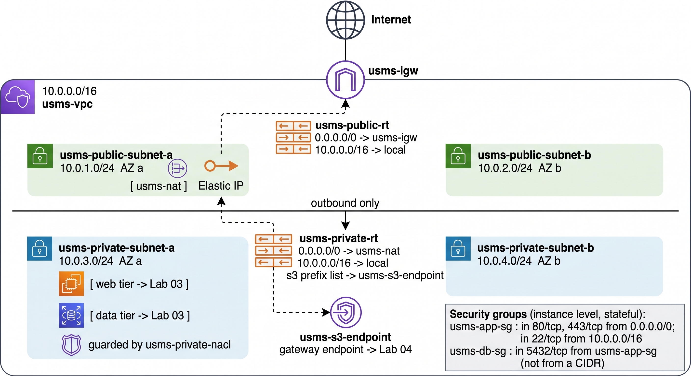

# Lab 02 - Virtual Private Cloud and Networking

## 1. Objectives

- Build the USMS network: a VPC, public and private subnets, an internet gateway, route tables and a NAT gateway.
- Protect it with security groups (one referencing another) and a network ACL.
- Add an S3 gateway endpoint for private access to Lab 4's bucket.
- Prove the network survives a restart and save its IDs to `configs/lab-02.env` for Lab 3.

!!! info "Concepts used in this lab"
    Read these first if a term is new: [VPC and CIDR](../unit1/topic6.md#cidr-and-address-planning) ·
    [subnets](../unit1/topic6.md#subnets-and-availability-zones) ·
    [route tables](../unit1/topic6.md#route-tables) ·
    [internet gateway](../unit1/topic6.md#internet-gateway) ·
    [NAT gateway](../unit1/topic6.md#nat-gateway) ·
    [security groups vs network ACLs](../unit1/topic6.md#security-groups-versus-network-acls) ·
    [security group referencing](../unit1/topic6.md#security-group-referencing-the-cloud-native-idiom) ·
    [VPC endpoints](../unit1/topic6.md#vpc-endpoints) ·
    [IAM roles and temporary credentials](../unit8/topic1.md#role-sessions-and-temporary-credentials)

---

## 2. Prerequisites

- Lab 1 complete: `./scripts/utilities/verify-lab-01.sh` reports `FAIL=0`.
- Floci running under Docker Compose with `FLOCI_STORAGE_MODE=hybrid`.
- `configs/course.env` sourced in every terminal (`~/.bashrc`, or `~/.zshrc` on zsh).
- `jq` installed (Step 3 uses it).

```bash
cd ~/aws-floci-course
echo "COURSE_ROOT = $COURSE_ROOT"
echo "PROFILE     = $AWS_PROFILE"
aws --version
docker compose version
```

> Example output - your versions will differ.

```text
COURSE_ROOT = /home/student/aws-floci-course
PROFILE     = floci
aws-cli/2.17.42 Python/3.11.9 Linux/6.5.0 exe/x86_64.ubuntu.22
Docker Compose version v2.29.1
```

If `COURSE_ROOT` is empty, `configs/course.env` is not sourced. Open a fresh terminal; do not export it by hand.

---

## 3. What This Lab Reuses

From Lab 1:

- `usms-developer-role` and `USMSAssumeAppRoles`: Step 3 assumes the role and builds the VPC as it.
- `USMSDeveloperBase` (v2): Step 3 checks it contains the EC2 actions this lab needs.
- `configs/course.env` and `configs/lab-01.env`: sourced in Step 2.
- The `Project=USMS` tagging convention: audited in Step 22.

```text
Created in this lab:
- usms-vpc                    10.0.0.0/16, DNS support and DNS hostnames enabled
- usms-igw                    internet gateway, attached to usms-vpc
- usms-public-subnet-a        10.0.1.0/24, us-east-1a, auto-assign public IPv4 on
- usms-public-subnet-b        10.0.2.0/24, us-east-1b   (your turn)
- usms-private-subnet-a       10.0.3.0/24, us-east-1a
- usms-private-subnet-b       10.0.4.0/24, us-east-1b   (Exercise 5)
- usms-public-rt              0.0.0.0/0 -> usms-igw
- usms-private-rt             0.0.0.0/0 -> usms-nat
- usms-nat                    NAT gateway in the public subnet, with an Elastic IP
- usms-app-sg, usms-db-sg     security groups; db sourced from app
- usms-private-nacl           network ACL on the private subnet
- usms-s3-endpoint            gateway VPC endpoint for Amazon S3
- configs/lab-02.env, scripts/utilities/verify-lab-02.sh, scripts/cleanup/lab-02-cleanup.sh

Required for future labs:
- usms-public-subnet-a   -> Lab 03 web server
- usms-private-subnet-a  -> Lab 03 database-tier instance
- usms-app-sg, usms-db-sg -> Lab 03 attaches these
- usms-vpc               -> Lab 06 RDS subnet group across the private subnets
- usms-s3-endpoint       -> Lab 04 private path to the bucket
```

---

## 4. What We Are Building

USMS needs a **web tier** reachable from the internet, a **data tier** that is never reachable from the internet, and outbound internet access for the data tier to fetch updates. That gives a public subnet, a private subnet and a NAT gateway. We build across two Availability Zones because Lab 6's RDS subnet group requires two.

| Range | Purpose | Addresses |
| --- | --- | --- |
| `10.0.0.0/16` | The whole VPC | 65,536 |
| `10.0.1.0/24` | `usms-public-subnet-a` web tier, AZ a | 256 (251 usable) |
| `10.0.2.0/24` | `usms-public-subnet-b` web tier, AZ b | 256 (251 usable) |
| `10.0.3.0/24` | `usms-private-subnet-a` data tier, AZ a | 256 (251 usable) |
| `10.0.4.0/24` | `usms-private-subnet-b` data tier, AZ b | 256 (251 usable) |
| `10.0.5.0/24` – `10.0.255.0/24` | Unallocated, left for later labs | |

---

## 5. Architecture

<figure markdown="span">
    {width="80%"}
    <figcaption>Lab 02 VPC Architecture</figcaption>
    <p align='right' style="font-size:0.8em"><i>Image Source: AI generated (Google Gemini)</i></p>
</figure>

Read the diagram once now and again at the end of the lab.

---

## 6. Directory Structure

This lab adds the following. It changes nothing that already exists.

```text
aws-floci-course/
├── labs/
│   └── lab-02-vpc/
│       ├── README.md                       
│       └── exercises.md                    
├── configs/
│   └── lab-02.env                          
├── scripts/
│   ├── utilities/
│   │   └── verify-lab-02.sh                
│   └── cleanup/
│       └── lab-02-cleanup.sh               
├── templates/
│   └── lab-02-subnet-skeleton.json         
└── outputs/
    └── lab-02-*.json                        
```

Create the lab folder now:

```bash
cd ~/aws-floci-course
mkdir -p labs/lab-02-vpc
ls -d labs/*
```

```text
labs/lab-01-iam  labs/lab-02-vpc
```

---

## 7. Step-by-Step Implementation

!!! info "Run every command from `aws-floci-course/`"
    All paths are relative to the repository root. If a command reports `No such file or directory`, check `pwd`.

!!! tip "Shell variables die with the terminal"
    Every ID below is captured into a variable. Step 24 writes them to `configs/lab-02.env` so Lab 3 can use them.

### Step 1 - Resume the environment

```bash
cd ~/aws-floci-course
./scripts/setup/floci-up.sh
./scripts/utilities/floci-storage-check.sh
```

**Expected result**

```text
[floci-up] container 'floci' already running (compose project: floci-course)
[floci-up] bind mount /home/student/floci-data -> /app/data  OK

== Floci storage check ==
  ✔ container running
  ✔ FLOCI_STORAGE_MODE=hybrid  (not memory)
  ✔ FLOCI_STORAGE_PERSISTENT_PATH=/app/data matches the mount target
  ✔ mount type is 'bind', not 'volume'
  ✔ host directory exists and is writable
  ✔ FLOCI_STORAGE_HOST_PERSISTENT_PATH is absolute
PASS=6  FAIL=0
```

> Example output - your host path will differ.

Anything other than `FAIL=0` stops the lab. `FLOCI_STORAGE_MODE=memory` means the container was not started by Compose (usually a stray `floci start`). Fix it:

```bash
docker rm -f floci
./scripts/setup/floci-up.sh
```

!!! danger "Read before running any delete command"
    **What will be deleted:** the running `floci` container, not its data.

    **What depends on it:** nothing on disk. `~/floci-data` is a bind mount and is not touched by `docker rm`.

    **Reversible?** Yes. `floci-up.sh` recreates the container from `docker-compose.yml`.

    **Effect on later labs:** none, provided the container removed was the memory-mode one.

---

### Step 2 - Load the previous lab's environment and confirm your identity

```bash
source configs/course.env
source configs/lab-01.env

./scripts/utilities/whoami.sh

echo "developer role : $USMS_ROLE_DEVELOPER"
echo "developer user : $USMS_DEV_USER"
echo "account        : $USMS_ACCOUNT_ID"
```

Use `source`, not `./configs/lab-01.env`: a child shell's variables vanish when it exits.

**Expected result**

```text
Identity : arn:aws:iam::000000000000:root
Account  : 000000000000
Endpoint : http://localhost:4566
Profile  : floci

developer role : usms-developer-role
developer user : usms-dev-01
account        : 000000000000
```

> These values are fixed by the course; yours should match exactly.

If any `echo` line is empty, regenerate `configs/lab-01.env` from Lab 1's final step. Do not hand-edit it.

**Checkpoint 1**

```text
Environment ready
 ├── Floci running under Compose, storage mode hybrid
 ├── course.env + lab-01.env sourced
 └── identity confirmed as account 000000000000
```

---

### Step 3 - Assume the developer role and create the VPC

Build the first resource as the least-privileged identity, `usms-developer-role`. Before relying on it, check what its policy allows.

**Part 1 - read the policy's default version**

```bash
POLICY_ARN="arn:aws:iam::${USMS_ACCOUNT_ID}:policy/USMSDeveloperBase"

DEFAULT_VERSION=$(aws iam get-policy \
  --policy-arn "$POLICY_ARN" \
  --query 'Policy.DefaultVersionId' \
  --output text)

echo "default version: $DEFAULT_VERSION"

aws iam get-policy-version \
  --policy-arn "$POLICY_ARN" \
  --version-id "$DEFAULT_VERSION" \
  --query 'PolicyVersion.Document' \
  --output json | tee outputs/lab-02-developer-base.json
```

**Expected result:** `default version: v2`, then the policy JSON. Confirm it has:

- an `Allow` listing `ec2:CreateVpc`, `ec2:CreateSubnet`, `ec2:CreateRouteTable` and similar,
- a `Condition` restricting the region to `us-east-1`,
- an explicit `Deny` on IAM escalation actions.

**Part 2 - assume the role**

```bash
ROLE_ARN="arn:aws:iam::${USMS_ACCOUNT_ID}:role/${USMS_ROLE_DEVELOPER}"

aws sts assume-role \
  --role-arn "$ROLE_ARN" \
  --role-session-name "lab02-vpc-build" \
  --profile usms-dev \
  > outputs/lab-02-assumed-role.json

chmod 600 outputs/lab-02-assumed-role.json

export AWS_ACCESS_KEY_ID=$(jq -r '.Credentials.AccessKeyId'     outputs/lab-02-assumed-role.json)
export AWS_SECRET_ACCESS_KEY=$(jq -r '.Credentials.SecretAccessKey' outputs/lab-02-assumed-role.json)
export AWS_SESSION_TOKEN=$(jq -r '.Credentials.SessionToken'    outputs/lab-02-assumed-role.json)

aws sts get-caller-identity --no-cli-pager
```

- `--profile usms-dev`: the call must come from `usms-dev-01`, the principal the trust policy names. Root would work on Floci but fail on real AWS.
- Credentials go straight to `outputs/` (git-ignored, `chmod 600`). Assumed-role credentials are the course's one allowed use of credential environment variables; Step 4 removes them.

!!! warning "These three variables now outrank your profile"
    Environment credentials sit above named profiles in the CLI's resolution order. Until Step 4 unsets them, every `aws` command runs as the assumed role, whatever `--profile` you pass.

**Expected result**

```text
{
    "UserId": "AROAEXAMPLEID:lab02-vpc-build",
    "Account": "000000000000",
    "Arn": "arn:aws:sts::000000000000:assumed-role/usms-developer-role/lab02-vpc-build"
}
```

> Example output - your `UserId` will differ.

The `Arn` must say `assumed-role`, not `user` or `root`.

**Part 3 - create the VPC**

```bash
VPC_ID=$(aws ec2 create-vpc \
  --cidr-block 10.0.0.0/16 \
  --tag-specifications 'ResourceType=vpc,Tags=[{Key=Name,Value=usms-vpc},{Key=Project,Value=USMS},{Key=Tier,Value=network},{Key=ManagedBy,Value=aws-cli}]' \
  --query 'Vpc.VpcId' \
  --output text)

echo "VPC_ID = $VPC_ID"
```

- `--cidr-block` is fixed for the life of the VPC.
- `--tag-specifications` tags at creation, so the resource is never untagged. Keep the value in single quotes so the shell leaves the braces alone.

**Expected result**

```text
VPC_ID = vpc-0a1b2c3d4e5f67890
```

> Example output - your VPC ID will differ. Empty or `None` means the command failed; re-run without `--query` to see the error.

---

### Step 4 - Restore your normal identity

The developer role has a one-hour session. Hand the credentials back now, or they expire mid-lab with confusing `ExpiredToken` errors.

```bash
unset AWS_ACCESS_KEY_ID AWS_SECRET_ACCESS_KEY AWS_SESSION_TOKEN

./scripts/utilities/whoami.sh

aws ec2 describe-vpcs \
  --vpc-ids "$VPC_ID" \
  --query 'Vpcs[0].{Id:VpcId,CIDR:CidrBlock,State:State,Default:IsDefault,Tenancy:InstanceTenancy}' \
  --output table
```

**Expected result**

```text
Identity : arn:aws:iam::000000000000:root
Account  : 000000000000

-------------------------------------------------------------------
|                          DescribeVpcs                           |
+-------------+-----------+---------+-----------+-----------------+
|    CIDR     |  Default  |   Id    |   State   |     Tenancy     |
+-------------+-----------+---------+-----------+-----------------+
| 10.0.0.0/16 |  False    | vpc-0a1b2c3d4e5f67890 | available | default |
+-------------+-----------+---------+-----------+-----------------+
```

> Example output - column widths and your VPC ID will differ.

`State` must be `available` and `Default` must be `False`. `True` means `VPC_ID` is empty and you are looking at the default VPC.

**Checkpoint 2**

```text
usms-vpc  (vpc-0a1b...)
 └── 10.0.0.0/16   state: available   tenancy: default
     created by:  arn:aws:sts::000000000000:assumed-role/usms-developer-role/lab02-vpc-build
     tags:        Name=usms-vpc  Project=USMS  Tier=network  ManagedBy=aws-cli
```

---

### Step 5 - Enable DNS support and DNS hostnames

A CLI-created VPC has DNS hostnames off. Labs 4 and 6 need them on so service endpoints resolve.

```bash
aws ec2 modify-vpc-attribute --vpc-id "$VPC_ID" --enable-dns-support   '{"Value":true}'
aws ec2 modify-vpc-attribute --vpc-id "$VPC_ID" --enable-dns-hostnames '{"Value":true}'
```

One attribute per call; no output on success.

**Verify**

```bash
aws ec2 describe-vpc-attribute --vpc-id "$VPC_ID" \
  --attribute enableDnsSupport   --query 'EnableDnsSupport.Value'   --output text
aws ec2 describe-vpc-attribute --vpc-id "$VPC_ID" \
  --attribute enableDnsHostnames --query 'EnableDnsHostnames.Value' --output text
```

Both must print `True`. Note the response key is capitalised (`EnableDnsSupport`) while the `--attribute` value is not.

---

### Step 6 - Create and attach the internet gateway

The gateway does nothing until it is attached (this step) **and** a route points at it (Step 10).

```bash
IGW_ID=$(aws ec2 create-internet-gateway \
  --tag-specifications 'ResourceType=internet-gateway,Tags=[{Key=Name,Value=usms-igw},{Key=Project,Value=USMS}]' \
  --query 'InternetGateway.InternetGatewayId' \
  --output text)

echo "IGW_ID = $IGW_ID"

aws ec2 attach-internet-gateway \
  --internet-gateway-id "$IGW_ID" \
  --vpc-id "$VPC_ID"
```

**Expected result**

```text
IGW_ID = igw-0f1e2d3c4b5a69870
```

> Example output - your ID will differ.

**Verify**

```bash
aws ec2 describe-internet-gateways \
  --internet-gateway-ids "$IGW_ID" \
  --query 'InternetGateways[0].{Id:InternetGatewayId,Attachments:Attachments}' \
  --output json
```

```json
{
    "Id": "igw-0f1e2d3c4b5a69870",
    "Attachments": [
        {
            "State": "available",
            "VpcId": "vpc-0a1b2c3d4e5f67890"
        }
    ]
}
```

> Example output - your IDs will differ.

`Attachments` must hold one entry with your `VPC_ID`. `State` may be `available` or `attached`; an empty array is wrong.

**Checkpoint 3**

```text
usms-vpc  10.0.0.0/16
 ├── DNS support   : enabled
 ├── DNS hostnames : enabled
 └── usms-igw      : attached
```

---

### Step 7 - Create the public subnet in us-east-1a

Lab 3 launches the web server here. It only becomes public after Step 10.

```bash
PUBLIC_SUBNET_A_ID=$(aws ec2 create-subnet \
  --vpc-id "$VPC_ID" \
  --cidr-block 10.0.1.0/24 \
  --availability-zone "${AWS_REGION_COURSE}a" \
  --tag-specifications 'ResourceType=subnet,Tags=[{Key=Name,Value=usms-public-subnet-a},{Key=Project,Value=USMS},{Key=Tier,Value=public},{Key=AZ,Value=a}]' \
  --query 'Subnet.SubnetId' \
  --output text)

echo "PUBLIC_SUBNET_A_ID = $PUBLIC_SUBNET_A_ID"
```

The AZ is built from `$AWS_REGION_COURSE`, the same Region `USMSDeveloperBase` is locked to.

**Expected result**

```text
PUBLIC_SUBNET_A_ID = subnet-01234abcd5678ef90
```

> Example output - your subnet ID will differ.

**Verify**

```bash
aws ec2 describe-subnets \
  --subnet-ids "$PUBLIC_SUBNET_A_ID" \
  --query 'Subnets[0].{Id:SubnetId,CIDR:CidrBlock,AZ:AvailabilityZone,Free:AvailableIpAddressCount,PublicIP:MapPublicIpOnLaunch,State:State}' \
  --output table
```

- `State` is `available`.
- `Free` is `251`, not `256`: AWS reserves five addresses per subnet.
- `PublicIP` is `False`. Step 8 fixes that.

---

### Step 8 - Turn on auto-assign public IPv4 for the public subnet

Instances launched here then get a public IPv4 address automatically. Lab 3 relies on this.

```bash
aws ec2 modify-subnet-attribute \
  --subnet-id "$PUBLIC_SUBNET_A_ID" \
  --map-public-ip-on-launch

aws ec2 describe-subnets \
  --subnet-ids "$PUBLIC_SUBNET_A_ID" \
  --query 'Subnets[0].MapPublicIpOnLaunch' \
  --output text
```

Here the flag is a boolean (negative form `--no-map-public-ip-on-launch`), unlike Step 5's JSON value. Check the shape with `aws ec2 modify-subnet-attribute help`.

**Expected result**

```text
True
```

An auto-assigned public IP is not an Elastic IP: it changes when the instance stops and starts. Lab 3 Step 18 shows this.

---

### Step 9 - Create the private subnet in us-east-1a

The data tier lives here. It never gets a route to the internet gateway.

```bash
PRIVATE_SUBNET_A_ID=$(aws ec2 create-subnet \
  --vpc-id "$VPC_ID" \
  --cidr-block 10.0.3.0/24 \
  --availability-zone "${AWS_REGION_COURSE}a" \
  --tag-specifications 'ResourceType=subnet,Tags=[{Key=Name,Value=usms-private-subnet-a},{Key=Project,Value=USMS},{Key=Tier,Value=private},{Key=AZ,Value=a}]' \
  --query 'Subnet.SubnetId' \
  --output text)

echo "PRIVATE_SUBNET_A_ID = $PRIVATE_SUBNET_A_ID"
```

Same API call as Step 7. Public and private differ only in what you associate afterwards. Do not enable `MapPublicIpOnLaunch` here.

**Expected result**

```text
PRIVATE_SUBNET_A_ID = subnet-09876fedcba543210
```

> Example output - your subnet ID will differ.

**Verify**

```bash
aws ec2 describe-subnets \
  --filters "Name=vpc-id,Values=$VPC_ID" \
  --query 'sort_by(Subnets, &CidrBlock)[].{Name:Tags[?Key==`Name`]|[0].Value,CIDR:CidrBlock,AZ:AvailabilityZone,Public:MapPublicIpOnLaunch}' \
  --output table
```

New in this query (see the [AWS CLI filtering guide](https://docs.aws.amazon.com/cli/latest/userguide/cli-usage-filter.html)):

- `--filters` runs **on the server**; `--query` runs **in the CLI** on what comes back. Filter first, then shape.
- `sort_by(Subnets, &CidrBlock)` sorts; `&` passes the field as an expression.
- ``Tags[?Key==`Name`]|[0].Value`` pulls one tag's value from the tag array.

**Expected result**

```text
--------------------------------------------------------------------------
|                             DescribeSubnets                            |
+------------+-------------+-------------------------+------------------+
|     AZ     |    CIDR     |          Name           |      Public      |
+------------+-------------+-------------------------+------------------+
| us-east-1a |  10.0.1.0/24|  usms-public-subnet-a   |  True            |
| us-east-1a |  10.0.3.0/24|  usms-private-subnet-a  |  False           |
+------------+-------------+-------------------------+------------------+
```

> Example output - column widths will differ.

**Checkpoint 4**

```text
usms-vpc  10.0.0.0/16
 ├── usms-igw (attached)
 ├── usms-public-subnet-a   10.0.1.0/24  us-east-1a  auto-public-IP: yes
 └── usms-private-subnet-a  10.0.3.0/24  us-east-1a  auto-public-IP: no
```

---

### Step 10 - Create the public route table and the default route

This route is what makes a subnet public. See [route tables](../unit1/topic6.md#route-tables) for longest-prefix match and the `local` route.

```bash
PUBLIC_RT_ID=$(aws ec2 create-route-table \
  --vpc-id "$VPC_ID" \
  --tag-specifications 'ResourceType=route-table,Tags=[{Key=Name,Value=usms-public-rt},{Key=Project,Value=USMS},{Key=Tier,Value=public}]' \
  --query 'RouteTable.RouteTableId' \
  --output text)

echo "PUBLIC_RT_ID = $PUBLIC_RT_ID"

aws ec2 create-route \
  --route-table-id "$PUBLIC_RT_ID" \
  --destination-cidr-block 0.0.0.0/0 \
  --gateway-id "$IGW_ID"
```

**Expected result**

```text
PUBLIC_RT_ID = rtb-0aa11bb22cc33dd44
```

```json
{
    "Return": true
}
```

> Example output - your route table ID will differ.

**Verify**

```bash
aws ec2 describe-route-tables \
  --route-table-ids "$PUBLIC_RT_ID" \
  --query 'RouteTables[0].Routes[].{Destination:DestinationCidrBlock,Target:GatewayId,State:State}' \
  --output table
```

Two `active` routes: `10.0.0.0/16` to `local`, and `0.0.0.0/0` to your `igw-...`. `blackhole` means the target no longer exists.

---

### Step 11 - Associate the public subnet with the public route table

A route table affects nothing until a subnet is associated. An unassociated subnet silently uses the VPC's main route table.

```bash
PUBLIC_ASSOC_A_ID=$(aws ec2 associate-route-table \
  --route-table-id "$PUBLIC_RT_ID" \
  --subnet-id "$PUBLIC_SUBNET_A_ID" \
  --query 'AssociationId' \
  --output text)

echo "PUBLIC_ASSOC_A_ID = $PUBLIC_ASSOC_A_ID"
```

**Expected result**

```text
PUBLIC_ASSOC_A_ID = rtbassoc-0123456789abcdef0
```

> Example output - your association ID will differ.

✏️ **Your turn**

Create `usms-public-subnet-b` with CIDR `10.0.2.0/24` in `us-east-1b`, turn on auto-assign public IPv4, associate it with `usms-public-rt`, and capture its ID into `PUBLIC_SUBNET_B_ID`. Tag it like the others.

```text
Expected result:
A subnet ID in PUBLIC_SUBNET_B_ID, and a describe-route-tables call on usms-public-rt
showing TWO associations. describe-subnets for the VPC now shows three subnets
across two Availability Zones.
```

Hint: Steps 7, 8 and 11. Only the CIDR, AZ letter and tags change.

---

### Step 12 - Create the private route table and associate the private subnet

Associate explicitly so the private subnet never inherits a main route table that might have a default route.

```bash
PRIVATE_RT_ID=$(aws ec2 create-route-table \
  --vpc-id "$VPC_ID" \
  --tag-specifications 'ResourceType=route-table,Tags=[{Key=Name,Value=usms-private-rt},{Key=Project,Value=USMS},{Key=Tier,Value=private}]' \
  --query 'RouteTable.RouteTableId' \
  --output text)

echo "PRIVATE_RT_ID = $PRIVATE_RT_ID"

PRIVATE_ASSOC_A_ID=$(aws ec2 associate-route-table \
  --route-table-id "$PRIVATE_RT_ID" \
  --subnet-id "$PRIVATE_SUBNET_A_ID" \
  --query 'AssociationId' \
  --output text)

echo "PRIVATE_ASSOC_A_ID = $PRIVATE_ASSOC_A_ID"
```

No `create-route`: that missing route is the whole difference between private and public at this point.

**Expected result**

```text
PRIVATE_RT_ID = rtb-0ee55ff66aa77bb88
PRIVATE_ASSOC_A_ID = rtbassoc-0fedcba9876543210
```

> Example output - your IDs will differ.

---

### Step 13 - Prove the two subnets are actually different

Successful commands are not proof. Read each subnet's effective route table back (the create, then read back pattern from Lab 1 Step 14).

```bash
for s in "$PUBLIC_SUBNET_A_ID" "$PRIVATE_SUBNET_A_ID"; do
  name=$(aws ec2 describe-subnets --subnet-ids "$s" \
          --query 'Subnets[0].Tags[?Key==`Name`]|[0].Value' --output text)

  rt=$(aws ec2 describe-route-tables \
        --filters "Name=association.subnet-id,Values=$s" \
        --query 'RouteTables[0].RouteTableId' --output text)

  igw=$(aws ec2 describe-route-tables --route-table-ids "$rt" \
        --query 'RouteTables[0].Routes[?DestinationCidrBlock==`0.0.0.0/0`].GatewayId | [0]' \
        --output text)

  printf '%-24s subnet=%-26s rt=%-24s default-route-target=%s\n' \
         "$name" "$s" "$rt" "$igw"
done
```

`Name=association.subnet-id` finds the route table associated with a subnet. Dotted filter names address nested fields; `aws ec2 describe-route-tables help` lists them.

**Expected result**

```text
usms-public-subnet-a     subnet=subnet-01234abcd5678ef90 rt=rtb-0aa11bb22cc33dd44 default-route-target=igw-0f1e2d3c4b5a69870
usms-private-subnet-a    subnet=subnet-09876fedcba543210 rt=rtb-0ee55ff66aa77bb88 default-route-target=None
```

> Example output - your IDs will differ.

The last column is the proof: the public subnet's default route targets an internet gateway; the private one has none (`None`). No subnet attribute called `Public` exists.

**Checkpoint 5**

```text
usms-vpc  10.0.0.0/16
 ├── usms-igw (attached)
 ├── usms-public-rt      0.0.0.0/0 -> usms-igw ; 10.0.0.0/16 -> local
 │    ├── usms-public-subnet-a   10.0.1.0/24  us-east-1a
 │    └── usms-public-subnet-b   10.0.2.0/24  us-east-1b   (your turn)
 └── usms-private-rt     10.0.0.0/16 -> local
      └── usms-private-subnet-a  10.0.3.0/24  us-east-1a
```

---

!!! info "Before Step 14: two firewalls"
    Read [security groups versus network ACLs](../unit1/topic6.md#security-groups-versus-network-acls) and [connection tracking](../unit8/topic2.md#connection-tracking-and-why-it-matters-for-security). Key points for this lab: security groups are stateful and allow-only; NACLs are stateless, numbered, first match wins, and need an ephemeral-port (1024–65535) rule for return traffic. Do access control in security groups; use a NACL as a subnet-wide backstop (Step 17).

### Step 14 - Create the application security group

`usms-app-sg` is attached to the Lab 3 web server: HTTP/HTTPS from anywhere, SSH from inside the VPC only.

```bash
APP_SG_ID=$(aws ec2 create-security-group \
  --group-name usms-app-sg \
  --description "USMS application tier: HTTP/HTTPS from the internet, SSH from inside the VPC" \
  --vpc-id "$VPC_ID" \
  --tag-specifications 'ResourceType=security-group,Tags=[{Key=Name,Value=usms-app-sg},{Key=Project,Value=USMS},{Key=Tier,Value=app}]' \
  --query 'GroupId' \
  --output text)

echo "APP_SG_ID = $APP_SG_ID"

aws ec2 authorize-security-group-ingress \
  --group-id "$APP_SG_ID" \
  --protocol tcp --port 80 --cidr 0.0.0.0/0 \
  --query 'SecurityGroupRules[0].SecurityGroupRuleId' --output text

aws ec2 authorize-security-group-ingress \
  --group-id "$APP_SG_ID" \
  --protocol tcp --port 22 --cidr 10.0.0.0/16 \
  --query 'SecurityGroupRules[0].SecurityGroupRuleId' --output text
```

- `--description` is mandatory and cannot be changed later.
- SSH is limited to `10.0.0.0/16`; never open port 22 to `0.0.0.0/0`.
- Every new group also has a default allow-all **outbound** rule.

**Expected result**

```text
APP_SG_ID = sg-0123456789abcdef0
sgr-0aaa111bbb222ccc3
sgr-0ddd444eee555fff6
```

> Example output - your IDs will differ. Each `sgr-` is a rule ID, usable with `revoke-security-group-ingress`.

✏️ **Your turn**

Add an inbound rule to `usms-app-sg` allowing TCP 443 from `0.0.0.0/0`, with a rule description.

```text
Expected result:
A third sgr- rule ID, and describe-security-group-rules showing three inbound rules
on usms-app-sg: 80, 443 and 22.
```

Hint: the short form cannot set a description. Look for `--ip-permissions` in `aws ec2 authorize-security-group-ingress help`, or use `modify-security-group-rules` afterwards.

---

### Step 15 - Create the database security group, sourced from the application group

The data tier accepts PostgreSQL only from the app tier. Name `usms-app-sg` as the source instead of a CIDR, so the rule stays correct when the web tier moves or scales ([why](../unit1/topic6.md#security-group-referencing-the-cloud-native-idiom)).

**Part 1 - create the group**

```bash
DB_SG_ID=$(aws ec2 create-security-group \
  --group-name usms-db-sg \
  --description "USMS data tier: PostgreSQL from the application tier only" \
  --vpc-id "$VPC_ID" \
  --tag-specifications 'ResourceType=security-group,Tags=[{Key=Name,Value=usms-db-sg},{Key=Project,Value=USMS},{Key=Tier,Value=data}]' \
  --query 'GroupId' \
  --output text)

echo "DB_SG_ID = $DB_SG_ID"
```

**Part 2 - write the rule as a JSON document**

```bash
mkdir -p policies

cat > policies/usms-db-sg-ingress.json << EOF
[
  {
    "IpProtocol": "tcp",
    "FromPort": 5432,
    "ToPort": 5432,
    "UserIdGroupPairs": [
      {
        "GroupId": "$APP_SG_ID",
        "Description": "PostgreSQL from the USMS application tier"
      }
    ]
  }
]
EOF

cat policies/usms-db-sg-ingress.json
```

!!! warning "Heredoc quoting"
    `<< EOF` (unquoted) expands `$APP_SG_ID` when the file is written, which is what we want here. Policy documents use `<< 'EOF'` (quoted) so `${aws:username}` stays literal. Getting it backwards fails silently: the file would contain the text `$APP_SG_ID` and the API would report an invalid group ID.

**Part 3 - apply it**

```bash
aws ec2 authorize-security-group-ingress \
  --group-id "$DB_SG_ID" \
  --ip-permissions file://policies/usms-db-sg-ingress.json \
  --query 'SecurityGroupRules[].SecurityGroupRuleId' \
  --output text
```

`UserIdGroupPairs` (instead of `IpRanges`) makes it a group-to-group rule.

**Expected result**

```text
DB_SG_ID = sg-0fedcba9876543210
sgr-0999888777666555a
```

> Example output - your IDs will differ.

**Verify**

```bash
aws ec2 describe-security-groups \
  --group-ids "$DB_SG_ID" \
  --query 'SecurityGroups[0].IpPermissions[].{Proto:IpProtocol,From:FromPort,To:ToPort,SourceSG:UserIdGroupPairs[0].GroupId,SourceCIDR:IpRanges[0].CidrIp}' \
  --output table
```

`SourceSG` must be your `APP_SG_ID` and `SourceCIDR` must be `None`.

---

### Step 16 - Read the groups back, and understand what stateful means

```bash
aws ec2 describe-security-groups \
  --filters "Name=vpc-id,Values=$VPC_ID" \
  --query 'SecurityGroups[].{Name:GroupName,Id:GroupId,Inbound:length(IpPermissions),Outbound:length(IpPermissionsEgress)}' \
  --output table
```

**Expected result**

```text
-----------------------------------------------------------------
|                    DescribeSecurityGroups                     |
+-------------+------------------------+----------+-------------+
|     Id      |         Name           | Inbound  |  Outbound   |
+-------------+------------------------+----------+-------------+
| sg-01234... |  usms-app-sg           |  3       |  1          |
| sg-0fedc... |  usms-db-sg            |  1       |  1          |
| sg-0aaaa... |  default               |  1       |  1          |
+-------------+------------------------+----------+-------------+
```

> Example output - app group inbound is 3 if you did the "Your turn" task, otherwise 2.

Three groups: every VPC gets a `default` group, used by any instance launched without `--security-group-ids`. `length()` is a JMESPath function.

**Trace one request:** browser to web server on TCP 80 (allowed by `usms-app-sg`), reply returns automatically (stateful), web server to database on TCP 5432 (allowed out by the default egress rule, allowed in by `usms-db-sg` because the source is in `usms-app-sg`), reply returns automatically. Two rules cover all of it; NACLs would need a rule per leg.

**Checkpoint 6**

```text
usms-vpc  10.0.0.0/16
 ├── usms-app-sg   in: 80, 443, 22(10.0.0.0/16)      out: all
 └── usms-db-sg    in: 5432 from usms-app-sg          out: all
```

---

### Step 17 - Explore the default network ACL, then create a private one

A NACL on the private subnet is a second control that no instance-level mistake can override.

**Part 1 - read the default NACL**

```bash
aws ec2 describe-network-acls \
  --filters "Name=vpc-id,Values=$VPC_ID" "Name=default,Values=true" \
  --query 'NetworkAcls[0].Entries[].{Rule:RuleNumber,Egress:Egress,Proto:Protocol,Action:RuleAction,CIDR:CidrBlock}' \
  --output table
```

**Expected result**

```text
---------------------------------------------------------------
|                     DescribeNetworkAcls                     |
+-----------+-----------+---------+-----------+---------------+
|  Action   |   CIDR    | Egress  |   Proto   |     Rule      |
+-----------+-----------+---------+-----------+---------------+
|  allow    | 0.0.0.0/0 |  False  |    -1     |  100          |
|  deny     | 0.0.0.0/0 |  False  |    -1     |  32767        |
|  allow    | 0.0.0.0/0 |  True   |    -1     |  100          |
|  deny     | 0.0.0.0/0 |  True   |    -1     |  32767        |
+-----------+-----------+---------+-----------+---------------+
```

> The default NACL is fixed, so values should match closely.

Protocol `-1` means all. Rules run in ascending order, first match wins. Rule 32767 (deny all) can never be deleted.

**Part 2 - create the private NACL**

```bash
PRIVATE_NACL_ID=$(aws ec2 create-network-acl \
  --vpc-id "$VPC_ID" \
  --tag-specifications 'ResourceType=network-acl,Tags=[{Key=Name,Value=usms-private-nacl},{Key=Project,Value=USMS},{Key=Tier,Value=private}]' \
  --query 'NetworkAcl.NetworkAclId' \
  --output text)

echo "PRIVATE_NACL_ID = $PRIVATE_NACL_ID"
```

**Part 3 - write the rules**

```bash
# Inbound 100: PostgreSQL from anywhere inside the VPC.
aws ec2 create-network-acl-entry \
  --network-acl-id "$PRIVATE_NACL_ID" \
  --rule-number 100 --protocol tcp --rule-action allow \
  --ingress --cidr-block 10.0.0.0/16 \
  --port-range From=5432,To=5432

# Inbound 110: return traffic for connections this subnet opened outbound.
aws ec2 create-network-acl-entry \
  --network-acl-id "$PRIVATE_NACL_ID" \
  --rule-number 110 --protocol tcp --rule-action allow \
  --ingress --cidr-block 0.0.0.0/0 \
  --port-range From=1024,To=65535

# Outbound 100: replies to the application tier.
aws ec2 create-network-acl-entry \
  --network-acl-id "$PRIVATE_NACL_ID" \
  --rule-number 100 --protocol tcp --rule-action allow \
  --egress --cidr-block 10.0.0.0/16 \
  --port-range From=1024,To=65535

# Outbound 110: HTTPS out, so the data tier can fetch OS updates through the NAT gateway.
aws ec2 create-network-acl-entry \
  --network-acl-id "$PRIVATE_NACL_ID" \
  --rule-number 110 --protocol tcp --rule-action allow \
  --egress --cidr-block 0.0.0.0/0 \
  --port-range From=443,To=443
```

- Inbound 110 is the ephemeral-port rule. Without it, outbound HTTPS requests leave and the replies are dropped (updates hang).
- Exactly one of `--ingress` / `--egress` is required. Omit `--port-range` only for protocol `-1`.
- No explicit deny needed: rule 32767 drops everything else, e.g. inbound SSH.

No output from these commands is normal.

**Verify**

```bash
aws ec2 describe-network-acls \
  --network-acl-ids "$PRIVATE_NACL_ID" \
  --query 'NetworkAcls[0].Entries[].{Rule:RuleNumber,Egress:Egress,Action:RuleAction,CIDR:CidrBlock,Ports:PortRange}' \
  --output json
```

Six entries: your four plus the two implicit 32767 denies.

---

### Step 18 - Associate the private NACL with the private subnet

Every subnet already has a NACL, so you **replace** the association rather than create one.

```bash
NACL_ASSOC_ID=$(aws ec2 describe-network-acls \
  --filters "Name=association.subnet-id,Values=$PRIVATE_SUBNET_A_ID" \
  --query 'NetworkAcls[0].Associations[?SubnetId==`'"$PRIVATE_SUBNET_A_ID"'`].NetworkAclAssociationId | [0]' \
  --output text)

echo "current association: $NACL_ASSOC_ID"

aws ec2 replace-network-acl-association \
  --association-id "$NACL_ASSOC_ID" \
  --network-acl-id "$PRIVATE_NACL_ID" \
  --query 'NewAssociationId' \
  --output text
```

The `--query` mixes quote types so the shell expands the variable inside a JMESPath literal. If it fights you, this simpler form is correct here (the subnet is in only one NACL):

```bash
NACL_ASSOC_ID=$(aws ec2 describe-network-acls \
  --filters "Name=association.subnet-id,Values=$PRIVATE_SUBNET_A_ID" \
  --query 'NetworkAcls[0].Associations[0].NetworkAclAssociationId' \
  --output text)
```

The replace is atomic: the subnet is never without a NACL.

**Expected result**

```text
current association: aclassoc-01111222233334444
aclassoc-05555666677778888
```

> Example output - your IDs will differ. The two values must differ.

**Verify**

```bash
aws ec2 describe-network-acls \
  --filters "Name=association.subnet-id,Values=$PRIVATE_SUBNET_A_ID" \
  --query 'NetworkAcls[0].{Id:NetworkAclId,Default:IsDefault,Name:Tags[?Key==`Name`]|[0].Value}' \
  --output table
```

`Id` is your `PRIVATE_NACL_ID`, `Default` is `False`, `Name` is `usms-private-nacl`.

**Checkpoint 7**

```text
usms-private-subnet-a  10.0.3.0/24
 ├── route table : usms-private-rt   (no default route yet)
 └── network ACL : usms-private-nacl
      in  100  allow tcp 5432        from 10.0.0.0/16
      in  110  allow tcp 1024-65535  from 0.0.0.0/0
      out 100  allow tcp 1024-65535  to   10.0.0.0/16
      out 110  allow tcp 443         to   0.0.0.0/0
      (implicit 32767 deny, both directions)
```

---

### Step 19 - Give the private subnet outbound internet access with a NAT gateway

The NAT gateway sits in the **public** subnet and lets private instances start outbound connections while staying unreachable from outside ([NAT gateway](../unit1/topic6.md#nat-gateway)).

**Part 1 - allocate an Elastic IP**

```bash
NAT_EIP_ALLOC_ID=$(aws ec2 allocate-address \
  --domain vpc \
  --tag-specifications 'ResourceType=elastic-ip,Tags=[{Key=Name,Value=usms-nat-eip},{Key=Project,Value=USMS}]' \
  --query 'AllocationId' \
  --output text)

echo "NAT_EIP_ALLOC_ID = $NAT_EIP_ALLOC_ID"

aws ec2 describe-addresses \
  --allocation-ids "$NAT_EIP_ALLOC_ID" \
  --query 'Addresses[0].{Alloc:AllocationId,IP:PublicIp,Domain:Domain}' \
  --output table
```

**Part 2 - create the NAT gateway in the public subnet**

```bash
NAT_GW_ID=$(aws ec2 create-nat-gateway \
  --subnet-id "$PUBLIC_SUBNET_A_ID" \
  --allocation-id "$NAT_EIP_ALLOC_ID" \
  --tag-specifications 'ResourceType=natgateway,Tags=[{Key=Name,Value=usms-nat},{Key=Project,Value=USMS}]' \
  --query 'NatGateway.NatGatewayId' \
  --output text)

echo "NAT_GW_ID = $NAT_GW_ID"
```

- `--subnet-id` must be the **public** subnet. In the private subnet it has no path out.
- A NAT gateway is zonal. Production uses one per AZ; Exercise 4 weighs the cost.

**Part 3 - wait for it**

```bash
aws ec2 wait nat-gateway-available --nat-gateway-ids "$NAT_GW_ID" && echo "NAT gateway available"
```

If it hangs for more than a minute, press ++ctrl+c++ and poll instead:

```bash
for i in $(seq 1 12); do
  state=$(aws ec2 describe-nat-gateways --nat-gateway-ids "$NAT_GW_ID" \
            --query 'NatGateways[0].State' --output text)
  echo "attempt $i: $state"
  [ "$state" = "available" ] && break
  sleep 5
done
```

**Expected result**

```text
NAT_EIP_ALLOC_ID = eipalloc-0123456789abcdef0
NAT_GW_ID = nat-0abcdef1234567890
NAT gateway available
```

> Example output - your IDs will differ.

!!! note "Floci Limitation - the NAT gateway is an object, not a translator"
    Floci creates the NAT gateway, assigns the Elastic IP and reports it `available`; the API behaves as documented.

    Real AWS also runs the managed translation service behind it and bills per hour plus per GB, often the largest line item on a small VPC.

    Take away the architecture: NAT in a public subnet, private route table pointing at it, outbound yes and inbound no.

---

### Step 20 - Point the private route table at the NAT gateway

```bash
aws ec2 create-route \
  --route-table-id "$PRIVATE_RT_ID" \
  --destination-cidr-block 0.0.0.0/0 \
  --nat-gateway-id "$NAT_GW_ID"

aws ec2 describe-route-tables \
  --route-table-ids "$PRIVATE_RT_ID" \
  --query 'RouteTables[0].Routes[].{Destination:DestinationCidrBlock,Gateway:GatewayId,NAT:NatGatewayId,State:State}' \
  --output table
```

Use `--nat-gateway-id`, not `--gateway-id`.

**Expected result**

```text
--------------------------------------------------------------------------
|                          DescribeRouteTables                           |
+---------------+-----------+--------------------------+----------------+
|  Destination  |  Gateway  |           NAT            |     State      |
+---------------+-----------+--------------------------+----------------+
|  10.0.0.0/16  |  local    |  None                    |  active        |
|  0.0.0.0/0    |  None     |  nat-0abcdef1234567890   |  active        |
+---------------+-----------+--------------------------+----------------+
```

> Example output - your IDs will differ.

The default route must target the NAT gateway. An `igw-` value here makes the private subnet public; delete that route:

!!! danger "Read before running any delete command"
    **What will be deleted:** one route in `usms-private-rt`, the `0.0.0.0/0` entry.

    **What depends on it:** the data tier's outbound access. Nothing else.

    **Reversible?** Yes. Re-run the `create-route` above with the correct target.

    **Effect on later labs:** none, provided you recreate it. Lab 3's private instance expects an outbound path.

    ```bash
    aws ec2 delete-route --route-table-id "$PRIVATE_RT_ID" --destination-cidr-block 0.0.0.0/0
    ```

---

### Step 21 - Create the S3 gateway endpoint

Lab 4's `usms-student-data` bucket should be reached from the private subnet without going through the NAT gateway and the internet. A gateway endpoint adds a route for S3 instead ([VPC endpoints](../unit1/topic6.md#vpc-endpoints)).

```bash
S3_ENDPOINT_ID=$(aws ec2 create-vpc-endpoint \
  --vpc-id "$VPC_ID" \
  --service-name "com.amazonaws.${AWS_REGION_COURSE}.s3" \
  --vpc-endpoint-type Gateway \
  --route-table-ids "$PRIVATE_RT_ID" \
  --tag-specifications 'ResourceType=vpc-endpoint,Tags=[{Key=Name,Value=usms-s3-endpoint},{Key=Project,Value=USMS}]' \
  --query 'VpcEndpoint.VpcEndpointId' \
  --output text)

echo "S3_ENDPOINT_ID = $S3_ENDPOINT_ID"
```

- `--route-table-ids` is where AWS injects the managed S3 route.
- List available service names (`@` is the current element):

```bash
aws ec2 describe-vpc-endpoint-services \
  --query 'ServiceNames[?contains(@, `s3`)]' \
  --output text
```

**Expected result**

```text
S3_ENDPOINT_ID = vpce-0123456789abcdef0
```

> Example output - your ID will differ.

**Verify**

```bash
aws ec2 describe-vpc-endpoints \
  --vpc-endpoint-ids "$S3_ENDPOINT_ID" \
  --query 'VpcEndpoints[0].{Id:VpcEndpointId,Service:ServiceName,Type:VpcEndpointType,State:State,RouteTables:RouteTableIds}' \
  --output json

aws ec2 describe-route-tables \
  --route-table-ids "$PRIVATE_RT_ID" \
  --query 'RouteTables[0].Routes[].{Destination:DestinationCidrBlock,PrefixList:DestinationPrefixListId,Target:GatewayId,NAT:NatGatewayId}' \
  --output table
```

Endpoint `State` is `available` and `RouteTables` contains `PRIVATE_RT_ID`. The route table gains a third route with a `pl-` prefix list.

!!! note "Floci Limitation - the endpoint route may not appear"
    Some Floci builds create the endpoint but do not inject the prefix-list route, so only two routes show.

    Real AWS always adds the route, and removes it with the endpoint.

    If you see two routes, Lab 4 still works. Record the endpoint ID, continue, and note the discrepancy in your report.

**Checkpoint 8**

```text
usms-vpc  10.0.0.0/16
 ├── usms-igw                          attached
 ├── usms-nat  (in public subnet a)     eip: eipalloc-...
 ├── usms-s3-endpoint                   gateway -> usms-private-rt
 ├── usms-public-rt      0.0.0.0/0 -> usms-igw
 │    ├── usms-public-subnet-a
 │    └── usms-public-subnet-b
 └── usms-private-rt     0.0.0.0/0 -> usms-nat ; pl-... -> usms-s3-endpoint
      └── usms-private-subnet-a  (usms-private-nacl)
```

---

### Step 22 - Audit your tags

Check that every resource really carries `Project=USMS`. The tag is how you find, bill and safely delete your resources in a shared account.

```bash
echo "== Resources tagged Project=USMS in this VPC =="
aws ec2 describe-tags \
  --filters "Name=tag:Project,Values=USMS" \
  --query 'sort_by(Tags[?Key==`Name`], &Value)[].{Type:ResourceType,Name:Value,Id:ResourceId}' \
  --output table
```

`describe-tags` searches all EC2 resource types at once. Tag filters use `tag:<key>`.

**Expected result**

```text
------------------------------------------------------------------------------
|                                DescribeTags                                |
+--------------+---------------------------+---------------------------------+
|      Id      |           Name            |              Type               |
+--------------+---------------------------+---------------------------------+
| igw-0f1e...  |  usms-igw                 |  internet-gateway               |
| eipalloc-... |  usms-nat-eip             |  elastic-ip                     |
| nat-0abc...  |  usms-nat                 |  natgateway                     |
| sg-0123...   |  usms-app-sg              |  security-group                 |
| sg-0fed...   |  usms-db-sg               |  security-group                 |
| acl-0999...  |  usms-private-nacl        |  network-acl                    |
| rtb-0ee5...  |  usms-private-rt          |  route-table                    |
| subnet-0987..|  usms-private-subnet-a    |  subnet                         |
| rtb-0aa1...  |  usms-public-rt           |  route-table                    |
| subnet-0123..|  usms-public-subnet-a     |  subnet                         |
| subnet-0456..|  usms-public-subnet-b     |  subnet                         |
| vpce-0123... |  usms-s3-endpoint         |  vpc-endpoint                   |
| vpc-0a1b...  |  usms-vpc                 |  vpc                            |
+--------------+---------------------------+---------------------------------+
```

> Example output - your IDs will differ; `usms-public-subnet-b` appears only if you did the Step 11 task.

A missing row means `--tag-specifications` was forgotten. Fix it now:

```bash
aws ec2 create-tags --resources <id> --tags Key=Project,Value=USMS Key=Name,Value=<name>
```

✏️ **Your turn**

Produce a table of every subnet in `usms-vpc` (name, CIDR, AZ, tier), private subnets first, using `--filters` and `--query`. Save it to `outputs/lab-02-subnet-inventory.txt`.

```text
Expected result:
A table with one row per subnet you have created, ordered so that Tier=private
rows appear before Tier=public rows, and a file in outputs/ containing it.
```

Hint: `sort_by()` takes an expression reference; Step 9's verify extracts a tag by name.

---

### Step 23 - Prove the network survives a restart

Create, perturb, read back (Lab 1 Step 14). Lab 3 depends on this.

**Part 1 - record the state before the restart**

```bash
aws ec2 describe-vpcs --vpc-ids "$VPC_ID" \
  --query 'Vpcs[0].VpcId' --output text > outputs/lab-02-pre-restart.txt

aws ec2 describe-subnets --filters "Name=vpc-id,Values=$VPC_ID" \
  --query 'length(Subnets)' --output text >> outputs/lab-02-pre-restart.txt

aws ec2 describe-security-groups --filters "Name=vpc-id,Values=$VPC_ID" \
  --query 'length(SecurityGroups)' --output text >> outputs/lab-02-pre-restart.txt

cat outputs/lab-02-pre-restart.txt
```

**Part 2 - perturb**

```bash
./scripts/setup/floci-down.sh
sleep 3
./scripts/setup/floci-up.sh
sleep 5
```

**Part 3 - read it back**

```bash
source configs/course.env

VPC_ID=$(aws ec2 describe-vpcs \
  --filters "Name=tag:Name,Values=usms-vpc" \
  --query 'Vpcs[0].VpcId' --output text)

{
  echo "$VPC_ID"
  aws ec2 describe-subnets --filters "Name=vpc-id,Values=$VPC_ID" \
    --query 'length(Subnets)' --output text
  aws ec2 describe-security-groups --filters "Name=vpc-id,Values=$VPC_ID" \
    --query 'length(SecurityGroups)' --output text
} > outputs/lab-02-post-restart.txt

diff outputs/lab-02-pre-restart.txt outputs/lab-02-post-restart.txt \
  && echo "PERSISTENCE PROVEN: VPC id, subnet count and security group count all unchanged" \
  || echo "PERSISTENCE FAILED: run ./scripts/utilities/floci-storage-check.sh"
```

`VPC_ID` is re-derived from the tag on purpose: reusing the variable would only prove Bash remembers a string. Counts are compared too, so a VPC that lost its subnets fails.

**Expected result**

```text
PERSISTENCE PROVEN: VPC id, subnet count and security group count all unchanged
```

On `PERSISTENCE FAILED`, stop and fix the storage mode with `./scripts/utilities/floci-storage-check.sh`.

**Checkpoint 9**

```text
Persistence proven for Lab 02
 ├── usms-vpc found by tag after a stop/start cycle
 ├── subnet count unchanged
 └── security group count unchanged
```

---

### Step 24 - Write `configs/lab-02.env`

Shell variables die with the terminal. Lab 3 reads its IDs from this file.

```bash
cat > configs/lab-02.env << EOF
# Lab 02 VPC and networking outputs
# Generated on $(date -u +%Y-%m-%dT%H:%M:%SZ)
# Contains IDs only. NO SECRETS. Safe to commit.

export USMS_VPC_ID=$(aws ec2 describe-vpcs \
  --filters "Name=tag:Name,Values=usms-vpc" \
  --query 'Vpcs[0].VpcId' --output text)
export USMS_VPC_CIDR=10.0.0.0/16

export USMS_IGW_ID=$(aws ec2 describe-internet-gateways \
  --filters "Name=tag:Name,Values=usms-igw" \
  --query 'InternetGateways[0].InternetGatewayId' --output text)

export USMS_PUBLIC_SUBNET_A=$(aws ec2 describe-subnets \
  --filters "Name=tag:Name,Values=usms-public-subnet-a" \
  --query 'Subnets[0].SubnetId' --output text)
export USMS_PUBLIC_SUBNET_B=$(aws ec2 describe-subnets \
  --filters "Name=tag:Name,Values=usms-public-subnet-b" \
  --query 'Subnets[0].SubnetId' --output text)
export USMS_PRIVATE_SUBNET_A=$(aws ec2 describe-subnets \
  --filters "Name=tag:Name,Values=usms-private-subnet-a" \
  --query 'Subnets[0].SubnetId' --output text)
export USMS_PRIVATE_SUBNET_B=$(aws ec2 describe-subnets \
  --filters "Name=tag:Name,Values=usms-private-subnet-b" \
  --query 'Subnets[0].SubnetId' --output text)

export USMS_PUBLIC_RT=$(aws ec2 describe-route-tables \
  --filters "Name=tag:Name,Values=usms-public-rt" \
  --query 'RouteTables[0].RouteTableId' --output text)
export USMS_PRIVATE_RT=$(aws ec2 describe-route-tables \
  --filters "Name=tag:Name,Values=usms-private-rt" \
  --query 'RouteTables[0].RouteTableId' --output text)

export USMS_APP_SG=$(aws ec2 describe-security-groups \
  --filters "Name=tag:Name,Values=usms-app-sg" \
  --query 'SecurityGroups[0].GroupId' --output text)
export USMS_DB_SG=$(aws ec2 describe-security-groups \
  --filters "Name=tag:Name,Values=usms-db-sg" \
  --query 'SecurityGroups[0].GroupId' --output text)

export USMS_PRIVATE_NACL=$(aws ec2 describe-network-acls \
  --filters "Name=tag:Name,Values=usms-private-nacl" \
  --query 'NetworkAcls[0].NetworkAclId' --output text)

export USMS_NAT_GW=$(aws ec2 describe-nat-gateways \
  --filter "Name=tag:Name,Values=usms-nat" \
  --query 'NatGateways[0].NatGatewayId' --output text)
export USMS_NAT_EIP_ALLOC=$(aws ec2 describe-addresses \
  --filters "Name=tag:Name,Values=usms-nat-eip" \
  --query 'Addresses[0].AllocationId' --output text)

export USMS_S3_ENDPOINT=$(aws ec2 describe-vpc-endpoints \
  --filters "Name=tag:Name,Values=usms-s3-endpoint" \
  --query 'VpcEndpoints[0].VpcEndpointId' --output text)

export USMS_AZ_A=${AWS_REGION_COURSE}a
export USMS_AZ_B=${AWS_REGION_COURSE}b
EOF
```

- **Unquoted** `<< EOF`: each `$(...)` runs now and the value lands in the file. A quoted `<< 'EOF'` would write the commands themselves.
- Every value is looked up **by tag**, so a missing resource shows as `None` instead of a stale ID.
- `describe-nat-gateways` takes `--filter` (singular); every other `describe-*` here takes `--filters`.

**Verify**

```bash
grep -n 'export .*=$\|None' configs/lab-02.env || echo "all values populated"
```

You want `all values populated`. Two lines may be missing until you finish the optional work:

- `USMS_PUBLIC_SUBNET_B`, from the Step 11 "Your turn" task.
- `USMS_PRIVATE_SUBNET_B`, from Exercise 5.

Any other `None` is a missing resource; fix it now, or Lab 3 fails with `InvalidSubnetID.NotFound`.

```bash
source configs/lab-02.env
echo "vpc=$USMS_VPC_ID  public-a=$USMS_PUBLIC_SUBNET_A  app-sg=$USMS_APP_SG"
```

---

### Step 25 - Commit your work

**Part 1 - look before you add**

```bash
git status --short
```

Before going on, confirm:

- nothing under `outputs/` appears,
- no root `.env` appears,
- `configs/lab-02.env` **does** appear (IDs only, safe to commit).

If anything under `outputs/` is listed, stop and diagnose:

```bash
git check-ignore -v outputs/lab-02-assumed-role.json
```

```text
.gitignore:7:outputs/*	outputs/lab-02-assumed-role.json
```

> Example output - the line number will differ.

No output means the file is **not** ignored; the rule is probably `outputs/` instead of `outputs/*`.

**Part 2 - commit**

```bash
git add labs/lab-02-vpc/ configs/lab-02.env policies/usms-db-sg-ingress.json \
        scripts/utilities/verify-lab-02.sh scripts/cleanup/lab-02-cleanup.sh

git status --short

git commit -m "Lab 02: USMS VPC, subnets, routing, security groups, NACL, NAT and S3 endpoint"

git log --oneline -3
```

Name paths explicitly; `git add -A` is how an un-ignored secret gets committed. The two script paths exist only after Section 8; drop them if you commit earlier.

```text
[main 4f2a1c9] Lab 02: USMS VPC, subnets, routing, security groups, NACL, NAT and S3 endpoint
 5 files changed, 412 insertions(+)
```

> Example output - your hash and counts will differ.

---

## 8. Verification

### 8.1 Build `scripts/utilities/verify-lab-02.sh`

The script checks the environment first, then this lab's resources **and their configuration**, then files and Git hygiene. If the Environment block fails, fix that first; failures below it are consequences.

```bash
cat > scripts/utilities/verify-lab-02.sh << 'EOF'
#!/usr/bin/env bash
# Verify every Lab 02 artefact exists and is configured correctly.
# Exit 1 if anything is missing. Safe to run at any time; read-only.
set -uo pipefail

REPO_ROOT="$(cd "$(dirname "${BASH_SOURCE[0]}")/../.." && pwd)"
cd "$REPO_ROOT"
source "$REPO_ROOT/configs/course.env"
source "$REPO_ROOT/configs/lab-01.env" 2>/dev/null || true
source "$REPO_ROOT/configs/lab-02.env" 2>/dev/null || true

: "${USMS_VPC_ID:=none}"
: "${USMS_IGW_ID:=none}"
: "${USMS_PUBLIC_SUBNET_A:=none}"
: "${USMS_PRIVATE_SUBNET_A:=none}"
: "${USMS_PUBLIC_RT:=none}"
: "${USMS_PRIVATE_RT:=none}"
: "${USMS_APP_SG:=none}"
: "${USMS_DB_SG:=none}"
: "${USMS_PRIVATE_NACL:=none}"
: "${USMS_S3_ENDPOINT:=none}"

PASS=0; FAIL=0
check() {
  if eval "$2" >/dev/null 2>&1; then printf "  ok   %s\n" "$1"; PASS=$((PASS+1))
  else printf "  FAIL %s\n" "$1"; FAIL=$((FAIL+1)); fi
}

echo "== Environment =="
check "Floci container running" \
  "test \"\$(docker container inspect $FLOCI_CONTAINER_NAME --format '{{.State.Running}}')\" = true"
check "Storage mode is NOT memory" \
  "docker container inspect $FLOCI_CONTAINER_NAME --format '{{range .Config.Env}}{{println .}}{{end}}' | grep -qE '^FLOCI_STORAGE_MODE=(hybrid|persistent|wal)$'"
check "AWS CLI reaches Floci" "aws sts get-caller-identity"
check "Account is 000000000000" \
  "test \"\$(aws sts get-caller-identity --query Account --output text)\" = 000000000000"

echo "== Lab 01 dependencies still present =="
check "role usms-developer-role"      "aws iam get-role --role-name usms-developer-role"
check "instance profile usms-ec2-app-profile" \
  "aws iam get-instance-profile --instance-profile-name usms-ec2-app-profile"

echo "== Lab 02 resources =="
check "usms-vpc exists"               "aws ec2 describe-vpcs --vpc-ids $USMS_VPC_ID"
check "vpc CIDR is 10.0.0.0/16" \
  "test \"\$(aws ec2 describe-vpcs --vpc-ids $USMS_VPC_ID --query 'Vpcs[0].CidrBlock' --output text)\" = 10.0.0.0/16"
check "vpc DNS hostnames enabled" \
  "test \"\$(aws ec2 describe-vpc-attribute --vpc-id $USMS_VPC_ID --attribute enableDnsHostnames --query 'EnableDnsHostnames.Value' --output text)\" = True"

check "usms-igw exists"               "aws ec2 describe-internet-gateways --internet-gateway-ids $USMS_IGW_ID"
check "usms-igw ATTACHED to usms-vpc" \
  "test \"\$(aws ec2 describe-internet-gateways --internet-gateway-ids $USMS_IGW_ID --query 'InternetGateways[0].Attachments[0].VpcId' --output text)\" = $USMS_VPC_ID"

check "public subnet a exists"        "aws ec2 describe-subnets --subnet-ids $USMS_PUBLIC_SUBNET_A"
check "public subnet a auto-assigns public IP" \
  "test \"\$(aws ec2 describe-subnets --subnet-ids $USMS_PUBLIC_SUBNET_A --query 'Subnets[0].MapPublicIpOnLaunch' --output text)\" = True"
check "private subnet a exists"       "aws ec2 describe-subnets --subnet-ids $USMS_PRIVATE_SUBNET_A"
check "private subnet a does NOT auto-assign public IP" \
  "test \"\$(aws ec2 describe-subnets --subnet-ids $USMS_PRIVATE_SUBNET_A --query 'Subnets[0].MapPublicIpOnLaunch' --output text)\" = False"

check "public rt has a default route to an igw" \
  "aws ec2 describe-route-tables --route-table-ids $USMS_PUBLIC_RT --query 'RouteTables[0].Routes[].GatewayId' --output text | grep -q '^igw-\|	igw-'"
check "public subnet a is associated with usms-public-rt" \
  "test \"\$(aws ec2 describe-route-tables --filters Name=association.subnet-id,Values=$USMS_PUBLIC_SUBNET_A --query 'RouteTables[0].RouteTableId' --output text)\" = $USMS_PUBLIC_RT"
check "private subnet a is associated with usms-private-rt" \
  "test \"\$(aws ec2 describe-route-tables --filters Name=association.subnet-id,Values=$USMS_PRIVATE_SUBNET_A --query 'RouteTables[0].RouteTableId' --output text)\" = $USMS_PRIVATE_RT"
check "private rt has NO route to an internet gateway" \
  "! aws ec2 describe-route-tables --route-table-ids $USMS_PRIVATE_RT --query 'RouteTables[0].Routes[].GatewayId' --output text | grep -q 'igw-'"

check "usms-app-sg exists"            "aws ec2 describe-security-groups --group-ids $USMS_APP_SG"
check "usms-app-sg allows tcp 80"     \
  "aws ec2 describe-security-groups --group-ids $USMS_APP_SG --query 'SecurityGroups[0].IpPermissions[].FromPort' --output text | grep -qw 80"
check "usms-db-sg exists"             "aws ec2 describe-security-groups --group-ids $USMS_DB_SG"
check "usms-db-sg is sourced from usms-app-sg (not a CIDR)" \
  "test \"\$(aws ec2 describe-security-groups --group-ids $USMS_DB_SG --query 'SecurityGroups[0].IpPermissions[0].UserIdGroupPairs[0].GroupId' --output text)\" = $USMS_APP_SG"

check "usms-private-nacl exists"      "aws ec2 describe-network-acls --network-acl-ids $USMS_PRIVATE_NACL"
check "usms-private-nacl is attached to the private subnet" \
  "test \"\$(aws ec2 describe-network-acls --filters Name=association.subnet-id,Values=$USMS_PRIVATE_SUBNET_A --query 'NetworkAcls[0].NetworkAclId' --output text)\" = $USMS_PRIVATE_NACL"
check "usms-private-nacl is not the default ACL" \
  "test \"\$(aws ec2 describe-network-acls --network-acl-ids $USMS_PRIVATE_NACL --query 'NetworkAcls[0].IsDefault' --output text)\" = False"

check "usms-s3-endpoint exists"       "aws ec2 describe-vpc-endpoints --vpc-endpoint-ids $USMS_S3_ENDPOINT"

echo "== Tagging =="
check "every Lab 02 resource carries Project=USMS" \
  "test \"\$(aws ec2 describe-tags --filters Name=tag:Project,Values=USMS Name=key,Values=Name --query 'length(Tags)' --output text)\" -ge 10"

echo "== Files and Git hygiene =="
check "configs/lab-02.env exists"     "test -f configs/lab-02.env"
check "configs/lab-02.env has no empty values" \
  "! grep -qE 'export [A-Z_]+=$|=None$' configs/lab-02.env"
check "policies/usms-db-sg-ingress.json is valid JSON" \
  "python3 -m json.tool policies/usms-db-sg-ingress.json"
check "no secret is tracked by git" "! git ls-files | grep -q '^outputs/'"
check ".gitignore uses outputs/* not outputs/" "grep -q '^outputs/\*' .gitignore"

echo; echo "PASS=$PASS  FAIL=$FAIL"
[ "$FAIL" -eq 0 ]
EOF

chmod +x scripts/utilities/verify-lab-02.sh
./scripts/utilities/verify-lab-02.sh
```

**Expected result**

```text
== Environment ==
  ok   Floci container running
  ok   Storage mode is NOT memory
  ok   AWS CLI reaches Floci
  ok   Account is 000000000000
== Lab 01 dependencies still present ==
  ok   role usms-developer-role
  ok   instance profile usms-ec2-app-profile
== Lab 02 resources ==
  ok   usms-vpc exists
  ...
== Files and Git hygiene ==
  ok   configs/lab-02.env exists
  ok   configs/lab-02.env has no empty values
  ok   policies/usms-db-sg-ingress.json is valid JSON
  ok   no secret is tracked by git
  ok   .gitignore uses outputs/* not outputs/

PASS=33  FAIL=0
```

> Example output - abbreviated; you will see all 33 lines.

**Target: `PASS=33  FAIL=0`.** If only `configs/lab-02.env has no empty values` fails, you have not yet done the Step 11 task or Exercise 5. Do them, re-run Step 24, then re-run the script.

### 8.2 Build the end-of-course cleanup script

!!! danger "DO NOT RUN THIS SCRIPT NOW"
    **What will be deleted:** the entire USMS network: NAT gateway, Elastic IP, VPC endpoint, route tables, network ACL, security groups, subnets, internet gateway and the VPC.

    **What depends on it:** Labs 3, 4, 5 and 6.

    **Reversible?** No. You would repeat this lab from Step 3.

    **Effect on later labs:** total. It is for the end of the course only, and requires typing `DELETE USMS NETWORK`.

````bash
cat > scripts/cleanup/lab-02-cleanup.sh << 'EOF'
#!/usr/bin/env bash
# END OF COURSE ONLY. Deletes the entire Lab 02 network, dependencies first.
set -Eeuo pipefail

REPO_ROOT="$(cd "$(dirname "${BASH_SOURCE[0]}")/../.." && pwd)"
cd "$REPO_ROOT"
source "$REPO_ROOT/configs/course.env"
source "$REPO_ROOT/configs/lab-02.env"

cat <<'WARN'
============================================================
  This deletes the ENTIRE USMS VPC and everything in it.
  Labs 03, 04, 05 and 06 all depend on it.
  Terminate all EC2 instances (Lab 03) BEFORE running this.
============================================================
WARN

read -r -p 'Type exactly: DELETE USMS NETWORK  > ' answer
[ "$answer" = "DELETE USMS NETWORK" ] || { echo "aborted"; exit 1; }

say() { printf '\n-- %s\n' "$1"; }

say "NAT gateway"
if [ "${USMS_NAT_GW:-None}" != "None" ]; then
  aws ec2 delete-nat-gateway --nat-gateway-id "$USMS_NAT_GW" || true
  aws ec2 wait nat-gateway-deleted --nat-gateway-ids "$USMS_NAT_GW" || sleep 20
fi

say "Elastic IP"
[ "${USMS_NAT_EIP_ALLOC:-None}" != "None" ] && \
  aws ec2 release-address --allocation-id "$USMS_NAT_EIP_ALLOC" || true

say "VPC endpoint"
[ "${USMS_S3_ENDPOINT:-None}" != "None" ] && \
  aws ec2 delete-vpc-endpoints --vpc-endpoint-ids "$USMS_S3_ENDPOINT" || true

say "route table associations"
for rt in "$USMS_PUBLIC_RT" "$USMS_PRIVATE_RT"; do
  [ "$rt" = "None" ] && continue
  for assoc in $(aws ec2 describe-route-tables --route-table-ids "$rt" \
                   --query 'RouteTables[0].Associations[?!Main].RouteTableAssociationId' \
                   --output text); do
    aws ec2 disassociate-route-table --association-id "$assoc" || true
  done
  aws ec2 delete-route-table --route-table-id "$rt" || true
done

say "network ACL"
[ "${USMS_PRIVATE_NACL:-None}" != "None" ] && \
  aws ec2 delete-network-acl --network-acl-id "$USMS_PRIVATE_NACL" || true

say "security groups (db first: app is referenced by it)"
[ "${USMS_DB_SG:-None}"  != "None" ] && aws ec2 delete-security-group --group-id "$USMS_DB_SG"  || true
[ "${USMS_APP_SG:-None}" != "None" ] && aws ec2 delete-security-group --group-id "$USMS_APP_SG" || true

say "subnets"
for s in "$USMS_PUBLIC_SUBNET_A" "$USMS_PUBLIC_SUBNET_B" \
         "$USMS_PRIVATE_SUBNET_A" "$USMS_PRIVATE_SUBNET_B"; do
  [ "$s" = "None" ] && continue
  aws ec2 delete-subnet --subnet-id "$s" || true
done

say "internet gateway"
if [ "${USMS_IGW_ID:-None}" != "None" ]; then
  aws ec2 detach-internet-gateway --internet-gateway-id "$USMS_IGW_ID" --vpc-id "$USMS_VPC_ID" || true
  aws ec2 delete-internet-gateway --internet-gateway-id "$USMS_IGW_ID" || true
fi

say "VPC"
aws ec2 delete-vpc --vpc-id "$USMS_VPC_ID" || true

echo; echo "Lab 02 teardown complete."
EOF

chmod +x scripts/cleanup/lab-02-cleanup.sh
bash -n scripts/cleanup/lab-02-cleanup.sh && echo "syntax OK do NOT run it"
````

You want `syntax OK do NOT run it`. `bash -n` parses without executing. The order deletes dependents first: NAT before its Elastic IP, associations before route tables, `usms-db-sg` before `usms-app-sg`, subnets before the VPC, and the gateway detached before deletion.

---

## 9. Checkpoints

| # | After step | What must be true |
| --- | --- | --- |
| 1 | Step 2 | Floci running under Compose, storage mode hybrid, `course.env` and `lab-01.env` sourced, account is `000000000000` |
| 2 | Step 4 | `usms-vpc` exists with CIDR `10.0.0.0/16`, state `available`, created while holding `usms-developer-role` credentials, and your normal identity restored |
| 3 | Step 6 | DNS support and DNS hostnames both `True`; `usms-igw` created and attached to `usms-vpc` |
| 4 | Step 9 | Two subnets: `usms-public-subnet-a` `10.0.1.0/24` with auto-assign public IP on, `usms-private-subnet-a` `10.0.3.0/24` with it off. `AvailableIpAddressCount` reads 251, not 256 |
| 5 | Step 13 | Public subnet's effective route table has `0.0.0.0/0` to `igw-...`; private subnet's has no default route at all |
| 6 | Step 16 | `usms-app-sg` with 80, 443 and 22; `usms-db-sg` with 5432 sourced from `usms-app-sg`; three groups total in the VPC including `default` |
| 7 | Step 18 | `usms-private-nacl` has four explicit entries plus two implicit denies, and is the ACL associated with the private subnet |
| 8 | Step 21 | `usms-nat` available in the public subnet with an Elastic IP; private route table's default route points at it; `usms-s3-endpoint` exists |
| 9 | Step 23 | `usms-vpc` still findable by tag after a stop/start cycle, with subnet and security group counts unchanged |

---

## 10. Troubleshooting

??? danger "`InvalidParameterValue: The CIDR '10.0.1.0/24' is invalid`"
    The subnet CIDR is outside the VPC range or overlaps an existing subnet. Check what is allocated:

    ```bash
    aws ec2 describe-subnets --filters "Name=vpc-id,Values=$VPC_ID" \
      --query 'Subnets[].CidrBlock' --output text
    ```

    Subnet CIDRs cannot change; delete and recreate the subnet while it is empty.

??? danger "`VpcLimitExceeded` or `The maximum number of VPCs has been reached`"
    You re-ran Step 3 several times. Find the strays:

    ```bash
    aws ec2 describe-vpcs \
      --query 'Vpcs[?IsDefault==`false`].{Id:VpcId,CIDR:CidrBlock,Name:Tags[?Key==`Name`]|[0].Value}' \
      --output table
    ```

    Delete the empty ones that are not `usms-vpc`.

??? danger "`InvalidGroup.NotFound` when creating the db security group rule"
    `$APP_SG_ID` was empty when the JSON was written. Check:

    ```bash
    cat policies/usms-db-sg-ingress.json
    ```

    The literal text `$APP_SG_ID` means a quoted heredoc was used. Re-export the variable and rewrite the file with `<< EOF`.

??? danger "`DependencyViolation` when deleting anything"
    Something still references the resource. Order: NAT gateway, Elastic IP, endpoints, route table associations, route tables, security groups (referencing group first), subnets, detach and delete the internet gateway, VPC. `scripts/cleanup/lab-02-cleanup.sh` follows this order.

??? danger "`ExpiredToken` or `The security token included in the request is expired`"
    The Step 3 role credentials expired. Do Step 4:

    ```bash
    unset AWS_ACCESS_KEY_ID AWS_SECRET_ACCESS_KEY AWS_SESSION_TOKEN
    ./scripts/utilities/whoami.sh
    ```

??? danger "A command works in one terminal and fails with `unbound variable` in another"
    Shell variables die with the terminal. In each new terminal:

    ```bash
    cd ~/aws-floci-course
    source configs/course.env
    source configs/lab-01.env
    source configs/lab-02.env
    ```

    If `configs/lab-02.env` does not exist yet, Step 24 re-derives every ID from tags.

??? danger "`describe-route-tables` returns nothing for a subnet you know you associated"
    The filter is `association.subnet-id` (with a dot), not `subnet-id`.

??? danger "`Could not connect to the endpoint URL` / exit code 255"
    Floci is not running or not listening on 4566.

    ```bash
    docker compose ps
    ./scripts/setup/floci-up.sh
    curl -s http://localhost:4566/_localstack/health | head -c 200
    ```

??? danger "The VPC is gone after a restart"
    Run `./scripts/utilities/floci-storage-check.sh`. `FLOCI_STORAGE_MODE=memory` means a stray `floci start` replaced the Compose container. Remove it, run `./scripts/setup/floci-up.sh`, and repeat from Step 3 after the storage check passes.

??? danger "`aws ec2 wait nat-gateway-available` never returns"
    Floci may not implement this waiter. Press ++ctrl+c++ and use the polling loop in Step 19. If the state stays `pending`, note it as a Floci limitation and continue.

??? danger "`describe-tags` shows a resource with no `Name` tag"
    It was created without `--tag-specifications`. Fix it and re-run Step 24:

    ```bash
    aws ec2 create-tags --resources <resource-id> \
      --tags Key=Name,Value=<name> Key=Project,Value=USMS
    ```

---

## 11. Floci vs Real AWS

| Feature | Real AWS | Floci | Status |
| --- | --- | --- | --- |
| `create-vpc`, `describe-vpcs` | Full | Full, IDs and state modelled correctly | Implemented in Floci |
| Subnets, CIDR validation, 5 reserved addresses | Full | Modelled, `AvailableIpAddressCount` correct | Implemented in Floci |
| Internet gateway create / attach / describe | Full | Full | Implemented in Floci |
| Route tables, routes, associations | Full | Full at the API level | Implemented in Floci |
| Longest-prefix-match packet forwarding | Real forwarding plane | No packets are forwarded; route tables are data | Floci Limitation |
| Security groups, group-to-group rules | Enforced on every packet | Stored and returned correctly; **not enforced** | Floci Limitation |
| Network ACLs, rule ordering | Enforced, stateless | Stored; ordering not evaluated against traffic | Floci Limitation |
| NAT gateway | Managed translation service, billed | Object reaches `available`; no translation | Floci Limitation |
| Elastic IP allocation | Real public address | Allocation ID and a plausible address, not routable | Floci Limitation |
| Gateway VPC endpoint | Prefix-list route injected | Endpoint created; route injection varies by build | Floci Limitation |
| DNS resolution inside the VPC (`10.0.0.2`) | Amazon-provided resolver | Not provided | Floci Limitation |
| VPC flow logs | Delivered to CloudWatch Logs or S3 | Not available | Conceptual / Real AWS |
| VPC peering, Transit Gateway, Direct Connect | Full | Not available | Conceptual / Real AWS |
| Availability Zone physical isolation | Separate facilities | AZ is a string label | Conceptual / Real AWS |
| Cost: NAT gateway hourly plus per-GB | Real, often the biggest line item | Free | Conceptual / Real AWS |
| Service quotas (5 VPCs per region, 200 route tables) | Enforced | Not enforced | Conceptual / Real AWS |
| IAM authorization of `ec2:*` actions | Enforced against your policies | **Not enforced**; any credentials accepted | Floci Limitation |

!!! note "Floci Limitation - security groups, NACLs and IAM are not enforced"
    Floci accepts any credentials and does not evaluate security groups, NACLs or IAM policies against traffic. An allow-everything group behaves the same as the scoped one in Step 15.

    Real AWS enforces all three on every packet and API call.

    **Judge your rules by reading them, not by whether the command succeeded.** Step 13's read-back is the model.

**Where Floci is nicer than reality (traps on real AWS):** changes are visible instantly (real route and DNS propagation takes time); no cost (a NAT gateway is about USD 32 per month idle); no quotas (5 VPCs per Region by default); NAT gateways appear instantly (real ones take 1–2 minutes, hence the waiter).

---

## 12. Independent Lab Exercises

Record commands and output in `labs/lab-02-vpc/exercises.md`; screenshots go in `screenshots/`.

### Exercise 1 - Basic: a third public subnet

**Requirements:** create `usms-public-subnet-c` in `us-east-1c` with CIDR `10.0.5.0/24`, tagged like the others, auto-assigning public IPv4, associated with `usms-public-rt`.

**Constraints**

- Use `--tag-specifications`, not a separate `create-tags`.
- Capture the ID with `$(...)` and `--query`.
- Do not add it to `configs/lab-02.env`; Exercise 4 removes it.

**Expected outcome:** the subnet appears in `us-east-1c`, and `usms-public-rt` shows one more association.

**Hints:** Steps 7 and 11.

### Exercise 2 - Intermediate: a bastion security group

**Requirements:** create `usms-bastion-sg` allowing inbound SSH from one address (your public IP, or `203.0.113.10/32`). Change `usms-app-sg` so SSH comes from `usms-bastion-sg` instead of `10.0.0.0/16`.

**Constraints**

- The new `usms-app-sg` rule must reference the group, not a CIDR.
- Remove the old `10.0.0.0/16` SSH rule and show it is gone.
- Every rule you add has a description.

**Expected outcome:** `usms-app-sg` has one SSH rule, sourced from the bastion group; `usms-bastion-sg` has one inbound rule from a `/32`.

**Hints:** `revoke-security-group-ingress --security-group-rule-ids` removes one rule. Step 15 shows `UserIdGroupPairs`.

### Exercise 3 - Problem solving: prove a claim about the network

**Requirements:** write `scripts/utilities/lab-02-network-report.sh` printing one line per subnet in `usms-vpc`:

```text
usms-public-subnet-a   10.0.1.0/24  us-east-1a  PUBLIC   via igw-0f1e2d3c4b5a69870
usms-private-subnet-a  10.0.3.0/24  us-east-1a  PRIVATE  via nat-0abcdef1234567890
usms-private-subnet-b  10.0.4.0/24  us-east-1b  ISOLATED no default route
```

`PUBLIC`, `PRIVATE` and `ISOLATED` must come from the route table, never from names or tags.

**Constraints**

- Runs correctly from any directory.
- No hard-coded resource IDs.
- Does not fail when a subnet has no default route.
- Uses `set -uo pipefail`; decide whether `-e` helps or hurts.

**Expected outcome:** identical output when run from `~` and from `~/aws-floci-course/labs/lab-02-vpc/`.

**Hints:** Step 13 does this for two subnets; Section 8's script header shows the `${BASH_SOURCE[0]}` pattern.

### Exercise 4 - Challenge: design and defend

**Requirements:** the project lead writes:

> We are adding an exam-results service. It must be reachable by staff on campus only; our campus uses `10.10.0.0/16` and reaches AWS over a VPN. It reads the transcripts database. It must never be reachable from the public internet, but it needs security patches. Tell me what you would build, what you would reuse, and roughly what it costs per month.

Write a design in `labs/lab-02-vpc/exercises.md` covering:

- which subnet the service goes in, and why,
- which security groups you create or change, with exact rules,
- whether a NACL change is warranted,
- whether to add a second NAT gateway in AZ b, with the availability-versus-cost trade-off quantified,
- what you would delete (including `usms-public-subnet-c`), in order, with a four-line danger note.

Then implement only the security group parts.

**Constraints**

- No new VPC.
- Justify every rule in one sentence.
- Give real NAT gateway prices and cite the source.

**Expected outcome:** a design a colleague could implement without questions, plus `usms-exam-sg` created as designed.

**Hints:** one NAT gateway is cheaper but a single point of failure; two double the largest cost. State the trade-off.

### Exercise 5 - Integration: complete the second Availability Zone

**Requirements:** Lab 6's RDS subnet group needs two AZs. While holding `usms-developer-role` credentials, create `usms-private-subnet-b` (`10.0.4.0/24`, `us-east-1b`), tagged consistently, associated with `usms-private-rt`, with `usms-private-nacl` applied. Restore your identity, regenerate `configs/lab-02.env`, and confirm `USMS_PRIVATE_SUBNET_B` is populated.

**Constraints**

- Show `get-caller-identity` before and after, proving the assumed role created it.
- Restore your identity immediately (as in Step 4) and say in one sentence why.
- `configs/lab-02.env` passes the empty-value check (except `USMS_PUBLIC_SUBNET_B` if you skipped Step 11's task).
- Include the `PASS=/FAIL=` line from `./scripts/utilities/verify-lab-02.sh`.

**Expected outcome:** four subnets across two AZs; both private ones use `usms-private-rt` and `usms-private-nacl`; `configs/lab-02.env` fully populated and committed.

**Lab 3 uses this:** Lab 3 Exercise 5 launches an instance into `usms-private-subnet-b`.

**Hints:** Step 3 (assume role) and Step 18 (replace the new subnet's default NACL association).

---

## 13. Lab Assessment Checklist

**Environment**

- [ ] Floci runs under Docker Compose, and `floci-storage-check.sh` reports `FAIL=0`
- [ ] `./scripts/utilities/whoami.sh` reports account `000000000000`
- [ ] No `floci start` appears anywhere in your shell history for this lab

**Resources**

- [ ] `usms-vpc` exists with CIDR `10.0.0.0/16`, DNS support and DNS hostnames both enabled
- [ ] `usms-igw` exists **and is attached**
- [ ] At least three subnets exist, across at least two Availability Zones
- [ ] `usms-public-subnet-a` auto-assigns public IPv4; `usms-private-subnet-a` does not
- [ ] `usms-public-rt` has a `0.0.0.0/0` route to the internet gateway
- [ ] `usms-private-rt` has **no** route to any internet gateway
- [ ] `usms-app-sg` allows 80, 443, and SSH from a restricted source
- [ ] `usms-db-sg` allows 5432 sourced from `usms-app-sg` by group reference
- [ ] `usms-private-nacl` is associated with the private subnet and is not the default ACL
- [ ] `usms-nat` and `usms-s3-endpoint` exist
- [ ] Every resource carries `Project=USMS` and a `Name` tag

**Evidence and hygiene**

- [ ] `configs/lab-02.env` exists, is committed, and contains no empty values or `None`
- [ ] `scripts/utilities/verify-lab-02.sh` exists and reports `FAIL=0`
- [ ] `scripts/cleanup/lab-02-cleanup.sh` exists, passes `bash -n`, and has not been run
- [ ] `git status --short` shows nothing under `outputs/`
- [ ] `git check-ignore -v outputs/lab-02-assumed-role.json` names the rule and line
- [ ] `notes/lab-02-notes.md` answers all seven review questions in prose
- [ ] `labs/lab-02-vpc/exercises.md` contains all five exercises with commands and output
- [ ] Screenshots in `screenshots/` for Checkpoints 5, 8 and 9

**Understanding**

- [ ] I can say what makes a subnet public without using the word "public"
- [ ] I can explain why `usms-db-sg` names a group instead of an address range
- [ ] I can explain what breaks if a custom NACL has no ephemeral-port rule

---

## 14. Review Questions

Answer in prose in `notes/lab-02-notes.md`.

1. A colleague creates a subnet, names it `public-subnet`, tags it `Tier=public`, and turns on auto-assign public IPv4. Instances cannot reach the internet. What is missing, and why did the name, tag and public IP all fail to make it public?
2. Describe a specific USMS request path (ports and direction of each leg) where stateful security groups and stateless NACLs need a different number of rules. Which would you reach for first, and why?
3. `usms-db-sg` allows PostgreSQL from `usms-app-sg` rather than `10.0.1.0/24`. Give two architecture changes that would silently break the CIDR version but not the group-referenced one.
4. Why must the NAT gateway sit in `usms-public-subnet-a`? What happens to the private subnet in AZ b if AZ a fails, and what does that say about the real availability boundary?
5. Describe the path from a private instance to `usms-student-data` with and without the S3 gateway endpoint. Which path leaves the AWS network, and what does it cost in money and exposure?
6. Step 23 looked the VPC up by tag instead of reusing `VPC_ID`. What would not have been proven otherwise? Relate it to Lab 1 Step 14.
7. Floci does not enforce security groups. How can you still be confident your Step 14 and 15 rules are correct? Name one mistake this lab's verification catches and one it does not.

---

## 15. KEEP vs CLEAN UP

```text
╔════════════════════ KEEP ═════════════════════╗    ╔═══════════ CLEAN UP ════════════╗
║ usms-vpc               10.0.0.0/16            ║    ║ outputs/lab-02-assumed-role.json ║
║ usms-igw               attached               ║    ║   expired after 1 hour;        ║
║ usms-public-subnet-a   Lab 03 web tier        ║    ║   delete it, it is dead weight   ║
║ usms-public-subnet-b   Lab 03 exercise 1      ║    ║                                  ║
║ usms-private-subnet-a  Lab 03 data tier       ║    ║ usms-public-subnet-c             ║
║ usms-private-subnet-b  Lab 06 RDS subnet grp  ║    ║   Exercise 1 practice subnet;  ║
║ usms-public-rt         + its associations     ║    ║   remove it in Exercise 4        ║
║ usms-private-rt        + its associations     ║    ║                                  ║
║ usms-app-sg            Lab 03 attaches this   ║    ║ outputs/lab-02-pre-restart.txt   ║
║ usms-db-sg             Lab 03 attaches this   ║    ║ outputs/lab-02-post-restart.txt  ║
║ usms-private-nacl                             ║    ║   evidence for the report;     ║
║ usms-nat + its Elastic IP                     ║    ║   keep until submitted, then go  ║
║ usms-s3-endpoint       Lab 04 explains it     ║    ║                                  ║
║ configs/lab-02.env     Lab 03 sources it      ║    ║ AWS_ACCESS_KEY_ID and friends    ║
║ scripts/utilities/verify-lab-02.sh            ║    ║   unset them; Step 4 did       ║
╚═══════════════════════════════════════════════╝    ╚══════════════════════════════════╝
```

```bash
rm -f outputs/lab-02-assumed-role.json
unset AWS_ACCESS_KEY_ID AWS_SECRET_ACCESS_KEY AWS_SESSION_TOKEN
./scripts/utilities/whoami.sh
```

Do **not** run `scripts/cleanup/lab-02-cleanup.sh`; it is for the end of the course.

```text
Lab 01  IAM
  usms-ec2-app-role  +  usms-ec2-app-profile   ....... waiting for Lab 03
  usms-lambda-exec-role .............................. waiting for Lab 05
  usms-developer-role ................................ USED IN THIS LAB
  USMSStudentDataReadWrite ........................... waiting for Lab 04's bucket

Lab 02  NETWORK                                        <-- you are here
  usms-vpc 10.0.0.0/16
    public  : usms-public-subnet-a / -b   -> usms-public-rt  -> usms-igw
    private : usms-private-subnet-a / -b  -> usms-private-rt -> usms-nat
                                                             -> usms-s3-endpoint
    firewalls: usms-app-sg, usms-db-sg, usms-private-nacl

Lab 03  COMPUTE (next session)
    usms-web-01  -> usms-public-subnet-a  + usms-app-sg + usms-ec2-app-profile
    usms-db-01   -> usms-private-subnet-a + usms-db-sg
```

---

## 16. Preparation for the Next Lab

Lab 3 (EC2) uses these without re-creating them:

| Variable | Lab 3 uses it for |
| --- | --- |
| `USMS_PUBLIC_SUBNET_A` | `run-instances --subnet-id` for the web server |
| `USMS_PRIVATE_SUBNET_A` | `run-instances --subnet-id` for the database-tier instance |
| `USMS_PRIVATE_SUBNET_B` | Lab 3 Exercise 5, and Lab 6's RDS subnet group |
| `USMS_APP_SG` | `run-instances --security-group-ids` for the web server |
| `USMS_DB_SG` | `run-instances --security-group-ids` for the database-tier instance |
| `USMS_VPC_ID` | Filtering every `describe-*` call to this VPC |
| `USMS_AZ_A`, `USMS_AZ_B` | Placement; an EBS volume attaches only within its AZ (Lab 3 Step 15) |
| `USMS_INSTANCE_PROFILE` (`lab-01.env`) | `run-instances --iam-instance-profile Name=usms-ec2-app-profile` |

Before the next session:

```bash
cd ~/aws-floci-course
./scripts/utilities/verify-lab-02.sh
grep -c '^export' configs/lab-02.env
aws iam get-instance-profile --instance-profile-name usms-ec2-app-profile \
  --query 'InstanceProfile.Roles[0].RoleName' --output text
```

You want `FAIL=0`, `17`, and `usms-ec2-app-role`. An empty last value means Lab 3 Step 11 will fail; fix the instance profile now.

Take a snapshot so a Lab 3 mistake is recoverable:

```bash
floci snapshot save lab-02-complete
```

If `floci snapshot` is unavailable, stop Floci first and archive outside the repository:

```bash
./scripts/setup/floci-down.sh
tar -czf ~/floci-data-lab-02.tar.gz -C ~ floci-data
./scripts/setup/floci-up.sh
ls -lh ~/floci-data-lab-02.tar.gz
```

---

## Appendix - New CLI and JMESPath patterns

Lab 1 taught `Key[*].Field`, `[A,B]`, `{X:A}`, `[?filter]` and `| [0]`. This lab adds:

| Pattern | Meaning | First used |
| --- | --- | --- |
| `--filters "Name=x,Values=y"` | Server-side filtering by EC2 | Step 9 |
| `--filters "Name=tag:Project,Values=USMS"` | Filter on a tag: `tag:` plus the key | Step 22 |
| `--filters "Name=association.subnet-id,Values=..."` | Filter on a nested field | Step 13 |
| `sort_by(List, &Field)` | Sort; `&` makes `Field` an expression reference | Step 9 |
| `length(List)` | Count elements | Step 16 |
| `contains(@, ...)` | Substring test; `@` is the current element | Step 21 |
| ``Tags[?Key==`Name`]\|[0].Value`` | One tag's value from the tag array | Step 9 |
| `[?DestinationCidrBlock==...].GatewayId \| [0]` | Filter then take the first, `None` if empty | Step 13 |
| `--ip-permissions file://...` | Long-form security group rule from JSON | Step 15 |
| `aws ec2 wait <condition>` | Block until a resource reaches a state | Step 19 |
| `--tag-specifications 'ResourceType=x,Tags=[{Key=K,Value=V}]'` | Tag atomically at creation | Step 3 |

`--filters` runs on the server; `--query` runs in the CLI on your machine. Filter first, then shape. `describe-nat-gateways` uses `--filter` (singular).

---

## Sources

- [What is Amazon VPC?](https://docs.aws.amazon.com/vpc/latest/userguide/what-is-amazon-vpc.html)
- [VPC CIDR blocks and sizing](https://docs.aws.amazon.com/vpc/latest/userguide/vpc-cidr-blocks.html)
- [Subnets for your VPC, including the five reserved addresses](https://docs.aws.amazon.com/vpc/latest/userguide/configure-subnets.html)
- [Route tables and longest-prefix match](https://docs.aws.amazon.com/vpc/latest/userguide/VpcSubnetRouting.html)
- [Internet gateways](https://docs.aws.amazon.com/vpc/latest/userguide/VPC_Internet_Gateway.html)
- [NAT gateways](https://docs.aws.amazon.com/vpc/latest/userguide/vpc-nat-gateway.html)
- [Security groups](https://docs.aws.amazon.com/vpc/latest/userguide/vpc-security-groups.html)
- [Network ACLs, including recommended ephemeral port ranges](https://docs.aws.amazon.com/vpc/latest/userguide/vpc-network-acls.html)
- [Gateway VPC endpoints for Amazon S3](https://docs.aws.amazon.com/vpc/latest/privatelink/vpc-endpoints-s3.html)
- [AWS CLI `ec2` command reference](https://docs.aws.amazon.com/cli/latest/reference/ec2/)
- [JMESPath specification](https://jmespath.org/specification.html)
- [Controlling command output with `--query` and `--filters`](https://docs.aws.amazon.com/cli/latest/userguide/cli-usage-filter.html)
