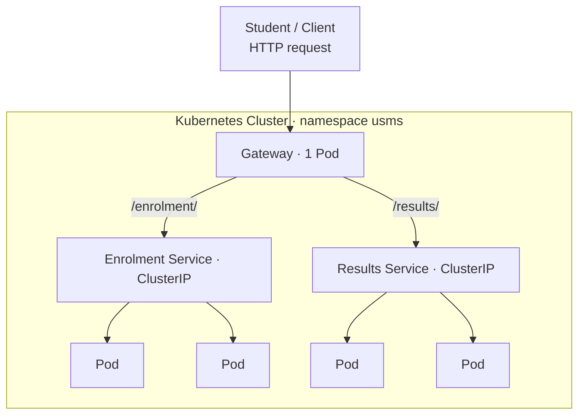
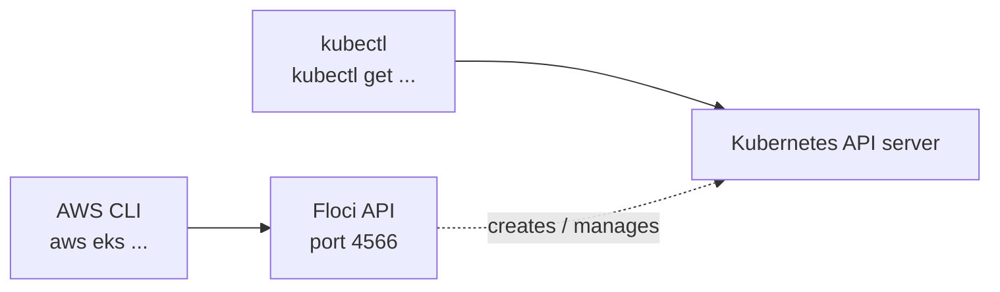
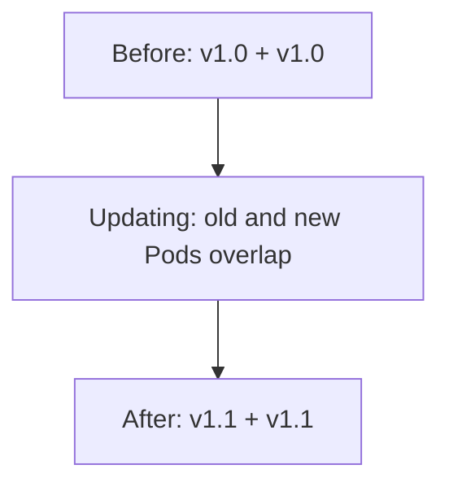

# Unit 3 Lecture: Amazon EKS Architecture

**Duration:** 2 hours (120 minutes, including a 5-minute break)  
**Audience:** 4th-year Software Engineering students who already know Kubernetes fundamentals (Pods, Deployments, Services, nodes, basic `kubectl`) and have completed Lab 07  
**Mode:** Lecture with a console walk-through of a real EKS cluster, a CLI comparison on Floci, and a ClassLegend quiz  
**Running scenario:** USMS, the University Student Management System, moving its portal services onto Amazon EKS

<div class="lesson-schedule"></div>

## Before class

!!! teacher "Purpose"
    Students know Kubernetes. They do not yet know what changes when Kubernetes runs **on AWS**. This lecture is about the seams: where AWS's half of the cluster ends and yours begins, how Pods get VPC addresses, how traffic and DNS reach them, and how IAM and Kubernetes RBAC split the job of deciding who may do what. Keep Kubernetes revision to the five minutes in the Hook.

    The [Lab 07 walkthrough](#lab-07-walkthrough-teacher-reference) at the end of this page explains all 24 Lab 07 steps against today's concepts; use it when students do the lab.

**Learning outcomes.** By the end, students should be able to:

1. Draw the EKS control-plane / data-plane boundary and say who owns, runs and pays for each side.
2. Explain why the Amazon VPC CNI gives every Pod a real VPC IP address, and why that makes subnet size a capacity limit.
3. Explain how a Service, CoreDNS and `kube-proxy` cooperate, and choose between IP mode and instance mode for the AWS Load Balancer Controller.
4. Compare the three cluster endpoint access modes and the role of subnets across Availability Zones.
5. Separate IAM authentication from Kubernetes authorisation, and diagnose `Unauthorized` versus `Forbidden`.
6. Choose between EKS Pod Identity and IRSA for workload identity, and explain why IMDSv2 with a hop limit of 1 is also required.
7. Identify which parts of an EKS cluster Floci reproduces faithfully and which it does not.

**Teacher preparation**

- [ ] **Create the shared cluster `dso303-u3-shared` at least 30 minutes before class**, following [Shared EKS cluster: before class](unit3-shared-eks-cluster.md#before-class-create-the-cluster). It takes 15 to 20 minutes with the node group.
- [ ] Do the shared page's optional Step 9 (the `portal` Deployment, three replicas) so the **Resources** tab shows real Pods with VPC IP addresses.
- [ ] Decide which access case applies (shared page, Step 8): students in **your account** with an `AmazonEKSViewPolicy` access entry, or students in **their own accounts** (for example AWS Academy Learner Lab) following on your screen.
- [ ] Open the cluster's **Overview**, **Networking**, **Add-ons**, **Access**, **Compute** and **Resources** tabs in browser tabs, in that order.
- [ ] Load the ClassLegend bank `private/quizzes/unit3-topic1.questions.md`.
- [ ] Set a calendar reminder to delete the cluster straight after class.

**Environment checks (Floci, student laptops)**

- [ ] Students completed Lab 07, so `configs/lab-07.env` exists and `notes/lab-07-notes.md` records **Path A** or **Path B**.
- [ ] `./scripts/setup/floci-up.sh` starts cleanly and `./scripts/utilities/whoami.sh` reports account `000000000000`.
- [ ] `kubectl get nodes` reaches the Lab 07 cluster (`usms-eks-cluster`) on at least one teacher laptop.
- [ ] `nginx:stable` can be pulled on the class network.
- [ ] Fallback ready: if Floci or the local cluster misbehaves, students pair with someone whose cluster works, or watch your screen.

!!! warning "Students create no EKS clusters"
    Students walk the **Create cluster** wizard to the Review page and stop. One shared cluster for the whole class keeps cost to a few dollars and leaves nothing behind. Nobody clicks **Create**.

!!! warning "Lab 07 and Lab 08 resources are off limits"
    Today's practice objects go in a new namespace, `u3t1`. Nobody modifies or deletes the cluster `usms-eks-cluster`, its node group, or anything in namespace `usms`; Lab 08 builds on them.

---

## Hook: the portal on results day { data-minutes="10" }

[3.1 Definition](../unit3/topic1.md#definition){ .notes-link target="_blank" }
[3.1 Why a managed Kubernetes service](../unit3/topic1.md#why-a-managed-kubernetes-service){ .notes-link target="_blank" }
[3.1 EKS or ECS?](../unit3/topic1.md#eks-or-ecs){ .notes-link target="_blank" }
[3.1 Kubernetes objects compared with ECS](../unit3/topic1.md#kubernetes-objects-compared-with-ecs){ .notes-link target="_blank" }

!!! prompt "Three tickets, one morning"
    USMS moved the student portal from ECS to Amazon EKS last month. On results day, three tickets arrive within an hour:

    1. "Scaling the `results` Deployment from 6 to 20 replicas left 9 Pods `Pending`. The nodes are at 40% CPU."
    2. "Our new engineer ran `kubectl get pods` and got `error: You must be logged in to the server (Unauthorized)`. Her IAM user has `AdministratorAccess`."
    3. "Security found that the `notifications` Pod can delete objects in the transcripts bucket. Nobody gave it that permission."

    None of these would happen the same way on a cluster you ran yourself on a laptop. **Why?**

**Pair discussion (3 minutes):** for each ticket, is the cause in Kubernetes, in AWS, or in the join between them?

???+ answer "Where we are heading"
    All three live in the join. Ticket 1 is the VPC CNI: Pods take real subnet IPs, and the subnet ran out. Ticket 2 is the gap between IAM authentication and Kubernetes authorisation: no access entry. Ticket 3 is workload identity: the Pod is borrowing the node's IAM role. Do not resolve them now; each one is answered in the lesson and revisited in the recap.

**Quick-fire revision (5 minutes).** Ask round the room, one answer per student, fast:

1. What is the difference between a node and a Pod?
2. What keeps three replicas running when one Pod dies?
3. Why do we need a Service if Pods already have IP addresses?
4. Which component stores all cluster state, and which is the only component that talks to it?
5. What does the `kubelet` do?
6. What is reconciliation?
7. In Unit 2's ECS terms, what is a Pod, and which two Kubernetes objects together do the job of one ECS service?

???+ answer "Expected answers"
    1. A node is compute capacity; a Pod is the smallest workload unit, scheduled **onto** a node.
    2. The Deployment's ReplicaSet controller, reconciling desired against actual state.
    3. Pod IPs change whenever Pods are replaced; a Service gives a stable name and virtual IP.
    4. `etcd` stores state; only `kube-apiserver` talks to it.
    5. The node agent: registers the node and starts the Pod's containers through the runtime (`containerd`).
    6. The continuous loop that compares desired state with actual state and corrects the difference.
    7. A Pod is roughly an ECS task; a Deployment (keep N replicas running) plus a Service (stable address) replace one ECS service. Close with one sentence from the notes: choose EKS for the Kubernetes ecosystem and portability; if neither matters, ECS reaches the same outcome with fewer concepts.

!!! teacher "Transition"
    "You know how Kubernetes works. Today is about what AWS does to it: where the cluster is split in half, and what that split costs you."

## The boundary and the network { data-minutes="15" }

[3.1 Control plane and data plane](../unit3/topic1.md#control-plane-and-data-plane){ .notes-link target="_blank" }
[3.1 The EKS control plane](../unit3/topic1.md#the-eks-control-plane){ .notes-link target="_blank" }
[3.1 Worker nodes: data plane options](../unit3/topic1.md#worker-nodes-data-plane-options){ .notes-link target="_blank" }
[3.1 The Amazon VPC CNI](../unit3/topic1.md#the-amazon-vpc-cni){ .notes-link target="_blank" }
[3.1 Cluster endpoint access](../unit3/topic1.md#cluster-endpoint-access){ .notes-link target="_blank" }
[3.1 Subnets and Availability Zones](../unit3/topic1.md#subnets-and-availability-zones){ .notes-link target="_blank" }

### A line through the middle of the cluster

| Side | What runs there | Who owns it | Who pays |
|---|---|---|---|
| **Control plane** | `kube-apiserver`, `etcd`, scheduler, controller managers, IAM authenticator | AWS, in an AWS-managed VPC | Flat per-cluster hourly fee |
| **Data plane** | `kubelet`, `kube-proxy`, `containerd`, VPC CNI, CoreDNS, your Pods | You, in your VPC, on EC2 or Fargate | The compute, storage and network you use |

**Why AWS keeps the control plane in its own account:** isolation (a mistake in your VPC cannot take it down), operability (AWS patches and replaces it without asking you), and an SLA on the API endpoint. On EKS the API server runs as at least two instances across AZs, and `etcd` as three instances across three AZs. You get no direct `etcd` access.

**The price of that design:** the control plane is outside your VPC but must reach in, to the `kubelet` for `kubectl logs` and `exec`, and to admission webhooks. EKS places **cross-account ENIs** in your subnets for this path, guarded by the **cluster security group**.

!!! prompt "Analogy: the airline and the airport"
    The airline (AWS) runs the control tower in its own building: scheduling, records, clearances. The airport apron (your VPC) is yours: the gates, ground crew and fuel. The tower talks to the apron through radios it installed at your gates (the cross-account ENIs). If the tower goes quiet, planes already in the air keep flying; nothing new is cleared for take-off.

!!! teacher "Where the analogy breaks"
    A real control tower failure grounds traffic for safety. In Kubernetes, running Pods genuinely keep serving with no API server; only change stops. Also, the "radios" are not passive: they are ENIs your security groups can block, which is how teams break `kubectl logs` and webhooks without touching the control plane.

**Predict, then check.**

!!! prompt "Predict"
    The EKS API endpoint is unreachable for ten minutes. Students are using the portal. What do they notice, and what can the USMS team not do?

???+ answer "Check"
    Students notice nothing: Pods and Services keep serving traffic, because the runtime path (load balancer, node, Pod) never touches the control plane. The team cannot deploy, scale or change anything, and controllers cannot replace a Pod that dies. **A control plane problem stops change, not traffic.**

### Data plane choices, in one line each

Managed node groups (the default), self-managed nodes, Fargate (one micro-VM per Pod), EKS Auto Mode (AWS runs compute, networking, storage and load balancing), and Hybrid Nodes. Topic 3.3 goes deep; today, note that a managed node group is what the shared cluster uses.

### Pods with real VPC addresses

Many CNI plugins give Pods addresses from an overlay network. The **Amazon VPC CNI** gives every Pod a **real, routable IP from your subnet**, as a secondary address on the node's ENIs.

| Benefit | Cost |
|---|---|
| No encapsulation; one network to debug | Pod density limited by IPs, not just CPU and memory |
| Pod traffic visible in VPC Flow Logs | Each instance type supports a fixed number of ENIs and IPs |
| Load balancers can target Pods directly | Subnet size becomes a cluster capacity limit |

!!! prompt "Back to ticket 1"
    Nine Pods `Pending`, nodes at 40% CPU. What do you check first?

???+ answer "Expected response"
    Free IP addresses in the node subnets (and `kubectl describe pod` events). With the VPC CNI, a cluster can run out of subnet IPs while nodes still have free CPU. Fix the design, not the symptom: size subnets for **Pod count**, not node count. A node also stays `NotReady` until the CNI works, so a broken CNI looks like nodes that never become ready.

### Who can reach the API, and where things live

| Endpoint mode | Who can reach the API | Typical use |
|---|---|---|
| Public only | Internet, limited by a CIDR allow-list | Development |
| Public and private | Allow-listed internet plus the VPC; nodes stay internal | Common production choice |
| Private only | Only from inside the VPC or a connected network | Regulated environments |

A typical layout puts nodes and Pods in **private subnets**, internet-facing load balancers in **public subnets**, with NAT gateways and VPC endpoints for outbound access. EKS requires subnets in **at least two AZs**. The goal is not "many nodes" but **surviving the loss of a whole AZ**, so spread nodes and replicas across zones (and remember cross-AZ traffic is billed). The VPC and IP family are **fixed at creation** (control plane subnets can later be swapped only within the same AZs).

!!! prompt "What would break if..."
    ...the USMS platform team switched the endpoint to **private only** on Friday afternoon, and the CI/CD pipeline runs on a hosted runner on the internet?

???+ answer "Expected response"
    The pipeline and any engineer outside the VPC lose access to the Kubernetes API: no deployments until someone builds a path in (VPN, bastion, or in-VPC runners). Running Pods are unaffected. Plan the admin path **before** going private-only.

!!! teacher "Transition"
    "That is the theory. Now let's find every one of those pieces on a real cluster: the endpoint, the subnets, the security group, the CNI, and the Pod IPs."

## Hands-on A: tour a real cluster { data-minutes="15" }

[3.1 Architecture Components](../unit3/topic1.md#architecture-components){ .notes-link target="_blank" }
[3.1 Configuration Options](../unit3/topic1.md#configuration-options){ .notes-link target="_blank" }
[3.1 The Amazon VPC CNI](../unit3/topic1.md#the-amazon-vpc-cni){ .notes-link target="_blank" }

!!! prompt "Predict before we look"
    The shared cluster's node group has two nodes in two subnets. The `portal` Deployment has three Pods. Will the Pod IP addresses look like the node IP addresses, or like something completely different?

!!! teacher "Which case applies?"
    **Same account:** students sign in to the console, Region `us-east-1` (or the class Region), **Elastic Kubernetes Service**, then `dso303-u3-shared`. They have read-only access through `AmazonEKSViewPolicy`.

    **Own accounts (for example Learner Lab):** students cannot see your cluster. Project steps 1 to 6 from your screen while they answer the questions, then everyone does step 7 in their own account.

    Tab names below match the current console as far as we know; if a label differs slightly, find the equivalent.

**Step 1: Overview.** Note the **Status** (`Active`), **Kubernetes version**, the support period shown for that version, and the **API server endpoint** URL.

> Why does the endpoint URL belong to an AWS domain rather than an address in our VPC? (Answer: the API server runs in the AWS-managed account; we reach it through the endpoint EKS publishes.)

**Step 2: Networking.** Find the **VPC**, the **subnets** (check that they sit in at least two different Availability Zones), the **cluster security group**, and **API server endpoint access** (the shared cluster uses public and private).

> Why does the cluster need a security group of its own when the control plane is not in our VPC? (Answer: it governs traffic between the control plane's cross-account ENIs and the nodes.)

**Step 3: Add-ons.** Find **Amazon VPC CNI**, **CoreDNS** and **kube-proxy** (installed by default) and **Amazon EKS Pod Identity Agent** (selected when the shared cluster was created), each with a version. The console may list further add-ons it pre-selected; note them, but these four are today's focus.

> These run on our nodes, not in AWS's account. Why are they listed in the EKS console at all? (Answer: they are data-plane components that EKS can manage as add-ons, but you are responsible for keeping them current.)

**Step 4: Access.** Note the **authentication mode** (`EKS API`) and the list of **IAM access entries**: the teacher's identity (the cluster creator), the node role entry EKS created for the managed node group, and, in the same-account case, the students' entry with `AmazonEKSViewPolicy`.

> Hold this question for Concept B: the students' IAM role could already call EKS APIs, so why did it still need an access entry to see Pods?

**Step 5: Compute.** Open node group `dso303-u3-nodes`: instance type `t3.medium`, desired size 2, and the two nodes with status **Ready**.

**Step 6: Resources.** Workloads, then **Pods**, namespace `default`. Open a `portal` Pod and note its **IP** and **Node**. Then open a node and note its internal IP.

> Why are the Pod IPs in the same range as the node IPs? (Answer: the VPC CNI assigns each Pod a secondary IP from the node's subnet. On an overlay network they would come from a separate Pod CIDR.)

**Step 7: The Create cluster wizard (do not create).** In your own console: **Elastic Kubernetes Service**, **Create cluster** (in some consoles **Add cluster**, then **Create**). Under **Configuration options** choose **Custom configuration**, then switch **Use EKS Auto Mode** off, so the wizard shows the classic settings the notes describe. Click **Next** through each page and, for each field, name the concept it controls. Stop on the **Review and create** page.

| Wizard page and field (labels may vary slightly) | Concept it controls |
|---|---|
| Configure cluster: Name, Kubernetes version | The version starts the upgrade clock: 14 months standard support, then 12 months extended at a higher price |
| Configure cluster: Support type (upgrade policy) | Extended support (default, extra hourly charge) or Standard support (AWS auto-upgrades at the end of standard support) |
| Configure cluster: Cluster IAM role | The role EKS uses to manage ENIs, load balancers and logs for you (Learner Lab: `LabRole`) |
| Configure cluster: Cluster access (bootstrap cluster administrator access, cluster authentication mode) | Who is admin on day one; access entries (`EKS API`) versus the deprecated `aws-auth` ConfigMap |
| Configure cluster: Secrets encryption | Optional customer managed KMS key; without it, EKS still envelope-encrypts `etcd` data with an AWS-owned key |
| Specify networking: VPC, Subnets, Security groups | Where the cross-account ENIs go; at least two AZs; the VPC is fixed at creation |
| Specify networking: cluster IP address family | IPv4 or IPv6; fixed at creation |
| Specify networking: Cluster endpoint access | Public, public and private, or private |
| Configure observability: Control plane logging | `api`, `audit`, `authenticator`, `controllerManager`, `scheduler` logs (all off by default) |
| Select add-ons | VPC CNI, CoreDNS and `kube-proxy` by default; Pod Identity Agent and others optional |

Leave any other fields (for example ARC zonal shift, Service IP range, control plane egress, Prometheus metrics) at their defaults; they are beyond this lecture.

!!! warning "Stop at Review"
    Do **not** click **Create**. Do **not** click any "Create recommended role" button (or **Customize** where the console offers to create the role for you): it creates a real IAM role. If the Cluster IAM role list is empty and **Next** is disabled, follow the remaining pages on the teacher's screen. Leaving the wizard creates nothing.

!!! teacher "If anything did get created"
    If a student created any resource by accident, it must be tagged `Course=DSO303`, `Session=u3t1`, named with the prefix `dso303-u3t1-<initials>`, and deleted in Recap and clean-up.

**Success criteria**

- [ ] Found the endpoint, the version and its support period
- [ ] Confirmed subnets in at least two AZs and named the cluster security group
- [ ] Listed the four add-ons
- [ ] Noted the authentication mode and at least two access entries
- [ ] Compared a Pod IP with a node IP
- [ ] Reached the wizard's Review page without creating anything

???+ answer "Prediction check"
    The Pod IPs come from the same subnet range as the nodes. That is the VPC CNI in action, and it is why the subnet's free IP count is a cluster capacity limit.

## Traffic and identity { data-minutes="15" }

[3.1 Services, CoreDNS and kube-proxy](../unit3/topic1.md#services-coredns-and-kube-proxy){ .notes-link target="_blank" }
[3.1 The AWS Load Balancer Controller](../unit3/topic1.md#the-aws-load-balancer-controller){ .notes-link target="_blank" }
[3.1 Cluster access: authentication versus authorisation](../unit3/topic1.md#cluster-access-authentication-versus-authorisation){ .notes-link target="_blank" }
[3.1 IAM for workloads: Pod identity](../unit3/topic1.md#iam-for-workloads-pod-identity){ .notes-link target="_blank" }
[3.1 Secrets](../unit3/topic1.md#secrets){ .notes-link target="_blank" }

### Reaching Pods whose IPs keep changing

- **Service:** a stable name and virtual IP (ClusterIP).
- **CoreDNS:** resolves the Service name to its ClusterIP.
- **`kube-proxy`:** on every node, rewrites packets for the ClusterIP so they reach a healthy Pod.

| Service type | Creates | Use |
|---|---|---|
| `ClusterIP` | Internal virtual IP | Default; service-to-service |
| `NodePort` | A port on every node | Rarely used directly |
| `LoadBalancer` | An NLB (with the AWS Load Balancer Controller or Auto Mode) | Expose one Service |
| Ingress (not a Service type) | An ALB | HTTP routing for many Services behind one load balancer |

The **AWS Load Balancer Controller**, which you install, turns an Ingress into an ALB and an annotated Service into an NLB.

| Target mode | Traffic goes to | Consequence |
|---|---|---|
| Instance mode | A node port, then `kube-proxy` forwards to a Pod | Extra hop |
| IP mode | Pod IPs directly | Lower latency; **required on Fargate** |

!!! prompt "Predict"
    USMS moves the `results` service onto Fargate and keeps its Ingress in **instance mode**. What happens?

???+ answer "Check"
    It cannot work: Fargate Pods have no node port for the load balancer to target. IP mode is required, and it works only because the VPC CNI made Pod IPs real VPC addresses that a load balancer can reach.

### Two questions, two systems

1. **Who can operate the cluster?** People and pipelines using `kubectl`.
2. **What can the application in a Pod do in AWS?** Workload identity.

| Step | Layer | Mechanism | Failure |
|---|---|---|---|
| Authentication | IAM | `kubectl` sends a token from `aws eks get-token` | `Unauthorized` |
| Mapping | EKS API | An **access entry** links the IAM principal to a Kubernetes identity | `Unauthorized` if missing |
| Authorisation | Kubernetes | An **access policy** (cluster admin, admin, edit, view) or RBAC binding | `Forbidden` |

!!! prompt "Analogy: the conference badge"
    Your passport (IAM) proves who you are at the registration desk. The desk prints a badge only if your name is on the attendee list (the access entry). The badge colour (access policy or RBAC) decides which rooms you may enter. No name on the list: "we don't know you" (`Unauthorized`). Wrong badge colour: "you can't go in there" (`Forbidden`).

!!! teacher "Where the analogy breaks"
    A badge is printed once; an EKS token is short-lived and fetched again by `kubectl` on each use. And unlike a conference, the identity that created the cluster is on the list automatically, which is exactly why a cluster created only by a pipeline role locks every human out.

???+ answer "Back to ticket 2, and the Hands-on A question"
    `AdministratorAccess` is an IAM permission; it does not create an access entry. The cluster does not recognise her, so the answer is `Unauthorized`. The fix is an access entry plus an access policy. In the console tour, the students' role needed an access entry for the same reason.

### Workload identity

| Approach | How it works | Verdict |
|---|---|---|
| Node instance role | Every Pod borrows the node's role | Avoid: every Pod gets every permission |
| IRSA | The cluster's OIDC provider lets a ServiceAccount assume a role | Works everywhere, **including Fargate** |
| EKS Pod Identity | An agent add-on supplies credentials for a ServiceAccount-to-role association | Simpler; preferred on EC2 nodes; **not on Fargate** |

Both IRSA and Pod Identity give temporary, auto-rotated credentials: no access key in the container. But a Pod can still reach the node's role through the **instance metadata service (IMDS)** unless nodes require **IMDSv2 with a hop limit of 1**. You need per-Pod identity **and** the hop limit.

???+ answer "Back to ticket 3"
    The `notifications` Pod is using the node's instance role, which someone gave S3 permissions for another workload. Fix: a ServiceAccount associated with a narrowly scoped role through Pod Identity, the S3 permission removed from the node role, and IMDSv2 hop limit 1 so the Pod cannot fall back to the node role.

**Secrets, in one breath.** A Kubernetes Secret is base64-encoded, **not encrypted**, to anyone allowed to read it, so restrict who can `get` Secrets. At rest, EKS (1.28 and later) envelope-encrypts all `etcd` data with KMS by default; you may bring your own KMS key, and must then never delete it, or the cluster's data becomes unreadable. Use Secrets Manager for rotating credentials.

!!! teacher "Transition"
    "Now the same cluster from the terminal. Your Lab 07 cluster runs on Floci, and part of today's job is spotting where it is a real EKS cluster and where it is only pretending."

## Hands-on B: the same view from the CLI { data-minutes="20" }

[3.1 How a request to the cluster flows](../unit3/topic1.md#how-a-request-to-the-cluster-flows){ .notes-link target="_blank" }
[3.1 Services, CoreDNS and kube-proxy](../unit3/topic1.md#services-coredns-and-kube-proxy){ .notes-link target="_blank" }
[3.1 Cluster access: authentication versus authorisation](../unit3/topic1.md#cluster-access-authentication-versus-authorisation){ .notes-link target="_blank" }

!!! prompt "Predict before we run anything"
    Your Lab 07 cluster runs locally under Floci. When you list the Pods in `kube-system`, will you see `aws-node` (the VPC CNI) and `kube-proxy` Pods, as on the shared cluster?

!!! teacher "Two paths"
    Students recorded their Lab 07 path in `notes/lab-07-notes.md`. **Path A:** Floci answers `aws eks` and created a k3s-backed cluster. **Path B:** the cluster was created with `k3d` directly, and `aws eks` calls do not apply. Every `kubectl` step is identical on both paths. All commands run from `~/aws-floci-course`.

**Step 1: Start the environment and confirm identity.**

```bash
cd ~/aws-floci-course
./scripts/setup/floci-up.sh
source configs/course.env
source configs/lab-07.env
./scripts/utilities/whoami.sh
echo "$USMS_EKS_CLUSTER"
```

What it does: starts or resumes Floci under Compose (never `floci start`), loads the course variables and the Lab 07 outputs, and confirms you are talking to the local emulator.

```text
Identity : arn:aws:iam::000000000000:root
Account  : 000000000000
Endpoint : http://localhost:4566
Region   : us-east-1
usms-eks-cluster
```

> Example output — yours will differ.

> Why check the account before running a single `eks` command? (Answer: if the account is not `000000000000`, you are pointed at something other than your emulator, possibly a real AWS account.)

**Step 2 (Path A): the AWS half of the cluster.**

```bash
aws eks describe-cluster --name "$USMS_EKS_CLUSTER" \
  --query 'cluster.{Status:status,Version:version,Endpoint:endpoint,Subnets:resourcesVpcConfig.subnetIds,Public:resourcesVpcConfig.endpointPublicAccess,Private:resourcesVpcConfig.endpointPrivateAccess,Auth:accessConfig.authenticationMode}' \
  --output json

aws eks list-nodegroups --cluster-name "$USMS_EKS_CLUSTER" --output text
```

What it does: asks the EKS API (served by Floci on port 4566) for the same facts you read on the console's Overview and Networking tabs, then lists the node groups.

```text
{
    "Status": "ACTIVE",
    "Version": "1.30",
    "Endpoint": "https://localhost:6443",
    "Subnets": ["subnet-0a1b...", "subnet-0b2c...", "subnet-0c3d...", "subnet-0d4e..."],
    "Public": true,
    "Private": false,
    "Auth": null
}
NODEGROUPS	usms-eks-nodes
```

> Example output — yours will differ. Fields your Floci build does not model may print `null`.

> The endpoint is `localhost`, while on the shared cluster it was an AWS domain. Why? (Answer: Floci started the Kubernetes API server in a local container; on AWS it runs in the AWS-managed account.)

**Step 2 (Path B).** There is no EKS object to describe. Run `k3d cluster list` instead and note the cluster name and agent count. Record that the AWS half is not available on your path.

**Step 3: Point `kubectl` at the cluster and check where it points.**

```bash
# Path A
aws eks update-kubeconfig --name "$USMS_EKS_CLUSTER" --alias usms-eks
# Path B
kubectl config use-context k3d-usms-eks-cluster

kubectl config current-context
kubectl config view --minify
```

What it does: writes or selects the kubeconfig context, prints which one is active, then shows only the active cluster, user and context.

```text
usms-eks
...
users:
- name: arn:aws:eks:us-east-1:000000000000:cluster/usms-eks-cluster
  user:
    exec:
      command: aws
      args: [--region, us-east-1, eks, get-token, --cluster-name, usms-eks-cluster, ...]
```

> Example output — yours will differ. On Path B, or if you used the Lab 07 fallback kubeconfig in `outputs/`, the user shows `client-certificate-data: DATA+OMITTED` instead of an `exec` block.

> Why does a real EKS kubeconfig contain a command instead of a password? (Answer: `kubectl` runs `aws eks get-token` each time, so access follows your current IAM identity and no long-lived secret is stored. That token is the authentication step from Concept B.)

!!! note "Floci Limitation — no IAM authentication into Kubernetes"
    Floci's cluster is k3s. Depending on the build, `aws eks get-token` may not be implemented, and the API server accepts certificate credentials rather than verifying an IAM identity. Access entries are not enforced.

    On real EKS, the IAM authenticator verifies the token, an access entry maps the principal, and an access policy or RBAC decides; missing pieces give `Unauthorized` or `Forbidden`.

    Judge your access design by reading it, not by whether `kubectl` let you in.

**Step 4: Nodes and their addresses.**

```bash
kubectl get nodes -o wide
```

```text
NAME                    STATUS   ROLES                  AGE   VERSION        INTERNAL-IP
usms-eks-cluster-srv0   Ready    control-plane,master   9d    v1.30.x+k3s1   172.18.0.3
usms-eks-cluster-ag0    Ready    <none>                 9d    v1.30.x+k3s1   172.18.0.4
usms-eks-cluster-ag1    Ready    <none>                 9d    v1.30.x+k3s1   172.18.0.5
```

> Example output — yours will differ.

> Two differences from the shared cluster: a node with the `control-plane` role is visible, and the INTERNAL-IP is not in Lab 2's `10.0.0.0/16`. Why can you never see a control-plane node on real EKS? (Answer: the control plane runs in AWS's account, outside your cluster's node list; only data plane nodes register.)

**Step 5: What runs in `kube-system`.**

```bash
kubectl get pods -n kube-system -o wide
```

```text
NAME                                      READY   STATUS    IP          NODE
coredns-xxxxxxxxxx-xxxxx                  1/1     Running   10.42.0.4   usms-eks-cluster-srv0
local-path-provisioner-xxxxxxxxxx-xxxxx   1/1     Running   10.42.0.2   usms-eks-cluster-srv0
metrics-server-xxxxxxxxxx-xxxxx           1/1     Running   10.42.0.3   usms-eks-cluster-srv0
```

> Example output — yours will differ; your build may show more or fewer system Pods.

> CoreDNS is here. Where are `aws-node` and `kube-proxy`? (Answer: k3s uses its own built-in networking and runs its proxy inside the k3s process, not as Pods. On the shared cluster you would see an `aws-node` DaemonSet (VPC CNI), a `kube-proxy` DaemonSet, CoreDNS and the `eks-pod-identity-agent` DaemonSet.)

!!! note "Floci Limitation — no Amazon VPC CNI"
    Pods get k3s cluster-network addresses (often `10.42.x.x`), unrelated to your VPC CIDR, and there is no `aws-node` DaemonSet.

    On real EKS, the VPC CNI gives every Pod a secondary IP from the node's subnet, so Pod IPs look like node IPs and subnet size limits Pod count.

    The IP-exhaustion lesson can only be seen on real EKS; the Kubernetes behaviour (scheduling, Services, DNS) is genuine here.

**Step 6: Practice Pods in their own namespace.**

```bash
kubectl create namespace u3t1
kubectl create deployment portal --image=nginx:stable --replicas=3 -n u3t1
kubectl rollout status deployment/portal -n u3t1
kubectl get pods -n u3t1 -o wide
```

What it does: creates today's namespace, three `nginx` replicas in it, waits until they are ready, and lists them with IP and node. Always pass `-n u3t1`: Lab 07 made `usms` your context's default namespace.

```text
NAME                      READY   STATUS    IP          NODE
portal-xxxxxxxxxx-aaaaa   1/1     Running   10.42.1.5   usms-eks-cluster-ag0
portal-xxxxxxxxxx-bbbbb   1/1     Running   10.42.2.4   usms-eks-cluster-ag1
portal-xxxxxxxxxx-ccccc   1/1     Running   10.42.0.9   usms-eks-cluster-srv0
```

> Example output — yours will differ.

> Compare with the console's Resources tab. Why are these Pod IPs in a different range from the node IPs here, but in the same range on the shared cluster? (Answer: k3s uses a separate Pod network; the VPC CNI takes Pod IPs from the node's own subnet.)

**Step 7: A Service and CoreDNS.**

```bash
kubectl expose deployment portal --port=80 -n u3t1
kubectl get svc,endpoints portal -n u3t1
kubectl run dnscheck -n u3t1 --image=busybox:1.36 --rm -it --restart=Never \
  -- nslookup portal.u3t1.svc.cluster.local
```

What it does: creates a `ClusterIP` Service for `portal`, shows its virtual IP and the three Pod endpoints behind it, then resolves the Service name from a throwaway Pod.

```text
NAME             TYPE        CLUSTER-IP     PORT(S)
service/portal   ClusterIP   10.43.120.17   80/TCP

NAME               ENDPOINTS
endpoints/portal   10.42.0.9:80,10.42.1.5:80,10.42.2.4:80

Name:      portal.u3t1.svc.cluster.local
Address:   10.43.120.17
```

> Example output — yours will differ.

> The name resolves to the ClusterIP, not to any Pod IP. Which component turns a packet for `10.43.120.17` into a packet for a real Pod? (Answer: `kube-proxy`, or k3s's built-in equivalent here. CoreDNS only answers the name lookup.)

**Step 8: Check your permissions.**

```bash
kubectl auth can-i create deployments -n u3t1
kubectl auth can-i delete nodes
```

```text
yes
yes
```

> Example output — yours will differ.

> On the shared cluster, a student with `AmazonEKSViewPolicy` asks `kubectl auth can-i create deployments`. What answer would they get, and if they tried anyway, which error? (Answer: `no`, and a real attempt fails with `Forbidden`: the cluster recognises them, but the view policy does not allow writes.)

**Success criteria**

- [ ] `whoami.sh` showed account `000000000000`
- [ ] Read the cluster's status, version and endpoint from `describe-cluster` (Path A) or `k3d cluster list` (Path B)
- [ ] Identified the active context and whether the user entry uses `exec` or a certificate
- [ ] Named two `kube-system` differences from a real EKS cluster
- [ ] Created `portal` in namespace `u3t1` and compared Pod IPs with node IPs
- [ ] Resolved `portal.u3t1.svc.cluster.local` to the ClusterIP

???+ answer "Prediction check"
    No. `aws-node` and `kube-proxy` Pods do not appear on the Floci cluster: k3s brings its own networking and proxy. The Kubernetes half (Deployments, Services, CoreDNS) is genuine; the AWS-facing half (VPC CNI, IAM authentication, access entries) is emulated or absent.

## Break { data-minutes="5" .break }

!!! teacher "During the break"
    Leave the shared cluster's **Resources** tab and the Floci `kube-system` output side by side on the projector.

## Recap and clean-up { data-minutes="10" }

[3.1 Summary](../unit3/topic1.md#summary){ .notes-link target="_blank" }
[3.1 Common Mistakes](../unit3/topic1.md#common-mistakes){ .notes-link target="_blank" }
[3.1 Operating It: Performance, Cost and Monitoring](../unit3/topic1.md#operating-it-performance-cost-and-monitoring){ .notes-link target="_blank" }
[3.1 Design Considerations](../unit3/topic1.md#design-considerations){ .notes-link target="_blank" }
[3.1 Security Considerations](../unit3/topic1.md#security-considerations){ .notes-link target="_blank" }

**Key lessons (5 minutes).** Return to the three tickets and ask students to close each one.

| Area | Key lesson | Ticket |
|---|---|---|
| Boundary | AWS runs the control plane in its own account; you run the data plane. A control plane problem stops change, not traffic | |
| Networking | VPC CNI gives each Pod a real VPC IP: good for load balancing (IP mode), but subnet size limits Pod count | 1 |
| Traffic | Service + CoreDNS + `kube-proxy`; the Load Balancer Controller creates ALBs and NLBs | |
| Cluster access | IAM authenticates, the access entry maps, the access policy or RBAC authorises. `Unauthorized` versus `Forbidden` | 2 |
| Workload identity | Pod Identity on EC2 nodes, IRSA on Fargate, plus IMDSv2 hop limit 1. Never the node role | 3 |
| Operations | Upgrade yearly, one minor version at a time, or pay for extended support (the default upgrade policy) | |

!!! teacher "Set as reading"
    Not taught live and not in the quiz (the quiz tests only what was taught in class), but useful before 3.2: **Design Considerations** (the decision flowchart and the two scenarios), **Security Considerations** (admission control, NetworkPolicies versus security groups, supply chain, audit), **AWS Best Practices** and **Integration with Other AWS Services**. Tell students to read them before 3.2.

!!! teacher "Bridge to 3.2"
    "Today we saw how the cluster is built: who runs what, how Pods get addresses, how people and Pods get permissions. Next lecture we put an application on it: create a cluster with `eksctl`, deploy with manifests and Helm, and roll a release forward and back without downtime."

!!! danger "Read before running any delete command"
    **What will be deleted:** namespace `u3t1` and everything in it (the `portal` Deployment, its Pods and Service).
    **What depends on it:** nothing. Lab 07 and Lab 08 objects live in namespace `usms`.
    **Reversible?** No, but the steps above recreate it in a minute.
    **Effect on later labs:** none. Do not delete `usms`, `usms-eks-cluster` or its node group.

**Clean-up (5 minutes).**

1. Delete the practice namespace (from `~/aws-floci-course`):

    ```bash
    kubectl delete namespace u3t1
    kubectl get namespaces
    ```

    `u3t1` disappears (it may show `Terminating` briefly); `usms` is still `Active`.

2. Close the Create cluster wizard without creating. Nothing was created, so there is nothing to delete.

3. **Only if anyone created a console resource by accident:** delete it, then open **Resource Groups & Tag Editor**, **Tag Editor**, your class Region, **All supported resource types**, tag `Session` = `u3t1`. The result must be empty. Also check for any untagged leftovers with the `dso303-u3t1-` name prefix.

4. Leave Floci running or pause it with `./scripts/setup/floci-down.sh` (state is kept). Do not delete `~/floci-data`.

- [ ] Namespace `u3t1` gone; namespace `usms` still `Active`
- [ ] No EKS cluster created by any student
- [ ] Tag Editor search for `Session=u3t1` empty (if anything was created)

!!! teacher "Transition"
    "Phones and laptops out for ClassLegend."

## Quiz { data-minutes="30" }

!!! quiz "ClassLegend quiz: 3.1 Amazon EKS Architecture"
    Bank of 121 questions in `private/quizzes/unit3-topic1.questions.md` covering the control-plane / data-plane boundary, cross-account ENIs and the cluster security group, data plane options, the Amazon VPC CNI and IP exhaustion, Services, CoreDNS and `kube-proxy`, the AWS Load Balancer Controller (IP versus instance mode), endpoint access modes, subnets and Availability Zones, IAM authentication versus RBAC authorisation with access entries, EKS Pod Identity versus IRSA and the IMDS hop limit, Secrets, upgrades, support windows and the upgrade policy, the console tour and wizard, and the Floci CLI comparison. Run as many as fit about 25 minutes, then spend 5 minutes reviewing the most-missed questions.

---

## After class

- [ ] Delete the shared cluster today: follow [Shared EKS cluster: after class](unit3-shared-eks-cluster.md#after-class-delete-everything) (objects that create AWS resources, then the node group, then the cluster).
- [ ] Re-run the **Tag Editor** search across the class account and Region for `Session=u3-shared` and `Session=u3t1`. Both must be empty.
- [ ] Check EC2 instances, volumes, load balancers and network interfaces for leftovers, as listed on the shared page.
- [ ] Next day: **Billing and Cost Management** shows no ongoing EKS or EC2 charges.
- [ ] AWS Academy Learner Lab: **End Lab**.
- [ ] Note the most-missed quiz questions to revisit at the start of 3.2.

## Command reference

| Command | Purpose |
|---|---|
| `./scripts/setup/floci-up.sh` | Start or resume Floci under Compose |
| `source configs/lab-07.env` | Load Lab 07 outputs (`USMS_EKS_CLUSTER` and others) |
| `./scripts/utilities/whoami.sh` | Confirm identity and the local endpoint |
| `aws eks describe-cluster --name "$USMS_EKS_CLUSTER"` | AWS-side cluster facts (Path A) |
| `aws eks list-nodegroups --cluster-name "$USMS_EKS_CLUSTER"` | Node groups (Path A) |
| `k3d cluster list` | Local cluster facts (Path B) |
| `aws eks update-kubeconfig --name "$USMS_EKS_CLUSTER" --alias usms-eks` | Write the kubeconfig context (Path A) |
| `kubectl config current-context` | Show the active context |
| `kubectl config view --minify` | Show the active cluster, user and context |
| `kubectl get nodes -o wide` | Nodes with internal IPs |
| `kubectl get pods -n kube-system -o wide` | System Pods (CoreDNS, and on EKS `aws-node`, `kube-proxy`) |
| `kubectl get pods -n u3t1 -o wide` | Practice Pods with IPs and nodes |
| `kubectl get svc,endpoints portal -n u3t1` | Service ClusterIP and its Pod endpoints |
| `kubectl auth can-i <verb> <resource>` | Check authorisation |
| `kubectl delete namespace u3t1` | Clean up today's practice objects |
| `./scripts/setup/floci-down.sh` | Pause Floci; state kept |

## Lab 07 walkthrough (teacher reference)

Not timed and not part of the 120 minutes. Use it to explain [Lab 07: Deploying a Microservices Application on Amazon EKS](../Lab/Lab-07-EKS.md){ target="_blank" } as a practical class: what each of the 24 steps does, why, and what happens behind the scenes. It connects today's concepts (control plane and data plane, VPC networking, cluster and Pod identity) to the hands-on lab. Students run the full commands from the lab page; the snippets here are simplified for explanation.

!!! teacher "The one idea to land"
    Four layers, each with its own job: **AWS infrastructure** (VPC, subnets, IAM roles, security groups), **Kubernetes infrastructure** (control plane, worker nodes, kubelet), **application orchestration** (namespaces, Deployments, ReplicaSets, Pods) and **application communication** (Services, CoreDNS, gateway, HTTP). Once students can say which layer owns an operation, the 24 steps read as one sequence rather than a pile of commands.

### What students build

USMS gets three microservices on Kubernetes:

- **Gateway:** receives requests and forwards them to the right service.
- **Enrolment service:** handles enrolment requests.
- **Results service:** handles results requests.



The finished namespace has **five application Pods**: one gateway, two enrolment, two results. They find each other by Kubernetes DNS names, never by Pod IPs, and stay internal to the cluster in this lab.

| Concept | Simple meaning |
|---|---|
| Cluster | The whole Kubernetes environment |
| Node | A machine that runs application Pods |
| Pod | The smallest deployable unit; one or more containers |
| Deployment | Keeps the required number of Pods running |
| Service | A stable network address for a set of Pods |

If the enrolment Deployment says `replicas: 2` and one Pod fails, its ReplicaSet creates a replacement.

### Part A: preparing the environment (Steps 1-5)

#### Step 1 - Start Floci and verify everything

[Lab 07 Step 1](../Lab/Lab-07-EKS.md#step-1-start-the-environment-and-confirm-the-ground-you-are-standing-on){ .notes-link target="_blank" }

**Purpose:** confirm the course environment works before building anything on it. Floci emulates supported AWS APIs locally; nothing is created in a real AWS account.

```bash
cd ~/aws-floci-course
./scripts/setup/floci-up.sh
source configs/course.env
source configs/lab-01.env
source configs/lab-02.env
source configs/lab-03.env
source configs/lab-04.env
./scripts/utilities/whoami.sh
./scripts/utilities/floci-storage-check.sh
./scripts/utilities/verify-lab-02.sh | tail -2
```

`source` reads a file and loads its variables into the current terminal, so `echo "$USMS_VPC_ID"` works without typing IDs by hand. Students should see the local account, endpoint `http://localhost:4566`, `FAIL=0` for Lab 02, and **four subnets** (two public, two private, across two AZs). Why: worker nodes go into the private subnets.

#### Step 2 - Check whether this Floci build supports EKS

[Lab 07 Step 2](../Lab/Lab-07-EKS.md#step-2-probe-what-your-build-actually-supports-and-record-the-answer){ .notes-link target="_blank" }

Not every Floci build supports every EKS operation, so students create and run a probe script (full code in the lab). Its key test is `aws eks list-clusters`.

| Path | Meaning | What to do |
|---|---|---|
| A | Floci's EKS API is available | Follow the main EKS instructions |
| B | EKS API unavailable, but k3d works | Create Kubernetes directly with k3d |
| C | Neither is available | Prepare and validate manifests without a running cluster |

```bash
chmod +x scripts/utilities/eks-support-probe.sh
./scripts/utilities/eks-support-probe.sh
```

The result decides the route in Step 8. Teaching point: `list-clusters` succeeding proves the API answers, not that cluster creation will work.

#### Step 3 - Control plane versus data plane

[Lab 07 Step 3](../Lab/Lab-07-EKS.md#step-3-understand-the-control-plane-data-plane-split-before-you-create-either){ .notes-link target="_blank" }

| Control plane: makes decisions | Data plane: runs applications |
|---|---|
| API server | Worker nodes |
| Scheduler | kubelet |
| Controllers | Container runtime |
| etcd | Application Pods |

Analogy: the control plane is the university administration (decides where classes run, monitors them); the data plane is the classrooms. In real EKS, AWS runs the control plane; who runs the workers depends on managed nodes, Fargate or another option. Floci reproduces this with local Kubernetes containers. This is the [boundary segment](#the-boundary-and-the-network) from today.

#### Step 4 - Two IAM trust policies

[Lab 07 Step 4](../Lab/Lab-07-EKS.md#step-4-write-the-two-trust-policies){ .notes-link target="_blank" }

A trust policy answers one question: **who may assume this role?** Students write `policies/trust-eks-cluster.json` and `policies/trust-eks-node.json`.

| Role | Trusted service | Why |
|---|---|---|
| Cluster role | `eks.amazonaws.com` | EKS manages AWS resources for the cluster |
| Node role | `ec2.amazonaws.com` | EC2 worker nodes need AWS permissions |

```json
"Principal": {
  "Service": "eks.amazonaws.com"
}
```

The lab validates both files with Python. Remember: a trust policy says **who**, not **what**.

#### Step 5 - Two IAM permissions policies

[Lab 07 Step 5](../Lab/Lab-07-EKS.md#step-5-write-the-two-permissions-policies){ .notes-link target="_blank" }

Now the question is **what may the role do?** The cluster policy covers cluster networking and load-balancing resources; the node policy covers pulling images from ECR, managing interfaces for Pod networking, and writing logs.

```json
{
  "Effect": "Allow",
  "Action": [
    "ecr:GetAuthorizationToken",
    "ecr:BatchGetImage"
  ],
  "Resource": "*"
}
```

These custom policies stand in for the AWS managed policies used in production. Floci stores them without necessarily enforcing them. **Trust policy names the principal; permissions policy authorises actions.**

### Part B: creating the EKS infrastructure (Steps 6-11)

#### Step 6 - Cluster IAM role and security group

[Lab 07 Step 6](../Lab/Lab-07-EKS.md#step-6-create-the-cluster-role-and-the-cluster-security-group){ .notes-link target="_blank" }

```bash
EKS_CLUSTER_ROLE=usms-eks-cluster-role

aws iam create-role \
  --role-name "$EKS_CLUSTER_ROLE" \
  --assume-role-policy-document file://policies/trust-eks-cluster.json
```

`file://` loads the Step 4 trust policy. The lab then attaches `USMSEKSClusterPolicy` and creates `usms-eks-cluster-sg` in the Lab 02 VPC, allowing TCP 443 to the cluster endpoint from the VPC CIDR. Two different problems: the **IAM role** controls which AWS resources the control plane may touch; the **security group** controls which network traffic may reach it.

#### Step 7 - Node IAM role

[Lab 07 Step 7](../Lab/Lab-07-EKS.md#step-7-create-the-node-role-and-attach-lab-1s-policy-to-it){ .notes-link target="_blank" }

`usms-eks-node-role` gets `USMSEKSNodePolicy` and `USMSStudentDataReadWrite` (reused from Lab 01), because nodes pull images from ECR and support the VPC CNI.

```bash
aws iam list-attached-role-policies \
  --role-name usms-eks-node-role \
  --query 'AttachedPolicies[].PolicyName' \
  --output text
```

Security point (from today's identity segment): Pods may reach the node's credentials through instance metadata unless that is restricted. In real EKS, give application Pods narrowly scoped credentials with EKS Pod Identity or IRSA, never the node role.

#### Step 8 - Create the cluster

[Lab 07 Step 8](../Lab/Lab-07-EKS.md#step-8-create-the-cluster){ .notes-link target="_blank" }

The request lives in a JSON file (name, Kubernetes version, IAM role, VPC configuration). Path A:

```bash
aws eks create-cluster \
  --cli-input-json file://templates/lab-07-create-cluster.json \
  --query 'cluster.{Name:name,Status:status,Version:version,Arn:arn}' \
  --output table
```

| Part | Meaning |
|---|---|
| `aws eks create-cluster` | Request a new EKS cluster |
| `--cli-input-json` | Read the configuration from a file |
| `--query` | Select fields from the response |
| `--output table` | Show them as a table |

The file's `_lb_ports_` tag is a **Floci-only** mechanism that reserves local ports for Lab 08's load balancers; it is not real EKS configuration. Path B runs `k3d cluster create` instead. The step ends by unsetting the `sts assume-role` credentials so later commands run as the normal identity.

#### Step 9 - Wait for the cluster

[Lab 07 Step 9](../Lab/Lab-07-EKS.md#step-9-wait-for-the-cluster-and-read-what-it-tells-you){ .notes-link target="_blank" }

`create-cluster` returns while the cluster is `CREATING`; it becomes `ACTIVE` only when provisioning succeeds. A successful request is not ready infrastructure.

```bash
aws eks describe-cluster \
  --name usms-eks-cluster \
  --query 'cluster.status' \
  --output text
```

Proceed only at `ACTIVE`.

#### Step 10 - Managed node group

[Lab 07 Step 10](../Lab/Lab-07-EKS.md#step-10-create-the-managed-node-group){ .notes-link target="_blank" }

The control plane exists; now the Pods need machines.

| Minimum | Desired | Maximum |
|---:|---:|---:|
| 2 | 2 | 4 |

Nodes go into Lab 02's two private subnets: workers do not need public IPs; traffic reaches them through load balancers. Teaching point: **scaling nodes adds capacity; scaling Pod replicas adds copies of the application.** Lab 08 does both.

#### Step 11 - Point `kubectl` at the cluster

[Lab 07 Step 11](../Lab/Lab-07-EKS.md#step-11-point-kubectl-at-the-cluster){ .notes-link target="_blank" }

Until now, `aws eks ...` talked to Floci's AWS-compatible endpoint. From here, `kubectl` talks to the Kubernetes API server.

```bash
aws eks update-kubeconfig --name usms-eks-cluster --alias usms-eks
kubectl cluster-info
kubectl get nodes
```

```text
NAME                    STATUS
usms-eks-cluster-srv0   Ready
usms-eks-cluster-ag0    Ready
usms-eks-cluster-ag1    Ready
```

> Example output: one server node (the local control plane) and two agents (workers). Counts vary by Floci build.



`aws` manages AWS-facing resources; `kubectl` manages what is inside Kubernetes. This is today's Hands-on B.

### Part C: deploying the application (Steps 12-16)

#### Step 12 - Namespace

[Lab 07 Step 12](../Lab/Lab-07-EKS.md#step-12-create-the-namespace-and-make-it-the-default-for-your-context){ .notes-link target="_blank" }

```yaml
apiVersion: v1
kind: Namespace
metadata:
  name: usms
```

```bash
kubectl apply -f manifests/lab-07/00-namespace.yaml
kubectl config set-context --current --namespace=usms
```

Now `kubectl get pods` looks in `usms` by default. A namespace groups and scopes resources (like a department); it does **not** isolate network traffic on its own.

#### Step 13 - Enrolment microservice

[Lab 07 Step 13](../Lab/Lab-07-EKS.md#step-13-deploy-the-first-microservice-usms-enrolment){ .notes-link target="_blank" }

Three objects together: a ConfigMap (Nginx configuration), a Deployment (two Pods) and a Service (stable address).

```yaml
apiVersion: apps/v1
kind: Deployment
metadata:
  name: usms-enrolment
  namespace: usms
spec:
  replicas: 2
  selector:
    matchLabels:
      app: usms-enrolment
  template:
    metadata:
      labels:
        app: usms-enrolment
    spec:
      containers:
        - name: enrolment
          image: nginx:1.27-alpine
          ports:
            - containerPort: 80
```

| Field | Meaning |
|---|---|
| `kind: Deployment` | Kubernetes manages this application |
| `replicas: 2` | Keep two Pods running |
| `image` | Container image to run |
| `containerPort: 80` | The app listens on 80 |
| `selector.matchLabels` | Which Pods this Deployment owns |

The full manifest adds a **readiness probe** (ready for traffic?), a **liveness probe** (healthy enough to keep running?) and **requests/limits** (`50m` CPU = 0.05 of a core).

```bash
kubectl get deployments,pods,services -n usms
```

Two enrolment Pods `Running` and ready, plus an internal Service.

#### Step 14 - Results microservice

[Lab 07 Step 14](../Lab/Lab-07-EKS.md#step-14-deploy-the-second-microservice-usms-results){ .notes-link target="_blank" }

Same pattern for `usms-results`. Key principle: two Pods, but the gateway needs only the Service name `usms-results.usms.svc.cluster.local`; Service networking forwards to ready Pods.

#### Step 15 - Gateway

[Lab 07 Step 15](../Lab/Lab-07-EKS.md#step-15-deploy-the-gateway-and-meet-cluster-dns){ .notes-link target="_blank" }

The gateway is Nginx as a reverse proxy: it accepts a request, picks the backend, forwards it.

```nginx
location /enrolment/ {
    proxy_pass http://usms-enrolment.usms.svc.cluster.local/;
}

location /results/ {
    proxy_pass http://usms-results.usms.svc.cluster.local/;
}
```

No Pod IPs anywhere: a recreated Pod gets a new IP, but the Service DNS name stays. That is Kubernetes service discovery (today's traffic segment: Service + CoreDNS + `kube-proxy`).

#### Step 16 - Prove service discovery

[Lab 07 Step 16](../Lab/Lab-07-EKS.md#step-16-prove-service-discovery-from-inside-the-cluster){ .notes-link target="_blank" }

```bash
kubectl run usms-debug --rm -it --restart=Never --image=busybox:1.36 -- \
  nslookup usms-enrolment.usms.svc.cluster.local
```

| Option | Purpose |
|---|---|
| `--rm` | Delete the Pod when it exits |
| `-it` | Interactive terminal |
| `--restart=Never` | A bare Pod, not a Deployment |
| `--image=busybox:1.36` | Small debugging image |
| `nslookup` | Resolve the Service name |

Then HTTP through the gateway (`/enrolment/`, `/results/`), repeated so more than one backend Pod answers (for example 7 and 5 out of 12; the split need not be even). Lesson: **the gateway depends on a Service name, not on any one Pod.**

### Part D: configuration, updates and troubleshooting (Steps 17-19)

#### Step 17 - ConfigMaps and Secrets

[Lab 07 Step 17](../Lab/Lab-07-EKS.md#step-17-configmaps-and-secrets-and-an-honest-account-of-what-a-secret-is){ .notes-link target="_blank" }

| ConfigMap | Secret |
|---|---|
| Non-sensitive configuration | Sensitive configuration |
| Versions, URLs | Passwords, tokens |
| Plain strings | Base64-encoded values |
| Not for confidential data | Needs RBAC and encryption at rest |

```bash
kubectl create secret generic usms-enrolment-secret \
  --namespace usms \
  --from-literal=ENROLMENT_API_TOKEN='floci-dummy-token-not-a-real-secret'
```

The lab decodes the value back. **Base64 is encoding, not encryption**: anyone allowed to `get` the Secret can read it. Protect with RBAC, encryption at rest (on by default in EKS) and an external store such as Secrets Manager.

#### Step 18 - Rolling update and rollback

[Lab 07 Step 18](../Lab/Lab-07-EKS.md#step-18-roll-out-a-change-then-roll-it-back){ .notes-link target="_blank" }



The ConfigMap version changes from `1.0.0` to `1.1.0`. Changing a ConfigMap does **not** restart Pods that read it as environment variables, so:

```bash
kubectl rollout restart deployment/usms-enrolment
kubectl rollout status deployment/usms-enrolment
kubectl rollout undo deployment/usms-enrolment
```

Subtle point: `rollout undo` does not revert the ConfigMap; restore it separately. That is why teams version configuration with the application. (3.2 builds on this.)

#### Step 19 - Break Pods deliberately

[Lab 07 Step 19](../Lab/Lab-07-EKS.md#step-19-break-a-pod-deliberately-and-diagnose-it){ .notes-link target="_blank" }

| Failure | Meaning | First command |
|---|---|---|
| `ImagePullBackOff` | The image cannot be pulled | `kubectl describe pod` |
| `Pending` | The Pod cannot be scheduled (for example, not enough resources) | `kubectl describe pod` |
| `CrashLoopBackOff` | The container starts and crashes repeatedly | `kubectl logs --previous` |

```bash
kubectl get pods -n usms
kubectl describe pod <pod-name> -n usms        # read Events at the bottom
kubectl logs <pod-name> -n usms
kubectl logs <pod-name> -n usms --previous     # the crashed container
```

Restore each Deployment and delete test Pods as the lab instructs.

### Part E: comparison, security and persistence (Steps 20-24)

#### Step 20 - ECS versus EKS

[Lab 07 Step 20](../Lab/Lab-07-EKS.md#step-20-write-down-the-ecs-comparison-while-both-are-in-front-of-you){ .notes-link target="_blank" }

| Area | Amazon ECS | Amazon EKS / Kubernetes |
|---|---|---|
| Container specification | Task definition | Pod spec |
| Keep replicas running | ECS service | Deployment |
| Unit of execution | Task | Pod |
| Service discovery | Cloud Map / Service Connect | Services and DNS |
| Rolling updates | ECS deployments | Deployment rollout |
| CLI | AWS CLI | `kubectl` |
| Portability | AWS-specific | Portable manifests |

ECS has fewer orchestration concepts and tight AWS integration; EKS fits when you need the Kubernetes API, its ecosystem or portability. Neither is universally better (today's hook mapping).

#### Step 21 - IRSA and Pod permissions

[Lab 07 Step 21](../Lab/Lab-07-EKS.md#step-21-irsa-the-right-way-to-give-a-pod-aws-permissions-and-why-it-stops-here){ .notes-link target="_blank" }

Back to Step 7: if only enrolment needs to write student data to S3, results should not get the same rights. IRSA workflow:

1. EKS provides an OIDC issuer.
2. IAM trusts that OIDC provider.
3. A role is restricted to one Kubernetes ServiceAccount.
4. A Pod runs under that ServiceAccount.
5. The Pod gets temporary credentials for that role.

```bash
kubectl create serviceaccount usms-enrolment-sa -n usms
```

A ServiceAccount alone grants no AWS permissions. The lab checks whether Floci supports the OIDC integration and, if not, records the limitation rather than pretending. In production, **EKS Pod Identity** is the simpler option on EC2 nodes; IRSA is needed on Fargate.

#### Step 22 - Survive a restart

[Lab 07 Step 22](../Lab/Lab-07-EKS.md#step-22-prove-that-all-of-this-survives-a-restart){ .notes-link target="_blank" }

Create, perturb, read back:

```bash
./scripts/setup/floci-down.sh
./scripts/setup/floci-up.sh
kubectl get namespaces
kubectl get deployments -n usms
kubectl get pods -n usms
```

```text
NAME              READY
usms-enrolment    2/2
usms-results      2/2
usms-gateway      1/1
```

Persistence relies on Floci's hybrid storage mode. Never `docker compose down -v`.

#### Step 23 - `configs/lab-07.env`

[Lab 07 Step 23](../Lab/Lab-07-EKS.md#step-23-write-configslab-07env){ .notes-link target="_blank" }

Shell variables die with the terminal, so the lab writes IDs and names (never credentials) for Lab 08:

```bash
export USMS_EKS_CLUSTER=usms-eks-cluster
export USMS_EKS_NODEGROUP=usms-eks-nodes
export USMS_EKS_NAMESPACE=usms
```

#### Step 24 - Commit

[Lab 07 Step 24](../Lab/Lab-07-EKS.md#step-24-commit-your-work){ .notes-link target="_blank" }

```bash
git status --short
git commit -m "Lab 07: EKS cluster and microservices"
```

Check first that no `outputs/` file, kubeconfig or credential is staged.

### Expected end state

| Item | Target |
|---|---|
| Cluster | `ACTIVE` |
| Worker nodes | 2 desired |
| Namespace | `usms` |
| Enrolment | 2/2 ready |
| Results | 2/2 ready |
| Gateway | 1/1 ready |
| Service discovery | Working |

```bash
kubectl get nodes
kubectl get all -n usms
kubectl get configmaps,secrets -n usms
kubectl get events -n usms --sort-by=.lastTimestamp
./scripts/utilities/verify-lab-07.sh
```

`kubectl get all` does not include ConfigMaps or Secrets, hence the separate check. Do **not** run the Lab 07 cleanup script: Lab 08 reuses this cluster.
