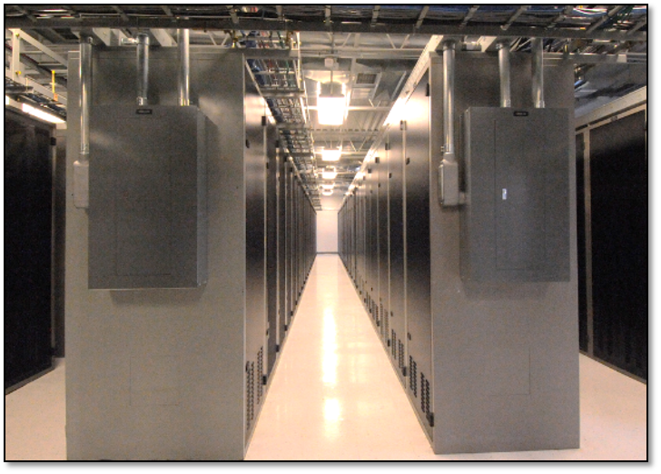
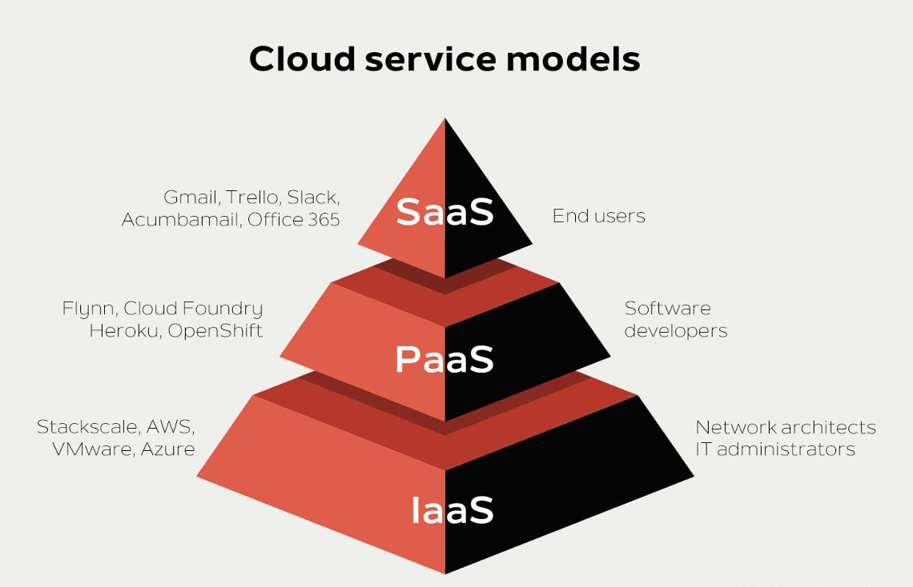
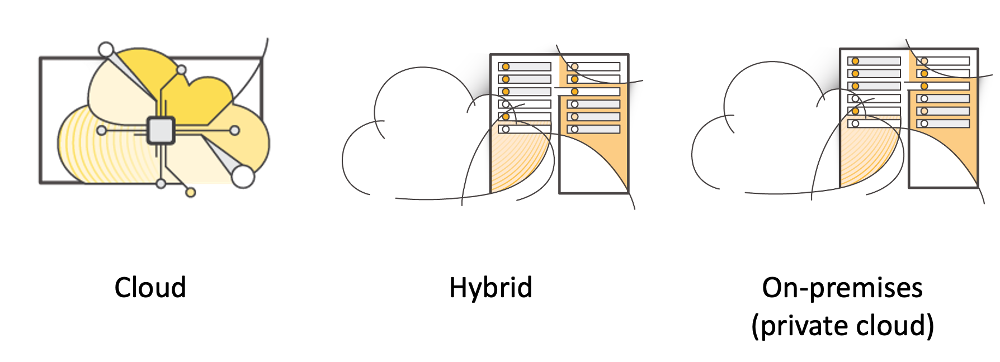
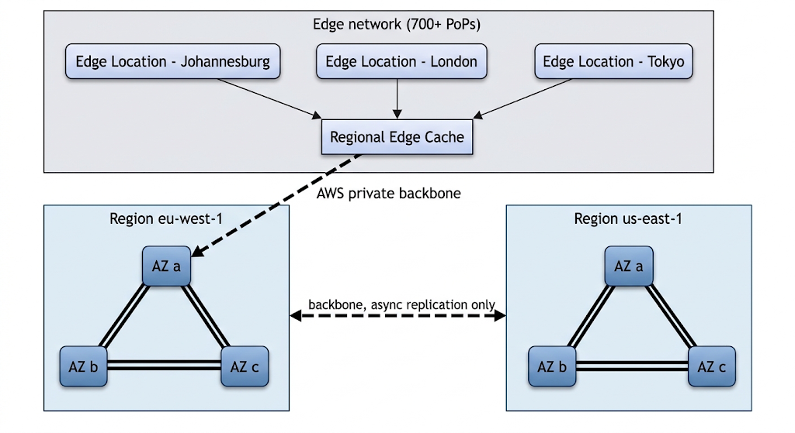
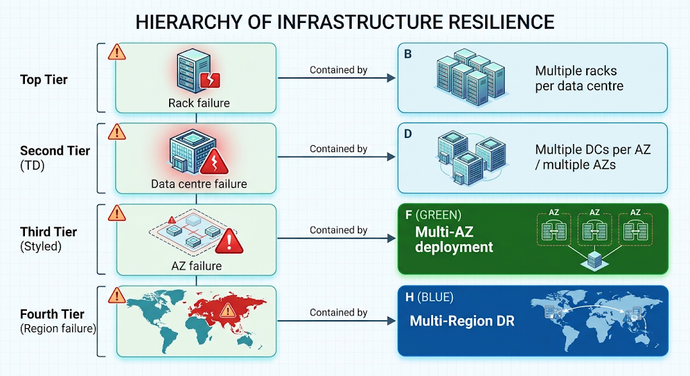
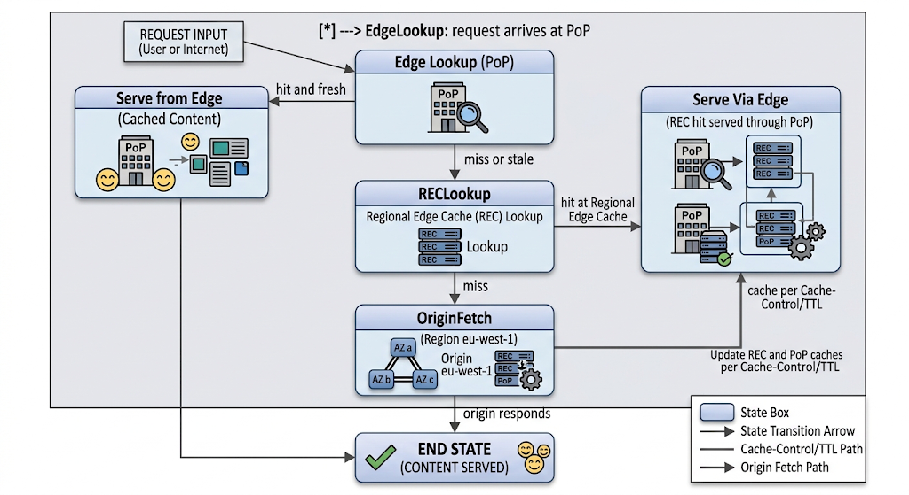
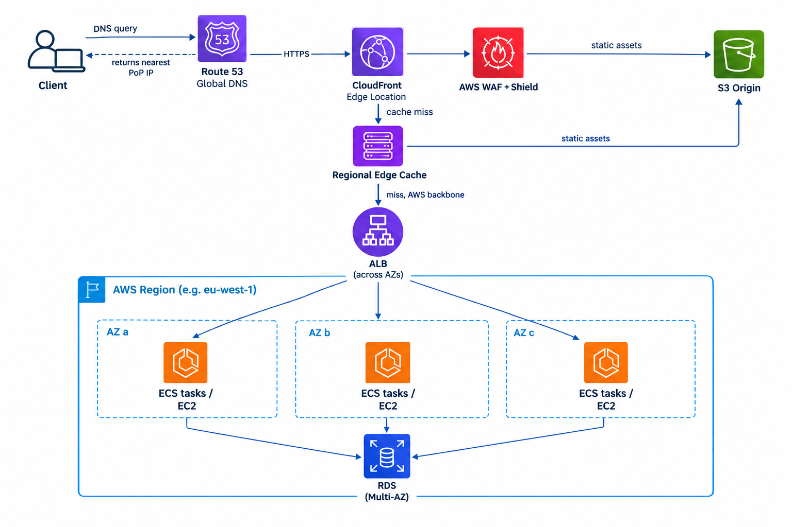
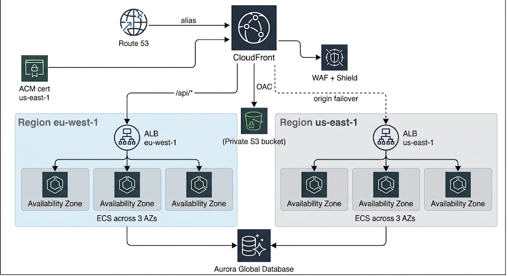
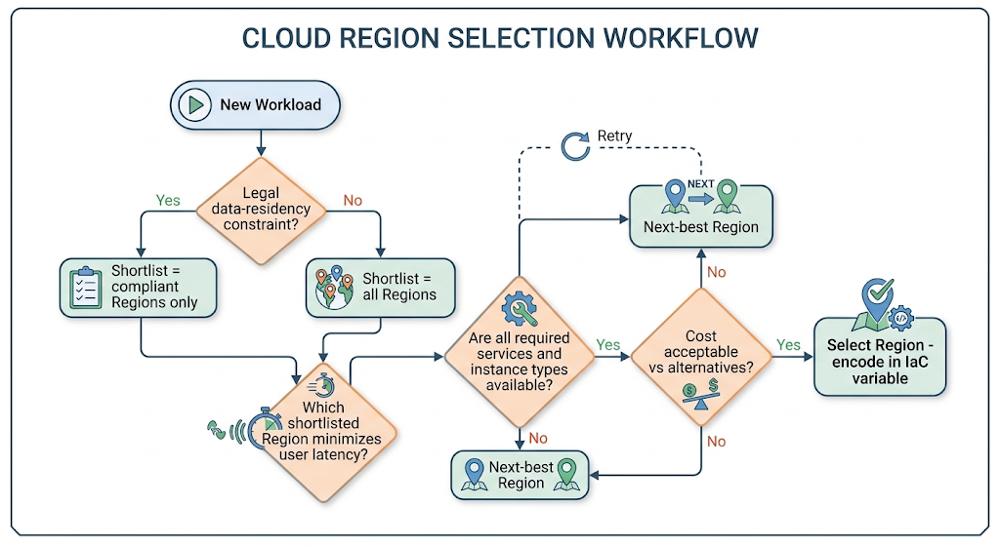

# AWS Cloud overview: Global Infrastructure, Regions and Availability Zones, Edge Locations and CloudFront

## Definition

**Cloud computing** is the on-demand delivery of IT resources (compute, storage, networking, databases and higher-level services) over the Internet with pay-as-you-go pricing. Instead of buying and operating physical servers, an organisation provisions resources programmatically from a provider that runs the physical infrastructure at massive scale.

The key mental shift: stop thinking of infrastructure as **hardware** and start thinking of it as **software**.

<figure markdown="span">
    {width="80%"}
    <figcaption>Physical Server Example</figcaption>
</figure>

## Why This Service or Concept Exists

Before cloud computing, running a production application meant:

1. **Capital expenditure (CapEx).** Buying servers, storage, network gear, power and cooling, often 6 to 12 months before the first user.
2. **Capacity guessing.** Forecasting peak demand years ahead. Over-provisioning wasted money; under-provisioning caused outages at the moment of success.
3. **Single points of failure.** Most companies had one data centre. A fire, flood or fibre cut took the business offline.
4. **Undifferentiated heavy lifting.** Engineers racked servers and replaced disks instead of building features.
5. **Unaffordable global reach.** Low latency on every continent required data centres on every continent.

AWS inverts each problem:

| Traditional approach | AWS approach | Benefit |
|---|---|---|
| Buy hardware up front (CapEx) | Rent capacity per second/hour (OpEx) | No upfront investment; cost tracks usage |
| Forecast capacity years ahead | Elastic scaling on demand | Capacity matches actual load |
| One data centre, one fault domain | Multiple AZs per Region, multiple Regions | Engineered fault isolation |
| Build your own global footprint | 30+ Regions, 100+ AZs, 700+ PoPs already built | Global deployment in minutes |
| Operate power, cooling, physical security | AWS operates the facility layer | Teams focus on applications |

## Cloud Service Models

<figure markdown="span">
    {width="80%"}
    <figcaption>Cloud Service Model</figcaption>
</figure>

Each service model is a different split of responsibility. Moving down the table, you manage less and control less.

| Model | You manage | Provider manages | AWS examples |
|---|---|---|---|
| **IaaS** (Infrastructure as a Service) | OS, runtime, application, data | Hardware, virtualisation, network | Amazon EC2, Amazon VPC, Amazon EBS |
| **PaaS** (Platform as a Service) | Application and data | Everything below the application, including the OS | AWS Elastic Beanstalk, Amazon RDS |
| **FaaS** (Function as a Service) | Function code and its configuration | Servers, OS, runtime, scaling | AWS Lambda |
| **SaaS** (Software as a Service) | Only how you use the product | The entire application | Web-based email, Amazon WorkMail |

- **IaaS** gives the most flexibility and control and is closest to traditional IT.
- **PaaS** removes the need to manage hardware and operating systems so you focus on deploying applications.
- **FaaS** (often called serverless) goes further: you deploy individual functions that run only when triggered. See [1.3 AWS Compute Services](topic3.md).
- **SaaS** is a finished product; you think only about using it.

!!! tip "The trade-off is control versus operational effort"
    No model is "better". IaaS suits workloads that need OS-level control; managed models suit teams that want to spend their time on application code. Cloud-native designs in this module lean towards managed services.

## Cloud Deployment Models

<figure markdown="span">
    {width="80%"}
    <figcaption>Cloud Deployment Model</figcaption>
</figure>

| Model | What it means | Typical reason |
|---|---|---|
| **Cloud** | All parts of the application run in the cloud, either built there or migrated | Gain full elasticity and managed services |
| **Hybrid** | Cloud resources connected to existing on-premises systems | Extend into the cloud gradually while keeping internal systems |
| **On-premises (private cloud)** | Resources in your own data centre using virtualisation and management tools | Dedicated resources or a hard requirement to stay on-site |

On-premises deployment does not provide most cloud benefits; it is often legacy infrastructure with better tooling. See [What is cloud computing?](https://aws.amazon.com/what-is-cloud-computing/) for more.

## What is AWS?

Amazon Web Services (AWS) is a secure cloud platform offering a broad set of global, on-demand services: compute, storage, networking, databases and the tools to manage them. Resources are ready in minutes, can be scaled up or down automatically, and are billed as an operational expense.

AWS services are designed as **building blocks**: you assemble them into a solution and change the assembly as needs change.

!!! info "AWS Stats"

    - $128.7 billion in annual revenue as of 2025
    - About 31% of the global cloud market, making AWS the largest provider
    - 15 consecutive years as market leader
    - More than 1 million active customers worldwide

## AWS Global Infrastructure

The [AWS Global Infrastructure](https://aws.amazon.com/about-aws/global-infrastructure/) is the physical foundation on which every AWS service runs. It has three layers:

| Layer | What it is | Primary purpose |
|---|---|---|
| **Region** | A geographic area containing multiple isolated data-centre clusters | Data residency, service hosting, geographic fault isolation |
| **Availability Zone (AZ)** | One or more discrete data centres in a Region, with independent power, cooling and networking | Fault isolation within a Region; the building block of high availability |
| **Edge Location / Point of Presence (PoP)** | A small facility close to end users | Low-latency content delivery (CloudFront), DNS resolution (Route 53), DDoS absorption |

<figure markdown="span">
    {width="80%"}
    <figcaption>3 layers of Global Infrastructure</figcaption>
    
<i>Image Source: AI Generated (Google Gemini)</i>

</figure>

Every resource you create lives somewhere physically. Choosing the right "where" is one of the first decisions in any cloud design.

!!! info "Fault domains and latency domains"
    Regions, AZs and Edge Locations are not trivia to memorise. They are **fault domains** and **latency domains**. Every availability, disaster-recovery, latency and compliance decision on AWS is a decision about how to place workloads across these three layers.

### Why this structure?

AWS could have offered one flat pool of "servers somewhere". It did not, for three reasons:

| Reason | Problem | How the structure solves it |
|---|---|---|
| **Physics** | Light in fibre adds about 5 microseconds per km; Sydney to Virginia is about 200 ms round trip however fast the server is | Proximity: Regions on every continent, Edge Locations in hundreds of cities |
| **Failure correlation** | Servers in one building share power and cooling; buildings in one city share floods and grid failures | AZs contain local disasters; Regions contain large-scale ones |
| **Law** | GDPR and data-sovereignty laws require data to stay in a jurisdiction | Regions are an explicit, auditable data boundary |

## Core Concepts

### Region

A **Region** is a geographic location where AWS clusters data centres, for example `us-east-1` (N. Virginia), `eu-west-1` (Ireland), `ap-southeast-1` (Singapore).

- Each Region has **multiple AZs** (at least three for modern Regions).
- Regions are **isolated**: a failure in one is designed not to affect any other.
- **Data does not leave a Region** unless you explicitly replicate or move it. This is the foundation of data-residency compliance.
- Each Region has its own service **control planes**, so an API outage in one Region does not block management in another.
- Not every service or instance type exists in every Region. New services usually launch in large Regions first, and smaller Regions can cost more. China and GovCloud Regions require separate accounts.

### Availability Zone (AZ)

An **Availability Zone** is one or more discrete data centres with redundant power, networking and connectivity, in separate facilities within a Region.

- AZs are **physically separated** (typically kilometres to roughly 100 km apart): far enough to avoid sharing most disasters, close enough for **synchronous replication** (round trip generally under 1 to 2 ms).
- Each AZ has **independent power, cooling and physical security**, linked to the other AZs by redundant private fibre.
- AZs are named by appending a letter to the Region code: `us-east-1a`, `us-east-1b`.

!!! warning "AZ names are randomised per account"
    The mapping from an AZ **name** (`us-east-1a`) to a physical zone is shuffled independently for each account, to spread load evenly. Your `us-east-1a` is probably not another account's `us-east-1a`. When zones must be coordinated across accounts, use the **AZ ID** (such as `use1-az4`), which is the same for everyone.

### Fault domain and blast radius

A **fault domain** is a set of resources that share a failure mode: a rack (shared switch), a data centre (shared power), an AZ, a Region. **Blast radius** is the scope of impact when something fails.

AWS architecture in one sentence: *place redundant resources in different fault domains so that any single failure has a bounded blast radius.*

<figure markdown="span">
    {width="80%"}
    <figcaption>Fault domain and Blast Radius</figcaption>
    
<i>Image Source: AI Generated (Google Gemini)</i>

</figure>

### High Availability vs Fault Tolerance vs Disaster Recovery

| Concept | Definition | Typical AWS mechanism |
|---|---|---|
| **High Availability (HA)** | The system stays operational despite component failure, possibly with brief degradation | Multi-AZ deployment behind a load balancer; RDS Multi-AZ failover |
| **Fault Tolerance** | The system keeps operating with **no** user-visible interruption | Active-active redundancy across AZs; S3 replicating every object across at least 3 AZs |
| **Disaster Recovery (DR)** | Recovering service in a **different location** after a large-scale event | Multi-Region: backup and restore, pilot light, warm standby, active-active |

Two metrics drive DR design:

- **RTO** (Recovery Time Objective): how long recovery may take.
- **RPO** (Recovery Point Objective): how much data loss is tolerable.

The DR strategies form a ladder: **backup and restore** (hours of RTO, cheapest) → **pilot light** (data replicated, minimal compute) → **warm standby** (scaled-down full stack) → **active-active** (full stack in two Regions, most expensive). Choose by RTO/RPO and pay accordingly.

!!! note "Durability is not availability"
    **Durability** means data is not lost; **availability** means data is reachable. S3 is designed for 99.999999999% (11 nines) durability through multi-AZ replication. A single EBS volume lives in one AZ and needs snapshots for durability beyond it. See [6.1 AWS Storage Solutions](../unit6/topic1.md).

### Edge Locations and Amazon CloudFront

An **Edge Location** is a small AWS facility in a major city, often inside an Internet exchange point. It hosts edge services: CloudFront caches, Route 53 DNS servers, AWS Shield DDoS protection, AWS WAF and Global Accelerator entry points. There are far more Edge Locations than Regions, because their job is proximity.

| Property | Region / AZ | Edge Location |
|---|---|---|
| Can you launch EC2 or RDS there? | Yes | No |
| Purpose | Run applications and store data | Cache content, terminate connections, resolve DNS |
| Scale | 30+ Regions / 100+ AZs | 700+ PoPs in 100+ cities |
| Services | Nearly all | CloudFront, Route 53, Shield, WAF, Global Accelerator, edge functions |

**Amazon CloudFront** is AWS's **Content Delivery Network (CDN)**. A CDN caches copies of content near users, giving two wins:

1. **Proximity.** A cache hit is served from tens of kilometres away, not thousands.
2. **Offload.** The origin serves each object once per cache lifetime, not once per user.

Key CloudFront terms:

| Term | Meaning |
|---|---|
| **Distribution** | A CloudFront configuration: origins, behaviours and settings |
| **Origin** | Where the real content lives: an S3 bucket, an ALB, API Gateway or any HTTP server |
| **TTL** | How long an object may be served from cache before it is checked again |
| **Cache hit ratio** | Fraction of requests served from cache; the main efficiency measure |
| **Regional Edge Cache** | A larger mid-tier cache between Edge Locations and the origin; an edge miss checks it before going to the origin |
| **Invalidation** | Removing objects from caches before their TTL expires |

<figure markdown="span">
    {width="80%"}
    <figcaption>CloudFront cache decision (per request)</figcaption>
    
<i>Image Source: AI Generated (Google Gemini)</i>

</figure>

Even uncached, dynamic requests benefit: CloudFront terminates TLS near the user and carries traffic to the origin over the **AWS private backbone** instead of the public Internet.

!!! warning "CloudFront vs Global Accelerator"
    Both use the edge network. **CloudFront** is an HTTP cache. **Global Accelerator** gives static anycast IP addresses and routes TCP/UDP traffic over the backbone with **no caching**, which suits non-HTTP workloads such as game servers.

DNS is how users find the edge: **Route 53** resolves your domain to the CloudFront distribution. Route 53 itself, including routing policies and health checks, is covered in [1.6 AWS Network Services](topic6.md).

### Extensions of the Region model

| Extension | What it is | Use case |
|---|---|---|
| **Local Zones** | Single-zone extensions of a Region in additional metros (for example, Los Angeles for `us-west-2`) | Single-digit-millisecond latency to users in that city |
| **Wavelength Zones** | AWS infrastructure embedded in 5G telecom networks | Ultra-low latency for mobile devices |
| **AWS Outposts** | AWS-managed racks installed in your data centre | Workloads that must stay on-site but want AWS APIs |
| **GovCloud / sovereign Regions** | Regions with extra legal and personnel restrictions | Government and regulated workloads |

### Global, Regional and Zonal services

| Scope | Examples | Implication |
|---|---|---|
| **Global** | IAM, Route 53, CloudFront | One logical instance for the whole account; no Region choice |
| **Regional** | S3 buckets, DynamoDB, SQS, Lambda, VPC, ALB | You choose the Region; the service spans multiple AZs internally |
| **Zonal** | EC2 instances, EBS volumes, subnets | Bound to one AZ; **you** are responsible for multi-AZ redundancy |

!!! tip "Architect's rule of thumb"
    Regional managed services (S3, DynamoDB, SQS, Lambda) give you multi-AZ resilience automatically. Zonal building blocks (EC2, EBS) make multi-AZ **your** job. This is one of the strongest arguments for managed, cloud-native architectures, and it recurs throughout DSO303.

!!! note "Global name, Regional home"
    S3 bucket **names** are globally unique, but each bucket **lives** in one Region.

## How the Layers Fit Together

A typical production web request passes through all three layers:

| Step | Component | Layer | Role |
|---|---|---|---|
| 1 | Route 53 | Edge (global) | Resolves the domain to CloudFront |
| 2 | CloudFront + WAF + Shield | Edge (global) | Terminates TLS, serves cached content, filters attacks |
| 3 | Application Load Balancer | Regional, multi-AZ | Spreads requests across healthy targets in several AZs |
| 4 | Compute (EC2, ECS, EKS, Lambda) | Zonal or Regional | Runs the application |
| 5 | S3, RDS, DynamoDB | Regional | Stores data, replicated across AZs |

The services in steps 3 to 5 are introduced in [1.3](topic3.md), [1.4](topic4.md), [1.5](topic5.md) and [1.6](topic6.md).

<figure markdown="span">
    {width="80%"}
    <figcaption>Architectural Components of Global Infra</figcaption>
    
<i>Image Source: AI Generated (ChatGPT)</i>

</figure>

<figure markdown="span">
    {width="80%"}
    <figcaption>Example: Integrating Different Services</figcaption>
</figure>

## Design Considerations

### Choosing a Region

Criteria, in the order most organisations apply them:

1. **Compliance and data residency.** A legal constraint overrides everything else.
2. **Latency to users.** Pick the Region closest to your users; measure, do not assume.
3. **Service availability.** Confirm every service and instance type you need exists there.
4. **Cost.** Identical resources can differ noticeably in price between Regions.
5. **Sustainability** and proximity to partners or on-premises sites.

<figure markdown="span">
    {width="80%"}
    <figcaption>Region Selection Work Flow</figcaption>
    
<i>Image Source: AI Generated (Google Gemini)</i>

</figure>

### Using AZs

- VPC **subnets** are created per AZ. Load balancers, Auto Scaling groups, ECS services and EKS node groups take a **list of subnets**: that list is your AZ spread.
- Use **at least two AZs** for HA; **three is preferred**. Losing one of three AZs removes only about a third of capacity and leaves a majority for clustered systems.
- **Availability is limited by the weakest link.** A multi-AZ application tied to a single-AZ database inherits the database's availability.
- Design for **static stability**: run enough spare capacity in every AZ that a failure needs no new launches or control-plane actions to recover.

### Latency anchors

| Path | Typical latency |
|---|---|
| Within one AZ | Under 1 ms |
| Between AZs in a Region | About 1 to 2 ms |
| User to nearest Edge Location | About 5 to 30 ms |
| Between Regions / user to a remote Region | Tens to hundreds of ms |

These numbers explain why synchronous replication stops at the Region boundary, and why CloudFront exists.

### Single-AZ, multi-AZ or multi-Region?

| Option | When to use | Cost of the choice |
|---|---|---|
| Single-AZ | Development and test only | One AZ event takes the system down |
| **Multi-AZ** | **The production default** | Small cross-AZ data-transfer charges |
| Multi-Region | Only when RTO/RPO, global latency or regulation demands it | Can double infrastructure cost; multiplies pipelines, monitoring and data-consistency questions |

!!! danger "The single-AZ production system"
    Running production in one AZ to avoid cross-AZ transfer charges is a classic false economy. AZ-level events happen every year somewhere. Multi-AZ is the non-negotiable production baseline in this module.

## Operating It: Security, Performance, Cost and Monitoring

**Security**

- Treat Regions as **compliance boundaries**. Organisations can block resource creation outside approved Regions using the `aws:RequestedRegion` condition key in a Service Control Policy (see [8.1](../unit8/topic1.md)).
- **KMS keys are Regional**: data encrypted in one Region needs a key strategy to be readable in another (see [8.3](../unit8/topic3.md)).
- The ACM certificate used by CloudFront must be requested in **`us-east-1`**.
- Edge services absorb attacks before they reach your Region: **Shield Standard** is automatic and free on CloudFront and Route 53; **WAF** filters web attacks at the edge (see [8.2](../unit8/topic2.md)).
- Keep origins private: with **Origin Access Control (OAC)**, an S3 bucket stays private while CloudFront serves it globally.

**Performance**

- Serve users from the edge; choose Regions by measured latency.
- Use **versioned file names** (`app.3f9a1c.js`) with long TTLs instead of frequent invalidations.
- Put in the cache key **only** what changes the response. Forwarding all cookies or query strings fragments the cache and destroys the hit ratio.

**Cost: placement drives the bill**

| Traffic | Billed? |
|---|---|
| Data transfer **in** from the Internet | Free |
| Data transfer **out** to the Internet | Billed per GB |
| Between AZs | Billed (about $0.01/GB each direction) |
| Between Regions | Billed at higher rates |
| From AWS origins (S3, ALB) to CloudFront | Free |

Because origin fetches are free, a high cache hit ratio can make CloudFront **cheaper** than serving directly from the Region while also being faster. Chatty microservices spread across AZs pay cross-AZ charges constantly. Use **price classes** to exclude expensive edge geographies if your users are local.

**Monitoring**

- Global services such as CloudFront publish CloudWatch metrics to **`us-east-1`**.
- Compare metrics **per AZ**: one AZ diverging from the others is the classic early sign of a zonal problem. Averages hide it.
- Enable CloudTrail in **all** Regions to catch activity in Regions you do not use.
- The **AWS Health Dashboard** shows when a Region, AZ or edge service is impaired. Observability in depth is covered in [Unit 7](../unit7/topic1.md).

## Industry Use Cases

| Sector | Use of Regions, AZs and the edge |
|---|---|
| Media and streaming | Nearly all bytes delivered from edge caches; live-event spikes absorbed at the edge |
| E-commerce | Multi-AZ storefronts; CloudFront for catalogue images; Route 53 failover |
| Banking and fintech | In-country Region for residency; Multi-AZ databases; warm-standby second Region for regulator-mandated DR |
| Gaming | Regions per continent for game servers; Global Accelerator for UDP; CloudFront for large patch downloads |
| Government | GovCloud and sovereign Regions; strict Region allowlists |
| Healthcare | Residency-driven Region choice; Multi-AZ patient-record systems |
| IoT and automotive | Regional analytics; Wavelength for vehicle-to-cloud latency |

## Advantages and Limitations

| Advantages | Limitations |
|---|---|
| **Engineered fault isolation**: HA becomes a configuration choice (a list of subnets), not a construction project | **The speed of light is fixed**: multi-Region synchronous consistency is impractical, so multi-Region data accepts either replication lag (RPO above zero) or slow writes |
| **Global reach in minutes** with the same template in any Region | **Regions are not equal**: services, instance types and prices vary; a Region choice is hard to reverse once data accumulates |
| **Elasticity** without a capacity gamble | **Cross-boundary traffic costs money**: resilience has a per-gigabyte price |
| **Compliance as configuration**: Region choice plus enforcement, with an audit trail | **Quotas are Regional**: a DR Region with default quotas can fail exactly when needed |
| **Latency solved at two scales**: Regions for continents, the edge for the last mile | **Caching adds consistency problems**: stale content, invalidation cost, personalised content caches poorly |
| **Attacks absorbed at the edge** before they reach your Regional resources | **Operational multiplication**: each extra Region multiplies pipelines, dashboards and on-call load |

## Common Mistakes

### Beginner Mistakes

| Mistake | Why it is wrong | Do instead |
|---|---|---|
| Deploying everything into one AZ or subnet | One AZ event takes everything down | Spread across at least two, ideally three AZs |
| Assuming `us-east-1a` is the same zone in every account | AZ names are shuffled per account | Use AZ IDs across accounts |
| "CloudFront caches content in AZs" | Caches live in Edge Locations, not AZs | Keep the three layers distinct |
| Believing data replicates between Regions automatically | It never does without explicit configuration | Configure cross-Region replication deliberately |
| Hard-coding a Region in code or templates | Blocks multi-Region deployment later | Make the Region a parameter |
| Making an S3 bucket public "so CloudFront works" | Exposes the data directly | Use Origin Access Control |
| Requesting the CloudFront certificate in the wrong Region | CloudFront only uses ACM certificates from `us-east-1` | Request it in `us-east-1` |

### Production Mistakes

| Mistake | Consequence | Remedy |
|---|---|---|
| Multi-AZ compute with a single-AZ database or single NAT gateway | Hidden zonal single point of failure | Make every tier multi-AZ |
| Forwarding all cookies and headers to the origin | Hit ratio collapses; "CloudFront does not help" | Minimal cache key |
| Recovery that depends on launching new resources | Fails when the control plane is impaired | Static stability: spare capacity already running |
| Never testing AZ or Region failover | DR exists only in a diagram | Regular failure drills |
| Leaving default quotas in the DR Region | Failover cannot scale | Raise quotas in advance |

## Summary

The AWS global infrastructure is a three-layer answer to three permanent problems: **Regions** answer law and geography, **Availability Zones** answer failure, and **Edge Locations with CloudFront** answer the speed of light.

| Area | Key lesson |
|---|---|
| **Service and deployment models** | IaaS → PaaS → FaaS → SaaS trades control for less operational work; cloud, hybrid and on-premises describe where it runs |
| **Regions** | Isolated geographic areas; data stays in a Region unless you move it; choose by compliance, latency, services, cost |
| **Availability Zones** | Separate data centres close enough for synchronous replication; multi-AZ is the production baseline |
| **Edge and CloudFront** | Edge Locations cache and terminate connections near users; they cannot run EC2 |
| **HA, fault tolerance, DR** | HA survives with brief degradation, fault tolerance with none; DR recovers elsewhere, sized by RTO and RPO |
| **Service scope** | Global, Regional and Zonal; Regional managed services give multi-AZ for free, Zonal ones make it your job |
| **Cost** | Placement drives cost: egress, cross-AZ and cross-Region traffic are billed; CloudFront can reduce egress cost |

**Next:** with the physical foundation in place, [1.2 AWS IAM](topic2.md) explains who is allowed to do what on it.

!!! question "Practice and interview questions"
    Questions for this topic are kept separately: [Practice questions](../Questions/unit1.md#11-aws-cloud-overview) · [Interview questions](../interviewquestions/unit1.md#11-aws-cloud-overview).
