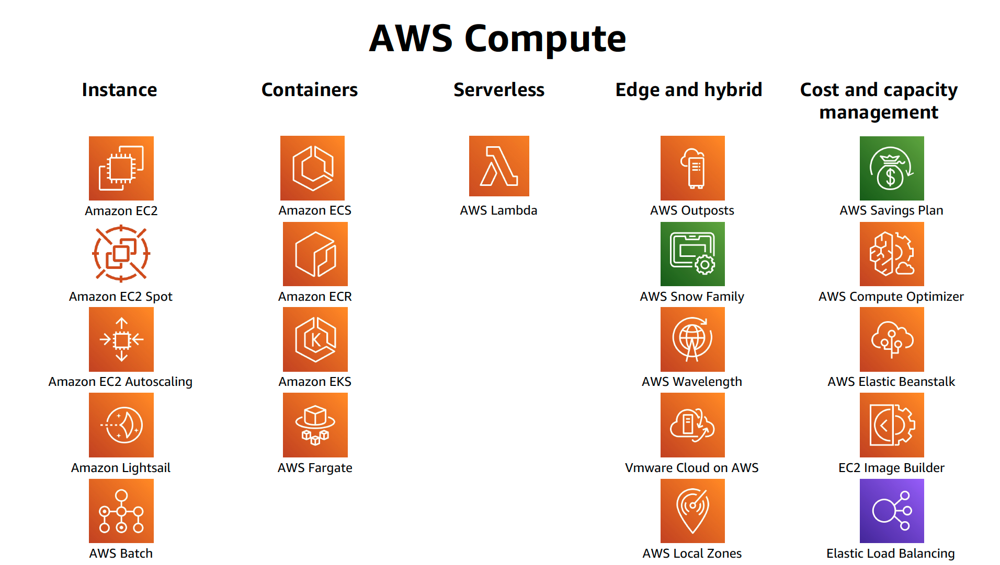
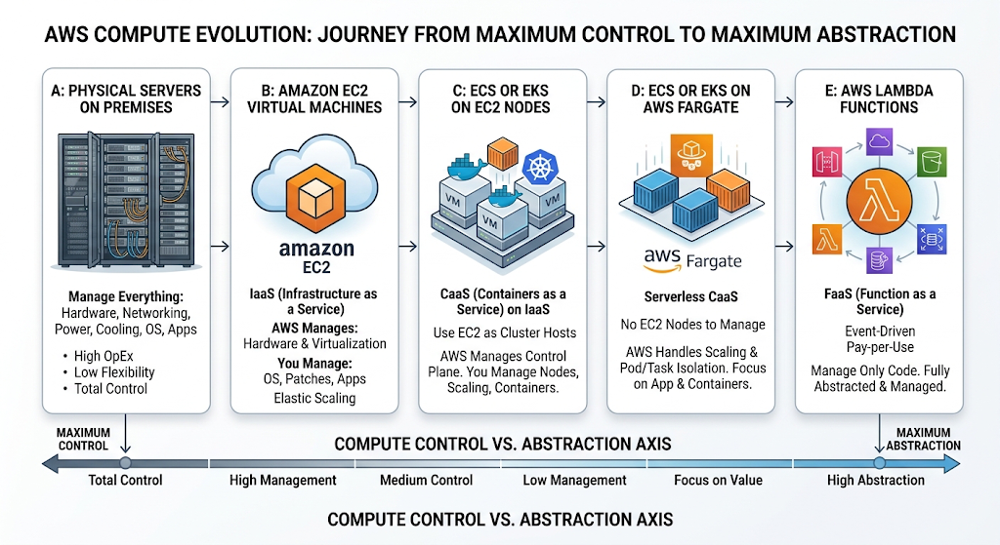
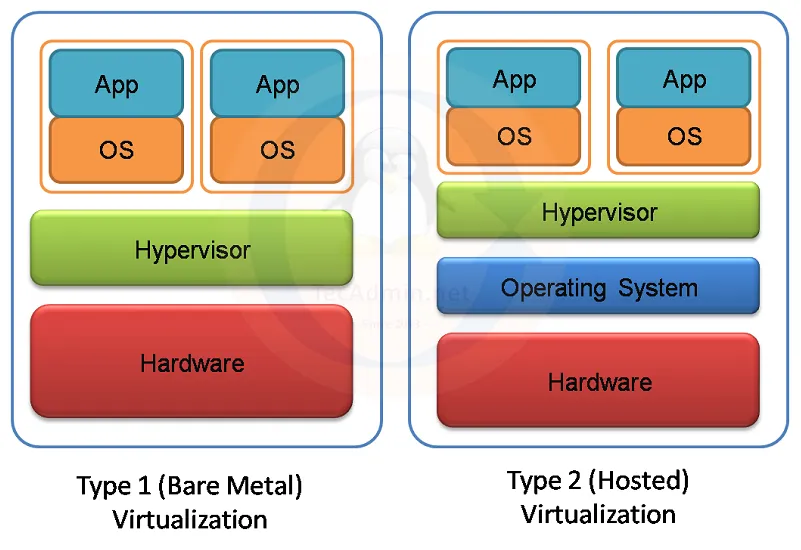
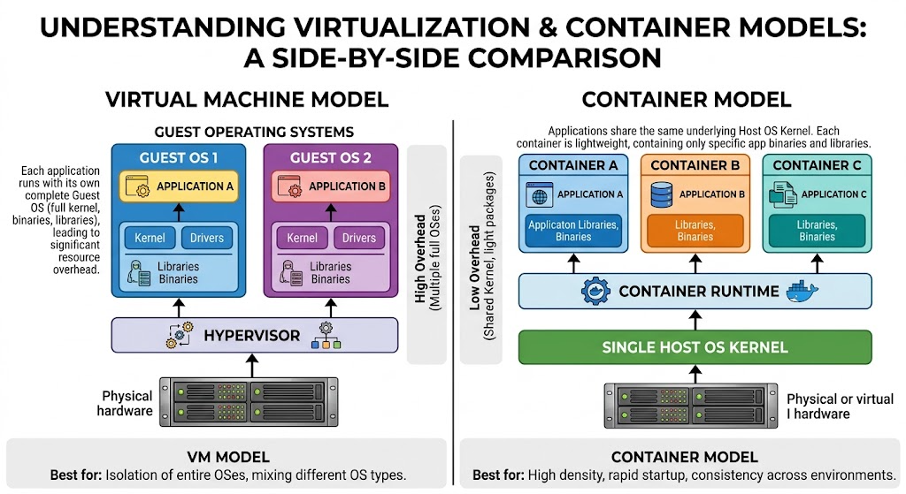
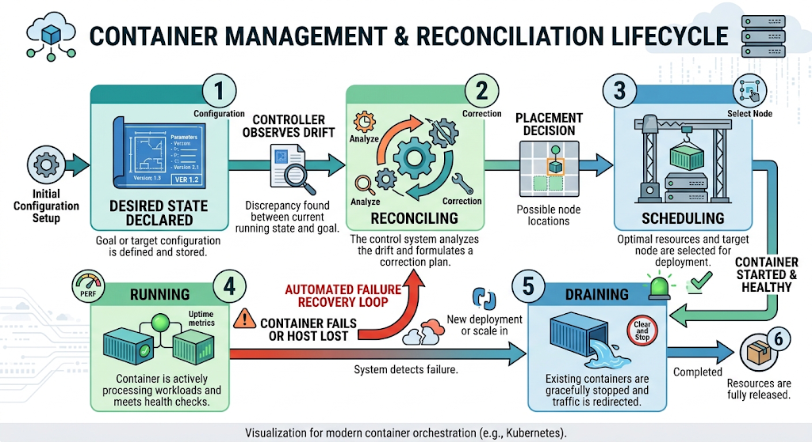
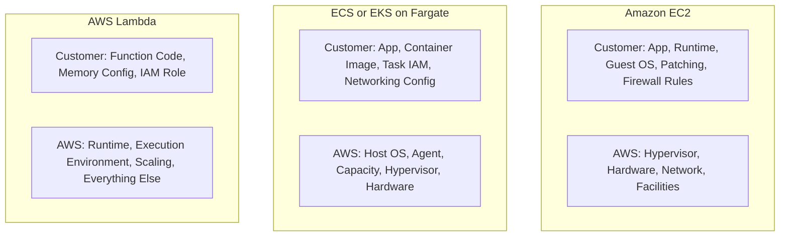
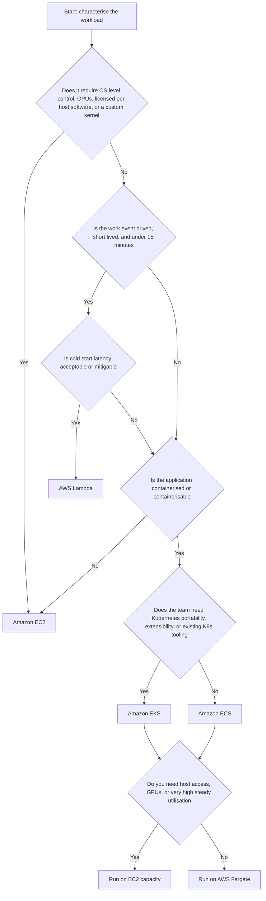
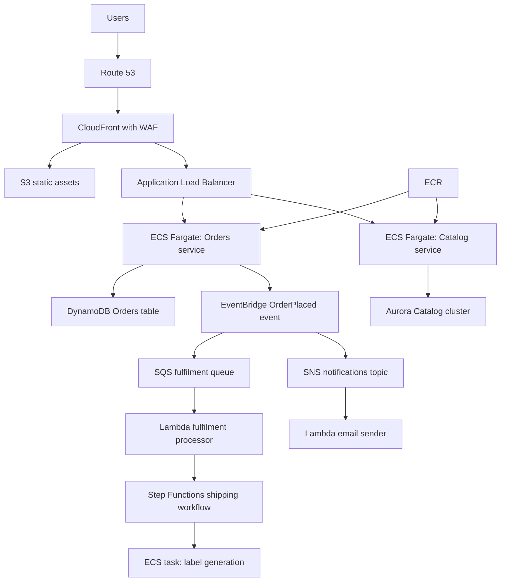

<!-- teachprep:refined 2026-10-11 -->
# Compute Services on AWS  EC2, ECS, EKS, Lambda and Fargate

## Definition

**Compute** services run your application code. They provide CPU, memory and an execution context for a process. Storage services hold data at rest, networking services move it, and compute services transform it.

<figure markdown="span">
    {width="80%"}
    <figcaption>AWS Compute Services</figcaption>
    
<i>Image Source: AI generated</i>

</figure>

AWS offers compute at several **levels of abstraction**. The higher the abstraction, the more of the stack AWS manages, and the less control you keep.

| Service | Model | Unit of deployment | AWS manages | You manage |
|---|---|---|---|---|
| **Amazon EC2** | Infrastructure as a Service (IaaS) | Virtual machine instance | Hosts, hypervisor, network, hardware failure | Guest OS, patching, runtime, application, scaling, capacity |
| **Amazon ECS on EC2** | Containers as a Service | Task (one or more containers) | Orchestration control plane, scheduling | Container image, EC2 host fleet, host patching, capacity |
| **ECS or EKS on Fargate** | Serverless containers | Task or Pod | Everything below the container: host, OS, agent, capacity | Container image, task sizing, IAM, network settings |
| **Amazon EKS** | Managed Kubernetes | Pod | Kubernetes control plane, `etcd`, control plane upgrades | Worker nodes (or Fargate profiles), add-ons, manifests, upgrades |
| **AWS Lambda** | Function as a Service (FaaS) | Function invocation | Everything except your code and configuration | Handler code, memory, IAM role, event sources |

!!! note "The key idea of this topic"
    You are not choosing the "best" or "most modern" service. You are choosing **how much of the operational stack you want to own**, and accepting the constraints that come with handing the rest to AWS.

### The compute spectrum

<figure markdown="span">
    {width="80%"}
    <figcaption>Level of Control in AWS</figcaption>
    
<i>Image Source: AI Generated (Google Gemini)</i>

</figure>

Moving from EC2 towards Lambda:

- **Operational burden falls.** First you stop patching kernels, then you stop managing hosts, then you stop thinking about servers.
- **Billing gets finer.** Per-second instances, then per-second tasks, then per-millisecond invocations.
- **Constraints tighten.** Lambda has a maximum duration, a package size limit and a stateless model. EC2 has none of these.
- **Portability changes.** Container images run on any cloud. Lambda business logic ports, but its event wiring does not.

## Why This Service or Concept Exists

### The problem before cloud compute

| Traditional data centre | AWS compute |
|---|---|
| Capacity bought before demand was known; utilisation often 10–20 percent | Pay for what you use; scale with real demand |
| Provisioning took weeks | Seconds to minutes through an API |
| Capital expenditure, approval for every experiment | Operating expenditure; terminate when finished |
| Manual configuration and hardware repair | Automatic replacement by an Auto Scaling group |
| No way to scale down: you cannot un-buy a server | Scale in as easily as out |

### How AWS compute evolved

Each service solved a problem the previous one left open.

| Service (year) | Problem it solved | What it left open |
|---|---|---|
| **EC2** (2006) | Virtual machines through an API in minutes, pay as you go. Made **elasticity** possible | You still patch an OS and deploy onto each machine |
| **Containers** | Packaging: one immutable image runs the same everywhere | **Placement**: which host runs which container, and what happens when a host dies |
| **ECS** (2014) | AWS-native orchestration, integrated with IAM, ELB and CloudWatch | You still run the EC2 hosts |
| **Lambda** (2014) | Run a function on demand, scale from zero, pay per millisecond | Short, stateless work only |
| **Fargate** (2017) | Containers with no EC2 instances to manage | Higher unit price; fewer host features |
| **EKS** (2018) | Managed **Kubernetes**, the open-source standard, for portability and ecosystem | Kubernetes complexity |

!!! tip "The evolution is additive, not a replacement"
    Lambda did not replace EC2, and EKS did not replace ECS. Mature AWS estates run all of them, each for the workload it fits: EC2 for a licensed legacy database, Kubernetes for a microservice platform, Lambda for event glue.

## Core Concepts

### Virtualisation and multi-tenancy

A **hypervisor** partitions one physical server into isolated virtual machines (VMs). Each VM believes it has its own CPU, memory, disks and network. The hypervisor stops one tenant reading another's memory. On AWS, the **Nitro System** moves most of this work onto dedicated hardware.

<figure markdown="span">
    {width="80%"}
    <figcaption>Types of Hypervisor</figcaption>
    
<i>Image Source: <a href="https://tecadmin.net/" target="_blank" rel="noopener">TecAdmin</a></i>

</figure>

**Multi-tenancy** means many customers share physical hardware. It is what makes cloud economics work. EC2 tenancy is **shared** by default; **Dedicated Instances** keep your hardware free of other accounts, and **Dedicated Hosts** give you a specific physical server with visible sockets and cores, which matters for per-socket licensing.

### Containers versus virtual machines

<figure markdown="span">
    {width="80%"}
    <figcaption>Virtual Machine Model Versus Container Model</figcaption>
    
<i>Image Source: AI generated (Google Gemini)</i>

</figure>

A **container** isolates a process at the operating-system level. It has no kernel of its own. Linux **namespaces** give it its own view of processes, network and filesystem; **cgroups** limit its CPU and memory.

| Property | Virtual machine | Container |
|---|---|---|
| Isolation boundary | Separate kernel, hardware-virtualised | Shared kernel, namespaces |
| Start time | Tens of seconds to minutes | Milliseconds to seconds |
| Image size | Gigabytes | Tens to hundreds of megabytes |
| Density per host | Tens | Hundreds |
| Isolation strength | Very strong | Strong, but the shared kernel is a shared attack surface |
| Typical use | Full OS environments, legacy software | Microservices, stateless processes |

!!! warning "A container is not as strong a boundary as a VM"
    A kernel vulnerability can, in principle, allow container escape. This is why Fargate and Lambda place each task or execution environment in its own lightweight VM (a **Firecracker microVM**) rather than sharing a kernel between customers.

A **container image** is immutable: the image tested in staging is exactly the image running in production, and rollback means redeploying an earlier tag. Images are stored in **Amazon ECR**. Images, Dockerfiles and ECR are covered in [2.1 Docker and Amazon ECR](../unit2/topic1.md).

### Orchestration

**Orchestration** is the automated management of containers across a fleet of hosts. An orchestrator:

- **schedules** containers onto hosts with enough CPU and memory;
- **reconciles** actual state with desired state, replacing failed containers;
- **registers** containers with load balancers and service discovery;
- **rolls out** new versions without downtime.

The model is **declarative**. You do not say "start three containers"; you declare "desired count is three", and a control loop keeps it true, even after failures you never see.

<figure markdown="span">
    {width="80%"}
    <figcaption>Container Orchestration Lifecycle</figcaption>
    
<i>Image Source: AI generated (Google Gemini)</i>

</figure>

### Serverless

**Serverless** does not mean there are no servers. It means four things are true at once:

1. You do not provision or manage servers.
2. Scaling is automatic, including **scaling to zero**.
3. You pay for use, with no charge when idle.
4. Availability across Availability Zones (AZs) is built in.

Lambda meets all four. Fargate meets the first, the fourth and most of the second, but an idle Fargate task still bills. That is why Fargate is called "serverless containers" rather than fully serverless.

### Statelessness

A **stateless** compute node holds nothing that would matter if it were lost. Sessions, uploads and caches live in external services such as DynamoDB, ElastiCache, S3 or RDS ([1.4](topic4.md), [1.5](topic5.md)).

Statelessness is what makes elasticity possible. If any instance can be terminated at any moment without data loss, the platform is free to replace instances for scaling, patching, Spot reclamation or failure recovery.

!!! example "The classic statefulness bug"
    A team keeps user sessions in each EC2 instance's memory and enables sticky sessions on the load balancer. It works until an instance is replaced during a deployment, and those users are logged out mid-checkout. The fix is not more stickiness; it is moving session state to ElastiCache or DynamoDB.

### Scalability, elasticity and availability

These terms are often confused.

| Term | Meaning | Mechanism on AWS |
|---|---|---|
| **Scalability** | Handling more load by adding resources | More instances, tasks, Pods or concurrent executions |
| **Elasticity** | Scaling **out and back in** automatically with demand | Auto Scaling groups, ECS service auto scaling, Kubernetes HPA, Lambda concurrency |
| **High availability** | Continuing to operate when a component fails | Multi-AZ deployment, health checks, redundancy |
| **Fault tolerance** | Continuing with **no degradation** when a component fails | Spare capacity (N+1), retries, idempotency |

**Vertical scaling** (a bigger instance) has a ceiling and needs a restart. **Horizontal scaling** (more instances) is the cloud-native default. Use vertical scaling only where work cannot be split, such as a single-writer relational database.

### Shared responsibility for compute

AWS is responsible for security **of** the cloud; you are responsible for security **in** the cloud. Where the line falls is exactly what separates the compute services.

## AWS Service Deep Dive

!!! warning "On numbers and quotas"
    Many limits below are **soft quotas** that can be raised through Service Quotas, and some vary by Region. Treat them as design signals and check the current documentation and the AWS Pricing Calculator before committing to a design.

### Amazon EC2

EC2 provides resizable virtual machines with full control of the operating system. Anything that runs on a physical server can run on EC2: legacy software, licensed products, custom kernels, GPU workloads.

#### What an instance is made of

An instance is launched from an **AMI** (Amazon Machine Image: the root volume template) with an **instance type** (a fixed vCPU, memory and network combination, for example `m7g.large`). It connects to a subnet through an **ENI** with security groups, stores data on persistent **EBS** volumes or fast but temporary **instance store** disks (lost on stop or termination), receives an IAM role through an **instance profile**, and can run a **user data** script at first boot.

**Instance families.** Match the hardware to the workload rather than over-buying one dimension.

| Family | Letters | Optimised for | Example workload |
|---|---|---|---|
| General purpose | M, T | Balanced CPU and memory | Web servers, small databases |
| Compute optimised | C | High CPU per GB | Batch processing, encoding, game servers |
| Memory optimised | R, X | High memory per vCPU | Databases, in-memory caches |
| Storage optimised | I, D | Fast local disk | High-I/O databases, data warehousing |
| Accelerated | P, G, Inf, Trn | GPUs and ML chips | Machine learning, graphics |

A `g` in the name (for example `m7g`) means **Graviton**, AWS's ARM processor. It usually gives better price-performance but needs **arm64** builds. **T instances** use CPU credits: sustained load exhausts them and the instance is throttled to its baseline, a classic cause of "it worked in testing" latency.

#### Purchasing options

| Option | How it works | Best for |
|---|---|---|
| **On-Demand** | Pay per second, no commitment | Unpredictable load, development, spikes |
| **Savings Plans** | Commit to a dollar-per-hour spend for one or three years; discounts commonly 30–70 percent. **Compute Savings Plans** also cover Fargate and Lambda | Steady baseline load |
| **Reserved Instances** | Commit to a specific instance configuration for one or three years | Long-lived, unchanging workloads |
| **Spot Instances** | Spare capacity at discounts often 70–90 percent; reclaimed with a **two-minute notice** | Fault-tolerant, interruptible work: batch, CI runners |
| **Dedicated Hosts / Instances** | Hardware isolation | Regulation or per-socket licensing |
| **Capacity Reservations** | Reserve capacity in one AZ, no term commitment | A known event or disaster recovery |

**Auto Scaling basics.** An **Auto Scaling group (ASG)** keeps a desired number of instances running across AZs, replaces unhealthy ones, and scales using a **launch template**.

- **Target tracking** keeps a metric at a target, like a thermostat (for example, 50 percent average CPU).
- **Scheduled** and **predictive** scaling handle known daily patterns.
- The **warm-up period** excludes booting instances from metrics; the **cooldown** prevents oscillation.
- Set the health check type to **`ELB`** so an instance failing the application health check is replaced, not just one failing EC2 status checks.

**Availability.** An instance lives in one AZ. Availability comes from an ASG across several AZs behind a load balancer ([1.6](topic6.md)).

!!! tip "When EC2 is the right answer"
    Choose EC2 when you need OS-level control, host-licensed software, a custom kernel, GPUs, or long-running steady load that suits Savings Plans, or when you are lifting and shifting an existing application before modernising it.

### Amazon ECS

**Amazon Elastic Container Service (ECS)** is AWS's own container orchestrator. Its control plane is fully managed and has **no charge**; you pay only for the capacity your tasks use.

A **task definition** is a versioned blueprint (images, CPU and memory, ports, secrets, IAM roles). A **task** is a running copy of it. A **service** keeps a desired number of tasks running behind a load balancer. A **cluster** groups services and capacity, and a **capacity provider** says where tasks run: an Auto Scaling group, `FARGATE` or `FARGATE_SPOT`.

Two points to remember now:

- **Two IAM roles per task.** The **task execution role** lets ECS pull images, write logs and fetch secrets. The **task role** is what your application code uses.
- **Two scaling layers on EC2, one on Fargate.** Service auto scaling changes the task count; on EC2 capacity, the instance count must scale as well.

Full treatment: [2.2 Amazon ECS](../unit2/topic2.md#amazon-ecs) (clusters, networking, IAM roles) and [2.3 Container Orchestration with Amazon ECS](../unit2/topic3.md#the-two-scaling-layers-revisited) (placement, scaling, deployments).

### Amazon EKS

**Amazon Elastic Kubernetes Service (EKS)** runs standard Kubernetes on AWS. AWS operates the control plane (API server and `etcd`) across at least three AZs; you choose the data plane: managed node groups, self-managed nodes, Fargate profiles, Karpenter or EKS Auto Mode.

- **Pricing.** An hourly fee **per cluster**, plus the EC2 or Fargate capacity you use. ECS has no such fee.
- **Upgrades are mandatory and recurring.** Each Kubernetes version has a limited standard support window; extended support costs more.
- **Three scaling layers.** Pods horizontally (**HPA**), Pods vertically (**VPA**), and nodes (**Cluster Autoscaler** or **Karpenter**).
- **Why choose it.** The Kubernetes ecosystem (Helm, operators, service meshes) and portability across clouds.

Full treatment: [3.1 Amazon EKS Architecture](../unit3/topic1.md#the-eks-control-plane), [3.2 Deploying Applications on Amazon EKS](../unit3/topic2.md) and [3.3 Amazon EKS Advanced Concepts](../unit3/topic3.md#eks-managed-node-groups).

### AWS Lambda

Lambda runs code in response to events, with no servers or capacity to manage. It scales automatically from zero and charges only for the time your code runs.

A **function** is your code (a ZIP package, or a container image up to 10 GB), a **runtime** (managed Node.js, Python, Java, .NET or Ruby, or a custom runtime), a **handler** entry point, a **memory** setting from 128 MB to 10,240 MB (**CPU is allocated in proportion to memory**), a **timeout** of up to 15 minutes, and an **execution role**. Layers, environment variables, VPC attachment and `/tmp` storage (512 MB to 10,240 MB) are optional.

**How invocation works.** Each request runs in an **execution environment** (a Firecracker microVM) that handles **one request at a time**. If a warm environment is free, the request reuses it. If not, Lambda creates a new one: a **cold start**, which must load the code and run initialisation before the handler. Cold starts range from about 100–300 ms for a small interpreted function to several seconds for large JVM or .NET applications.

#### Important features

| Feature | Purpose |
|---|---|
| **Versions and aliases** | Immutable versions; aliases point to them and can split traffic for canary releases |
| **Reserved concurrency** | **Caps and guarantees** a function's concurrency; protects other functions and downstream databases. Setting it to zero is an emergency stop |
| **Provisioned concurrency** | **Pre-warms** environments to remove cold starts, at extra cost |
| **SnapStart** | Restores a snapshot of an initialised environment to cut cold starts (for example, Java) |
| **Event source mappings** | Lambda polls SQS, Kinesis or DynamoDB Streams and invokes the function with batches |
| **Destinations and DLQs** | Route failed asynchronous events somewhere visible instead of losing them |

#### Limits that decide whether Lambda fits

| Limit | Value | Design implication |
|---|---|---|
| Maximum duration | 15 minutes (hard) | Longer jobs go to Fargate, AWS Batch or Step Functions |
| Memory | 128 MB to 10,240 MB | About one vCPU near 1,769 MB, up to about six at maximum |
| Package size | 50 MB zipped upload, 250 MB unzipped with layers, 10 GB as an image | Large models need the image path or EFS |
| Payload | 6 MB synchronous, 1 MB asynchronous (hard) | Store large data in S3 and pass a reference |
| Concurrency | 1,000 per account per Region by default (soft) | Raise it before a launch; it is shared by all functions |
| Environment variables | 4 KB total | Larger configuration goes in Parameter Store or Secrets Manager |
| State | No guaranteed environment reuse | Never rely on memory surviving between invocations |

**Pricing.** You pay for **requests** and **GB-seconds** (memory multiplied by duration), plus provisioned concurrency if used. `arm64` is cheaper per GB-second. Watch the surrounding costs: API Gateway requests, CloudWatch Logs, and NAT for VPC-attached functions.

!!! tip "More memory can cost less"
    Because CPU grows with memory, a function taking 2,000 ms at 512 MB may take 400 ms at 1,536 MB. Fewer GB-seconds are used even though the rate per millisecond is higher. Measure with **AWS Lambda Power Tuning** rather than guessing.

**Scaling and availability.** Concurrency equals the number of environments running at once. Lambda adds environments in bursts, far faster than an ASG adds instances. Under load, latency per request stays flat; concurrency rises instead. Lambda runs across multiple AZs automatically; if you attach it to a VPC, give it subnets in several AZs.

### AWS Fargate as a Capacity Mode

Fargate is often mistaken for a fourth orchestrator. It is not. **Fargate is a way of supplying capacity to ECS or EKS; you still need one of those orchestrators.** See [2.2 Amazon ECS](../unit2/topic2.md#the-launch-type-decision-made-honestly) for the ECS launch-type decision and [3.3 Amazon EKS Advanced Concepts](../unit3/topic3.md#eks-fargate-profiles) for Fargate on EKS.

| Aspect | ECS or EKS on EC2 | ECS or EKS on Fargate |
|---|---|---|
| Host management | Yours | AWS |
| Billing | Per instance-second, whether full or not | Per requested vCPU and GB, per second |
| DaemonSets, host agents, privileged containers | Supported | **Not supported** |
| GPUs | Supported | Not supported |
| Spot | EC2 Spot | Fargate Spot on ECS; not available on EKS Fargate |
| Cheaper when | Utilisation is high and steady | Utilisation is low or spiky |

!!! note "The Fargate cost heuristic"
    Fargate's per-vCPU rate is higher than EC2's, but you pay only for what tasks request. Fargate tends to win when instances would sit below roughly 60–70 percent utilisation; well-packed EC2 with Savings Plans or Spot wins above that. Include the engineering time spent patching and scaling nodes: for most teams it outweighs the raw price difference.

## Architecture Components

Compute is never deployed alone. The components below appear in nearly every design in this module.

| Component | Role around compute | Covered in |
|---|---|---|
| Route 53, CloudFront | DNS and edge caching in front of compute | [1.6](topic6.md) |
| Application / Network Load Balancer | Spread traffic across instances, tasks or Pods; health checks | [1.6](topic6.md) |
| API Gateway | API front door, especially for Lambda | [4.2](../unit4/topic2.md) |
| VPC, subnets, security groups | Network isolation; compute belongs in private subnets | [1.6](topic6.md), [8.2](../unit8/topic2.md) |
| Auto Scaling group | Keeps EC2 capacity at the desired count | This topic |
| ECR | Stores container images | [2.1](../unit2/topic1.md) |
| IAM roles | Temporary credentials for every compute service | [8.1](../unit8/topic1.md) |
| S3, EBS, EFS, RDS, DynamoDB | Hold the state that keeps compute stateless | [1.4](topic4.md), [1.5](topic5.md) |
| SQS, SNS, EventBridge, Step Functions | Decouple and coordinate compute components | [1.7](topic7.md), [6.3](../unit6/topic3.md) |
| CloudWatch, X-Ray, CloudTrail | Metrics, logs, traces and audit | [Unit 7](../unit7/topic1.md) |

!!! tip "Keep compute boring"
    In a good design, compute is stateless and replaceable, surrounded by managed services that hold the state, route the traffic and observe the behaviour. If compute is the most complicated part of your diagram, responsibilities are probably in the wrong place.

## Important AWS Terminology

| Term | Meaning |
|------|----------|
| **Instance type / family** | A vCPU-memory-network combination (`m7g.large`); families group types by workload |
| **Graviton** | AWS ARM-based processor; needs arm64 builds |
| **Nitro System** | AWS hardware and lightweight hypervisor behind modern EC2 |
| **Firecracker microVM** | Minimal VM that isolates each Lambda environment and Fargate task |
| **Instance profile** | Delivers an IAM role to an EC2 instance |
| **IMDSv2** | Token-based Instance Metadata Service; blocks SSRF credential theft |
| **Launch template** | Versioned instance configuration used by Auto Scaling groups |
| **Task definition / Task** | ECS blueprint / a running copy of it |
| **Task execution role / Task role** | Role used by ECS infrastructure / role used by your code |
| **Pod** | Smallest Kubernetes unit: one or more containers sharing a network |
| **Execution environment** | The microVM running a Lambda function, one request at a time |
| **Cold start** | Invocation that pays the cost of creating a new environment |
| **Reserved / provisioned concurrency** | Cap-and-guarantee / pre-warmed environments |
| **Event source mapping** | Lambda poller for queues and streams |
| **Control plane / data plane** | Management layer / layer that runs workloads and serves traffic |
| **Bin packing** | Placing workloads on hosts to maximise utilisation |

## Configuration Options

### EC2

Instance family, purchase option and scaling policy are covered in the EC2 deep dive above. In addition: prefer **arm64 (Graviton)** where dependencies allow, use **gp3** EBS volumes by default (io2 for high, consistent IOPS; instance store for scratch only), set the ASG health check to **`ELB`**, and always **require IMDSv2**.

### Lambda

| Setting | Options | Guidance |
|---|---|---|
| Memory | 128 MB to 10,240 MB | Tune with Power Tuning |
| Architecture | x86_64 or arm64 | arm64 where dependencies allow |
| Timeout | 1 s to 900 s | Slightly above observed p99, never "maximum to be safe" |
| Packaging | ZIP or container image | Image for large dependencies |
| Concurrency | Unreserved, reserved, provisioned | Reserved to protect databases; provisioned for latency-critical paths |
| VPC | None, or subnets and security groups | Attach only to reach private resources |
| Error handling | Retries, DLQ, on-failure destination | Always capture failed asynchronous events |

ECS settings are covered in [2.2](../unit2/topic2.md#configuration-options) and [2.3](../unit2/topic3.md#configuration-options); EKS settings in [3.1](../unit3/topic1.md#configuration-options) and [3.3](../unit3/topic3.md#configuration-options).

## Design Considerations

### Choosing a compute service

Work through the questions in order. The first constraint that applies decides the answer.

!!! question "Apply the framework"
    A nightly report job reads 40 GB from S3 and runs for 40 minutes. Lambda is ruled out by the 15-minute limit. The job is containerisable, stateless and needs no host control, so an **ECS task on Fargate, triggered by EventBridge Scheduler**, fits. If it needed GPUs, it would move to **AWS Batch on EC2 Spot**.

### Comparison matrix

This table also serves as the advantages and limitations of each service.

| Dimension | EC2 | ECS on Fargate | EKS | Lambda |
|---|---|---|---|---|
| Operational burden | Highest | Low | High | Lowest |
| Billing | Per instance-second | Per task-second | Cluster fee plus nodes | Per millisecond |
| Idle cost | Full | Full while task runs | Cluster fee plus nodes | Zero |
| Scaling speed | Minutes | Tens of seconds | Seconds (Pods), minutes (nodes) | Milliseconds to seconds |
| Maximum duration | Unlimited | Unlimited | Unlimited | 15 minutes |
| Portability off AWS | Low | Medium (images port) | High | Low |
| Skills needed | Linux administration | Docker and AWS | Deep Kubernetes | Code and event design |
| Main advantage | Full OS control, widest hardware choice | No nodes; free control plane | Kubernetes ecosystem and portability | No infrastructure, zero idle cost |
| Main limitation | You patch the OS; slow to scale | Higher unit price; no GPUs or DaemonSets | Complexity, cluster fee, mandatory upgrades | 15-minute limit, cold starts, payload limits |
| Best fit | Legacy, licensed, GPU, steady heavy load | Microservices, small ops team | Large multi-team platforms | Event glue, APIs, spiky work |

### Scalability and availability

- **Know the bottleneck.** More compute is useless if the database runs out of connections, which is exactly what happens when 1,000 concurrent Lambda functions hit RDS. Use **RDS Proxy** or a queue in between.
- **Scaling latency sets your headroom.** Lambda reacts in seconds, Fargate tasks in tens of seconds, EC2 instances in minutes. Slower scaling needs more spare capacity.
- **Spread across at least two, preferably three, AZs.** This is the highest-value availability decision.
- **Treat every node as disposable.** Handle `SIGTERM`, finish in-flight requests, and deregister from the load balancer before exiting.
- **Run at least two copies of everything.** One replica has no availability during a deployment or node drain.

!!! tip "The architect's default"
    For a new, containerisable, stateless service with no unusual needs, start with **ECS on Fargate**, with **Lambda** for event glue. Move to **EKS** when several teams need a shared, extensible platform or genuine multi-cloud portability. Move to **EC2** when a hard constraint forces it. "We might need Kubernetes later" is speculation, not a constraint.

## AWS Best Practices

| Pillar | Compute practice |
|---|---|
| **Operational excellence** | Define all infrastructure as code ([5.3](../unit5/topic3.md)); make deployments small and reversible; automate patching or remove it with immutable AMIs and Fargate |
| **Security** | One IAM role per instance, task, Pod or function; no long-lived keys; compute in private subnets; IMDSv2 required |
| **Reliability** | Multi-AZ by default; health-based replacement; queues to absorb downstream failures; raise service quotas before launch |
| **Performance efficiency** | Choose instance family and Lambda memory from measurements; prefer Graviton; move non-urgent work out of the request path |
| **Cost optimisation** | Savings Plans for the steady baseline only; Spot for interruptible work; switch off non-production outside working hours |
| **Sustainability** | Higher utilisation means less energy per unit of work; Graviton does more work per watt; serverless uses nothing when idle |

## Security Considerations

Every compute service has a way to obtain **temporary, automatically rotated credentials**. Using anything else, such as access keys in code or images, is a defect.

| Compute service | Credential mechanism | Granularity |
|---|---|---|
| EC2 | Instance profile, read through IMDSv2 | Per instance |
| ECS (EC2 or Fargate) | Task execution role and task role | Per task |
| EKS | Node role, plus EKS Pod Identity or IRSA | Per Pod |
| Lambda | Execution role | Per function |

!!! danger "The node role anti-pattern in EKS"
    Permissions on the EKS **node role** are inherited by every Pod on that node. Keep the node role minimal and give each workload its own role. See [3.1 Amazon EKS Architecture](../unit3/topic1.md#iam-for-workloads-pod-identity).

Further compute-specific rules:

- **Private subnets.** Only load balancers and NAT gateways belong in public subnets.
- **No SSH from the internet.** Use Systems Manager Session Manager instead of opening port 22.
- **Secrets at runtime.** Fetch from Secrets Manager or Parameter Store; never bake them into images or plaintext environment variables.
- **Harden containers.** Run as non-root, scan images in ECR, and block vulnerable images in the pipeline.
- **Lambda in a VPC is not automatically more secure.** Attach it only when it must reach private resources.

IAM is covered in [8.1](../unit8/topic1.md), network security in [1.6](topic6.md) and [8.2](../unit8/topic2.md), and encryption in [8.3](../unit8/topic3.md).

## Operating It: Performance, Cost and Monitoring

**Performance.**

- **Cache** before computing: CloudFront at the edge, ElastiCache in front of the database.
- **Reuse connections.** In Lambda, create SDK clients and database connections **outside the handler** so warm invocations reuse them.
- **Scale on the real bottleneck.** Request count per target for a web tier; queue depth or message age for a queue consumer. Scale out fast, scale in slowly.
- **Right-size** with AWS Compute Optimizer, which covers EC2, Fargate and Lambda.

**Cost.**

| Service | You pay for | Often overlooked |
|---|---|---|
| EC2 | Instance-seconds, EBS storage | Unattached volumes and Elastic IPs, cross-AZ transfer |
| ECS on EC2 | The underlying instances | Idle capacity from poor packing |
| Fargate | Requested vCPU and GB per second | Over-sized tasks |
| EKS | Cluster fee plus data plane | Extended-support surcharge, one load balancer per Ingress |
| Lambda | Requests and GB-seconds | CloudWatch Logs, NAT for VPC functions, API Gateway |

Match the purchase option to the shape of demand: Savings Plans for the steady baseline, scheduled scaling for predictable peaks, On-Demand with target tracking for unpredictable spikes, and Spot or Fargate Spot for interruptible work.

!!! warning "NAT and data transfer are the classic surprise"
    A NAT Gateway charges per hour **and per GB processed**. Containers pulling images from ECR, or Lambda calling S3, through NAT can cost more than the compute itself. Gateway endpoints for S3 and DynamoDB are free; add them always.

**Monitoring.**

| Service | Key metrics | What they reveal |
|---|---|---|
| EC2 | `CPUUtilization`, `StatusCheckFailed`, `CPUCreditBalance` | Saturation, health, T-family credit exhaustion |
| EC2 (agent) | Memory and disk use | The hypervisor cannot see inside the guest: **install the CloudWatch agent** |
| ECS | `CPUUtilization`, `MemoryUtilization`, running and pending task counts | Sustained pending tasks mean not enough capacity |
| Lambda | `Errors`, `Duration`, `Throttles`, `ConcurrentExecutions` | `Throttles` means a concurrency limit was hit |

Every service should alarm on errors, latency, saturation, and failure to scale (pending tasks, unschedulable Pods or Lambda throttles). Monitoring is covered fully in [Unit 7](../unit7/topic1.md).

## Integration with Other AWS Services

The services compute depends on are listed under [Architecture Components](#architecture-components). Two integrations deserve a note: **RDS Proxy** protects relational databases from Lambda connection storms, and **Step Functions** runs workflows longer than Lambda's 15-minute limit. The diagram shows how the compute services combine in one system.

!!! info "Reading this diagram"
    The synchronous path (user, load balancer, service, database) is kept short. Everything that need not finish before responding, such as fulfilment, emails and shipping, runs behind EventBridge and SQS on Lambda or ECS tasks. Each component uses the compute service that fits its shape.

## Common Architecture Patterns

Compute choice follows the pattern. The patterns themselves are covered elsewhere.

| Pattern | Typical compute | Covered in |
|---|---|---|
| Three-tier web application | EC2 ASG or ECS service behind an ALB | [1.7](topic7.md) |
| Microservices | ECS or EKS, one service per team | [4.1](../unit4/topic1.md) |
| Event-driven processing | Lambda triggered by S3, SQS or EventBridge | [1.7](topic7.md), [6.3](../unit6/topic3.md) |
| Queue-based load levelling | ECS tasks or Lambda scaling on queue depth | [1.7](topic7.md) |
| Batch and scheduled jobs | Fargate tasks, AWS Batch on Spot | This topic |
| Sidecar (logging, tracing, proxy) | Extra container in the same task or Pod | [2.1](../unit2/topic1.md) |
| Retry, circuit breaker, bulkhead | Any; Lambda reserved concurrency acts as a bulkhead | [4.3](../unit4/topic3.md#timeout-retry-with-backoff-and-jitter-circuit-breaker-bulkhead) |
| Blue/green and canary deployment | CodeDeploy for ECS and Lambda; Lambda alias weights | [5.2](../unit5/topic2.md) |

## Industry Use Cases

| Workload | Typical compute | Why |
|---|---|---|
| Video transcoding | EC2 Spot or AWS Batch | Long, parallel, interruptible |
| E-commerce storefront | ECS Fargate or EC2 ASG behind an ALB | Stateless, spiky during campaigns |
| Image thumbnails | Lambda on S3 events | Short, parallel, event-shaped |
| Banking core ledger | EC2 on Dedicated Hosts | Licensing, audit, isolation |
| Real-time game servers | EC2 with an NLB | UDP, stateful sessions, low latency |
| Multi-tenant SaaS platform | EKS | Many teams, extensibility, portability |

## Common Mistakes

### Beginner Mistakes

| Mistake | Why it is wrong | Do instead |
|---|---|---|
| Thinking Fargate is an orchestrator | It is a **capacity mode** for ECS and EKS | Choose ECS or EKS first, then the capacity |
| Thinking ECS costs more than EKS | ECS has **no** control plane fee; EKS charges per cluster | Compare total cost, not labels |
| Application servers in public subnets | Compute exposed to the internet | Private subnets; only load balancers public |
| Opening SSH (port 22) to `0.0.0.0/0` | Invites brute-force attacks | Systems Manager Session Manager |
| Access keys in code, AMIs or images | Long-lived credentials leak | Instance profiles, task roles, execution roles |
| Using the `latest` image tag | Non-deterministic deploys, no clean rollback | Immutable tags such as the Git commit SHA |
| Writing state to a container's or instance's disk | Lost on restart, scale-in or replacement; instance store is lost on stop | S3, DynamoDB, RDS or EFS |
| Confusing the task execution role with the task role | Your code uses the **task role** | Keep both minimal and separate |
| Confusing reserved and provisioned concurrency | Reserved caps and guarantees; provisioned pre-warms | Use each for its purpose |
| Using T instances for sustained high CPU | Credits run out and the instance is throttled | M or C families |
| Running databases on compute-optimised C instances | Too little memory per vCPU | Memory-optimised R or X families |
| Expecting memory metrics in EC2 by default | The hypervisor cannot see guest memory | Install the CloudWatch agent |
| Assuming Lambda is always cheapest | Steady high volume can cost more | Model costs with real volumes |
| Thinking Multi-AZ means multi-Region | Multi-AZ is inside one Region | Separate deployments plus Route 53 for multi-Region |

### Production Mistakes

| Mistake | Consequence | Do instead |
|---|---|---|
| High-concurrency Lambda connecting straight to RDS | Database connection exhaustion | RDS Proxy, reserved concurrency or a queue |
| No reserved concurrency anywhere | One runaway function throttles every other function | Reserve for critical functions; cap the rest |
| No DLQ on asynchronous processing | Events silently lost after retries | DLQ or on-failure destination with an alarm |
| ASG health check type left as `EC2` | Instances with a broken application stay in service | Use `ELB` health checks |
| Scaling on CPU when the bottleneck is a queue | The system never scales when it should | Scale on the metric that reflects the constraint |
| No graceful shutdown | Requests dropped at every deployment and scale-in | Handle `SIGTERM` and drain |
| Long Lambda timeouts "to be safe" | A hung dependency bills up to 15 minutes per call | Timeout slightly above observed p99 |
| Not testing at the concurrency quota | Throttling discovered on launch day | Load-test and raise quotas in advance |
| No rollback mechanism | A bad release becomes a long outage | Deployment circuit breaker, blue/green or canary |

## Summary

AWS compute is one **spectrum of abstraction**, not five unrelated products. EC2 gives full control and full responsibility. Lambda takes almost all responsibility in exchange for a constrained model. ECS and EKS sit in between, with Fargate available to remove the node layer.

| Area | Key lesson |
|---|---|
| **The spectrum** | Every step up trades control for less operational work. Pick the highest abstraction your constraints allow |
| **EC2** | Choose the family by workload; Savings Plans for the baseline, Spot for interruptible work; ASGs across AZs with `ELB` health checks |
| **ECS, EKS, Fargate** | ECS is simple and free to run; EKS buys the Kubernetes ecosystem at the cost of complexity; Fargate is capacity, not an orchestrator |
| **Lambda** | Event-driven, per-millisecond, zero idle cost; 15-minute limit, cold starts, concurrency is shared |
| **Statelessness** | Elasticity, Spot, rolling deployments and multi-AZ resilience all depend on compute holding no durable state |
| **Security** | Temporary credentials per instance, task, Pod or function; compute in private subnets |
| **Cost** | Purchase model, Lambda memory, NAT and log retention are design decisions that show up on the bill later |

**Next:** compute is only half the picture; the state it relies on lives in storage. [1.4 AWS Storage Services](topic4.md) covers S3, EBS and EFS.

!!! question "Practice and interview questions"
    Questions for this topic are kept separately: [Practice questions](../Questions/unit1.md#13-aws-compute-services) · [Interview questions](../interviewquestions/unit1.md#13-aws-compute-services).
