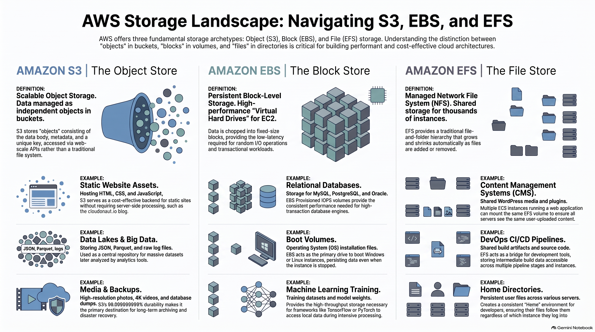
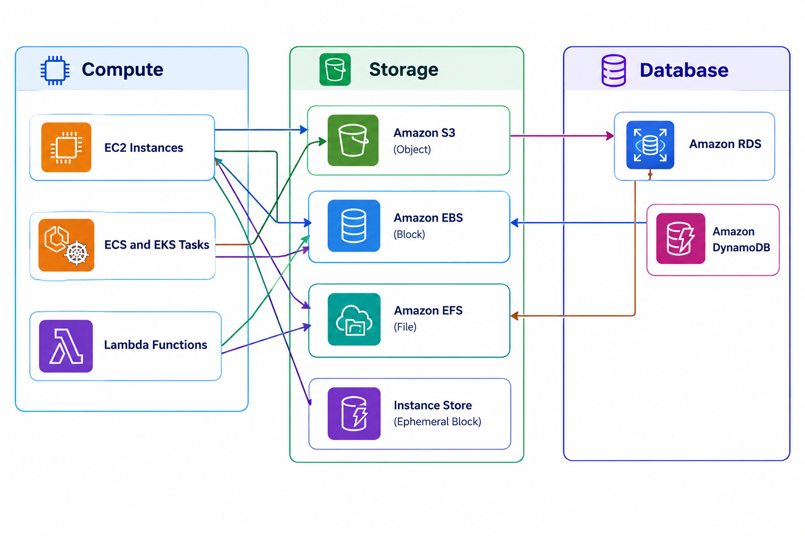
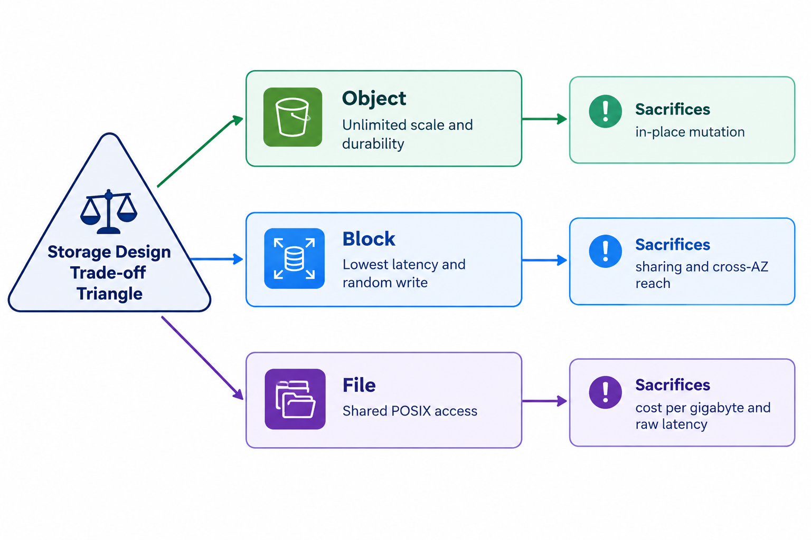
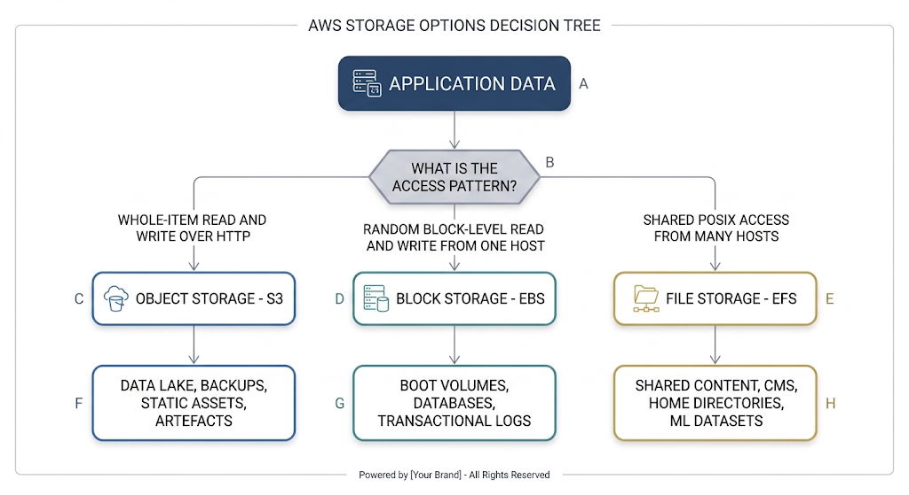
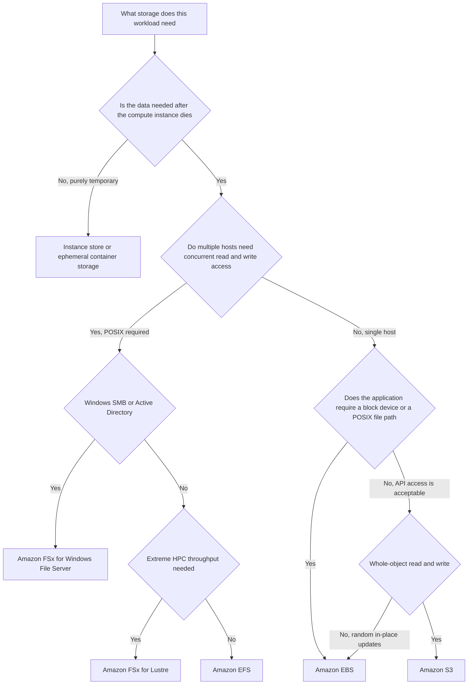

<!-- teachprep:refined 2026-10-11 -->
# Storage Services  Amazon S3, Amazon EBS, and Amazon EFS

!!! info "Scope of this chapter"
    This is the Unit 1 survey of AWS storage: object, block and file storage, what S3, EBS and EFS each are, and how to choose between them. The full treatment of each service is in [6.1 AWS Storage Solutions](../unit6/topic1.md): [Amazon S3](../unit6/topic1.md#object-storage-with-amazon-s3), [Amazon EBS](../unit6/topic1.md#block-storage-with-amazon-ebs) and [Amazon EFS](../unit6/topic1.md#file-storage-with-amazon-efs).

## Definition

AWS storage services are managed, API-driven services that keep data **independent of any single compute resource**. They form the **data layer** of an architecture: beneath compute (EC2, ECS, EKS, Lambda) and alongside databases (RDS, DynamoDB, Aurora).

Three services form the foundation. Each implements a different storage abstraction.

| Service | Abstraction | Scope | In one sentence |
|---|---|---|---|
| **Amazon S3** (Simple Storage Service) | Object | Regional | Stores whole **objects** (bytes plus metadata) in **buckets**, accessed over an HTTPS REST API, with effectively unlimited capacity and eleven nines of durability |
| **Amazon EBS** (Elastic Block Store) | Block | One Availability Zone | A network-attached disk for one EC2 instance, which the operating system formats (ext4, XFS, NTFS) like a physical disk; backed up by snapshots stored in S3 |
| **Amazon EFS** (Elastic File System) | File | Regional (multi-AZ) | A shared **NFSv4.1** file system with directories, permissions and locking, mounted by thousands of clients at once; capacity grows and shrinks automatically |

<figure markdown="span">
    {width="80%"}
    <figcaption>Storage Services in AWS</figcaption>
    
<i>Image Source: AI generated (Google Gemini)</i>

</figure>

<figure markdown="span">
    {width="80%"}
    <figcaption>Where the storage services fit in AWS architecture</figcaption>
    
<i>Image Source: AI generated (Chatgpt)</i>

</figure>

!!! note "Storage is not the same as a database"
    A database adds structure, queries, transactions and indexes on top of storage. A storage service stores bytes and returns bytes. If you need to **query** data by its content, use a database ([1.5](topic5.md)). If you need to **retrieve** data by its name, use storage.

## Why This Service or Concept Exists

In a traditional data centre, storage is bought years ahead, durability depends on RAID inside one building, and restores from tape take days. AWS storage replaces this with:

- capacity provisioned by API, on demand;
- multi-AZ durability as a default;
- performance set independently of capacity (gp3 volumes);
- incremental snapshots restorable in minutes;
- access control by IAM identity rather than network location.

AWS offers **three** services because the three abstractions make **incompatible trade-offs**:

| Abstraction | Gives up | To gain |
|---|---|---|
| Object (S3) | In-place updates | Unbounded scale and durability |
| Block (EBS) | Sharing and cross-AZ reach | Sub-millisecond random access |
| File (EFS) | Lower cost and latency | Shared POSIX files across many hosts |

<figure markdown="span">
    {width="80%"}
    <figcaption>Storage service trade-offs</figcaption>
    
<i>Image Source: AI generated (Chatgpt)</i>

</figure>

!!! tip "The architect's framing"
    Do not ask "which storage service should I use". Ask "what is the **access pattern** of my data". Access pattern determines abstraction; abstraction determines service. See [6.1 The Three Storage Abstractions](../unit6/topic1.md#the-three-storage-abstractions).

## Core Concepts

### Object, block and file compared

| Dimension | Object storage (S3) | Block storage (EBS) | File storage (EFS) |
|---|---|---|---|
| Unit of storage | Object: bytes plus metadata | Fixed-size block | File in a directory tree |
| Access | HTTPS REST API | Block device on one instance | NFS mount from many clients |
| Updates | Replace the whole object | Overwrite any block in place | Read, write, seek, append |
| Concurrent writers | Many; last write wins per key | Normally one instance | Many, coordinated by the file system |
| Typical latency | Tens of milliseconds | Sub-millisecond to low milliseconds | Low milliseconds |
| Scope | Regional, three or more AZs | One Availability Zone | Regional (or One Zone) |

<figure markdown="span">
    {width="80%"}
    <figcaption>Storage service decision options</figcaption>
    
<i>Image Source: AI generated (Google Gemini)</i>

</figure>

### Instance store

**Instance store** is disk physically attached to the EC2 host. It is the fastest option but **ephemeral**: data is lost when the instance stops or terminates. Use it only for scratch space, caches and data replicated elsewhere.

### Durability is not availability

| Property | Meaning | Example |
|---|---|---|
| **Durability** | Probability that data is **not lost** | S3 Standard: eleven nines |
| **Availability** | Probability that data **can be reached** right now | S3 Standard: 99.99 percent |

A single EBS volume is replicated only within one AZ, so a zone failure makes it **unavailable** (though not lost).

!!! warning "Durability does not protect against deletion"
    Durability figures cover hardware failure only. A user or application that deletes data deletes it durably. Versioning, Object Lock and backups protect against that. Per-class figures: [6.1 Durability and Availability](../unit6/topic1.md#durability-and-availability).

S3 provides **strong read-after-write consistency** for object operations. Bucket configuration changes and cross-Region replication remain eventually consistent.

## AWS Service Deep Dive

A summary of the options an architect chooses between. Full limits, pricing and features are in 6.1.

### Amazon S3 storage classes

| Storage class | Use when | Minimum storage duration | Retrieval |
|---|---|---|---|
| S3 Standard | Data is accessed frequently | None | Milliseconds |
| S3 Intelligent-Tiering | The access pattern is unknown or changes | None | Milliseconds |
| S3 Standard-IA | Read rarely, but needed immediately | 30 days | Milliseconds, per-GiB fee |
| S3 One Zone-IA | As above, and the data can be recreated | 30 days | Milliseconds, single AZ |
| S3 Glacier Instant Retrieval | Archive that still needs millisecond access | 90 days | Milliseconds |
| S3 Glacier Flexible Retrieval | Archive; minutes to hours is acceptable | 90 days | Restore required |
| S3 Glacier Deep Archive | Long-term retention at the lowest price | 180 days | Restore in about 12 hours or more |
| S3 Express One Zone | Single-digit-millisecond latency at very high request rates | One hour | Single-AZ directory bucket |

!!! warning "Colder is not always cheaper"
    Colder classes have minimum storage durations and retrieval fees. Moving short-lived or frequently read data into IA or Glacier can **increase** cost. See [6.1 Storage classes](../unit6/topic1.md#storage-classes).

Other S3 features to recognise:

- **Versioning**: every overwrite and delete keeps the previous version.
- **Lifecycle rules**: transition or expire objects by age.
- **Object Lock**: write-once-read-many retention.
- **Replication**: asynchronous copy to another bucket or Region.
- **Presigned URLs**: time-limited access to one object without sharing credentials.
- **Multipart upload**: large objects uploaded in parallel parts.

### Amazon EBS volume types

| Type | Media | Use when |
|---|---|---|
| **gp3** | SSD | The default: boot volumes, most databases and app servers; IOPS and throughput set independently of size |
| gp2 | SSD | Legacy; performance tied to size. Migrate to gp3 |
| **io2 Block Express** | SSD | Mission-critical databases needing the highest IOPS (up to 256,000) and lowest latency |
| io1 | SSD | Legacy provisioned IOPS; superseded by io2 |
| st1 | HDD | Large sequential reads: log processing, data warehouses |
| sc1 | HDD | Cold data read a few times a month, at the lowest cost |

EBS bills for **provisioned** capacity. Volumes can grow but not shrink, and performance is also capped by the instance type. See [6.1 Volume types](../unit6/topic1.md#volume-types).

### Amazon EFS options

| Setting | Options | Default choice |
|---|---|---|
| Throughput mode | Elastic, Provisioned, Bursting | Elastic |
| Performance mode | General Purpose, Max I/O | General Purpose |
| Storage class | Standard, Infrequent Access, Archive (plus One Zone variants) | Lifecycle management moves cold files to cheaper classes |
| Availability | Regional or One Zone | One Zone only for recreatable data |

See [6.1 Throughput modes, performance modes and elastic capacity](../unit6/topic1.md#throughput-modes-performance-modes-and-elastic-capacity).

### Related services

- **Amazon FSx**: managed file systems beyond EFS: Windows File Server (SMB, Active Directory), Lustre (HPC and ML, linked to S3), NetApp ONTAP and OpenZFS.
- **AWS Storage Gateway**: presents on-premises NFS, SMB, iSCSI or virtual tape interfaces backed by AWS storage, for hybrid and migration use.

See [6.1 Choosing between EFS, FSx and Mountpoint for Amazon S3](../unit6/topic1.md#choosing-between-efs-fsx-and-mountpoint-for-amazon-s3).

## Architecture Components

| Component | Role in a storage architecture |
|---|---|
| EC2, ECS, EKS, Lambda | Attach EBS, mount EFS and call the S3 API ([1.3](topic3.md)). Containers use EFS for shared volumes and EBS for per-task or per-pod volumes |
| VPC endpoints, route tables | Private path from compute to S3 (Gateway endpoint) and to EFS mount targets ([1.6](topic6.md)) |
| Security groups | Allow TCP 2049 from clients to EFS mount targets |
| CloudFront | Caches S3 objects at the edge; Origin Access Control keeps the bucket private |
| IAM | Authorises every storage API call ([1.2](topic2.md)) |
| KMS | Encrypts S3 objects, EBS volumes and EFS file systems ([8.3](../unit8/topic3.md#encryption-at-rest-with-aws-kms)) |
| CloudWatch, CloudTrail | Storage metrics, alarms and audit records |
| AWS Backup | Central backup policy for EBS, EFS and S3 |

## Important AWS Terminology

| Term | Meaning |
|---|---|
| Bucket | Regional container for S3 objects, with a globally unique name |
| Key and prefix | The full name of an object, and a leading part of it used for grouping. S3 has no real folders |
| Storage class | Per-object setting for cost, latency, availability and retrieval behaviour |
| Lifecycle policy | Rules that transition or expire objects by age |
| Versioning | Keeps every version of an object; a delete inserts a delete marker |
| Volume | An EBS block device in one Availability Zone |
| IOPS | Input/output operations per second |
| Snapshot | Incremental, point-in-time backup of an EBS volume, stored as a Regional resource |
| Multi-Attach | Attaching one io1/io2 volume to several instances in the same AZ |
| Mount target | Network interface in a subnet (one per AZ) through which clients reach EFS |
| Access point | EFS entry point enforcing a root directory and POSIX identity |
| Gateway VPC endpoint | Free, route-table-based private path from a VPC to S3 |

## Configuration Options

| Service | Settings that matter first | Sensible default |
|---|---|---|
| S3 | Storage class, versioning, encryption, Block Public Access, lifecycle, replication | Versioning on, Block Public Access on, lifecycle rule for noncurrent versions and incomplete multipart uploads |
| EBS | Type, size, IOPS and throughput, encryption, delete on termination, snapshots | gp3, encrypted, snapshots automated by Data Lifecycle Manager or AWS Backup |
| EFS | Throughput and performance mode, lifecycle, encryption, access points, mount targets | Elastic, General Purpose, a mount target in every AZ, TLS mounts |

Detailed tables: [S3 bucket configuration](../unit6/topic1.md#bucket-configuration), [EBS configuration](../unit6/topic1.md#configuration-options_1), [EFS configuration](../unit6/topic1.md#configuration-options_2).

## Design Considerations

### The decision framework

### When to choose each

| Choose | When | Avoid when |
|---|---|---|
| **S3** | Data is written whole and read by name: data lakes, backups, media, static assets, build artefacts, logs | The application needs POSIX semantics or low-latency transactional writes |
| **EBS** | One instance needs a persistent disk: boot volumes, self-managed databases | Data must be shared, or must stay accessible through an AZ failure |
| **EFS** | Many instances, containers or functions share files: CMS content, uploads, ML models, home directories | Latency-critical databases, or workloads dominated by small metadata operations |
| **Instance store** | Scratch space, caches, data replicated elsewhere | Anything that must survive a stop or termination |

!!! tip "Scope determines availability"
    S3 and EFS survive the loss of an Availability Zone; a single EBS volume does not. Going beyond one Region always needs **asynchronous** replication (S3 replication, EFS replication, snapshot copies), so a multi-Region design always has a non-zero Recovery Point Objective.

## Security Considerations

- **Access control.** S3 access combines IAM identity policies, bucket policies and Block Public Access; an explicit `Deny` anywhere wins. Keep ACLs disabled. Never make a bucket public to host a website; use CloudFront with Origin Access Control. See [1.2](topic2.md) and [8.1](../unit8/topic1.md).
- **Encryption.** New S3 objects are encrypted by default with SSE-S3; SSE-KMS adds key control and an audit trail. EBS and EFS encrypt at rest with KMS; EFS encrypts in transit with TLS via `efs-utils`. See [8.3 S3 encryption choices](../unit8/topic3.md#server-side-and-client-side-encryption-choices-for-s3).
- **Network isolation.** Use a Gateway VPC endpoint for S3. Restrict EFS mount targets to TCP 2049 from the application's security group.
- **Audit.** CloudTrail records management events by default; S3 object-level data events must be enabled explicitly.

## Operating It: Performance, Cost and Monitoring

| Service | Performance | Main cost driver | Cost lever | Metrics to watch |
|---|---|---|---|---|
| S3 | Multipart upload and byte-range reads in parallel; CloudFront caching; avoid millions of tiny objects | Storage class, requests, data transfer out | Lifecycle transitions, fewer larger objects, Gateway endpoint instead of NAT | `4xxErrors`, `5xxErrors`, `FirstByteLatency`, `BucketSizeBytes` |
| EBS | SSD for random I/O, HDD for sequential; the instance's EBS bandwidth is often the real ceiling | Provisioned capacity, used or not | Right-size, delete unattached volumes, gp2 to gp3, snapshot retention | `VolumeQueueLength`, `BurstBalance`, `VolumeReadOps`, `VolumeWriteOps` |
| EFS | Elastic throughput and parallel clients; avoid very large directories | Data in the Standard class | Lifecycle to Infrequent Access and Archive | `PercentIOLimit`, `BurstCreditBalance`, `ClientConnections` |

!!! tip "The two practices with the highest return"
    1. **S3 versioning plus a lifecycle rule expiring noncurrent versions.** Accidental deletion becomes an inconvenience, not a disaster, at bounded cost.
    2. **A Gateway VPC endpoint for S3 in every VPC.** It is free, improves security, and often removes a large NAT Gateway bill.

Other habits: define storage as code, tag everything, automate snapshots and **test restores**, and copy backups to another account and Region. CloudWatch itself is covered in [7.1](../unit7/topic1.md#infrastructure-and-application-monitoring-with-amazon-cloudwatch).

## Common Architecture Patterns

| Pattern | How it works |
|---|---|
| **Externalised state** | App servers keep no durable state: uploads in S3, shared files in EFS, sessions in ElastiCache or DynamoDB. This makes the tier horizontally scalable ([1.7](topic7.md)) |
| **Static website, private origin** | S3 holds the assets; CloudFront serves them |
| **Event-driven processing** | An S3 upload emits an event to Lambda, SNS, SQS or EventBridge, which writes a derived object |
| **Direct upload** | Browsers upload to S3 with presigned URLs; the app tier never handles the bytes |
| **Data lake** | S3 as the landing zone, queried in place by Athena, Glue or EMR |
| **Container volumes** | EFS gives shared `ReadWriteMany` volumes; EBS gives `ReadWriteOnce` volumes bound to one AZ |
| **Isolated backups** | Snapshots and backups copied to another account and Region to survive credential compromise |

## Advantages and Limitations

| Advantages | Limitations |
|---|---|
| Durability far beyond what one organisation can engineer | S3 has no POSIX semantics and is too slow for transactional writes |
| Elasticity: S3 and EFS have no size to provision | EBS is confined to one AZ and bills for provisioned capacity |
| Storage separated from compute, so compute can be replaced or run on Spot | EFS costs more per GiB, has higher latency than EBS, and is weak on metadata-heavy workloads |
| Performance decoupled from capacity (gp3) | Cross-Region replication is always asynchronous |
| Security tied to IAM identity and audited by CloudTrail | Lifecycle transitions run roughly daily; cold classes have minimum durations |

## Common Mistakes

| Mistake | Do instead |
|---|---|
| Believing S3 has folders, so a "folder rename" is cheap | Treat keys as flat names; a rename copies every object |
| Making a bucket public to serve a website | CloudFront with Origin Access Control |
| Attaching an EBS volume to an instance in another AZ | Snapshot it and restore in the target AZ |
| Mounting EFS without opening TCP 2049 | Allow 2049 from the client security group |
| Using EFS or S3 as a transactional database's data directory | EBS, or a managed database ([1.5](topic5.md)) |
| Versioning without a lifecycle rule | Expire noncurrent versions |
| Routing S3 traffic through a NAT gateway | Gateway VPC endpoint |
| Leaving unattached volumes and old snapshots | Regular clean-up and snapshot retention rules |

## Summary

The storage decision comes **before** the compute decision. Three ideas carry beyond AWS:

| Idea | Key lesson |
|---|---|
| **Access pattern determines abstraction** | Object (S3), block (EBS) and file (EFS) make incompatible trade-offs. Know how data is read and written, and the service follows |
| **Scope determines availability** | S3 and EFS are Regional and survive an AZ loss. EBS is bound to one AZ; instance store to one host |
| **Durability is not availability** | Neither protects against deletion; versioning, Object Lock and backups do |
| **Settings are dials, not defaults** | Storage classes, volume types, throughput modes, lifecycle, replication and encryption are chosen against explicit requirements |
| **Cheapest high-value habits** | Versioning plus lifecycle; Gateway endpoint for S3; gp3; delete unattached volumes |

Container platforms (Units 2 and 3) need EBS and EFS volumes; serverless designs are triggered by S3 events; pipelines store artefacts in S3. [6.1 AWS Storage Solutions](../unit6/topic1.md) returns to all three services in depth.

**Next:** [1.5 AWS Database Services](topic5.md) covers the services that add structure and queries on top of storage.

!!! question "Practice and interview questions"
    Questions for this topic are kept separately: [Practice questions](../Questions/unit1.md#14-aws-storage-services) · [Interview questions](../interviewquestions/unit1.md#14-aws-storage-services).
