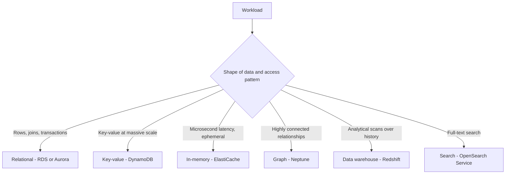
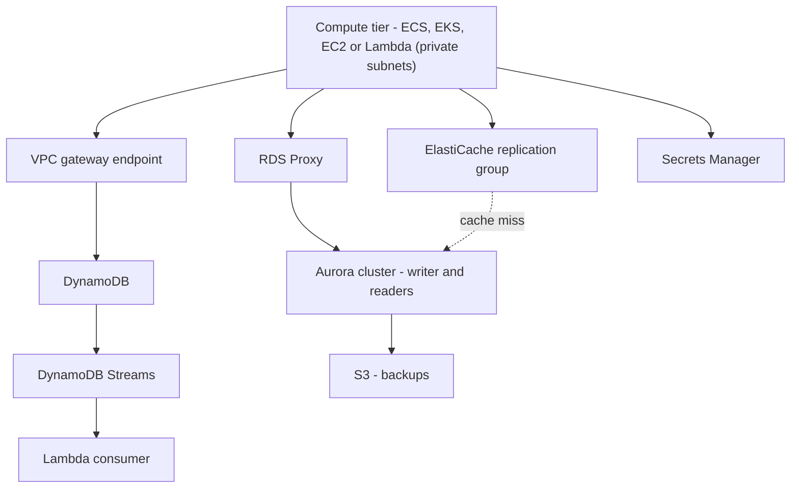
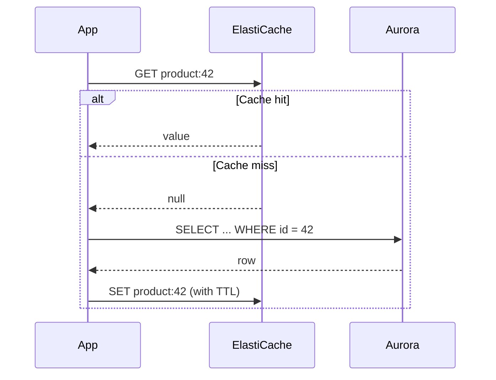

<!-- teachprep:refined 2026-10-11 -->
# Database Services on AWS  Amazon RDS and Aurora, Amazon DynamoDB, and Amazon ElastiCache

## Definition

A **managed database service** is a database whose infrastructure AWS operates for you: hardware, operating system and engine patching, backups, failure detection and failover. You keep responsibility for the data model, queries, indexes, access control and capacity or cost decisions.

This chapter covers three services, each with a different job:

| Service | Category | Data model | Primary purpose |
|---|---|---|---|
| **Amazon RDS** | Managed relational database | Relational, SQL, ACID | Structured transactional data with relationships and joins |
| **Amazon Aurora** | Cloud-native relational engine (an RDS option) | MySQL- and PostgreSQL-compatible | Relational workloads needing higher throughput, faster recovery and auto-growing storage |
| **Amazon DynamoDB** | Managed NoSQL database | Key-value and document | Single-digit millisecond access at any scale for known access patterns |
| **Amazon ElastiCache** | Managed in-memory store | In-memory key-value and data structures | Microsecond reads, offloading the primary database, sessions and leaderboards |

!!! info "Scope of this chapter"
    This is the Unit 1 survey: the concepts you need to choose a database, and each service at summary level. The full treatment of RDS, Aurora and DynamoDB (and of Amazon Neptune and Amazon Redshift) is in [6.2 AWS Database Services](../unit6/topic2.md). ElastiCache is covered in depth in [6.1](../unit6/topic1.md#caching-strategies-with-amazon-elasticache).

!!! note "The data tier is the stateful tier"
    In a well-designed cloud-native system the compute tier is **stateless**: instances can be destroyed and recreated freely. State lives in the database, and state is what makes distributed systems hard. Scaling stateless compute is easy (add instances behind a load balancer). Scaling state forces explicit decisions about consistency, partitioning and replication. This is why the data tier usually sets the ceiling of an architecture.

## Why This Service or Concept Exists

### Running a database yourself is hard

Self-managing a production database means owning provisioning, OS and engine patching, backups and restore tests, replication and failover, monitoring, capacity planning and security. None of this differentiates the business. AWS calls it **undifferentiated heavy lifting**, and removing it is the core value of managed databases.

| Dimension | Self-managed | AWS managed |
|---|---|---|
| Time to first database | Weeks | Minutes |
| High availability | Weeks of replication and failover engineering | Enable Multi-AZ |
| Failover time | Often manual, minutes to hours | Typically 60 to 120 seconds for RDS Multi-AZ; around 30 seconds or less for Aurora |
| Backups and point-in-time recovery | Custom scripts and log shipping | Automated, to any second within the retention window |
| Read scaling | Manual replica configuration | Add a read replica with a few API calls |
| Encryption at rest | Disk- or engine-level setup | Enable at creation, integrated with KMS |

!!! warning "Managed does not mean AWS handles everything"
    AWS will faithfully replicate a badly designed schema and back up a table with no indexes. It will not tell you that a query does a full table scan, that a partition key causes a hot partition, or that your application role is over-privileged. Under the shared responsibility model, **design is your responsibility**, and poor design is what usually causes outages.

### Purpose-built databases

The second reason is architectural: **the relational model is not optimal for every workload**. A shopping cart, a social graph, IoT telemetry, a search index and a financial ledger have different access patterns, consistency needs and scaling behaviour. AWS therefore offers a family of **purpose-built databases** and expects architects to choose deliberately.

!!! tip "Choose by access pattern, but do not over-fragment"
    Choose the database that matches the **access pattern**, not the one you already know: changing a data model after production data exists usually means a rewrite. Equally, every extra data store adds backups, monitoring, credentials and a consistency boundary. Add a new store only when the workload demonstrably does not fit the ones you have.

## Core Concepts

### Relational databases and ACID

A **relational database** stores data in tables with a fixed schema, links them with foreign keys, and uses SQL so that joins and filters can be decided at query time. Its contract is **ACID**:

| Property | Meaning | Example |
|---|---|---|
| **Atomicity** | A transaction completes fully or not at all | A transfer cannot debit one account without crediting the other |
| **Consistency** | Every transaction respects all constraints | Foreign keys and uniqueness are never violated |
| **Isolation** | Concurrent transactions do not see each other's intermediate state | Two simultaneous stock decrements cannot both oversell |
| **Durability** | Committed data survives crashes | An acknowledged order is not lost if the instance dies |

Isolation is a dial, not a switch. SQL defines levels (Read Uncommitted, Read Committed, Repeatable Read, Serializable); stronger levels cost throughput. PostgreSQL defaults to Read Committed and MySQL InnoDB to Repeatable Read.

### NoSQL and BASE

**NoSQL** databases relax a relational constraint (fixed schema, joins, or strict consistency) in exchange for horizontal scale and predictable latency. Their typical posture is **BASE**:

- **Basically Available**: every request gets a response, possibly not the latest data.
- **Soft state**: state may change as replicas converge.
- **Eventually consistent**: with no new writes, all replicas converge to the same value.

!!! warning "NoSQL does not mean no consistency"
    DynamoDB offers strongly consistent reads per request and ACID transactions across up to 100 items. Conversely, a relational database read through an asynchronous replica is eventually consistent. BASE describes a default, not an absolute limit.

### Vertical versus horizontal scaling

| Aspect | Vertical (scale up) | Horizontal (scale out) |
|---|---|---|
| Method | Bigger machine | More machines |
| Natural fit | Relational writer | Key-value stores, stateless compute |
| Ceiling | The largest instance type | Effectively none |
| Downtime | Usually a restart or failover | None if designed for it |
| Complexity | Low | High: needs a partitioning strategy |

!!! note "The single-writer ceiling"
    A relational database's **write path scales vertically**. Read replicas scale reads, but there is one writer on one machine. DynamoDB scales writes horizontally by adding partitions, which is why it can absorb workloads no single relational instance could.

### The CAP theorem

The **CAP theorem** says a distributed data store cannot guarantee all three of the following at once:

| Guarantee | Precise meaning |
|---|---|
| **Consistency (C)** | Every read returns the most recent write or an error (linearizability, not the "C" in ACID) |
| **Availability (A)** | Every request gets a non-error response, possibly stale |
| **Partition tolerance (P)** | The system keeps working when messages between nodes are lost |

!!! danger "CA is not an option for a distributed system"
    Network partitions are a fact of physical networks, not a design choice, so any distributed system **must** tolerate them. The practical statement of CAP is: *when a partition occurs, choose between consistency and availability.*

| Service | Behaviour under partition | Leaning |
|---|---|---|
| RDS Multi-AZ | Fails over to the synchronous standby; writes unavailable during failover | CP |
| Aurora | Quorum-based storage across three AZs | CP with high availability |
| DynamoDB, eventually consistent reads | Any replica may answer | AP |
| DynamoDB, strongly consistent reads | Must reach the partition leader | CP for those requests |
| ElastiCache with replicas | Failover can lose recent unreplicated writes | AP, not durable by design |

### PACELC  The Extension That Matters More in Practice

CAP only describes behaviour during a partition, which is rare. **PACELC** extends it:

> **If** there is a **P**artition, choose **A**vailability or **C**onsistency; **E**lse, in normal operation, choose **L**atency or **C**onsistency.

The "else" branch is what you meet every day. A strongly consistent DynamoDB read costs twice the capacity of an eventually consistent read and has higher latency, because the partition leader must serve it. A read replica is faster and offloads the primary but may return stale data. **Almost every read path trades latency for consistency.**

!!! tip "Using PACELC in a design review"
    For each read path ask: *what does it cost the business if this data is slightly stale?* A product description: nothing. A user's profile just after they edited it: it looks like a bug. An account balance before a withdrawal: unacceptable. Paths in one application can legitimately choose differently.

### OLTP Versus OLAP

| Characteristic | OLTP (transaction processing) | OLAP (analytical processing) |
|---|---|---|
| Typical operation | Read or write a few rows by key | Scan and aggregate millions of rows |
| Latency target | Milliseconds | Seconds to minutes |
| Concurrency | Thousands of short transactions | Few long queries |
| Storage layout | Row-oriented | Column-oriented |
| Example | "Insert this order" | "Revenue by region by month for three years" |
| AWS services | RDS, Aurora, DynamoDB | Redshift, Athena, EMR |

!!! danger "Do not run analytics on the production OLTP database"
    A large report can saturate I/O or hold locks, exhaust connection pools, and take the checkout path down with it. Separate the workloads: a dedicated reporting replica, an export to S3 queried with Athena, or a load into Redshift (Aurora offers zero-ETL integration with Redshift for this).

### Consistency models

| Model | Guarantee | Where you see it |
|---|---|---|
| **Strong** | A read reflects all prior writes | RDS primary, Aurora writer, DynamoDB strongly consistent read |
| **Eventual** | A read may be stale; replicas converge | DynamoDB default read, RDS read replica, Aurora reader |
| **Read-your-own-writes** | A client always sees its own writes | Route that client's reads to the primary for a short window after a write |

### Durability, availability, RPO and RTO

**Durability** is the likelihood that committed data is not lost. **Availability** is the proportion of time the system can serve requests. They are different: data can be safely stored across three AZs while the database is unreachable during failover, and ElastiCache can answer every request yet lose everything on restart.

| Term | Meaning | Example |
|---|---|---|
| Availability | Uptime in "nines" | 99.99 percent is roughly 52 minutes of downtime per year |
| **RPO** (Recovery Point Objective) | Maximum acceptable data loss, in time | "We can lose at most 5 minutes of transactions" |
| **RTO** (Recovery Time Objective) | Maximum acceptable downtime | "We must be serving within 15 minutes" |

!!! example "RPO and RTO drive the design"
    RPO 5 minutes and RTO 1 hour: automated backups with point-in-time recovery. RPO near zero and RTO under 2 minutes: Multi-AZ synchronous replication with automatic failover. Survive a Region loss: Aurora Global Database or DynamoDB Global Tables. Always extract these two numbers before designing.

### Caching basics

A **cache** is a fast store holding a subset of data so repeat requests avoid the origin. It works because of **locality**: a small fraction of items receives most requests.

| Term | Meaning |
|---|---|
| **Hit / miss** | The item was / was not in the cache |
| **Hit ratio** | Hits divided by total requests; the key measure of effectiveness |
| **TTL** | Time after which an entry expires |
| **Eviction policy** | Which entries to discard when memory is full, for example LRU |
| **Invalidation** | Removing or updating an entry when the source data changes |
| **Stampede** | Many requests miss at once and all hit the database together |

!!! note "Why hit ratio matters so much"
    With a 0.5 ms cache read and a 10 ms database read, a 95 percent hit ratio averages `0.95 × 0.5 + 0.05 × 10 = 0.975 ms`. At 80 percent it is `0.8 × 0.5 + 0.2 × 10 = 2.4 ms`, about 2.5 times worse.

## AWS Service Deep Dive

Each service is summarised at Unit 1 level. Full deep dives: [6.2](../unit6/topic2.md) for RDS, Aurora and DynamoDB; [6.1](../unit6/topic1.md#caching-strategies-with-amazon-elasticache) for ElastiCache.

### Amazon RDS and Amazon Aurora

**Purpose.** A managed relational database with full SQL, ACID transactions and the existing tooling ecosystem, without the operational burden.

**Engines.** Aurora (MySQL- and PostgreSQL-compatible), MySQL, PostgreSQL, MariaDB, Oracle, SQL Server and IBM Db2. For a new application with no licence constraint, Aurora PostgreSQL is the usual default.

| Feature | What it gives you |
|---|---|
| **Multi-AZ** | Synchronous standby in another AZ with automatic failover (availability, not read scaling) |
| **Read replicas** | Asynchronous readable copies for read scaling; up to 15 Aurora Replicas per cluster |
| **Automated backups and PITR** | Restore to any second within a 1 to 35 day retention window |
| **Encryption with KMS** | Chosen at creation; cannot be enabled in place |
| **RDS Proxy** | Managed connection pooling for Lambda and highly elastic compute |
| **Aurora storage** | Six copies across three AZs, self-healing, grows automatically, shared by all instances |
| **Aurora Serverless v2** | Capacity that scales in fine-grained Aurora Capacity Units (ACUs) |
| **Aurora Global Database** | Cross-Region replication, typically with sub-second lag |

The shared limit is a **single writer**: reads scale out with replicas, writes scale up. See [6.2](../unit6/topic2.md#amazon-rds-and-aurora-engine-fundamentals) for engines, pricing, limits and configurations.

!!! danger "The Lambda and RDS connection problem"
    A relational database supports a limited number of connections (a few hundred on a small instance). A Lambda function at 1,000 concurrent executions, each opening its own connection, exhausts that limit and breaks every other service sharing the database. Remedies: RDS Proxy, creating the connection outside the handler so warm invocations reuse it, reserved concurrency, or DynamoDB, which has no connections. See [6.2](../unit6/topic2.md#the-connection-problem-quantified).

### Amazon DynamoDB

**Purpose.** A fully managed, serverless key-value and document database with consistent single-digit millisecond latency at any scale, no servers and no connections to manage.

| Concept | Summary |
|---|---|
| Table, item, attribute | Regional table of items, each up to 400 KB; no schema beyond the primary key |
| Primary key | A partition key alone, or partition key plus sort key |
| Secondary indexes | **GSI**: any keys, add any time, eventually consistent. **LSI**: same partition key, created only with the table, supports strong reads |
| Capacity modes | **On-demand** (pay per request) or **provisioned** (RCU and WCU, with auto scaling) |
| Capacity units | 1 RCU = one strongly consistent read per second up to 4 KB (or two eventually consistent); 1 WCU = one write per second up to 1 KB |
| Transactions | ACID across up to 100 items, at twice the capacity cost |
| Other features | TTL, Streams, Global Tables, point-in-time recovery, DAX |

!!! danger "Model the access patterns before the data"
    Relational design starts with entities, because SQL can express any query later. DynamoDB design starts with a **written list of every access pattern**, and the key schema is derived from it. A poor partition key (for example `status`, where all `ACTIVE` items land together) cannot scale no matter how much capacity you buy, and fixing it later means a data migration.

See [6.2](../unit6/topic2.md#nosql-databases-with-amazon-dynamodb) for key and index design, single-table design and capacity arithmetic.

### Amazon ElastiCache

**Purpose.** Managed in-memory stores (Valkey, Redis OSS and Memcached) that sit in front of a database or hold shared ephemeral state, serving hot data from RAM in microseconds instead of from disk in milliseconds.

A Valkey or Redis OSS deployment is a replication group of one shard or many (cluster mode), each a primary with asynchronous replicas; ElastiCache Serverless removes node sizing. Because replication is asynchronous, failover can lose recent writes, so **ElastiCache is never the system of record**.

| Dimension | Valkey / Redis OSS | Memcached |
|---|---|---|
| Data structures | Strings, lists, sets, sorted sets, hashes, streams, geospatial | Strings only |
| Replication, Multi-AZ failover | Yes | No |
| Persistence and backup | Yes (snapshots to S3) | No |
| Threading | Largely single-threaded command execution | Multi-threaded |
| Typical use | Sessions, leaderboards, rate limiting, caching | Simple, high-throughput object caching |

!!! tip "Default to Valkey or Redis OSS"
    Choose Memcached only for a simple, disposable, multi-threaded object cache where losing everything is acceptable. Otherwise replication, failover and richer data structures make Valkey or Redis OSS the better default.

## Architecture Components

The data tier is more than the database itself.

| Component | Responsibility |
|---|---|
| **Private subnets** | Hold RDS, Aurora and ElastiCache. Databases never go in public subnets |
| **DB subnet group / cache subnet group** | Subnets in at least two AZs where RDS or ElastiCache may place nodes; required for Multi-AZ |
| **Security groups** | Allow the engine port only from the application tier's security group |
| **VPC gateway endpoint** | Private, no-charge route to DynamoDB (and S3) without a NAT gateway |
| **Aurora cluster** | Shared storage volume plus one writer and up to 15 readers |
| **RDS Proxy** | Pools connections between elastic compute and RDS or Aurora |
| **DynamoDB table, partitions, indexes** | Regional container; partitions are the unit of storage and throughput |
| **DynamoDB Streams** | Ordered change log that triggers Lambda for event-driven integration |
| **Secrets Manager, KMS, CloudWatch** | Credentials with rotation; encryption keys; metrics and alarms |

## Important AWS Terminology

| Term | Meaning |
|---|---|
| **ACID / BASE** | Relational transactional guarantees / the eventual-consistency posture of many NoSQL systems |
| **ACU** | Aurora Capacity Unit, the scaling unit of Aurora Serverless v2 |
| **Aurora cluster volume** | Shared storage replicated six ways across three AZs |
| **Capacity mode** | DynamoDB on-demand or provisioned throughput |
| **Cluster endpoint** | DNS name that always points at the current writer |
| **DAX** | DynamoDB Accelerator, a write-through in-memory cache for DynamoDB |
| **DB subnet group** | Subnets across AZs in which RDS may place instances |
| **Global Secondary Index (GSI)** | Index with different keys from the table, its own capacity, eventually consistent |
| **Global Table** | Multi-Region, multi-active DynamoDB table using last-writer-wins |
| **IAM role** | Identity assumed by a service or application to call AWS APIs ([8.1](../unit8/topic1.md)) |
| **Item / item collection** | One DynamoDB record (max 400 KB) / all items sharing a partition key value |
| **KMS** | AWS Key Management Service, which manages encryption keys ([8.3](../unit8/topic3.md)) |
| **Local Secondary Index (LSI)** | Index sharing the table's partition key with a different sort key; created with the table |
| **Multi-AZ** | Synchronous standby in a second AZ for automatic failover |
| **OLTP / OLAP** | Short transactional operations / large analytical scans |
| **Partition key / sort key** | Attribute whose hash places an item / attribute that orders items within a partition |
| **PITR** | Point-in-time recovery to any second within the retention window |
| **Projection** | Attributes copied into a secondary index: `KEYS_ONLY`, `INCLUDE` or `ALL` |
| **RCU / WCU** | DynamoDB read capacity unit (4 KB strong read) / write capacity unit (1 KB write) |
| **RDS Proxy** | Managed connection pool in front of RDS or Aurora |
| **Read replica / replica lag** | Asynchronous read-only copy / delay before a write appears on it |
| **Replication group** | ElastiCache primary nodes and their replicas, optionally sharded |
| **Scan versus Query** | `Scan` reads every item; `Query` reads only items with one partition key value |
| **Security group** | Stateful virtual firewall attached to a network interface |
| **Sparse index** | GSI containing only items that have the index key attribute |
| **Streams** | Time-ordered log of item changes in a DynamoDB table |
| **TTL** | Automatic expiry of a DynamoDB item or cache entry |
| **VPC** | Isolated virtual network in which RDS, Aurora and ElastiCache run ([1.6](topic6.md)) |
| **Writer / reader endpoints** | Aurora DNS names for the writer and for load-balanced readers |

## Configuration Options

These decisions are made at creation and are expensive to change. Full option tables are in 6.2 for [RDS and Aurora](../unit6/topic2.md#engine-instance-and-storage-settings) and [DynamoDB](../unit6/topic2.md#general-table-settings), and in [6.1](../unit6/topic1.md#configuration-options_3) for ElastiCache.

| Service | Decisions that matter most |
|---|---|
| RDS and Aurora | Engine and version; instance class or Serverless v2 ACU range; Multi-AZ for production; backup retention (zero disables PITR); encryption at creation; deletion protection |
| DynamoDB | Primary key; capacity mode; secondary indexes and projections; PITR; TTL attribute; Streams; Global Tables |
| ElastiCache | Engine; node-based or Serverless; cluster mode; Multi-AZ with automatic failover; eviction policy; encryption |

## Design Considerations

### Which database do I choose?

| Requirement in a design or exam question | Choose |
|---|---|
| Relational data, joins, ACID transactions, an existing SQL application | RDS, or Aurora for higher throughput, faster failover and auto-growing storage |
| Key-value access at any scale, serverless, unpredictable traffic | DynamoDB |
| Access patterns not yet known, ad hoc queries likely | A relational database |
| Microsecond reads in front of a database, sessions, leaderboards | ElastiCache, or DAX when the database is DynamoDB |
| Improve read performance | Read replicas or a cache, **not** Multi-AZ |
| Improve availability or add automatic failover | Multi-AZ, **not** read replicas |
| Recover from an accidental deletion | PITR or backups, **not** replication (it copies the deletion) |
| Survive the loss of a Region | Aurora Global Database or DynamoDB Global Tables |
| Deep relationship traversal, such as fraud rings | Amazon Neptune ([6.2](../unit6/topic2.md#graph-databases-with-amazon-neptune)) |
| Aggregations over large history | Amazon Redshift ([6.2](../unit6/topic2.md#data-warehousing-with-amazon-redshift)) |

### Service comparison

| Dimension | RDS | Aurora | DynamoDB | ElastiCache |
|---|---|---|---|---|
| Query flexibility | Full SQL | Full SQL | Key and index lookups only | Key lookups and data-structure commands |
| Write scaling | Vertical, one writer | Vertical, one writer | Horizontal by partition | Horizontal by shard |
| Typical latency | Low milliseconds | Low milliseconds | Single-digit milliseconds | Sub-millisecond |
| Durability | Synchronous standby, backups | Six copies across three AZs | Synchronous replication across three AZs | Weak by design |
| Availability | Multi-AZ failover, 1 to 2 minutes | Failover typically under 30 seconds | Built in; no visible failover | Replica promotion; app must survive cache loss |
| Connection model | Persistent TCP | Persistent TCP | Stateless HTTPS | Persistent TCP |
| Network placement | Private subnets | Private subnets | Regional endpoint via gateway endpoint | Private subnets |

!!! question "The question to ask before choosing DynamoDB"
    Can you list every access pattern the application will need? If yes, DynamoDB serves them at any scale. If not, a relational database absorbs that uncertainty far more gracefully. DynamoDB moves design effort forward: more thinking before the first write, less firefighting at scale.

## Common Architecture Patterns

### Cache-Aside with a Read-Through Fallback

The default pattern for read-heavy applications. The application checks ElastiCache or DAX first; on a miss it reads the database and stores the result with a TTL. Only requested data is cached, and if the cache fails the application still works, only slower. Write-through, TTL design and stampede protection are in [6.1](../unit6/topic1.md#caching-strategies-with-amazon-elasticache).

### Read replica fan-out

One writer and several readers, with read-only traffic sent to the reader endpoint. Reads that must reflect the caller's own write go to the writer. Aurora replicas share the storage volume, so lag is typically tens of milliseconds.

### Polyglot persistence

Choose the store per access pattern: Aurora for orders and payments, DynamoDB for high-volume key access, ElastiCache for sessions and hot reads, OpenSearch for search (often fed from DynamoDB Streams, because DynamoDB is not a search engine), S3 for large objects, Redshift for analytics.

Service-level data patterns (database per service, saga, CQRS, event sourcing) are covered in [1.7 Cloud-Native Design Patterns](topic7.md) and [4.1](../unit4/topic1.md#database-per-service-with-polyglot-persistence).

## Security Considerations

- **Two layers.** IAM controls the control plane (create, modify, delete a database). Database users control the data plane (who can `SELECT` which table). `rds:*` does not grant a `SELECT`. DynamoDB is the exception: every `GetItem` and `PutItem` is an IAM action, so access can be restricted per table, index or even per partition key ([6.2](../unit6/topic2.md#fine-grained-access-control-for-multi-tenancy)).
- **Network isolation.** Private subnets only; security group rules that reference the application security group, not CIDR ranges; DynamoDB through a gateway endpoint.
- **Credentials.** Secrets Manager with automatic rotation, or IAM database authentication (short-lived tokens, no stored password). Never hard-code credentials.
- **Encryption.** KMS at rest and TLS in transit. DynamoDB is always encrypted at rest; for RDS and ElastiCache it is a **creation-time** choice (encrypting later means snapshot, encrypted copy, restore).
- **Least privilege inside the database.** Separate accounts for migrations, runtime and reporting.

Deeper treatment: IAM in [8.1](../unit8/topic1.md), KMS and Secrets Manager in [8.3](../unit8/topic3.md).

## Operating It: Performance, Cost and Monitoring

**Performance.**

- Cache the hot working set; set TTLs from tolerable staleness.
- Send read-only traffic to replicas; use RDS Proxy for elastic compute.
- Index for known queries (each index slows writes); confirm plans with `EXPLAIN ANALYZE`.
- In DynamoDB, request paths use `Query` or `GetItem`, never `Scan`.

**Cost.**

| Service | Main cost drivers | Key lever |
|---|---|---|
| RDS / Aurora | Instance or ACU hours, storage, I/O, backups, licences | Right-size; Reserved Instances for steady load; stop non-production databases |
| DynamoDB | Requests or provisioned capacity, storage, optional features | On-demand for spiky traffic; provisioned with auto scaling once steady; TTL to expire old items |
| ElastiCache | Node hours or serverless usage | Size to the working set; a cache is usually cheaper than the larger database it replaces |
| All | Cross-AZ transfer, NAT processing, orphaned snapshots | Gateway endpoints; snapshot and log retention policies |

Figures change; check the AWS Pricing Calculator before committing to a budget.

**Monitoring.**

| Service | Metrics to alarm on | Why |
|---|---|---|
| RDS / Aurora | `DatabaseConnections`, `FreeStorageSpace`, `ReplicaLag`, `CPUUtilization` | Exhausted connections and full disks are the commonest hard outages |
| DynamoDB | `ThrottledRequests`, read and write throttle events | Throttling signals under-provisioning or a hot partition |
| ElastiCache | `CacheHitRate`, `Evictions`, `EngineCPUUtilization` | Rising evictions with falling hits means the cache is too small |

Performance Insights (RDS/Aurora) and Contributor Insights (DynamoDB hot keys) help diagnose. CloudWatch is covered in [7.1](../unit7/topic1.md).

## Advantages and Limitations

| Service | Advantages | Limitations |
|---|---|---|
| **RDS** | Removes patching, backups, failover and replica setup while keeping SQL, tools and skills | Writes scale vertically; failover is not instantaneous, so apps must retry; replicas are asynchronous |
| **Aurora** | Shared self-healing storage: cheap replicas, fast failover, automatic storage growth | Still a single writer; higher ceiling, not none |
| **DynamoDB** | Consistent latency at any size; nothing to size, patch or fail over; on-demand needs no forecast | No joins or ad hoc queries; access patterns fixed up front; 400 KB items; Global Tables use last-writer-wins |
| **ElastiCache** | Large latency gains and much less database load at small cost; rich data structures | Not durable; invalidation is hard; memory is a hard limit; one more component to fail |

!!! warning "There is no free scalability"
    DynamoDB's horizontal scale costs query flexibility. Aurora's rich queries cost a write ceiling. ElastiCache's speed costs durability. The architect chooses which price the workload can afford.

## Common Mistakes

### Beginner Mistakes

| Mistake | Why it is wrong | Do instead |
|---|---|---|
| Making an RDS instance publicly accessible | Exposes the database to the internet | Private subnets and security group references |
| Hard-coding credentials | They leak through source control and logs | Secrets Manager or IAM database authentication |
| Using `Scan` in DynamoDB | Reads and bills every item | Design keys so access is `Query` or `GetItem` |
| Backup retention of zero | Disables PITR | Set retention deliberately |
| Treating ElastiCache as durable | Data lost on failover or eviction | Cache only what can be rebuilt |
| Using Multi-AZ to scale reads | The standby is for failover | Read replicas or a cache |

### Production Mistakes

| Mistake | Consequence | Remedy |
|---|---|---|
| Lambda connecting directly to RDS at high concurrency | Connection exhaustion and cascading failure | RDS Proxy, reserved concurrency, connection reuse |
| Never testing failover or restore | Recovery is an assumption | Regular failover and restore drills |
| Analytics on the OLTP database | Checkout slows or fails | Reporting replica, S3 plus Athena, or Redshift |
| Ignoring DynamoDB throttling because retries succeed | Latency degrades until it becomes an outage | Alarm on throttling; check key distribution |
| Cache smaller than the working set | Low hit rate, load pushed back to the database | Monitor evictions and hit rate; resize |

## Summary

AWS rejects the idea that one database should serve every workload. Characterise the access pattern first, then choose the store.

| Area | Key lesson |
|---|---|
| **Managed databases** | AWS removes the heavy lifting; you still own schema, queries, indexes and access control |
| **Relational vs NoSQL** | ACID and flexible SQL with a single-writer ceiling, versus horizontal scale with access patterns fixed up front |
| **CAP and PACELC** | Partitions force C or A; in normal operation every read trades latency against consistency |
| **OLTP vs OLAP** | Keep analytics off the transactional database |
| **RDS / Aurora** | Default for relational data; Aurora adds shared six-copy storage and faster failover |
| **DynamoDB** | Serverless key-value at any scale; the partition key decides whether it scales |
| **ElastiCache** | Microsecond reads via cache-aside; never the system of record |
| **Replication vs standby vs backup** | Replicas scale reads, Multi-AZ provides availability, backups recover from mistakes |

**Next:** with the data tier understood, [1.6 AWS Network Services](topic6.md) covers the VPC, subnets and routing that these databases live inside.

!!! question "Practice and interview questions"
    Questions for this topic are kept separately: [Practice questions](../Questions/unit1.md#15-aws-database-services) · [Interview questions](../interviewquestions/unit1.md#15-aws-database-services).
