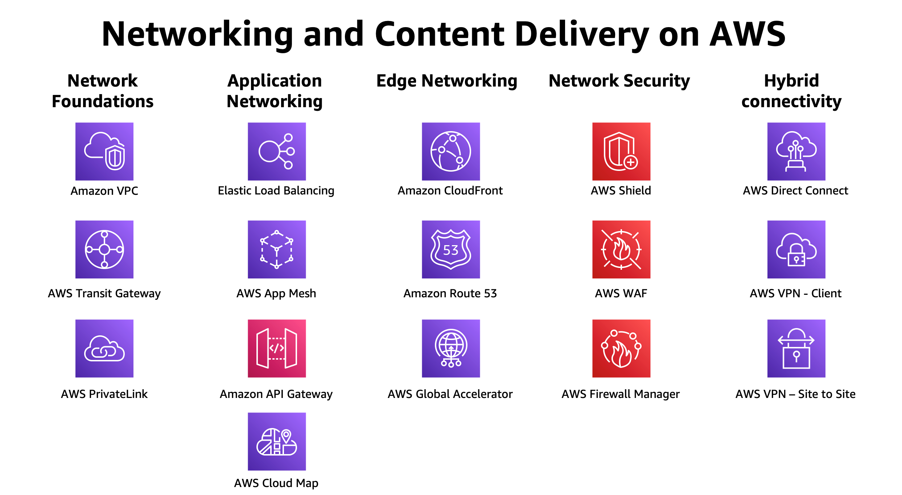
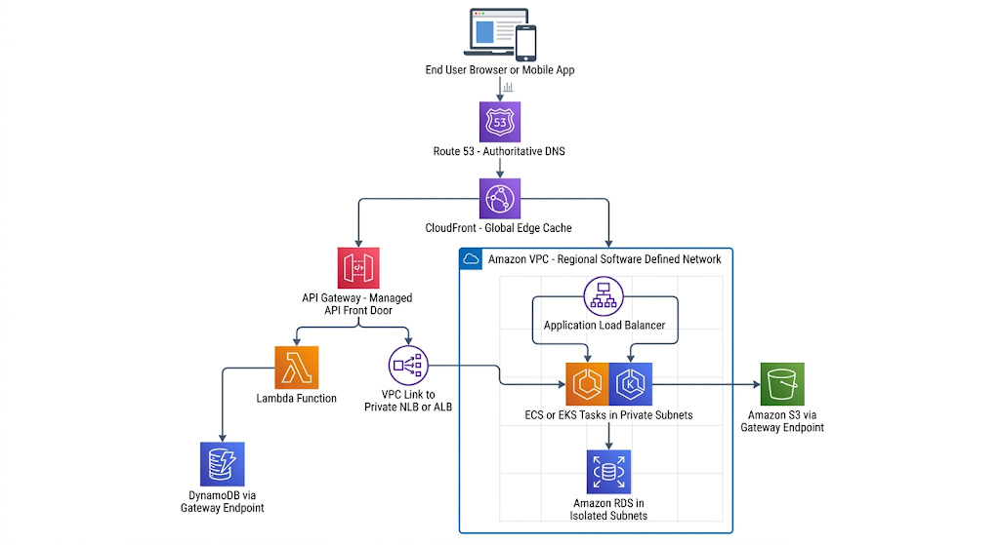
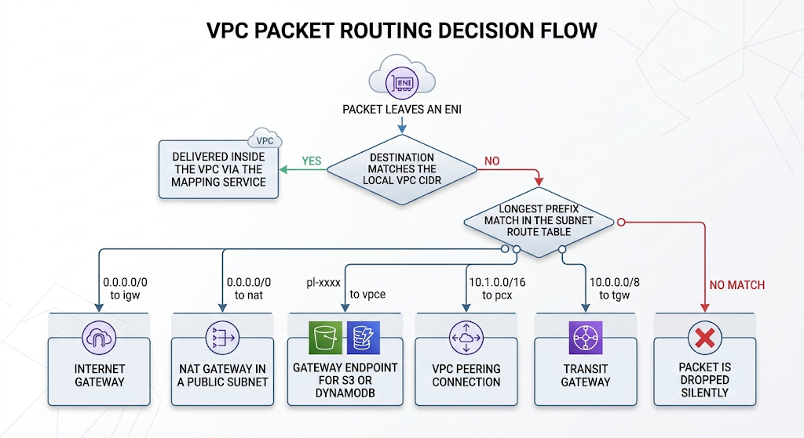
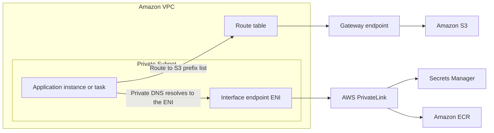
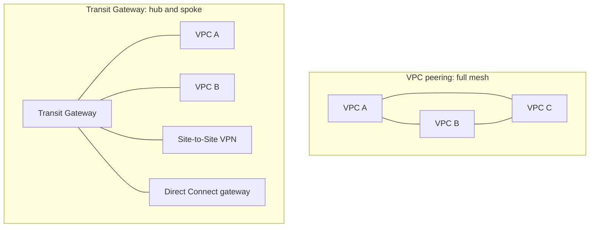
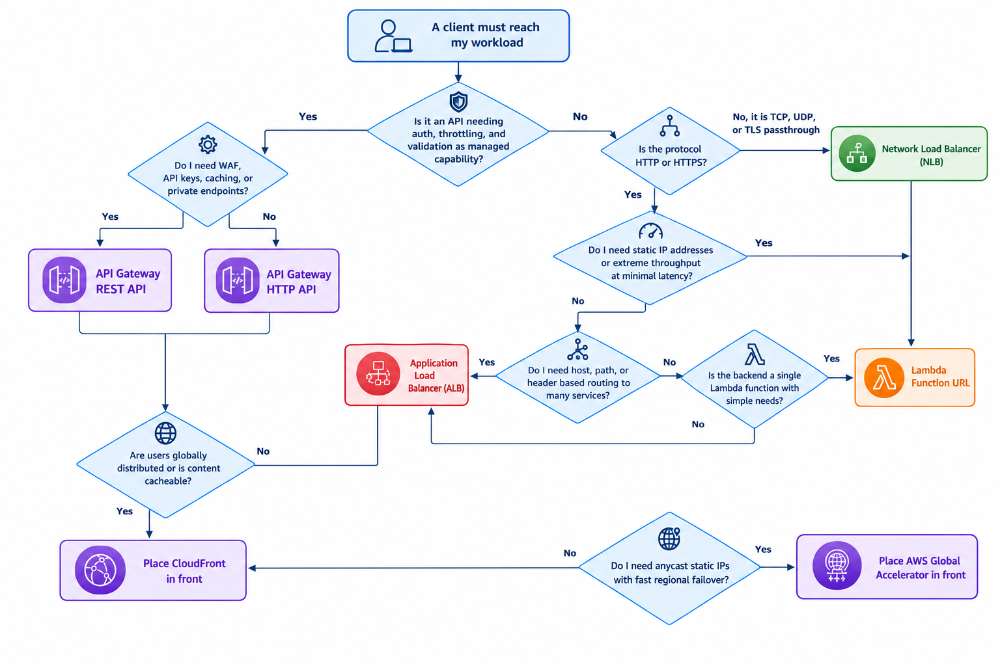
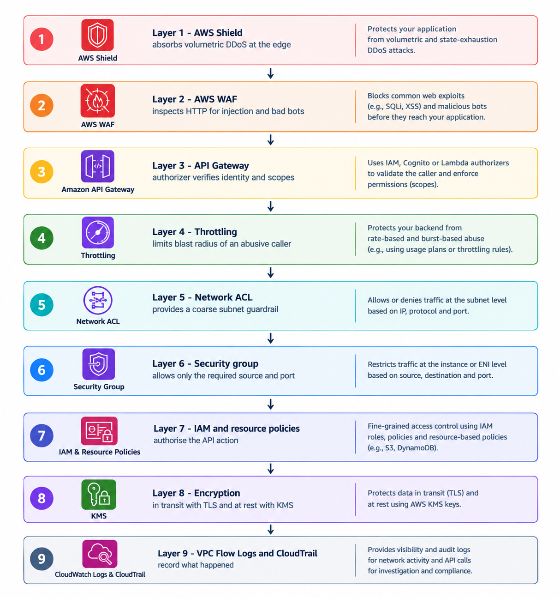
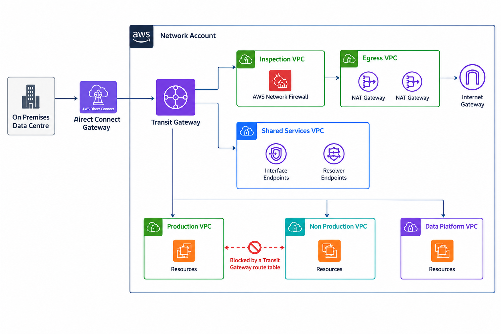

<!-- teachprep:refined 2026-10-11 -->
# Networking Services: Amazon VPC, Amazon Route 53, and Amazon API Gateway

## Definition

This topic covers the three services that decide how a request reaches your application:

| Service | What it is | Scope |
|---|---|---|
| **Amazon VPC** | A logically isolated, software-defined network in which you place AWS resources, using an IP range you choose | **Regional**: spans every AZ in one Region, never crosses Regions |
| **Amazon Route 53** | A highly available authoritative DNS service, with domain registration, health checks and DNS-based traffic routing | **Global** (control plane anchored in `us-east-1`) |
| **Amazon API Gateway** | A fully managed front door for APIs: authentication, validation, throttling, caching and monitoring without application code | **Regional** |

Route 53 turns a name such as `api.example.com` into an address. The VPC decides whether a packet can travel to that address. API Gateway is one of the managed entry points that sits in that path.

<figure markdown="span">
    {width="80%"}
    <figcaption>AWS network services</figcaption>
    
<i>Image Source: AI Generated (Google Gemini)</i>

</figure>

<figure markdown="span">
    {width="80%"}
    <figcaption>Where networking sits in the architecture</figcaption>
    
<i>Image Source: AI Generated (Google Gemini)</i>

</figure>

!!! note "The three layers of a network answer"
    Almost every AWS networking problem breaks into three layers. When something does not work, check them in this order:

    1. **Name resolution** (Route 53): what address do I connect to?
    2. **Path** (route tables, gateways, endpoints): can the packet get there?
    3. **Permission** (security groups, NACLs, IAM and resource policies): is the packet allowed?

## Why This Service or Concept Exists

### Why Amazon VPC

The original EC2 network (**EC2-Classic**) put every customer on one flat shared network. There was no customer-defined address space, no subnets, no route tables and no private-only instances. Enterprises could not accept this:

1. **No network isolation.** Regulated workloads need a database to be *unreachable* from the internet as a property of the network, not just of a firewall rule.
2. **No address planning.** Connecting to an on-premises data centre over VPN or Direct Connect requires addresses that do not collide.
3. **No tiering.** The classic three-tier design depends on saying "this subnet has no route to the internet".

Amazon VPC (launched 2009, the default since 2013) gave customers a network they could design. Compared with a data centre, a subnet is an API call rather than a VLAN change, the router is built in and free, and the firewall is enforced at every network interface rather than in a shared appliance.

### Why Route 53

Running authoritative DNS yourself is hard: it needs globally distributed infrastructure, DDoS resistance and near-perfect availability, because **when DNS fails, everything fails**.

Route 53 also turns DNS into a **traffic-management tool**. Classic DNS answers "what is the address of this name?" Route 53 can answer "what is the *best* address for this user, given health, latency, location and weighting?" That makes DNS a mechanism for global failover and gradual releases.

### Why API Gateway

Before managed API front doors, every service re-implemented authentication, rate limiting, request validation, CORS and per-route metrics. This code was duplicated, drifted between services and caused many security incidents. API Gateway moves these concerns into a managed tier **in front of** your code. It also makes serverless HTTP possible: a Lambda function has no listening port, so something must terminate TLS and invoke it.

## Core Concepts

### The VPC as a software-defined network

A VPC is **not** a physical network. Your instances share hosts and network fabric with other customers; isolation is enforced in software at every host. That is why you cannot sniff a neighbour's traffic, why broadcast and multicast do not work natively, and why a security group is not a chokepoint that can be overwhelmed.

### CIDR and Address Planning

**CIDR notation** writes a network as `address/prefix-length`. The prefix length is the number of fixed leading bits; the rest number the hosts. A `/16` fixes 16 bits and leaves 16, giving 65,536 addresses. Each extra prefix bit halves the size.

| CIDR | Total addresses | Usable in an AWS subnet | Typical use |
|---|---|---|---|
| `/16` | 65,536 | 65,531 | Largest VPC CIDR block |
| `/20` | 4,096 | 4,091 | Common private application subnet |
| `/24` | 256 | 251 | Public subnet for load balancers and NAT |
| `/26` | 64 | 59 | Minimum practical subnet for an ALB |
| `/28` | 16 | 11 | Smallest subnet AWS permits |

VPC and subnet blocks must be between `/16` and `/28`. A VPC can add **secondary CIDR blocks** later; this is the normal remedy when it runs out of addresses.

**AWS reserves five addresses in every subnet.** In `10.0.1.0/24` they are `.0` (network address), `.1` (VPC router), `.2` (Amazon-provided DNS), `.3` (future use) and `.255` (broadcast, not supported but reserved).

!!! warning "The reserved-address trap"
    A `/28` gives 11 usable addresses, not 16, and an ALB needs at least 8 free addresses per subnet to scale. Undersized subnets fail with `InsufficientFreeAddressesInSubnet` during a traffic spike, exactly when scaling matters most. Containers make this worse: ECS `awsvpc` mode and the EKS VPC CNI use one VPC IP per task or Pod.

**A reference plan.** Allocate hierarchically so ranges never collide across environments and Regions:

| Scope | CIDR | Rationale |
|---|---|---|
| Production, Region A | `10.0.0.0/14` | Room for several VPCs, summarisable in one route |
| Production VPC 1 | `10.0.0.0/16` | Public `/24`s, private `/20`s and isolated `/22`s per AZ (see [Common configuration](#amazon-vpc)) |
| Reserved for growth | `10.0.128.0/17` | Do not allocate the second half on day one |
| Non-production / DR Region | `10.4.0.0/14` / `10.8.0.0/14` | Distinct ranges so peering stays possible |

!!! danger "Overlapping CIDRs are effectively permanent"
    VPC peering and Transit Gateway **cannot** connect networks with overlapping CIDRs. A VPC's CIDR cannot be changed and subnets cannot be resized. If two teams both chose `10.0.0.0/16`, the fix is rebuilding a VPC or inserting a NAT layer. Address planning is one of the few AWS decisions that is genuinely expensive to reverse.

### Subnets and Availability Zones

A **subnet** is a range of addresses inside a VPC, bound to **exactly one Availability Zone**. To survive the loss of an AZ you need subnets, and running capacity, in at least two AZs, preferably three.

What makes a subnet public or private is **only its route table**:

| Subnet type | Route table contains | Typical contents |
|---|---|---|
| **Public** | A route to an Internet Gateway | Load balancers, NAT gateways |
| **Private** | A default route to a NAT gateway (outbound only) | Application instances, containers |
| **Isolated** | Neither | Databases, caches |

!!! note "AZ names versus AZ IDs"
    The name `us-east-1a` maps to different physical zones in different accounts. The **AZ ID** (for example `use1-az2`) is the same everywhere. Compare AZ IDs when aligning resources across accounts, for example to avoid cross-AZ data charges.

### Route tables

Every VPC has a built-in router; **route tables** tell it where to send traffic. Each subnet uses exactly one route table; without an explicit association it uses the VPC's **main** route table.

- **Longest prefix match:** the most specific matching route wins, regardless of order.
- Every route table has a **local route** for the VPC CIDR. It cannot be removed and always handles traffic inside the VPC.

<figure markdown="span">
    {width="80%"}
    <figcaption>VPC packet routing</figcaption>
    
<i>Image Source: AI Generated (Google Gemini)</i>

</figure>

!!! warning "Timeout versus connection refused"
    A packet with no matching route is silently dropped, and a security group or NACL denial is also silent. Both appear to the application as a **timeout**. A **connection refused** (TCP reset) means the packet arrived and the destination rejected it. Reading this difference is the most useful troubleshooting reflex in AWS networking.

### Internet Gateway

An **Internet Gateway (IGW)** is a highly available component attached to a VPC (one per VPC). It is the route-table target for internet traffic, and it performs **one-to-one NAT** between an instance's private address and its public IP or Elastic IP. The instance never sees its public address: `ip addr` inside it shows only the private one. An IGW is free and adds no bandwidth limit.

For IPv6, which needs no NAT, an **egress-only Internet Gateway** allows outbound connections and their replies while blocking inbound ones.

!!! tip "Internet access needs four things"
    An IGW alone is not enough. An instance also needs a public IP or Elastic IP, a route to the IGW, and security group and NACL rules that allow the traffic.

### NAT Gateway

A **NAT gateway** lets instances in private subnets start outbound connections (patches, image pulls, third-party APIs) while the internet cannot connect to them.

- It lives **in a public subnet** and uses an Elastic IP.
- It is **zonal**: it does not fail over across AZs. Deploy **one per AZ**, each zone's private route table pointing at its own NAT gateway.
- It scales automatically from 5 Gbps up to 100 Gbps, and supports up to 55,000 simultaneous connections to each unique destination. Exceeding that produces `ErrorPortAllocation`.
- It cannot accept inbound connections, so it cannot publish a service.

!!! tip "The most common avoidable networking cost"
    NAT gateways charge per hour **and** per gigabyte processed. A workload that pulls images and writes to S3 through NAT can spend more on NAT than on compute. A **Gateway endpoint for S3** is free and removes that traffic from the NAT path.

### Security Groups Versus Network ACLs

The two packet filters in a VPC. This fundamentals comparison is examined constantly.

| Dimension | Security group | Network ACL |
|---|---|---|
| Attaches to | Network interfaces (instances, tasks, load balancers, RDS, endpoints) | Subnets |
| State | **Stateful**: replies to allowed traffic are allowed automatically | **Stateless**: replies need their own rule |
| Rule types | Allow only | Allow **and** deny |
| Evaluation | All rules; any allow permits | In rule-number order; first match wins |
| Default | New group: all outbound, no inbound | Default NACL allows all; a custom NACL denies all until rules are added |
| Source can be | CIDR, prefix list, **another security group** | CIDR only |
| Typical use | The main control; expresses application intent | Coarse subnet guardrail; blocking a specific CIDR |

!!! warning "The ephemeral-port trap"
    Because a NACL is stateless, the reply to an inbound HTTPS request goes to the client's **ephemeral port**, so outbound NACL rules must allow `1024-65535`. Forgetting this makes every connection hang. Put the real policy in security groups and keep NACLs coarse.

Security group design, connection tracking and NACL incident use are covered in [8.2 Network Security](../unit8/topic2.md#vpc-design-and-security-groups) and [Network ACLs and VPC Flow Logs](../unit8/topic2.md#network-acls-and-vpc-flow-logs).

### Security Group Referencing  the Cloud-Native Idiom

A security group rule's source can be **another security group** instead of a CIDR. For example, `sg-app` allows TCP 8080 from `sg-alb`. As load balancer nodes scale and tasks are replaced with new IP addresses, the rule stays correct with no edits.

This is **identity-based** rather than **address-based** policy: a firewall rule that survives elasticity. CIDR-based rules in an auto-scaling environment drift and become a maintenance defect. [8.2](../unit8/topic2.md#vpc-design-and-security-groups) builds on this with one group per service role and chained tiers.

### VPC Endpoints

By default, a call from a private subnet to an AWS service such as S3 goes out through the NAT gateway to the service's public endpoint. **VPC endpoints** keep that traffic on the AWS private network and remove the NAT dependency.

| Aspect | Gateway endpoint | Interface endpoint (AWS PrivateLink) |
|---|---|---|
| Services | **S3 and DynamoDB only** | Most AWS services, plus partner and your own services |
| Mechanism | A **route** in the route table to a prefix list | A **network interface** with a private IP in your subnet |
| Reachable over peering, VPN, Direct Connect | No | Yes |
| Security control | Endpoint policy | Endpoint policy plus a **security group** |
| Cost | **Free** | Per hour per AZ, plus per gigabyte |

!!! note "PrivateLink can also publish a service"
    A provider can put a Network Load Balancer in front of a service, create a **VPC endpoint service**, and let named accounts create Interface endpoints to it. Consumers reach it through an address in their own VPC: no peering, no route exchange, and no CIDR-overlap problem. This is the standard way to deliver SaaS privately.

### VPC Peering Versus Transit Gateway

**VPC peering** is a one-to-one private connection between two VPCs (same or different Region and account). It is **non-transitive**: if A peers with B and B with C, A still cannot reach C.

**AWS Transit Gateway** is a regional hub. Each VPC, VPN or Direct Connect gateway attaches once, and the hub routes between attachments. This turns an n(n−1)/2 mesh into n attachments.

| Criterion | VPC peering | Transit Gateway |
|---|---|---|
| Transitive routing | No | Yes |
| Connections for n VPCs | n(n−1)/2 | n |
| On-premises integration | No | Native (VPN, Direct Connect) |
| Segmentation | Implicit (which peerings exist) | Explicit (multiple TGW route tables) |
| Cost | No hourly charge; data transfer applies | Per attachment hour plus per gigabyte |
| Choose when | Two to about five VPCs, stable, cost-sensitive | Many VPCs, hybrid connectivity, multi-account |

!!! tip "Decision rule"
    Below roughly five VPCs with no on-premises link, peering is cheaper and simpler. Beyond that, or as soon as you need VPN, Direct Connect or segmentation, choose Transit Gateway.

### Load balancers and CloudFront in the request path

These services are covered elsewhere; here, only their place in the path matters.

- **Elastic Load Balancing** distributes traffic across targets in several AZs. Its nodes live in the subnets you choose and their addresses change, so always use the load balancer's **DNS name** or a Route 53 alias, never an IP. An **ALB** works at layer 7 (HTTP routing by host and path); an **NLB** works at layer 4 (TCP/UDP, static IP per AZ, very high throughput). Load balancers are used hands-on with ECS in Unit 2.
- **Amazon CloudFront** terminates TLS at the edge location nearest the user, serves cached content, and forwards misses over the AWS backbone. It helps dynamic APIs too, by shortening the TLS handshake distance. The edge network is introduced in [1.1](topic1.md).

### DNS fundamentals and Route 53

DNS is a distributed, hierarchical, cached database: resolution goes from the root, to the top-level domain, to the zone's authoritative name servers.

| Concept | Meaning |
|---|---|
| **Public / private hosted zone** | Answers the internet / answers only the VPCs associated with it |
| **Split-horizon DNS** | The same name in a public and a private zone, resolving differently inside and outside the VPC |
| **NS records** | Delegate authority; Route 53 gives each public zone four name servers, which you set at the registrar |
| **TTL** | How long resolvers may cache an answer. Short (about 60 s) speeds failover; long (300 to 3600 s) reduces cost and suits stable records |
| **Health check** | Active probe of an endpoint, a CloudWatch alarm, or a combination of other checks |
| **Route 53 Resolver** | The DNS resolver inside every VPC (base address plus two); Resolver endpoints forward DNS to and from on-premises networks |

**Common record types.**

| Record | Maps | Note |
|---|---|---|
| `A` / `AAAA` | Name to IPv4 / IPv6 address | The basic answer |
| `CNAME` | Name to another name | **Not allowed at the zone apex** (`example.com`) |
| **Alias** | Name to an AWS resource | Allowed at the apex; returns an A/AAAA answer; follows changing addresses; queries to AWS resources are free |
| `MX`, `TXT` | Mail servers; arbitrary text | TXT is often used for domain verification |
| `NS`, `SOA` | Delegation; zone metadata | Created automatically with the zone |

!!! warning "Health checks cannot see private resources"
    Route 53 health checkers run on the public internet and cannot probe a private subnet. To fail over on a private resource's health, publish a CloudWatch metric and use a **CloudWatch alarm health check**.

### Route 53 routing policies

| Policy | What it does | Typical use | Caution |
|---|---|---|---|
| **Simple** | Returns one record (multiple values in random order) | A single endpoint | No health checks, no failover |
| **Weighted** | Splits answers by weight (0 to 255) | Canary and blue-green releases, migration | Caching makes the split approximate |
| **Latency** | Returns the Region with lowest latency to the resolver | Multi-Region active-active | Optimises speed, not compliance |
| **Failover** | Primary while healthy, otherwise secondary | Active-passive disaster recovery | Speed limited by TTL plus detection time |
| **Geolocation** | Answers by the user's continent or country | Data residency, licensing, localisation | Always add a **default** record |
| **Geoproximity** | Routes by distance, adjustable with a bias | Gradually shifting traffic between Regions | Needs Traffic Flow; harder to reason about |
| **Multivalue answer** | Up to eight healthy records at random | Simple health-aware spreading | Not a load balancer |
| **IP-based** | Answers by client CIDR ranges you define | Steering specific networks or ISPs | CIDR data must be maintained |

!!! tip "Choosing a routing policy"
    **Performance** for global users: latency. **Percentages** or canaries: weighted. **Legal or country rules**: geolocation. **Active-passive DR**: failover.

!!! info "DNS failover is coarse"
    Failover depends on TTL, and some resolvers ignore TTL. For faster failover, use a load balancer within a Region or AWS Global Accelerator across Regions, which shifts traffic at the network layer without relying on DNS caches.

## AWS Service Deep Dive

### Amazon VPC

**Architecture.** A regional VPC contains zonal subnets. A built-in router follows per-subnet route tables. Gateways and endpoints are the exits. Filtering is enforced at every network interface.

**Useful features beyond the basics.** **Flow Logs** (metadata of accepted and rejected flows), **prefix lists** (named CIDR sets reusable in routes and rules), **VPC sharing** through Resource Access Manager (a network team owns the VPC; application accounts deploy into it), **Reachability Analyzer** (tells you from configuration whether A can reach B, and what blocks it), and **AWS Network Firewall** for egress filtering ([8.2](../unit8/topic2.md)).

**Pricing.** The VPC, subnets, route tables, Internet Gateways, security groups and NACLs are **free**. You pay for NAT gateways, Interface endpoints, Transit Gateway, data transfer, and every public IPv4 address (hourly since 2024, attached or idle). See the [cost table](#operating-it-performance-cost-and-monitoring).

**Availability.** The router and Internet Gateways are highly available by design. **NAT gateways, Interface endpoint interfaces and subnets are zonal**: here your design, not AWS, decides availability.

**Limits worth knowing.** A VPC cannot span Regions. Its CIDR cannot change (only secondary blocks can be added) and subnets cannot be resized. Default quotas include 5 VPCs per Region and 5 security groups per network interface; most are adjustable in Service Quotas.

**Common configuration.** A `/16` VPC across three AZs: one public `/24` per AZ for load balancers and NAT, one private `/20` per AZ for compute, one isolated `/22` per AZ for data, one NAT gateway per AZ, Gateway endpoints for S3 and DynamoDB, Interface endpoints for the AWS APIs you call often, and Flow Logs enabled.

### Amazon Route 53

**Architecture and features.** Globally distributed name servers, a global health-checker fleet and a Resolver in every VPC. Features: Public and private hosted zones (split-horizon), alias records, the routing policies above, health checks, **Traffic Flow** (a visual editor for combining policies), Resolver endpoints for hybrid DNS, Resolver DNS Firewall, and DNSSEC signing.

**Availability.** Route 53 offers a **100 percent availability SLA** for its DNS data plane, unique among AWS services.

**Pricing.** Per hosted zone per month, per million queries (rates vary by policy), and per health check per month. **Alias queries to AWS resources are free.**

**Propagation.** Record changes reach all Route 53 name servers within about 60 seconds, but what users see depends on TTL and resolver caching.

### Amazon API Gateway

API Gateway is the managed front door between clients and backend compute (Lambda, ECS, EKS, EC2 or any HTTP endpoint). This section is an introduction; the full treatment of features, throttling levels, usage plans and pricing is in [4.2 API Management and Service Mesh](../unit4/topic2.md#amazon-api-gateway).

**Core vocabulary.**

| Term | Meaning |
|---|---|
| **Integration** | What API Gateway calls: Lambda, an HTTP endpoint, an AWS service directly, or a private resource through a **VPC Link** |
| **Stage** | A named deployment (`dev`, `prod`) with its own settings, throttling and URL |
| **Authorizer** | IAM, Amazon Cognito, a Lambda authorizer, or (HTTP APIs) a built-in JWT authorizer |
| **Throttling** | Token-bucket rate and burst limits that protect the backend |

**The three API types.**

| Dimension | REST API | HTTP API | WebSocket API |
|---|---|---|---|
| Model | Request-response | Request-response | Persistent two-way connection |
| Relative cost | Highest | Roughly 70 percent cheaper than REST | Per message and connection minute |
| Endpoint types | Edge, Regional, Private | Regional | Regional |
| WAF, API keys and usage plans, caching, request validation | Yes | No | No |
| Best for | Regulated or monetised APIs | Most new serverless APIs | Chat, live dashboards, notifications |

!!! tip "Choosing the API type"
    Start with an **HTTP API**. Move to a **REST API** only for a feature it alone offers (WAF, API keys, request validation, caching, private or edge endpoints). Use a **WebSocket API** only when the server must push to the client. The type cannot be changed after creation.

!!! info "Direct service integration"
    API Gateway can put a message on SQS or start a Step Functions execution with **no Lambda function in between**. When an API only needs to accept and enqueue work, this removes a whole compute tier.

**Limits that shape design.** By default: 10,000 requests per second with a 5,000-request burst per account per Region; a 29-second default integration timeout; a 10 MB payload limit (use pre-signed S3 URLs for large uploads). Long-running work should be made asynchronous. API Gateway will accept more traffic than your backend can serve, so per-route throttling is a design tool.

## Architecture Components

The components a request meets, in order, and what each is responsible for:

| Component | Responsibility | Scope |
|---|---|---|
| **Route 53** | Resolves the name; applies routing policy and health checks | Global |
| **CloudFront** (optional) | Terminates TLS near the user; caches | Edge |
| **API Gateway / ALB / NLB** | Entry point: authentication and throttling, or HTTP / TCP load balancing | Regional, multi-AZ |
| **VPC** | Address space and network boundary | Regional |
| **Subnet + route table** | Address range in one AZ; decides where traffic goes | Zonal |
| **Internet Gateway / NAT gateway** | Internet path in and out / outbound only | VPC / zonal |
| **Security group / NACL** | Permits traffic at the interface / subnet | Interface / subnet |
| **VPC endpoints** | Private path to AWS services | Route table / zonal |
| **Peering / Transit Gateway** | Connects VPCs and on-premises networks | VPC pair / regional |
| **Compute and data** (EC2, ECS, EKS, Lambda, RDS) | The workload that finally handles the request | Placement decides resilience |

## Important AWS Terminology

| Term | Meaning |
|---|---|
| **VPC** | Logically isolated virtual network in one Region |
| **CIDR block** | IP range written as address/prefix, for example `10.0.0.0/16` |
| **Subnet** | A CIDR range inside a VPC, in exactly one AZ |
| **Public / private / isolated subnet** | Route to an IGW / route to a NAT gateway / neither |
| **Route table** | Routes applied to traffic leaving a subnet |
| **Internet Gateway** | Internet path plus one-to-one NAT for public addresses |
| **NAT gateway** | Zonal, managed outbound-only internet access for private subnets |
| **ENI** | Elastic network interface; carries addresses and security groups |
| **Security group** | Stateful, allow-only filter on network interfaces |
| **Network ACL** | Stateless, ordered allow and deny filter on subnets |
| **Ephemeral port** | Short-lived client port, typically 1024 to 65535 |
| **Gateway endpoint** | Free route-based private path to S3 or DynamoDB |
| **Interface endpoint** | Network interface giving a private path to a service via PrivateLink |
| **VPC peering** | Non-transitive private link between two VPCs |
| **Transit Gateway** | Regional hub with transitive routing between VPCs, VPN and Direct Connect |
| **VPC Flow Logs** | Metadata records of accepted and rejected flows |
| **Hosted zone** | Container of DNS records for a domain; public or private |
| **Alias record** | Route 53 record pointing at an AWS resource; usable at the apex |
| **TTL** | How long a resolver may cache a DNS answer |
| **VPC Link** | API Gateway connection to private resources in a VPC |

## Configuration Options

### VPC configuration

| Setting | Guidance |
|---|---|
| VPC CIDR | `/16` unless there is a strong reason; unused space is free |
| DNS support and DNS hostnames | Enable both; Interface endpoint private DNS needs them |
| Auto-assign public IPv4 | Off for private and isolated subnets |
| Route table association | Always explicit; relying on the main route table causes accidents |
| IPv6 | Consider dual stack to reduce public IPv4 charges |
| Interface endpoint private DNS | Enable so existing code needs no change |
| Endpoint policy | Restrict to your own buckets and accounts to prevent data exfiltration |

### API Gateway Configuration

Only the settings that affect network design. Authorizer, throttling and logging settings are covered in [4.2](../unit4/topic2.md#api-gateway-configuration).

| Setting | Options | Guidance |
|---|---|---|
| Endpoint type | Edge-optimised, Regional, Private | Regional plus your own CloudFront gives most control; Private for internal APIs |
| Integration | Lambda proxy, HTTP proxy, AWS service, VPC Link | Prefer proxy integrations; VPC Link to reach a private ALB or NLB |
| Caching | Off, or a sized cache per stage (REST only) | Charged per hour; justify with a measured hit rate |
| CORS | Per API or per route | Configure at the gateway, not in every handler |

## Design Considerations

<figure markdown="span">
    {width="80%"}
    <figcaption>Entry-point decision framework</figcaption>
    
<i>Image Source: AI Generated (Chatgpt)</i>

</figure>

| Quality | What to design for |
|---|---|
| **Scalability** | The fabric scales itself; **address space**, NAT capacity and downstream capacity do not. EKS is the usual cause of IP exhaustion: 300 nodes with 30 Pods each need about 9,000 addresses. Bound API Gateway with throttling so scaling does not just move the failure to the database |
| **Availability** | List the zonal components and make each loss survivable: one NAT gateway per AZ, Interface endpoints in every AZ used, load balancers in at least two (preferably three) subnets, Multi-AZ RDS, Route 53 failover records |
| **Latency** | Every hop adds latency and a failure mode. Terminate TLS at the edge, reuse connections, remove components that exist only by habit |
| **Cost** | Charges are per gigabyte and invisible in code: NAT processing, cross-AZ traffic, internet egress, endpoint hours, public IPv4 |
| **Maintainability** | Prefer fewer parts; reference security groups instead of CIDRs; define everything in code |

!!! danger "The single NAT gateway anti-pattern"
    Routing every private subnet to one NAT gateway saves one hourly charge but causes two problems. If that AZ fails, **every** private subnet loses outbound access, so a zonal failure becomes a VPC-wide failure. And traffic from other AZs pays cross-AZ charges on top of NAT processing.

## AWS Best Practices

| Pillar | Network-specific practice |
|---|---|
| **Operational Excellence** | Define the network in code ([5.3](../unit5/topic3.md)), in a stack separate from applications; tag every resource; check paths with Reachability Analyzer |
| **Security** | Private by default; security groups reference security groups; restrict endpoint policies; enable Flow Logs |
| **Reliability** | Three AZs where available (two minimum); one NAT gateway per AZ; recovery that does not depend on control-plane calls in the failed Region |
| **Performance Efficiency** | CloudFront in front of user-facing traffic; Gateway endpoints for S3 and DynamoDB; connection reuse |
| **Cost Optimization** | Audit NAT traffic and move top talkers to endpoints; release idle Elastic IPs; prefer HTTP APIs |
| **Sustainability** | Less data moved means less energy: cache at the edge, compress, remove unnecessary hops |

## Security Considerations

<figure markdown="span">
    {width="80%"}
    <figcaption>Defence in depth applied to the network</figcaption>
    
<i>Image Source: AI Generated (Chatgpt)</i>

</figure>

- **Nothing public by default.** Only load balancers and NAT gateways belong in public subnets.
- **No open SSH.** Port 22 open to `0.0.0.0/0` is the most common finding in AWS security reviews. Use **Systems Manager Session Manager**, which needs no inbound port and no bastion host.
- **Network permissions are dangerous IAM permissions.** `ec2:AuthorizeSecurityGroupIngress` can open a database to the world; keep it out of application deployment roles ([8.1](../unit8/topic1.md)).
- **Keep service calls private.** Reach Secrets Manager, KMS and S3 through endpoints, and use the `aws:SourceVpce` condition so leaked credentials do not work outside your network ([8.3](../unit8/topic3.md)).
- **Encrypt in transit.** Terminate TLS at CloudFront or the load balancer with ACM certificates; CloudFront certificates must be in `us-east-1`.
- **Log everything.** Flow Logs, CloudTrail, Resolver query logs and access logs answer who did what and which flows were rejected.

WAF, Shield and detailed security group and NACL design are covered in [8.2](../unit8/topic2.md).

## Operating It: Performance, Cost and Monitoring

**Performance.**

- **Cache** at CloudFront (design the cache key; forwarding every header destroys the hit rate) and, for REST APIs, at the API Gateway stage. DNS TTL is also a cache.
- **Reuse connections** at every layer: HTTP keep-alive, database pools, SDK clients created outside the Lambda handler.
- **Lambda in a VPC** gets no internet access unless its subnet routes to a NAT gateway; attach a function to a VPC only when it must reach a private resource (see [1.3](topic3.md)).

**Cost.**

| Cost driver | How to control it |
|---|---|
| NAT gateway processing | Gateway endpoints for S3 and DynamoDB; Interface endpoints for ECR, CloudWatch Logs, Secrets Manager |
| NAT gateway hours | One per AZ in production; fewer in development only |
| Cross-AZ data transfer | Keep chatty traffic within an AZ where availability allows |
| Internet egress | CloudFront and compression |
| Public IPv4 addresses | Remove unnecessary public IPs; release idle Elastic IPs; consider IPv6 |
| Interface endpoints | Create only for services called at volume; share centrally in large estates |
| Transit Gateway | Justify against peering below about five VPCs |

!!! example "A real cost investigation"
    A team's NAT data-processing charge exceeded its whole ECS compute bill. Flow Logs analysed in Athena showed 78 percent of NAT bytes went to S3 and Amazon ECR. A free S3 Gateway endpoint plus Interface endpoints for `ecr.api`, `ecr.dkr` and `logs` cut the NAT charge by more than 80 percent. You cannot optimise what you have not measured.

**Monitoring.**

| Signal | Source | Tells you |
|---|---|---|
| Accepted and rejected flows | VPC Flow Logs (metadata, not payloads) | Misconfigurations, probes, what crosses the NAT gateway |
| `ErrorPortAllocation`, `BytesOutToDestination` | NAT gateway metrics | Port exhaustion; cost driver |
| `Latency` versus `IntegrationLatency` | API Gateway metrics | The gap is API Gateway's own overhead |
| `HealthCheckStatus` | Route 53 | Failover readiness |
| Security group and route changes | CloudTrail | Who changed what; alert on rules opening `0.0.0.0/0` |

Flow Log fields and security use are in [8.2](../unit8/topic2.md#network-acls-and-vpc-flow-logs); CloudWatch and X-Ray are covered in [7.1](../unit7/topic1.md).

## Integration with Other AWS Services

| Service | Network integration |
|---|---|
| **ECS** | `awsvpc` mode gives each task its own interface, IP and security groups ([2.2](../unit2/topic2.md)) |
| **EKS** | VPC CNI gives each Pod a VPC IP, so subnets must be sized for Pod count ([3.1](../unit3/topic1.md)) |
| **Lambda** | Optional VPC attachment for private resources ([1.3](topic3.md)) |
| **S3, DynamoDB** | Gateway endpoints; `aws:SourceVpce` in bucket policies |
| **RDS, ElastiCache** | Subnet groups across AZs; security group referencing the app's group ([6.2](../unit6/topic2.md)) |
| **SQS, SNS, EventBridge** | Interface endpoints; direct API Gateway integration ([6.3](../unit6/topic3.md)) |
| **CloudFormation, CDK, Terraform** | The network defined as code (Unit 5) |

## Common Architecture Patterns

**Three-tier web application.** Internet-facing ALB in public subnets, an Auto Scaling group or ECS service in private subnets, Multi-AZ RDS in isolated subnets, a Route 53 alias to the ALB, and CloudFront in front. This remains the right default for many workloads.

**Serverless API.** Route 53 alias to an API Gateway custom domain, an HTTP API with a JWT authorizer, Lambda proxy integration, and DynamoDB. If the functions need no private resources, the compute tier may need no VPC at all.

**Private microservices.** ECS services in `awsvpc` mode behind an internal ALB, discovered through private DNS, exposed externally only through API Gateway with a VPC Link. Each service has its own security group, so policy reads like the architecture diagram: "orders may call payments on port 8443".

**Hub-and-spoke multi-account network.** A network account owns a Transit Gateway shared through Resource Access Manager. Workload VPCs attach to it, an inspection VPC filters traffic, and a shared-services VPC hosts central endpoints so many accounts share one set.

<figure markdown="span">
    {width="80%"}
    <figcaption>Hub-and-spoke multi-account network</figcaption>
    
<i>Image Source: AI Generated (Chatgpt)</i>

</figure>

**Centralised egress.** Instead of NAT gateways in every VPC, send internet-bound traffic through the Transit Gateway to one egress VPC. This saves NAT hours at scale but adds Transit Gateway processing charges and a hop; model the crossover.

Network-level releases use weighted Route 53 records, weighted ALB target groups or API Gateway canary stages ([5.2](../unit5/topic2.md)). Retries, circuit breakers and bulkheads are covered in [4.3](../unit4/topic3.md); event-driven decoupling in [1.7](topic7.md).

## Industry Use Cases

| Industry | Requirement | Networking design |
|---|---|---|
| Banking | Isolation and auditability | Isolated data subnets, Interface endpoints for all AWS APIs, central Flow Logs |
| Healthcare | Hybrid, data residency | Direct Connect plus Transit Gateway, geolocation routing |
| IoT | Devices pin IP addresses | NLB with an Elastic IP per AZ |
| SaaS | Private delivery into customer VPCs | PrivateLink endpoint services behind an NLB |

## Advantages

- **Isolation with software speed.** Data-centre topology provisioned by API call.
- **No firewall chokepoint.** Security groups are enforced at each network interface and scale with the fleet.
- **Identity-based rules.** Security group referencing survives auto scaling and IP churn.
- **Private access to managed services.** Endpoints and PrivateLink remove the internet path.
- **DNS as traffic control.** Failover, canaries and compliance routing without code changes.
- **Shared API concerns handled once**, in API Gateway rather than every service.
- **Everything is code.** The network can be reviewed, reproduced and rebuilt.

## Limitations

- **Address planning is close to irreversible.** CIDRs cannot change and subnets cannot be resized.
- **Peering is non-transitive and forbids overlap.**
- **Zonal components are hidden single points of failure** (NAT gateways, single-AZ endpoints).
- **Data transfer charges are invisible to developers.**
- **DNS failover is limited by caching.**
- **API Gateway limits** (timeout, payload) force asynchronous designs for long or large operations; HTTP APIs lack some REST features, and the type cannot be changed.
- **Multi-account designs grow complex** and need documentation and automated checks.

## Common Mistakes

### Beginner Mistakes

| Mistake | Why it is wrong | Do instead |
|---|---|---|
| Calling a subnet public because of its name | Only an IGW route makes it public | Check the route table |
| Instance in a public subnet with no public IP | The IGW has nothing to translate to | Assign a public or Elastic IP, or use a load balancer |
| Application policy in NACLs | Stateless rules break ephemeral-port replies | Security groups for policy, NACLs as guardrails |
| Sizing subnets by instance count | Reserved addresses, ALB and container IPs are forgotten | Size for peak tasks or Pods plus headroom |
| Hard-coding a load balancer IP | Its addresses change | Use its DNS name or an alias record |
| Overlapping CIDRs across environments | Peering becomes impossible | Plan ranges centrally |

### Production Mistakes

| Mistake | Consequence | Remedy |
|---|---|---|
| One NAT gateway for the VPC | Zonal failure becomes VPC-wide; cross-AZ charges | One per AZ |
| No S3 Gateway endpoint | NAT processing charges on object traffic | Add the free endpoint |
| Security groups built from CIDR lists | Rules drift as the fleet changes | Reference security groups |
| No Flow Logs | Cost and incident analysis become guesswork | Enable and centralise them |
| Interface endpoints in one AZ | A "private" design depends on one zone | Create in every AZ used |
| DR plans needing control-plane calls in the failed Region | Recovery fails when needed | Pre-provision and use health-check failover |

## Summary

AWS networking is about controlling three things deliberately: **what a name resolves to** (Route 53), **where a packet may travel** (VPC routing and endpoints), and **who may send it** (security groups, NACLs, API Gateway authorisers).

| Area | Key lesson |
|---|---|
| **VPC model** | A VPC is software, not wire: enforcement at every interface, no chokepoint, no broadcast |
| **Address planning** | The decision you cannot cheaply undo. Plan hierarchically, leave headroom, never overlap, allow for containers |
| **Subnets** | Public, private or isolated is decided only by the route table. One subnet = one AZ |
| **Filters** | Security groups are stateful and can reference each other, so they carry the real policy; NACLs are stateless guardrails |
| **Zonal components** | NAT gateways, Interface endpoints and subnets are per AZ; you make them highly available |
| **Endpoints** | Keeping traffic on the AWS network improves security and cuts NAT cost; the S3 Gateway endpoint is free |
| **Connectivity** | Peering for a few VPCs; Transit Gateway for many, hybrid or segmented networks |
| **Route 53** | DNS as traffic control: alias records, routing policies and health checks, always limited by TTL |
| **API Gateway** | Managed front door; start with an HTTP API, choose REST only for its extra features |

**Next:** with the network foundation in place, [1.7 Cloud-Native Design Patterns](topic7.md) surveys the architecture patterns built on top of it.

!!! question "Practice and interview questions"
    Questions for this topic are kept separately: [Practice questions](../Questions/unit1.md#16-aws-network-services) · [Interview questions](../interviewquestions/unit1.md#16-aws-network-services).
