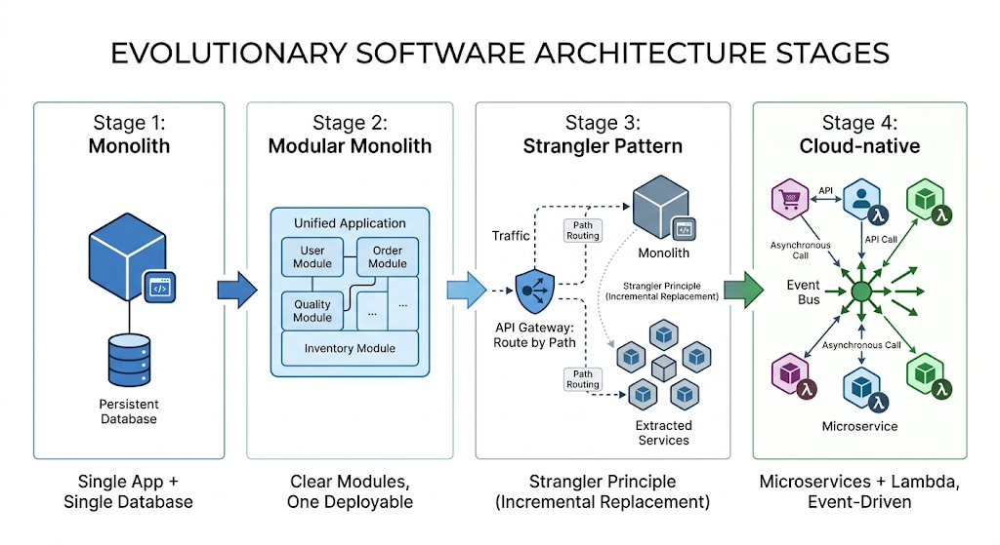
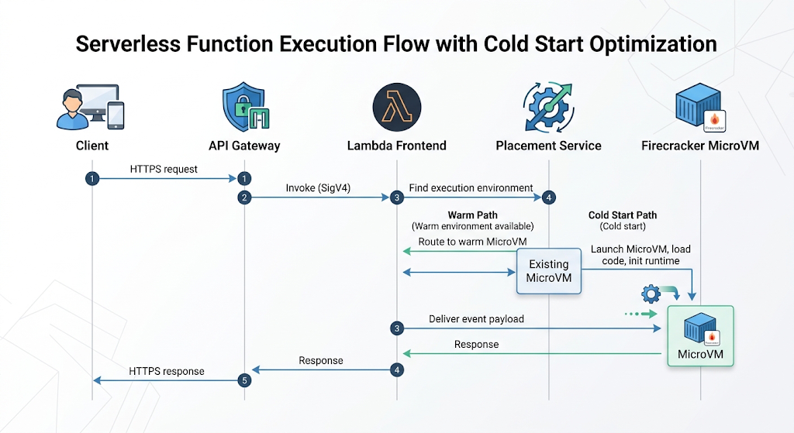
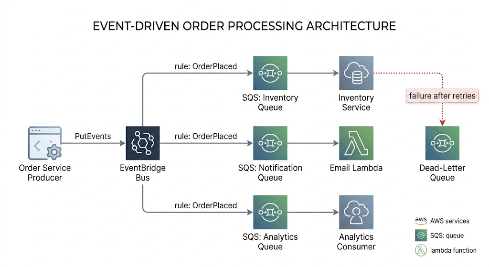
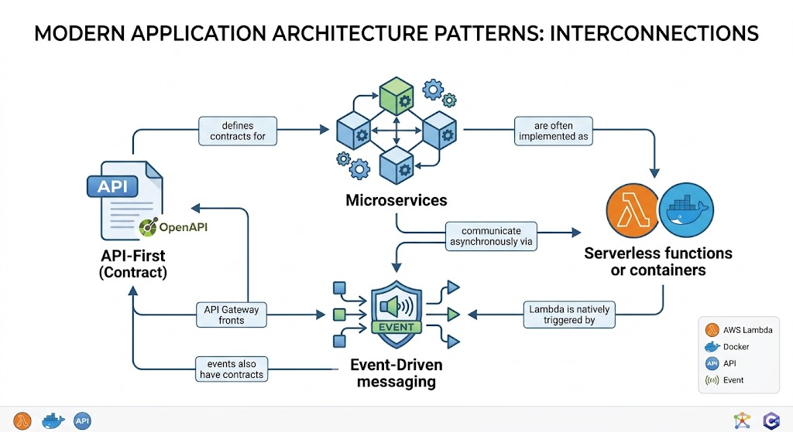
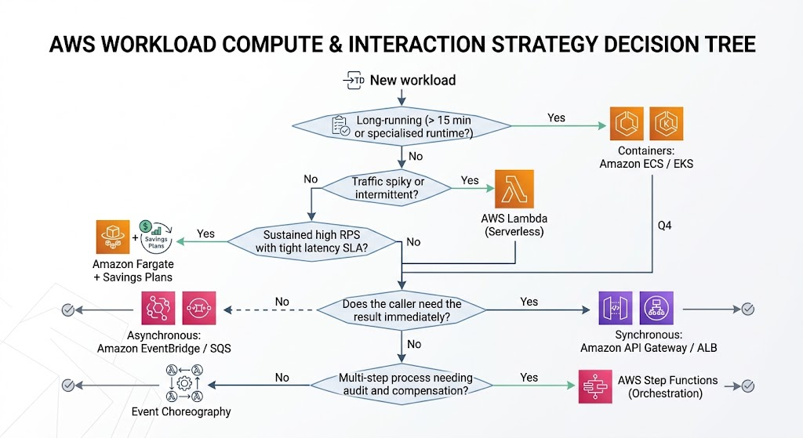
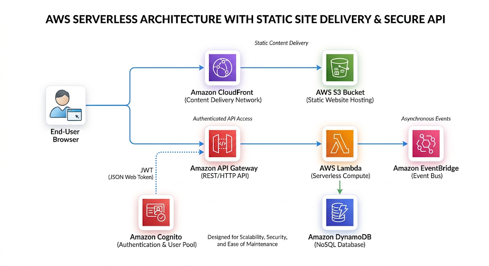
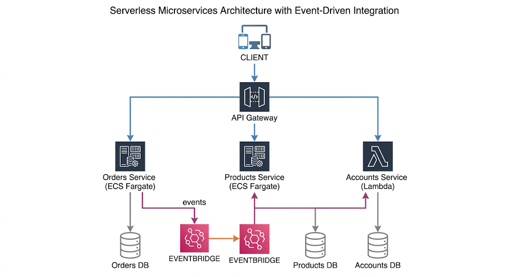
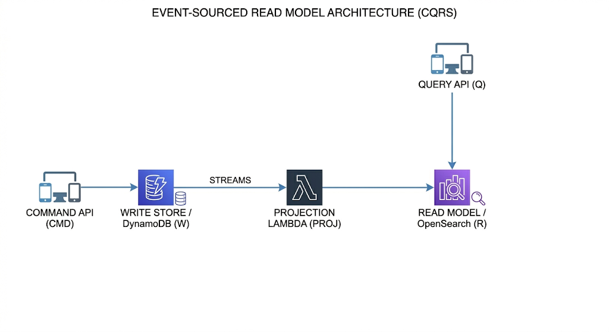
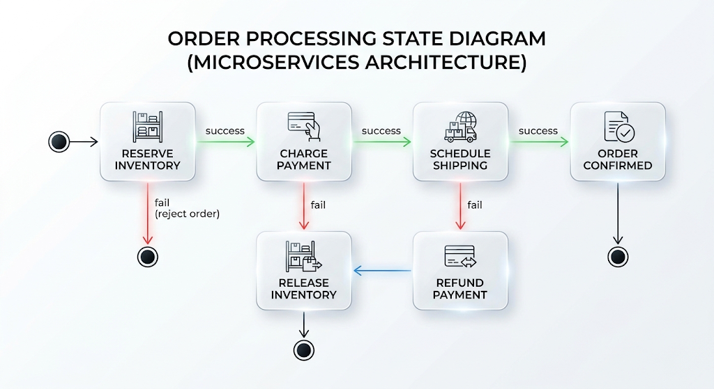
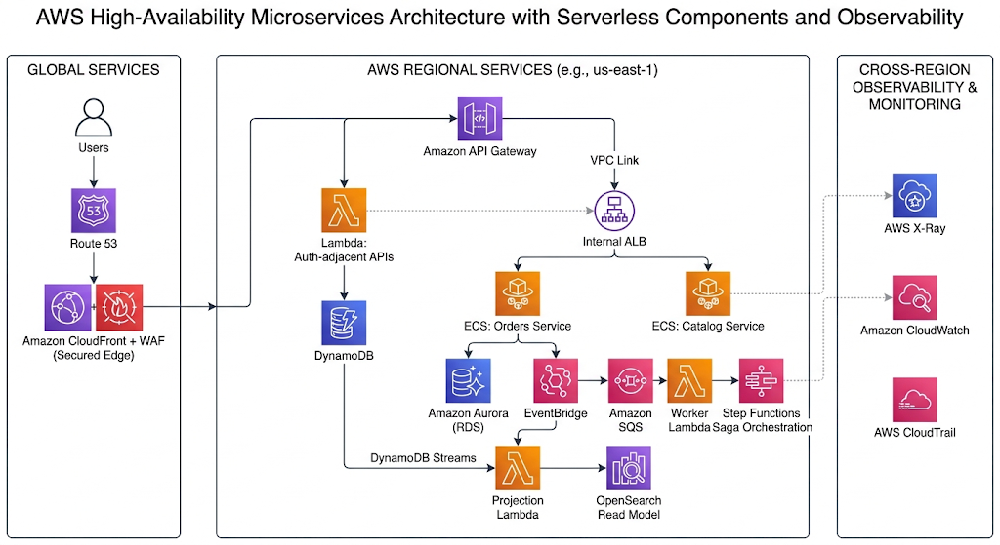

# Cloud-Native Design Patterns: Serverless, Microservices, Event-Driven, API-First

## Definition

A **cloud-native design pattern** is a reusable solution to a recurring architectural problem. It assumes the application runs on elastic, distributed, API-driven cloud infrastructure, not on fixed on-premises servers.

Cloud-native applications are designed _for_ the cloud, not merely _moved to_ it. The Cloud Native Computing Foundation (CNCF) describes cloud-native systems as loosely coupled, resilient, manageable and observable, combined with robust automation so that engineers can make high-impact changes frequently and predictably.

Four patterns form the structural pillars of cloud-native design:

| Pattern | One-sentence definition | Question it answers |
|---|---|---|
| **Serverless** | Run code without provisioning or managing servers; the provider allocates compute on demand and bills per use | How is compute provisioned and billed? |
| **Microservices** | Split an application into small, independently deployable services, each owning its data | How is the system decomposed? |
| **Event-Driven** | Components communicate by producing and consuming events asynchronously | How do parts communicate without coupling? |
| **API-First** | Design and agree the API contract before writing implementation code | How is integration governed? |

!!! info "Patterns, not products"
    A pattern is a way of thinking; a service is a tool. You can build microservices badly on EKS, and you can build a serverless system that breaks every microservices principle. Examinations and interviews test whether you understand the _pattern_, not whether you can name the service.

## Why These Patterns Exist

### The problem with the traditional monolith

The traditional enterprise application was a **monolith** on long-lived servers:

- All features in one deployable artifact and one shared relational database.
- Scaling meant a bigger server, or cloning the whole application even if only one feature was busy.
- One bug could crash everything; one deployment risked every feature.
- Releases took weeks or months because every team coordinated around one artifact.
- Capacity was bought for _peak_ load, so servers sat mostly idle but were paid for 24/7.

### Why the cloud demanded new patterns

Cloud infrastructure changed three assumptions:

1. **Compute became elastic and metered.** Provisioning for peak is wasteful when capacity arrives in seconds and is billed per second. Serverless takes this to its conclusion: pay per invocation.
2. **Failure became normal.** In a fleet of thousands of machines across Availability Zones, something is always failing. Architectures must isolate failure (microservices) and absorb it asynchronously (event-driven).
3. **Delivery speed became a competitive advantage.** Independent deployability (microservices) and stable contracts (API-first) make frequent deployment safe.

| Dimension | Traditional monolith | Cloud-native |
|---|---|---|
| Deployment unit | One large artifact | Many small services or functions |
| Scaling | Vertical, whole application | Horizontal, per component, automatic |
| Failure blast radius | Entire application | One service or function |
| Data ownership | One shared database | Database per service |
| Communication | In-process method calls | Network calls: APIs and events |
| Capacity model | Provision for peak | Elastic, pay per use |
| Release cadence | Weeks to months | Minutes to hours |
| Team structure | Layered (UI team, DB team) | Cross-functional, service-aligned |

<figure markdown="span">
    {width="80%"}
    <figcaption>Evolution of software architecture stages</figcaption>
    
<i>Image Source: AI Generated (Google Gemini)</i>

</figure>

!!! note "Conway's Law"
    Organisations design systems that mirror their communication structures. Microservices are as much an _organisational_ pattern as a technical one: small autonomous teams own small autonomous services. Amazon's "two-pizza team" rule is the organisational twin of the microservices pattern.

## Core Concepts

### Coupling and cohesion

These two ideas underlie all four patterns.

- **Coupling** is how much components depend on each other. Cloud-native design reduces three kinds:
    - **Technology coupling**: a service should not care what language or database another service uses.
    - **Temporal coupling**: a producer should not need the consumer to be available _right now_. Event-driven design removes this.
    - **Location coupling**: a producer should not need to know _who_ or _how many_ consumers exist.
- **Cohesion** is how well the responsibilities inside one component belong together. A good microservice has high cohesion: it does one business capability completely.

!!! tip "One rule to remember"
    Aim for **low coupling between components** and **high cohesion within them**. Every pattern below is a way of achieving that.

### Serverless  core concepts

- **Function as a Service (FaaS):** code packaged as functions triggered by events. AWS Lambda is the canonical FaaS.
- **Serverless is broader than FaaS:** S3, DynamoDB on-demand, SQS, EventBridge, Fargate, Aurora Serverless and Step Functions are also serverless, because you never manage capacity.
- **Scale-to-zero:** no traffic means no compute cost. This is the defining economic property.
- **Stateless, short-lived environments:** state must live in external stores such as DynamoDB, S3 or ElastiCache.
- **Cold start:** the extra latency of creating a new execution environment when no warm one is free. It is the price of scale-to-zero.
- **Concurrency model:** Lambda handles one request per environment and scales by adding environments, not threads.

<figure markdown="span">
    {width="80%"}
    <figcaption>Lambda invocation: warm start versus cold start</figcaption>
    
<i>Image Source: AI Generated (Google Gemini)</i>

</figure>

How Lambda works internally (execution environments, memory and CPU, concurrency, Provisioned Concurrency and SnapStart) is covered in [1.3 AWS Compute Services](topic3.md#aws-lambda).

### Microservices  core concepts

- **Bounded context** (from Domain-Driven Design): each service maps to one business subdomain with its own vocabulary, such as Orders, Inventory or Payments.
- **Independent deployability:** the single most important test. If deploying service A needs service B's team, you have a distributed monolith.
- **Database per service:** each service owns its data and exposes it only through its API or events.
- **Smart endpoints, dumb pipes:** business logic lives in services; the network (ALB, SQS) only transports messages.
- **Service discovery:** services find each other through DNS (AWS Cloud Map), load balancers or a service mesh, not hard-coded addresses.
- **Decentralised governance:** teams choose their own languages and databases within organisational guardrails.

On AWS a containerised microservice is built into an image (ECR), scheduled by ECS or EKS across Availability Zones, registered behind a load balancer or in Cloud Map, and scaled on metrics. See [2.2 Amazon ECS](../unit2/topic2.md), [2.3](../unit2/topic3.md) and [3.1 Amazon EKS Architecture](../unit3/topic1.md) for how the orchestrators do this, and [4.1 Microservices Design Principles](../unit4/topic1.md) for decomposition, granularity and data ownership in depth.

!!! warning "The distributed monolith"
    The most common and most damaging failure mode: services are split physically but stay logically coupled. They share a database, must be released together, and call each other synchronously in long chains. This brings every cost of microservices and none of the benefits. Diagnostic question: _can this service be deployed to production right now without coordinating with any other team?_ If not, it is not a microservice.

### Event-driven  core concepts

- **Event:** an immutable record that _something happened_, such as `OrderPlaced` or `PaymentCaptured`. Events are facts about the past, not requests.
- **Command versus event:** a command (`ChargeCard`) asks one specific recipient to act and implies coupling; an event announces a fact to whoever cares.
- **Producer and consumer:** producers emit events without knowing the consumers; consumers subscribe without knowing the producers.
- **Event router or broker:** the intermediary, for example EventBridge, SNS, SQS or Kinesis.
- **Choreography versus orchestration:**
    - _Choreography:_ services react to each other's events with no central coordinator. Flexible, but the overall flow is implicit.
    - _Orchestration:_ a central coordinator (Step Functions) directs the workflow. Visible and auditable, but a central dependency.
- **Delivery semantics:** at-least-once delivery is the practical default, so consumers must be **idempotent** (safe to process the same event twice).
- **Eventual consistency:** consumers process events after the fact, so services' views of the data converge over time rather than instantly.

Each broker implements a different messaging model. The model, not the brand name, is what the pattern depends on:

| Broker | Model | What happens to a message after it is read |
|---|---|---|
| **SQS** | Point-to-point queue; consumers poll | Hidden while processed, deleted on success, retried if not; repeated failures go to a dead-letter queue |
| **SNS** | Pub/sub topic; the service pushes | A copy goes to every subscription |
| **EventBridge** | Event bus; rules match on event content | Delivered to the targets of every matching rule; can be archived and replayed |
| **Kinesis Data Streams** | Ordered, partitioned log | Kept for the retention period; each consumer tracks its own position and can replay |

<figure markdown="span">
    {width="80%"}
    <figcaption>Event-driven architecture example</figcaption>
    
<i>Image Source: AI Generated (Google Gemini)</i>

</figure>

Service mechanics (visibility timeout, FIFO, DLQ redrive, filters, shards, rules, archives and Pipes) are covered in [6.3 Messaging and Event Streaming](../unit6/topic3.md): see [SQS](../unit6/topic3.md#message-queues-with-amazon-sqs), [SNS](../unit6/topic3.md#pubsub-messaging-with-amazon-sns), [Kinesis](../unit6/topic3.md#stream-processing-with-amazon-kinesis) and [EventBridge](../unit6/topic3.md#event-routing-with-amazon-eventbridge).

!!! warning "At-least-once means duplicates will happen"
    SQS standard queues, SNS and EventBridge all deliver at least once. Retries and timeouts produce duplicates in production. Make consumers idempotent, for example by recording processed event IDs in DynamoDB with a conditional write. See [4.3 Idempotency](../unit4/topic3.md#idempotency).

### API-first  core concepts

- **Contract-first design:** the specification (OpenAPI for REST, a GraphQL schema, AsyncAPI or EventBridge schemas for events) is written, reviewed and agreed _before_ implementation.
- **API as product:** APIs have consumers, documentation, versioning, SLAs and a lifecycle. They are products, not by-products.
- **Consumer-driven design:** the contract is shaped by what consumers need, not by the internal data model.
- **Versioning and backward compatibility:** contracts evolve additively; breaking changes need a new version and a deprecation timeline.
- **Parallel development:** once the contract exists, frontend and backend teams build at the same time against mock servers.
- **Governance:** style guides, linting (for example Spectral) and reviews keep many APIs consistent.

The API-first workflow in practice:

1. Architects and consumers co-author an **OpenAPI 3.x specification** (paths, schemas, status codes, authentication).
2. The specification is reviewed like code, through pull requests and linting.
3. Mock servers are generated so consumers can integrate immediately.
4. The specification is **imported into API Gateway**, which enforces it at runtime: request validation, authentication, throttling and versioning.
5. Server stubs and client SDKs are generated from the same specification.
6. Contract tests in CI verify the implementation never drifts from the contract.

API Gateway itself (API types, limits, authorizers, stages) is covered in [1.6 AWS Network Services](topic6.md#amazon-api-gateway) and in depth in [4.2 API Management and Service Mesh](../unit4/topic2.md).

### How the four patterns interlock

API-first defines _what_ services promise. Microservices define _how the system is decomposed_. Event-driven defines _how parts communicate without coupling_. Serverless defines _how compute is provisioned and billed_. Real systems combine all four.

<figure markdown="span">
    {width="80%"}
    <figcaption>How the four patterns combine in a modern application</figcaption>
    
<i>Image Source: AI Generated (Google Gemini)</i>

</figure>

## Architecture Components

Each pattern is implemented by a small set of AWS services. Know the _role_ each one plays; the service details live in the linked topics.

| Pattern | Core AWS services | Role | Details |
|---|---|---|---|
| **Serverless** | Lambda, Fargate, DynamoDB on-demand, Aurora Serverless, Step Functions | Compute and data with no capacity management | [1.3](topic3.md#aws-lambda), [2.3](../unit2/topic3.md), [6.2](../unit6/topic2.md) |
| **Microservices** | ECS, EKS, Fargate, ECR, ALB, Cloud Map | Run, publish and discover independent services | [2.2](../unit2/topic2.md), [3.1](../unit3/topic1.md), [4.1](../unit4/topic1.md) |
| **Event-driven** | EventBridge, SNS, SQS, Kinesis, DynamoDB Streams | Route, fan out, buffer and stream events | [6.3](../unit6/topic3.md) |
| **API-first** | API Gateway, Cognito, CloudFront | Enforce the contract, authenticate callers, cache at the edge | [1.6](topic6.md#amazon-api-gateway), [4.2](../unit4/topic2.md) |
| **Cross-cutting** | IAM, CloudWatch, X-Ray, CloudFormation / SAM / CDK | Identity, observability, automation | [8.1](../unit8/topic1.md), [7.1](../unit7/topic1.md), [Unit 5](../unit5/overview.md) |

!!! note "ECS or EKS for microservices?"
    ECS is simpler and deeply AWS-integrated; EKS adds Kubernetes portability and its ecosystem at the cost of more operational complexity. ECS on Fargate is the pragmatic default for AWS-native microservices. The full comparison is in [3.1](../unit3/topic1.md).

## Important AWS Terminology

| Term | Meaning |
|---|---|
| **Cloud-native** | Designed to exploit elastic, managed, distributed infrastructure: loosely coupled, resilient, observable, automated |
| **FaaS** | Function as a Service; event-triggered, provider-managed code execution (Lambda) |
| **Cold start** | Latency of creating and initialising a new Lambda execution environment |
| **Bounded context** | DDD term: the boundary within which one domain model applies; the natural seam for a microservice |
| **Distributed monolith** | Services that are physically separate but must be deployed or changed together |
| **Database per service** | Each service exclusively owns its data; others reach it only via its API or events |
| **Event / Command** | An event is a past-tense fact (`OrderPlaced`); a command is a directed request (`ChargeCard`) |
| **Choreography / Orchestration** | Coordination by reacting to events / coordination by a central workflow (Step Functions) |
| **Fan-out / Fan-in** | One event to many consumers / many results aggregated into one |
| **Dead-letter queue (DLQ)** | Queue that receives messages that repeatedly failed, isolating poison messages |
| **Idempotency** | Processing the same message twice gives the same result as processing it once |
| **Eventual consistency** | Copies of data converge over time; reads may briefly be stale |
| **At-least-once delivery** | The broker guarantees delivery but may duplicate |
| **OpenAPI** | Standard machine-readable format for REST API contracts |
| **Contract testing** | Automated check that an implementation matches its published contract |
| **Saga** | A distributed transaction run as local transactions with compensating actions |
| **Load levelling** | Using a queue to smooth bursts so consumers work at a sustainable rate |

## Configuration Options

Most configuration belongs to individual services and is covered in their own topics. The decisions below are the ones that change the _pattern_:

| Pattern | Decision | Options | Architectural implication |
|---|---|---|---|
| Serverless | Concurrency | Unreserved, reserved, provisioned | Reserved concurrency protects a small database; provisioned removes cold starts on latency-critical paths |
| Serverless | Invocation model | Synchronous, asynchronous, poll-based (event source mapping) | Decides who retries and where failures go |
| Microservices | Compute | Fargate, Fargate Spot, EC2 | Fargate for simplicity; EC2 for GPUs or dense steady load; Spot for interruptible workers |
| Microservices | Deployment type | Rolling, blue/green, canary | Blue/green gives instant rollback; canary limits the blast radius |
| Microservices | Scaling signal | CPU, request count per target, queue depth | Request count or queue depth usually tracks real demand better than CPU |
| Event-driven | Ordering | Standard or FIFO | FIFO gives ordering and deduplication at bounded throughput |
| Event-driven | Failure handling | DLQ and retry count on every queue, subscription and rule target | Poison messages are isolated instead of retried forever or lost |
| Event-driven | Visibility timeout | Longer than worst-case processing time | Too short and the same message is processed twice at once |
| API-first | Authorisation | Cognito, IAM, Lambda authorizer, JWT | Cognito for end users; IAM for service-to-service |
| API-first | Versioning | Path (`/v1`), header or stage | Path versioning is explicit and cache-friendly; never break an existing version |

Lambda settings: [1.3](topic3.md#aws-lambda). ECS settings: [2.2](../unit2/topic2.md). Messaging settings: [6.3](../unit6/topic3.md). API Gateway settings: [4.2](../unit4/topic2.md#api-gateway-configuration).

## Design Considerations

| Quality | Serverless | Microservices | Event-driven | API-first |
|---|---|---|---|---|
| **Scalability** | Automatic, per invocation | Scale only the busy service | Broker absorbs bursts; consumers scale independently | Throttling protects backends |
| **Availability** | Multi-AZ by default | Needs multi-AZ placement and health checks | Durable broker buffers consumer outages | Managed gateway is multi-AZ |
| **Reliability** | Built-in retries; needs idempotency | Failure isolated per service; needs timeouts and circuit breakers | Retries plus DLQ give durable delivery | Validation rejects bad input early |
| **Latency** | Cold starts on the tail | Extra network hop per call | Adds broker delay but removes work from the user path | One extra hop; caching can offset it |
| **Cost** | Zero when idle; can exceed containers at constant high volume | Pay for running capacity, idle included | Small per-message cost; smooths peaks | Per-request gateway cost |
| **Operational complexity** | Lowest infrastructure burden, highest observability burden | Highest: pipelines, networking and on-call per service | Async flows are hard to debug | Governance overhead |

!!! warning "Complexity is relocated, not removed"
    These patterns move complexity out of the codebase and into the network, the deployment pipeline and the observability stack. A team without CI/CD maturity and distributed tracing will find microservices slower and less reliable than the monolith they replaced.

### When to choose which pattern

| Scenario | Recommended approach | Reasoning |
|---|---|---|
| New product, small team, unclear domain boundaries | Modular monolith on Fargate, API-first from day one | Avoid distributed complexity until the domain is understood |
| Spiky, unpredictable traffic | Serverless (Lambda + DynamoDB on-demand) | Scale-to-zero and automatic burst scaling |
| Sustained high throughput, long-running processes | Containers on ECS/EKS with Savings Plans or Spot | Steady compute is cheaper than per-invocation pricing at scale |
| Many systems react to the same business fact | Event-driven fan-out with EventBridge or SNS | Adding a consumer needs no producer change |
| Multi-step process needing auditability and compensation | Step Functions orchestration (saga) | Explicit state, visible history, built-in retries |
| Public or partner-facing integration | API-first with API Gateway | Stable contract, throttling, authentication |
| Strict low latency at high, constant load | Containers with warm connection pools | Avoids cold starts and gateway overhead |
| Legacy migration with limited cloud skills | Rehost, then strangle incrementally | Strangler fig reduces risk versus a big-bang rewrite |

<figure markdown="span">
    {width="80%"}
    <figcaption>Pattern selection flow</figcaption>
    
<i>Image Source: AI Generated (Google Gemini)</i>

</figure>

## AWS Best Practices

Pattern-level practices, grouped by Well-Architected pillar:

| Pillar | Practice |
|---|---|
| **Operational Excellence** | Everything as code (SAM, CDK, CloudFormation, Terraform); small, frequent deployments with automatic rollback; correlation IDs on every hop |
| **Security** | One IAM role per function, task or service; authenticate at the edge _and_ authorise between services |
| **Reliability** | Idempotent consumers; a DLQ with an alarm on every async target; timeouts, backoff with jitter and circuit breakers on every sync call |
| **Performance Efficiency** | Match compute to the workload profile; filter events before they invoke compute; cache at the edge and gateway |
| **Cost Optimization** | Right-size continuously; Savings Plans for steady baseline, Spot for interruptible work, serverless for spiky load |
| **Sustainability** | Scale-to-zero uses no compute when idle; good bin-packing reduces physical footprint |

## Security Considerations

Security services are covered in Unit 8 ([8.1 IAM](../unit8/topic1.md), [8.2 Network Security](../unit8/topic2.md), [8.3 Encryption and Secrets](../unit8/topic3.md)). What changes with these patterns is the **number of trust boundaries**: every function, service, queue and bus is now an identity and an attack surface.

- **Least privilege per component.** A separate role per Lambda function and per ECS task, scoped to specific resource ARNs.
- **Edge and internal authorisation.** Validate tokens and schemas at API Gateway, then authorise service-to-service calls with IAM or mTLS. Do not trust the network perimeter alone.
- **Private by default.** Only load balancers, CloudFront and API Gateway face the internet; compute and data stay in private subnets.
- **Secrets outside code.** Use Secrets Manager or Parameter Store, never plaintext in images or environment variables.

!!! danger "Common security failure in event-driven systems"
    Teams authenticate carefully at the API edge, then treat the internal event bus as trusted. Any component that can publish to the bus can then trigger privileged downstream actions. Authorise _publishing_ and _consuming_ explicitly, validate events against schemas, and never let an event carry an unverified `userId` that downstream services trust.

## Operating It: Performance, Cost and Monitoring

### Performance

- **Cache** at every layer: CloudFront, the API Gateway cache, DAX or ElastiCache for hot data.
- **Scale on demand signals**: request count per target for web tiers, queue backlog for workers.
- **Reuse connections**: create SDK clients outside the Lambda handler; use RDS Proxy when Lambda talks to a relational database.
- **Keep events small**: use the claim-check pattern (payload in S3, pointer in the event).
- **Measure p99, not averages**: cold starts and retries hide in tail latency.

### Cost

!!! tip "The serverless cost crossover"
    Lambda is much cheaper than containers at low and bursty volume, and can become more expensive at very high, constant volume. Model the crossover with real numbers (requests per month, duration, memory) against an equivalent Fargate service with Savings Plans, and include engineering time saved.

Other pattern-level levers: filter events before invoking compute, batch SQS and Kinesis records, prefer HTTP APIs over REST APIs when advanced features are not needed, set CloudWatch Logs retention, and tag every resource by service and team.

### Monitoring

Distributed systems fail in ways no single component can see. Observability is a design requirement, covered in depth in [7.1](../unit7/topic1.md).

- **Metrics** answer _is something wrong?_ Alarm on business signals (orders per minute) as well as infrastructure.
- **Logs** answer _what happened?_ Emit structured JSON with a `correlationId` on every line.
- **Traces** (X-Ray) answer _which hop is slow or failing?_ Essential once a request crosses three or more services.

!!! warning "The asynchronous debugging problem"
    In event-driven systems the user request succeeds while the real work fails silently in a consumer seconds later. Always alarm on DLQ depth greater than zero and on `ApproximateAgeOfOldestMessage`, Lambda `Errors` and `Throttles`, and EventBridge `FailedInvocations`.

## Integration with Other AWS Services

The service pairings that recur across these patterns:

| Integration | Why it matters |
|---|---|
| **API Gateway → Lambda** | The canonical serverless API-first pairing |
| **SNS → SQS → Lambda** | Durable fan-out: SNS distributes, SQS buffers and retries per consumer |
| **S3 → Lambda** | Object events trigger processing pipelines with no polling |
| **DynamoDB Streams → Lambda** | Table changes become events: read models, audit trails, outbox |
| **EventBridge → Step Functions** | Events start orchestrated workflows with retries and compensation |
| **ECS/EKS → ALB → API Gateway (VPC Link)** | Container microservices behind a governed API front door |
| **Cognito → API Gateway** | Managed user identity validated at the edge |
| **CodePipeline → ECS and Lambda** | Independent deployment per service ([Unit 5](../unit5/overview.md)) |

## Common Architecture Patterns

### Serverless web application

Static content from S3 through CloudFront; dynamic requests through API Gateway to Lambda and DynamoDB.

<figure markdown="span">
    {width="80%"}
    <figcaption>Serverless architecture with static site delivery and a secure API</figcaption>
    
<i>Image Source: AI Generated (Google Gemini)</i>

</figure>

### Microservices with an API gateway

Each service is independently deployable, owns its data, and is reachable only through the gateway or an internal load balancer.

<figure markdown="span">
    {width="80%"}
    <figcaption>Serverless microservice architecture with event-driven integrations</figcaption>
    
<i>Image Source: AI Generated (Google Gemini)</i>

</figure>

### Event-driven fan-out (pub/sub)

One producer, many independent consumers, each with its own queue, retry policy and DLQ. Adding a consumer never changes the producer. See the fan-out pattern in [6.3](../unit6/topic3.md#pubsub-messaging-with-amazon-sns).

### CQRS

Commands write to one store; change streams project the data into read-optimised views. Reads and writes then scale independently. See [4.1](../unit4/topic1.md#cqrs-and-event-sourcing).

<figure markdown="span">
    {width="80%"}
    <figcaption>Event-sourced read model architecture (CQRS)</figcaption>
    
<i>Image Source: AI Generated (Google Gemini)</i>

</figure>

### Saga (distributed transaction)

There are no ACID transactions across microservices. A saga runs a sequence of local transactions, each with a **compensating action** if a later step fails. Step Functions implements orchestrated sagas with `Catch` blocks that call compensation states. See [4.3](../unit4/topic3.md#saga-with-compensating-transactions).

<figure markdown="span">
    {width="80%"}
    <figcaption>Order processing saga state diagram</figcaption>
    
<i>Image Source: AI Generated (Google Gemini)</i>

</figure>

### Resilience patterns (survey)

Depth is in [4.3 Resilience in AWS Microservices](../unit4/topic3.md#timeout-retry-with-backoff-and-jitter-circuit-breaker-bulkhead).

| Pattern | Purpose | AWS implementation |
|---|---|---|
| **Circuit breaker** | Stop calling a failing dependency; fail fast | Application libraries; ECS deployment circuit breaker for rollbacks |
| **Retry with backoff and jitter** | Recover from transient faults without retry storms | AWS SDK retry modes; SQS redrive; Step Functions `Retry` |
| **Bulkhead** | Contain failure to one compartment | Reserved concurrency per function; separate queues and pools per consumer |
| **Queue-based load levelling** | Protect a slow downstream from bursts | SQS between producer and consumer |
| **Claim check** | Keep large payloads out of messages | Store in S3, pass the key in the event |
| **Strangler fig** | Replace a monolith incrementally | Route selected paths at API Gateway or ALB to new services |
| **Idempotent consumer** | Tolerate duplicate delivery | Conditional write on an idempotency key in DynamoDB |
| **Outbox** | Keep the database write and the event in agreement | Write the event in the same transaction, publish from the change stream |

### Reference architecture

<figure markdown="span">
    {width="80%"}
    <figcaption>High availability microservice architecture</figcaption>
    
<i>Image Source: AI Generated (Google Gemini)</i>

</figure>

## Industry Use Cases

| Sector | Pattern combination | Application |
|---|---|---|
| **Media streaming** | Microservices + event-driven | Separate playback, recommendation and billing services; viewing events feed personalisation |
| **Ride-hailing** | Event-driven + microservices | Trip events drive pricing, ETA, payouts and fraud detection concurrently |
| **E-commerce** | All four | API-first storefront, a service per domain, serverless for flash sales, events for fulfilment |
| **Financial services** | Event-driven + saga | Event ledgers for audit; sagas for transfers with compensation |
| **Government services** | API-first + serverless | Published contracts for integration; serverless absorbs deadline spikes |
| **IoT** | Event-driven + serverless | Device telemetry routed through streams to functions and time-series stores |

## Advantages and Limitations

| Pattern | Advantages | Limitations |
|---|---|---|
| **Serverless** | No servers to manage; scales from zero automatically; idle costs nothing; multi-AZ by default; fast time to market | Cold starts; hard execution limits (15-minute maximum); stateless; database connection pressure; can cost more at constant high volume; highest lock-in; harder local testing |
| **Microservices** | Independent deployment; failure isolation; targeted scaling; right tool per service; clear team ownership | Distributed-systems complexity; operational overhead per service; no cross-service ACID transactions; harder end-to-end testing; wrong boundaries are expensive to fix |
| **Event-driven** | Extreme loose coupling; brokers buffer outages; load levelling; replay and audit trail | Hard to debug; eventual consistency confuses users; duplicates and ordering must be handled; implicit flow under choreography; schema changes can break unknown consumers |
| **API-first** | Parallel development; stable contracts allow internal refactoring; reuse across clients; generated docs and SDKs; a single governance point | Upfront design effort; governance overhead; a bad public API is hard to change; version proliferation without enforced deprecation |

## Common Mistakes

### Beginner Mistakes

| Mistake | Why it is wrong | Do instead |
|---|---|---|
| Treating lift-and-shift as cloud-native | Running on EC2 changes the host, not the design | Apply the patterns where they solve a real problem |
| Starting with microservices before boundaries are clear | Services keep changing together | Modular monolith first, extract later |
| One Lambda with a giant `if/else` router | A monolith in a function | One function per responsibility |
| Creating SDK clients inside the handler | Initialisation cost on every call | Initialise outside the handler |
| Ignoring idempotency | Duplicate charges and emails | Idempotency keys on every consumer |
| Scaling queue workers on CPU | CPU does not reflect backlog | Scale on queue depth |
| Building in the console with no IaC | Environment cannot be recreated | SAM, CDK, CloudFormation or Terraform |

### Production Mistakes

| Mistake | Consequence | Remedy |
|---|---|---|
| No DLQ, or a DLQ with no alarm | Silent, permanent data loss | DLQ plus alarm on depth greater than zero |
| Unbounded Lambda concurrency in front of a small RDS | Connection pool exhausted in a spike | Reserved concurrency, RDS Proxy |
| Synchronous call chains several services deep | Latency compounds; one failure fails all | Asynchronous events, timeouts, circuit breakers |
| Retries without backoff and jitter | A blip becomes a self-inflicted outage | Exponential backoff with jitter |
| Shared database across services | Schema change needs a multi-team release | Database per service |
| Breaking API change without a new version | Mobile clients break | Additive changes; version and deprecate |
| No correlation IDs | Incidents across services cannot be traced | Propagate a correlation ID on every hop |

## Summary

Cloud-native patterns exist because the cloud changed three assumptions: capacity became elastic and metered, failure became routine, and delivery speed became a competitive advantage. Each pattern answers one consequence of that shift, and real systems combine all four.

| Area | Key lesson |
|---|---|
| **Coupling and cohesion** | Low coupling between components, high cohesion within them. Event-driven removes temporal and location coupling |
| **Serverless** | Compute on demand, scale to zero, pay per use. Best for bursty work; trades cold starts, limits and portability for low operational burden |
| **Microservices** | Independently deployable services aligned to bounded contexts and teams. Fails badly with premature boundaries or a shared database |
| **Event-driven** | Immutable facts routed by a broker so producers never know consumers. Demands idempotency, DLQs and correlation IDs |
| **API-first** | Agree the contract before code; enforce it at the gateway; evolve it additively |
| **Choosing** | Patterns relocate complexity rather than remove it. Start simple, add distribution only where it solves a real problem |

**Next:** [Unit 2](../unit2/overview.md) puts the microservices and serverless patterns into practice with containers, Amazon ECR and Amazon ECS.

!!! question "Practice and interview questions"
    Questions for this topic are kept separately: [Practice questions](../Questions/unit1.md#17-cloud-native-design-patterns) · [Interview questions](../interviewquestions/unit1.md#17-cloud-native-design-patterns).
