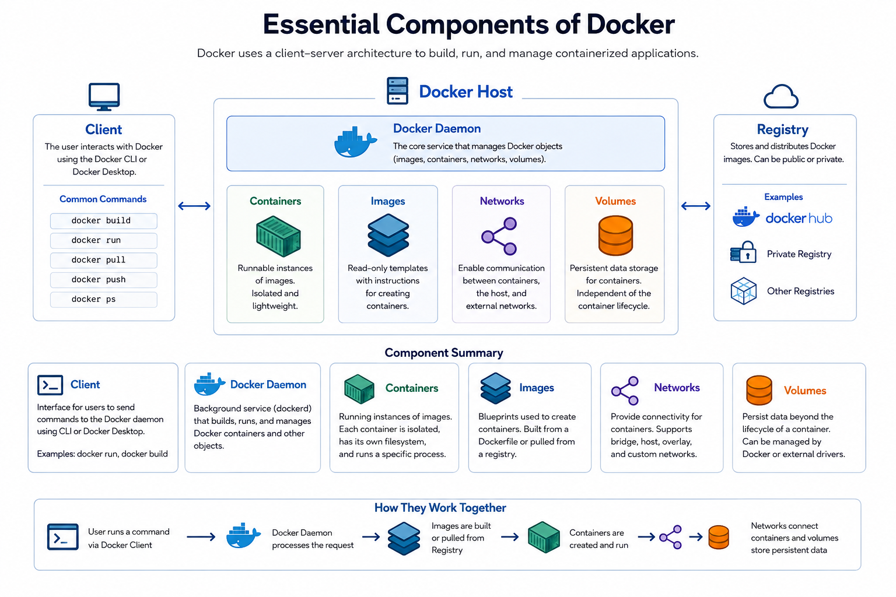
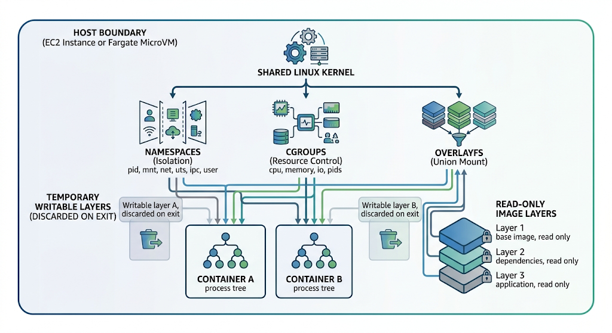
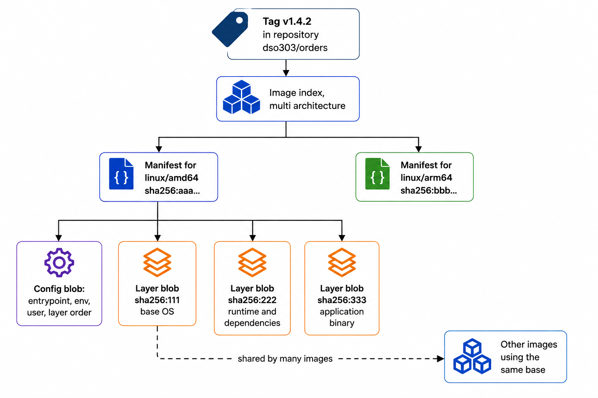
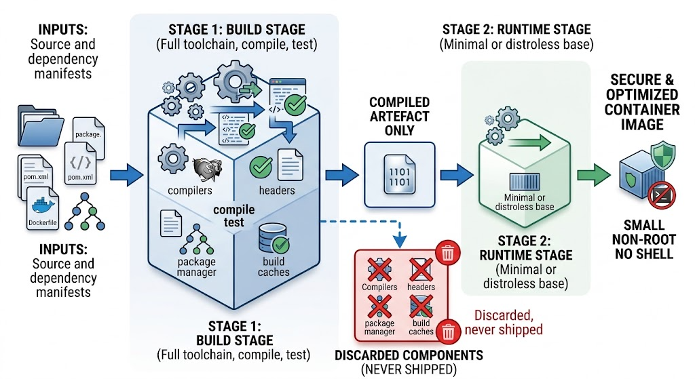
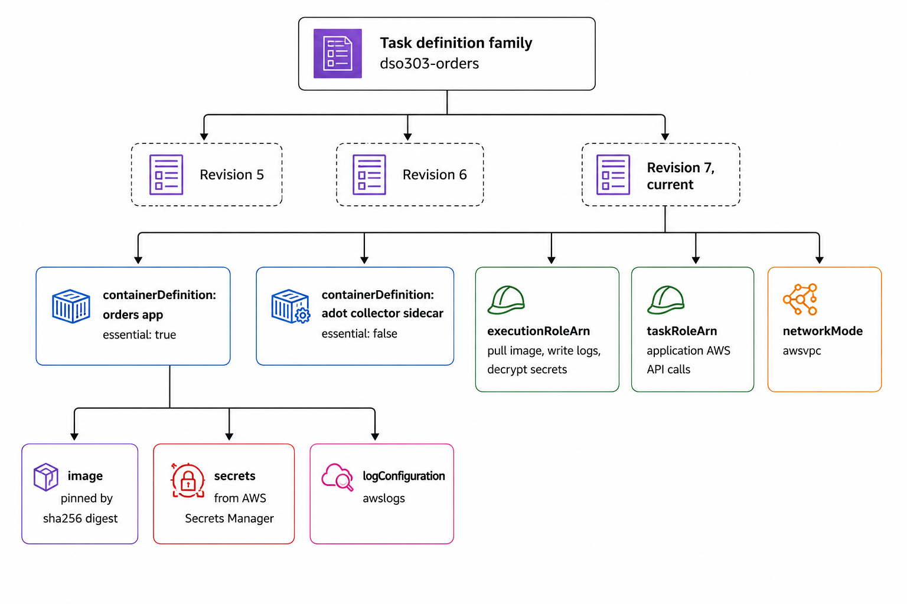

# Docker Fundamentals on AWS

## Definition

A **container** is a process, or a small group of processes, running on a shared host kernel with a private view of the system: its own filesystem root, its own process tree, its own network interfaces, its own hostname, and a hard ceiling on the CPU, memory, and I/O it may consume. It is not a lightweight virtual machine. It is an ordinary Linux process that the kernel has been instructed to lie to.

A **container image** is an immutable, layered, content-addressed filesystem bundle plus a configuration document describing how to start a process from it. The image is the artefact; the container is a running instance of it. The relationship is exactly that of a class to an object, and the same reasoning applies: many containers can run from one image, and the image itself never changes.

**Docker** is the toolchain that popularised both, a build tool, a local runtime, and a registry client. The formats it created have since been standardised by the **Open Container Initiative (OCI)** into an image specification, a runtime specification, and a distribution specification, so that "Docker image" is now loosely used for what is properly an **OCI image**, and images built by Docker run on runtimes Docker never touched.

<figure markdown="span">
    {width="80%"}
    <figcaption>Components of Docker</figcaption>
    
<i>Image Source: AI generated (Google Gemini)</i>

</figure>

**Amazon Elastic Container Registry (ECR)** is AWS's managed OCI-compliant registry: a private, regional, IAM-authorised store for images, integrated with ECS, EKS, AWS Lambda container images, and AWS App Runner.

<figure markdown="span">
    {width="80%"}
    <figcaption>Amazon Elastic Container Registry</figcaption>
    
<i>Image Source: <a href="https://aws.amazon.com/architecture/icons/" target="_blank" rel="noopener">AWS Architecture Icons</a></i>

</figure>

**Amazon ECS task definitions** and **services** are the declarative layer that turns an image into a running workload. A task definition is the immutable specification; a service is the controller that keeps a desired number of instances of that specification alive and reachable.

| Layer | Artefact | Mutable? | Analogy |
|---|---|---|---|
| **Dockerfile** | Build instructions | Yes, it is source code | The recipe |
| **Image layer** | A tarball of filesystem changes, addressed by SHA-256 | No | One prepared ingredient |
| **Image manifest** | A JSON document listing layers and configuration, itself addressed by SHA-256 | No | The assembled dish's specification |
| **Tag** | A human-readable pointer to a manifest digest | **Yes, unless made immutable** | A label on the shelf |
| **Container** | A running process created from an image | Its writable layer is, and is discarded on exit | The dish being eaten |
| **Task definition** | An ECS JSON specification referencing an image | No; each registration creates a new revision | The order ticket |
| **Task** | A running instantiation of a task-definition revision | No | The order being served |
| **Service** | A controller maintaining N tasks | Its desired state is | The kitchen manager |

Within an AWS architecture these sit at the boundary between build time and run time. ECR is the handoff point: everything before it is CI, everything after it is deployment. The single most consequential property of that handoff is that the artefact crossing it is **immutable and identified by a cryptographic digest**, which is what makes a deployment reproducible, a rollback trustworthy, and a security scan meaningful.

!!! note "Containers are not virtual machines, and the difference is the kernel"

    A virtual machine runs its own kernel on virtualised hardware provided by a hypervisor. A container shares the host's kernel. That single fact explains every difference that follows: containers start in milliseconds because there is no kernel to boot; they are dense because there is no duplicated operating system per workload; and their isolation is weaker, because a kernel vulnerability is a shared vulnerability. AWS Fargate exists precisely to close that last gap, by giving each task its own lightweight virtual machine while preserving the container developer experience.

## Why This Service or Concept Exists

- **Environments drift:** before containers, an application's behaviour depended on a host environment that was installed step by step and diverged silently between development, staging, and production.
- **The environment becomes the artefact:** a container image packages the application with its dependencies and filesystem, so the identical bytes run everywhere and deployment becomes a substitution of image A for image B.
- **Lighter isolation than a VM per workload:** containers share the host kernel, giving process isolation in milliseconds and megabytes rather than minutes and gigabytes.
- **A registry is infrastructure:** public registries add an availability dependency, rate limits that bite during scale-out, and mutable tags nobody in the organisation controls.
- **ECR keeps the artefact store inside your boundary:** IAM authentication, VPC endpoints, scanning, immutability, lifecycle policies, KMS encryption, and CloudTrail audit apply to every image.
- **An orchestrator closes the control loop:** `docker run` on one host cannot replace failed containers, place replicas, deploy without downtime, or scale, which is why ECS exists (see [Running a container on EC2 by hand](#running-a-container-on-ec2-by-hand)).

## Core Concepts

### What the Linux kernel actually provides

Three kernel mechanisms, combine to produce a container.

**Namespaces** partition kernel resources so that a process sees only its own partition. There are several, and they are independent:

| Namespace | What it isolates | Practical consequence |
|---|---|---|
| **PID** | Process identifiers | The container's main process is PID 1, and it inherits PID 1's signal-handling responsibilities |
| **Mount (mnt)** | Filesystem mount points | The container has its own root filesystem |
| **Network (net)** | Interfaces, routes, ports, firewall rules | Two containers can both bind port 8080 without conflict |
| **UTS** | Hostname and domain name | The container has its own hostname |
| **IPC** | System V IPC and POSIX message queues | Shared-memory isolation between containers |
| **User** | UID and GID mappings | Root inside the container can map to an unprivileged UID outside it |
| **Cgroup** | The cgroup hierarchy view | The container cannot see the host's full cgroup tree |

**Control groups (cgroups)** account for and limit resource consumption: CPU shares and quotas, memory limits, block-I/O weights, and process cµounts. Two properties matter architecturally. Memory limits are enforced by **killing**  a container that exceeds its memory limit is terminated by the kernel OOM killer, surfacing as `OOMKilled` and exit code 137. CPU limits are enforced by **throttling**  a container that exceeds its CPU quota is paused until the next scheduling period, which produces latency spikes while average utilisation graphs look calm. This asymmetry is the reason for the standard advice in [Chapter 1.7](../unit1/topic7.md): set memory limits, and be cautious with CPU limits on latency-sensitive services.

**Union filesystems** (OverlayFS on modern Linux) stack read-only layers with a thin writable layer on top. Reads fall through the stack to the first layer containing the file; writes are copied up into the writable layer. This is what makes images shareable: fifty containers from the same image share one copy of the read-only layers on disk and in the page cache.

<figure markdown="span">
    {width="80%"}
    <figcaption>Union File System and Container Isolation</figcaption>
    
<i>Image Source: AI generated (Google Gemini)</i>

</figure>

!!! danger "The writable layer is not storage"

    Anything a container writes to its own filesystem disappears when the task stops, and on Fargate it counts against the task's ephemeral storage allocation. Application state belongs in Amazon RDS, Amazon DynamoDB, Amazon S3, Amazon EFS, or an Amazon EBS volume  never in the container. Writing logs to a file inside the container is the most common version of this mistake: write to `stdout` and let the log driver route it, or the logs vanish with the task that produced them, which is the moment you most want them.

### Images, layers, manifests, tags, and digests

An OCI image is not a single file. It is a set of objects in a content-addressed store:

- **Layers** (blobs): compressed tar archives of filesystem changes. Each is identified by the SHA-256 of its content.
- **Image configuration**: a JSON document holding the entrypoint, command, environment, working directory, exposed ports, user, and the ordered list of layer digests. Also a blob, also digest-addressed.
- **Image manifest**: a JSON document referencing the configuration blob and the layer blobs. Its own digest  `sha256:...`  *is* the image's identity.
- **Image index** (or manifest list): a document referencing several manifests, one per platform, which is how one name serves both `linux/amd64` and `linux/arm64`.
- **Tag**: a mutable label in a repository pointing at a manifest digest.

<figure markdown="span">
    {width="80%"}
    <figcaption>Docker files</figcaption>
    
<i>Image Source: AI Generaed (Google Gemini)</i>

</figure>

The distinction between a tag and a digest is the single most important operational fact in this section. A tag is a **name**; a digest is an **identity**. Repushing a tag changes what the name refers to and leaves no trace in the deployment specification that used it. Referencing an image as `...amazonaws.com/dso303/orders@sha256:aaa...` makes the deployed bytes cryptographically exact: the same digest today and in two years retrieves the same image or fails, and it cannot silently retrieve something else.

!!! danger "Never deploy `latest`, and never rely on a mutable tag in production"

    `latest` is not a version; it is a pointer that anyone with push access can move. Two tasks launched ten minutes apart can run different code. A rollback to the previous tag can retrieve bytes that are not the bytes that tag held when it was healthy. And a vulnerability scan of a tag tells you nothing about what is currently running under it. Enable **tag immutability** on every ECR repository at creation, tag with the commit SHA or a semantic version, and **pin by digest** in task definitions and manifests.

### Dockerfiles and the build cache

A Dockerfile is a sequence of instructions, most of which produce a layer. The builder caches each layer keyed on the instruction and its inputs; when a layer's cache key changes, that layer and **every layer after it** are rebuilt. Layer ordering is therefore a performance decision:

| Instruction | Produces a layer? | Notes |
|---|---|---|
| `FROM` | Starts from an existing image's layers | Pin by digest for reproducibility, or at minimum a specific version tag |
| `RUN` | Yes | Chain related commands with `&&` and clean caches in the same `RUN`, or the cleanup happens in a later layer and the bytes remain in the earlier one |
| `COPY` and `ADD` | Yes | Copy dependency manifests before source so that a source change does not invalidate the dependency-install layer. Prefer `COPY`; `ADD` also fetches URLs and auto-extracts archives, which is surprising behaviour |
| `ENV`, `WORKDIR`, `USER`, `EXPOSE`, `LABEL` | Metadata only | Cheap; `EXPOSE` is documentation and publishes nothing by itself |
| `ENTRYPOINT` and `CMD` | Metadata only | `ENTRYPOINT` is the executable, `CMD` supplies default arguments. Use exec form (`["prog","arg"]`) so the process is PID 1 and receives signals |
| `HEALTHCHECK` | Metadata only | Honoured by Docker; **ECS uses the task definition's `healthCheck` block instead** |

**Multi-stage builds** are the single highest-value technique. A build stage carries the compiler, package manager, and test tooling; a runtime stage copies only the built artefact into a minimal base. The result is smaller, starts faster, and has a dramatically smaller vulnerability surface because the tools an attacker would use are simply absent.

<figure markdown="span">
    {width="80%"}
    <figcaption>Multi stage Build process</figcaption>
    
<i>Image Source: AI Generaed (Google Gemini)</i>

</figure>

!!! tip "Image size is a scaling-latency decision, not housekeeping"

    On Fargate there is no warm image cache: every task launch pulls the image. A 1 GB image can add tens of seconds between "traffic arrived" and "a task is serving it", which directly limits how fast a service can absorb a spike. Reducing an image from 1.2 GB to 80 MB through a multi-stage build is a *performance* change with a measurable effect on scale-out responsiveness, and it reduces ECR storage and data-transfer costs at the same time.

### Amazon ECR concepts

| Concept | Definition | Why it matters |
|---|---|---|
| **Registry** | One per AWS account per Region, at `<account-id>.dkr.ecr.<region>.amazonaws.com` | The registry is regional; an image in `us-east-1` is not in `eu-west-1` unless replicated |
| **Repository** | A named collection of related images, for example `dso303/orders` | The unit of IAM policy, immutability, scanning configuration, and lifecycle policy |
| **Repository policy** | A resource-based policy on the repository | The mechanism for cross-account pull access; distinct from identity-based IAM policies |
| **Tag immutability** | Repository setting rejecting a push to an existing tag; also available in exclusion-filter variants that exempt named tag patterns | The control that makes a tag a reliable identifier |
| **Lifecycle policy** | Declarative rules expiring images by age or count | Controls storage cost; untagged images accumulate rapidly in an active pipeline |
| **Basic scanning** | Free CVE scan on push, based on the Clair database, OS packages only | A baseline; does not rescan and does not cover language dependencies |
| **Enhanced scanning** | Amazon Inspector, continuous rescanning, OS packages plus language dependencies | Catches CVEs disclosed *after* the push, which is when most relevant CVEs are disclosed |
| **Pull-through cache** | An ECR repository that transparently caches images from an upstream public registry | Removes a public registry from the deployment path and from rate-limit exposure |
| **Replication** | Cross-Region and cross-account automatic copying | Reduces pull latency and removes a cross-Region dependency at scale-out |
| **ECR Public** | A separate public registry service at `public.ecr.aws` | Where AWS publishes base images; not the same service as private ECR |
| **Encryption** | AES-256 by default, or a customer-managed KMS key | A CMK gives key-level policy and a CloudTrail record of every decrypt |
| **Interface VPC endpoints** | `ecr.api` and `ecr.dkr`, plus an S3 **gateway** endpoint | Required for tasks in private subnets without NAT; also removes NAT data-processing charges |

!!! warning "ECR image pulls need three endpoints, not one"

    A task in a private subnet with no NAT gateway needs the `ecr.api` interface endpoint (for `GetAuthorizationToken` and manifest operations), the `ecr.dkr` interface endpoint (for the Docker registry protocol), **and** an S3 **gateway** endpoint, because the layer blobs themselves are served from S3. Configuring only the two ECR endpoints produces a pull that authenticates successfully and then hangs or fails while fetching layers  a confusing failure that is entirely avoidable and appears in certification scenarios. Interface versus gateway endpoints themselves are covered in [Chapter 1.6](../unit1/topic6.md#vpc-endpoints).

### Running a container on EC2 by hand

On an EC2 instance, running a container requires a container runtime. The practical stack is a high-level runtime (`docker` or `nerdctl`) over `containerd` over `runc`, where `runc` is the component that actually calls `clone()` with the namespace flags and writes the cgroup files.

The manual workflow is short: install the runtime, authenticate to ECR, pull, run with explicit port mappings and resource limits, and supervise with `systemd` so the container restarts on failure and on reboot. What it lacks is the entire content of 2.2 and 2.3:

| Concern | Manual on EC2 | What ECS provides |
|---|---|---|
| Restart on crash | `systemd` unit with `Restart=always` | Service scheduler replaces the task |
| Instance failure | Nothing; the containers are gone | Scheduler places replacement tasks on healthy capacity |
| Placement across hosts | A human decision, recorded nowhere | Placement strategies and constraints ([2.3](topic3.md#placement-constraints)) |
| Port conflicts | Manual allocation, tracked in a wiki | `awsvpc` mode gives each task its own IP, or dynamic port mapping with ALB |
| Load-balancer registration | Manual target registration | Automatic registration and deregistration on task lifecycle |
| Rolling deployment | A shell script and hope | Deployment configuration with minimum healthy percent ([2.3](topic3.md#deployment-the-rolling-update)) |
| Secrets | Environment variables in a file on disk | `secrets` block sourced from Secrets Manager or Parameter Store |
| Credentials for AWS APIs | The instance profile, shared by every container | A per-task IAM role |
| Scaling | Manual instance launch and manual placement | Service auto scaling plus capacity providers ([2.3](topic3.md#application-auto-scaling-on-ecs)) |
| Inventory of what runs where | `docker ps` on every host | `DescribeServices` and `DescribeTasks`, and the console |
| Logs | Files on the instance, lost when it terminates | `awslogs` or FireLens streaming off the host |

!!! info "Do the manual version once, deliberately"

    Run a container on EC2 by hand *and then* deploy the identical image as an ECS service. The comparison is the lesson. Students who skip the manual step tend to treat ECS as arbitrary configuration to memorise; students who have supervised a container with `systemd` and manually registered an ALB target recognise every ECS feature as the automation of something they did by hand.

### ECS task definitions

A **task definition** is an immutable JSON document. Registering it creates a numbered **revision** within a **family**, and revisions are never modified  `dso303-orders:7` means one exact specification forever. This immutability is what makes rollback a pointer change rather than a rebuild.

The structural elements, grouped by what they control:

| Group | Fields | Purpose |
|---|---|---|
| **Identity** | `family`, `revision` (assigned) | Versioned name of the specification |
| **Platform** | `requiresCompatibilities`, `cpu`, `memory`, `runtimePlatform` (OS and CPU architecture), `ephemeralStorage` | Where and on what shape the task runs |
| **Networking** | `networkMode` (`awsvpc`, `bridge`, `host`, `none`) | How the task gets network identity |
| **Identity and access** | `executionRoleArn`, `taskRoleArn` | The two task-scoped IAM roles |
| **Containers** | `containerDefinitions[]` | One entry per container in the task |
| **Storage** | `volumes[]`, `mountPoints`, `volumesFrom` | Bind mounts, EFS volumes, Docker volumes |
| **Placement** | `placementConstraints` | Constraints evaluated at task-definition level |
| **Process controls** | `pidMode`, `ipcMode` | Namespace sharing between containers, rarely needed |

And within each container definition:

| Field | Purpose | Frequently misunderstood because |
|---|---|---|
| `name` | Container name within the task | Referenced by `dependsOn`, `links`, and the service's `loadBalancers` block |
| `image` | Image reference, tag or digest | A digest here is what makes the deployment reproducible |
| `essential` | If true, the container exiting stops the whole task | Every task needs at least one essential container; sidecars are usually `false` |
| `cpu`, `memory`, `memoryReservation` | Container-level allocation | `memory` is a hard limit that triggers `OOMKilled`; `memoryReservation` is a soft floor. On Fargate the task-level values dominate |
| `portMappings` | Container port, host port, protocol, `name`, `appProtocol` | Host port `0` means dynamic assignment on `bridge` mode; `name` is **required** for ECS Service Connect |
| `environment` | Plaintext environment variables | Visible to anyone with `ecs:DescribeTaskDefinition`; never for secrets |
| `secrets` | Values pulled from Secrets Manager or SSM at start | Retrieved by the **execution role**, before your code runs |
| `logConfiguration` | Log driver and its options | `awslogs` to CloudWatch, or `awsfirelens` for routing and filtering |
| `healthCheck` | Command, interval, timeout, retries, start period | This is the **container** health check, distinct from the target group's |
| `dependsOn` | Ordering with conditions `START`, `COMPLETE`, `SUCCESS`, `HEALTHY` | How an init container or a config-fetching sidecar is sequenced |
| `stopTimeout` | Seconds between `SIGTERM` and `SIGKILL`, up to 120 | Must exceed your longest in-flight request for graceful drain |
| `user`, `readonlyRootFilesystem`, `linuxParameters` | Runtime hardening | Free security wins that most tutorials omit |
| `ulimits` | Per-container resource limits, notably `nofile` | The cause of "too many open files" under load |

<figure markdown="span">
    {width="80%"}
    <figcaption>AWS Task Defination</figcaption>
    
<i>Image Source: AI Generaed (Chatgpt)</i>

</figure>

### Tasks, services, and the reconciliation loop

A **task** is one running instantiation of a task-definition revision; a **service** is the controller that keeps a desired number of them running, replaces failures, and registers them with load balancers. The reconciliation loop, the standalone-task versus service distinction, and how to read the state a stuck task is in are covered in [2.2 Amazon ECS](topic2.md#tasks-services-and-the-reconciliation-loop).

---

## Architecture Components

| Component | Responsibility in this chapter's scope |
|---|---|
| **Developer workstation** | Authors the Dockerfile and validates locally; the source of architecture-mismatch bugs when it differs from the target platform |
| **Source repository** | Holds the Dockerfile beside the application; the commit SHA becomes the image tag, tying artefact to source |
| **AWS CodeBuild or another CI runner** | Performs the build in a controlled environment for the correct target architecture; holds no long-lived registry credentials, only an IAM role |
| **BuildKit** | The modern builder: parallel stages, cache mounts, build secrets that do not persist into layers, multi-architecture output |
| **Amazon ECR (private)** | The artefact store and the supply-chain control point: immutability, scanning, lifecycle, replication, policy |
| **Amazon ECR Public / `public.ecr.aws`** | Source of AWS-published base images; using it directly on the deployment path is an availability dependency |
| **ECR pull-through cache** | Caches upstream public images inside your registry, removing that dependency and rate limits |
| **Amazon Inspector** | Enhanced, continuous vulnerability scanning of images at rest in ECR |
| **AWS KMS** | Encryption of repository contents; a customer-managed key adds key-level policy and decrypt auditing |
| **Amazon EC2** | The manual container host when running containers without an orchestrator, and the capacity substrate underneath ECS EC2 launch type |
| **containerd and runc** | The runtime layer that creates namespaces and cgroups and executes the entrypoint |
| **`systemd`** | The manual supervisor for containers on a single host  restart-on-failure and start-on-boot, and nothing beyond one host |
| **ECS agent** | On EC2 capacity, registers the instance with a cluster, receives placement instructions, manages task lifecycle, reports state |
| **Amazon ECS control plane** | Stores task definitions and service state; runs the scheduler and the reconciliation loop |
| **AWS Fargate** | Serverless capacity: one microVM per task, no instance to manage, no shared image cache |
| **Task execution role** | Used by the agent before your code runs: ECR pull, log-stream creation, secret decryption |
| **Task role** | Used by your application code for AWS API calls, delivered through the task metadata endpoint |
| **AWS Secrets Manager and SSM Parameter Store** | Sources for the `secrets` block, keeping credentials out of images and out of `environment` |
| **Amazon CloudWatch Logs** | Destination for `stdout` and `stderr` via the `awslogs` driver; the only place logs survive the task |
| **Interface and gateway VPC endpoints** | `ecr.api`, `ecr.dkr`, `logs`, `secretsmanager`, `ssm`, `sts` as interface endpoints; **S3 as a gateway endpoint** for layer blobs |
| **Application Load Balancer** | Registers task IPs as targets; without ECS you register them by hand, which is what ECS automates |
| **AWS CloudTrail** | Audit record of every ECR push, pull authorisation, task-definition registration, and service update |

Read architecturally, these fall into three groups. The **build group**  workstation, CI, BuildKit  produces an artefact and should be the only thing that can write to the registry. The **registry group**  ECR with its immutability, scanning, lifecycle, and policy settings  is the control point where an organisation decides what is allowed to reach production, and it is the cheapest place to enforce that decision. The **runtime group**  EC2 or Fargate, the agent, the roles, the endpoints, the log destination  consumes the artefact and must never modify it. When these three groups are cleanly separated, "what is running in production" has a single, checkable answer: a digest.

## AWS Service Deep Dive

!!! warning "On numbers and quotas"

    Quotas here are representative as of 2026 and most are **soft**  adjustable through AWS Service Quotas or a support case. They vary by Region and account. Verify in the Service Quotas console for the account and Region you are designing in rather than trusting a printed figure. Pricing is described only as **dimensions** and **relative positions**; model actual cost in the AWS Pricing Calculator.

### Amazon Elastic Container Registry

**Purpose.** Store, version, scan, and serve OCI images inside your AWS account boundary, authorised by IAM, integrated with every AWS container runtime.

**Architecture.** One registry per account per Region. Manifests and metadata are held by the ECR service; layer blobs are stored in ECR-managed Amazon S3, which is why pulls require an S3 route. The API endpoint (`ecr.api`) serves the AWS API surface  `GetAuthorizationToken`, `DescribeImages`, `PutImage`, lifecycle and policy operations  while the registry endpoint (`ecr.dkr`) serves the OCI distribution protocol used by container clients.

**Important features.** Tag immutability per repository; lifecycle policies with rules keyed on age, count, and tag prefix; basic scan-on-push and Inspector-backed enhanced continuous scanning; pull-through cache rules for upstream public registries; cross-Region and cross-account replication configured registry-wide; repository policies for cross-account access; encryption with AES-256 or a customer-managed KMS key; image signing through AWS Signer with container-image signing; OCI artefact support, so Helm charts and SBOMs can be stored alongside images.

**Limitations.** The registry is regional, so multi-Region deployment requires replication or accepts cross-Region pull latency and data-transfer charges. Lifecycle policies evaluate on a schedule rather than instantly. Basic scanning covers operating-system packages only and does not rescan, which makes it a weak control on its own. Pull-through cache supports a defined set of upstream registries and requires the first pull to populate the cache, so it removes the steady-state dependency rather than the first-pull dependency. Immutability cannot be applied retroactively to tags already pushed.

**Pricing model.** Storage per GB-month of stored images, and data transfer out. Data transfer **within the same Region** to ECS, EKS, or EC2 is not charged, which is a strong argument for keeping images in the Region where they are consumed. Enhanced scanning is charged per image scanned and rescanned. Replication incurs cross-Region transfer plus storage in the destination Region. The largest avoidable line item is almost always accumulated untagged images from CI, addressed by a lifecycle policy.

**Performance characteristics.** Pull throughput is high and generally not the bottleneck; the bottleneck is image size and the number of layers. Layer deduplication means an unchanged base is neither stored twice nor transferred twice. Interface endpoints remove NAT gateway hops and their per-GB processing charge from the pull path.

**Scaling behaviour.** Fully managed; you scale by pushing more images. The practical limits are API rate quotas on `GetAuthorizationToken` and image operations, which a very large simultaneous scale-out can approach  a reason to prefer fewer, larger tasks over very many tiny ones when scaling by hundreds.

**Availability.** Regional service, multi-AZ internally. For a multi-Region architecture, configure replication so that a Region's deployment path does not depend on another Region.

**Security features.** IAM identity policies and repository resource policies; encryption at rest; TLS in transit; CloudTrail for every API call; scan findings routed to Amazon EventBridge and AWS Security Hub; tag immutability; image signing and verification; pull-through cache so third-party content enters through a controlled path.

**Service limits (representative, mostly soft).** Repositories per Region and images per repository are in the tens of thousands. Maximum layer size and maximum image size are large enough that hitting them indicates a design problem rather than a quota problem. Lifecycle policy rules per repository are limited to a small number, which is ample for well-designed policies. Verify current values in Service Quotas.

**Common configurations.** Immutable tags enabled at creation; enhanced scanning enabled registry-wide; a lifecycle policy expiring untagged images after one to seven days and retaining the last thirty tagged images; interface endpoints for `ecr.api` and `ecr.dkr` plus an S3 gateway endpoint in every VPC that runs tasks; a repository policy granting pull-only access to the workload accounts when builds are centralised; replication to any Region that runs workloads.

### Amazon EC2 as a container host

**Purpose.** Provide a Linux host on which a container runtime executes containers  either manually, without an orchestrator, or under the ECS agent as EC2 launch-type capacity.

**Architecture.** An EC2 instance running a container runtime. For ECS, use the **ECS-optimised AMI**, which ships with `containerd`, the ECS agent, and sensible defaults already configured; the agent reads `/etc/ecs/ecs.config` for the cluster name and registers the instance as a container instance.

**Important features for manual use.** `systemd` units for supervision; instance user data for bootstrapping; instance profiles for AWS credentials; EBS volumes for persistent data; Auto Scaling groups for replacement on failure.

**Limitations for manual use.** Everything in the comparison table earlier: no cross-host scheduling, no automatic replacement on instance failure, no rolling deployment, no dynamic load-balancer registration, no per-container identity, and no inventory. These are not deficiencies of EC2; they are simply not EC2's job.

**Pricing model.** Instance hours plus EBS. Unlike Fargate, you pay for the whole instance whether containers use it or not, which is favourable at high sustained utilisation and wasteful at low utilisation.

**Performance characteristics.** A warm instance with cached layers starts a container in seconds, materially faster than a cold Fargate task, because there is no ENI attachment and no image download. This is the main performance argument for EC2 capacity.

**Security features.** The critical one is the **instance metadata service**. By default every container on the instance can reach IMDS and obtain the instance profile's credentials, which destroys per-task identity. Enforce IMDSv2 and set the hop limit to 1 so that a container's network namespace cannot reach it, or block the `169.254.169.254` route from container networks. Why this matters, and how narrow the container instance role must be, is covered in [2.2](topic2.md#amazon-ec2-capacity-for-ecs).

### The task definition as a specification

**Purpose.** Declare, immutably and completely, what a task is: its containers, images, resources, networking, identity, storage, logging, and lifecycle behaviour.

**Resource sizing on Fargate.** Task CPU and memory must come from Fargate's fixed valid matrix, listed in [2.2](topic2.md#aws-fargate); an invalid pair is rejected at registration. Container-level `cpu` and `memory` then subdivide the task-level allocation; a container `memory` value is a hard limit and exceeding it is `OOMKilled` even if the task as a whole has room.

**Ephemeral storage.** Fargate tasks receive an encrypted ephemeral volume, sized as described in [2.2](topic2.md#aws-fargate) and destroyed with the task. It is scratch space, not storage.

**Network modes.** `networkMode` is one of `awsvpc` (required on Fargate, and the default for everything), `bridge`, `host`, or `none`. The behaviour of each and when to choose it are covered in [2.2](topic2.md#task-network-modes).

**Common configurations.** `awsvpc` mode; task-level CPU and memory from the Fargate matrix; image pinned by digest; `secrets` rather than `environment` for credentials; `awslogs` with an explicit log group that has a retention policy; a `healthCheck` with a `startPeriod` longer than the application's cold start; `stopTimeout` above the p99 request duration; `readonlyRootFilesystem: true`; a non-root `user`; and `runtimePlatform` set explicitly when building on ARM.

---

## Important AWS Terminology

| Term | Meaning |
|---|---|
| **Container** | A process isolated by kernel namespaces and constrained by cgroups, sharing the host kernel |
| **Image** | An immutable, layered, content-addressed filesystem bundle plus start-up configuration |
| **OCI** | Open Container Initiative; the standards body owning the image, runtime, and distribution specifications |
| **Layer** | A compressed tar archive of filesystem changes, identified by the SHA-256 of its content |
| **Image manifest** | JSON document referencing the configuration blob and layer blobs; its digest is the image's identity |
| **Image index / manifest list** | A document referencing one manifest per platform, enabling multi-architecture images |
| **Digest** | `sha256:...`, the cryptographic identity of an image; immutable by construction |
| **Tag** | A human-readable, by default mutable, pointer to a manifest digest |
| **Tag immutability** | ECR repository setting rejecting a push to an existing tag, optionally with wildcard exclusion filters |
| **Base image** | The image a Dockerfile starts `FROM` |
| **Distroless image** | A runtime image containing the application and its runtime only  no shell, no package manager |
| **Multi-stage build** | A Dockerfile with several `FROM` stages, shipping only the final stage's contents |
| **BuildKit** | The modern Docker builder: parallelism, cache mounts, build secrets, multi-architecture output |
| **Build context** | The directory sent to the builder; `.dockerignore` controls what is excluded |
| **Namespace (Linux)** | Kernel mechanism partitioning a resource type so a process sees only its own partition |
| **cgroup** | Kernel mechanism accounting for and limiting CPU, memory, I/O, and process count |
| **OverlayFS** | The union filesystem stacking read-only layers under a writable layer |
| **Writable layer** | The per-container top layer, discarded when the container is removed |
| **containerd** | The container runtime managing image storage and container lifecycle |
| **runc** | The low-level runtime that creates namespaces and cgroups and executes the process |
| **Registry** | A service storing and serving images; in ECR, one per account per Region |
| **Repository** | A named collection of images within a registry; the unit of policy |
| **Repository policy** | A resource-based policy on an ECR repository, used for cross-account access |
| **Authorisation token** | A short-lived (12-hour) ECR credential obtained through `GetAuthorizationToken` |
| **Lifecycle policy** | Declarative ECR rules expiring images by age, count, or tag pattern |
| **Basic scanning** | Free scan-on-push covering operating-system packages only, no rescanning |
| **Enhanced scanning** | Amazon Inspector continuous scanning covering OS and language-package vulnerabilities |
| **Pull-through cache** | An ECR repository transparently caching images from an upstream public registry |
| **Replication (ECR)** | Registry-level configuration copying images across Regions or accounts automatically |
| **ECR Public** | The separate public registry at `public.ecr.aws` |
| **Task definition** | Immutable, versioned ECS JSON specification of a task |
| **Family** | The name grouping task-definition revisions |
| **Revision** | The auto-incrementing version of a task definition within its family |
| **Container definition** | One container's entry within a task definition |
| **Essential container** | A container whose exit stops the entire task |
| **Sidecar** | A non-essential helper container in the same task, sharing its network namespace |
| **Task** | A running instantiation of a task-definition revision |
| **Task metadata endpoint** | The link-local endpoint supplying task metadata and task-role credentials to containers |
| **`awslogs` driver** | The log driver streaming container `stdout` and `stderr` to CloudWatch Logs |
| **FireLens** | ECS log routing through a Fluent Bit or Fluentd sidecar to arbitrary destinations |
| **`stopTimeout`** | Seconds between `SIGTERM` and `SIGKILL` when a container is stopped |
| **`dependsOn`** | Container start ordering with `START`, `COMPLETE`, `SUCCESS`, or `HEALTHY` conditions |
| **`OOMKilled`** | Kernel termination of a container that exceeded its memory limit; exit code 137 |
| **`exec format error`** | Failure to run an image built for a different CPU architecture |
| **`CannotPullContainerError`** | Task failure caused by an image that could not be retrieved |
| **Multi-architecture image** | One tag serving several platforms via an image index |
| **SBOM** | Software Bill of Materials; the inventory of components in an image |
| **Image signing** | Cryptographic attestation of an image's provenance, verified before deployment |

## Configuration Options

### Dockerfile and build configuration

| Choice | Options | How to decide |
|---|---|---|
| **Base image** | Full distribution, slim variant, Alpine, distroless, scratch | Distroless or slim for compiled languages; slim for interpreted runtimes. Alpine uses musl rather than glibc, which breaks some native extensions and can change DNS resolution behaviour  test rather than assume |
| **Base image pinning** | Floating tag, version tag, digest | Digest for reproducibility; a version tag plus a scheduled rebuild is the pragmatic middle ground, because a pinned digest never receives security patches until you move it |
| **Target architecture** | `linux/amd64`, `linux/arm64`, multi-architecture | ARM64 (Graviton) for better price-performance where dependencies allow; build explicitly for the target, never implicitly from the build host |
| **Build stages** | Single stage, multi-stage | Multi-stage always; the only reason not to is a trivial image with no build step |
| **Layer ordering** | Dependencies before source, or the reverse | Dependency manifests first, then `RUN` install, then source  so a source edit does not re-resolve dependencies |
| **Build secrets** | `ARG`, `COPY`, BuildKit `--mount=type=secret` | Only the BuildKit secret mount; `ARG` and `COPY` persist the secret in the image history |
| **`.dockerignore`** | Present or absent | Always present, excluding `.git`, `node_modules`, local environment files, and test fixtures  it reduces context upload time and prevents secrets leaking into the build |
| **Process form** | Shell form or exec form for `ENTRYPOINT` | Exec form, so the application is PID 1 and receives `SIGTERM` directly rather than through a shell that swallows it |
| **User** | root, or a created non-root user | Non-root, always; combine with `readonlyRootFilesystem` in the task definition |
| **Compression** | gzip (default), zstd | zstd decompresses faster, reducing task start time, where the toolchain supports it |

### Amazon ECR repository configuration

| Setting | Options | How to decide |
|---|---|---|
| **Tag mutability** | `MUTABLE`, `IMMUTABLE`, and the newer `IMMUTABLE_WITH_EXCLUSION` / `MUTABLE_WITH_EXCLUSION` with up to five wildcard exclusion filters | `IMMUTABLE` at creation. Use an exclusion variant only for a deliberate, narrow case such as allowing `dev-*` to be overwritten; the setting governs subsequent pushes and does not lock or unlock tags already present |
| **Scan configuration** | Manual, basic scan-on-push, enhanced (Inspector) | Enhanced registry-wide for anything reaching production; basic is a weak control because it never rescans |
| **Encryption** | AES-256 (default), AWS KMS customer-managed key | CMK where you need key-level policy, rotation control, and decrypt auditing; default otherwise |
| **Lifecycle policy** | Rules by age, count, tag prefix | Expire untagged after one to seven days; retain the last N tagged images per prefix; keep release-tagged images longer than CI-tagged ones |
| **Repository policy** | Absent, or cross-account statements | Grant `ecr:BatchGetImage`, `ecr:GetDownloadUrlForLayer`, `ecr:BatchCheckLayerAvailability` to workload accounts; never grant push |
| **Replication** | None, cross-Region, cross-account | Replicate to every Region that launches tasks from the image |
| **Pull-through cache** | Configured per upstream registry | Configure for every public base image the organisation uses |

### ECS task-definition configuration

| Setting | Options | How to decide |
|---|---|---|
| **`requiresCompatibilities`** | `FARGATE`, `EC2`, `EXTERNAL` | Fargate unless you need GPUs, local NVMe, a host daemon, or lowest unit cost at sustained utilisation |
| **`networkMode`** | `awsvpc`, `bridge`, `host`, `none` | `awsvpc` by default; `bridge` with dynamic ports only for density on EC2 capacity |
| **Task CPU and memory** | Fargate matrix values; arbitrary on EC2 | Size from measured p99 plus headroom; over-sizing is paid continuously on every replica |
| **`memory` vs `memoryReservation`** | Hard limit vs soft floor | Set `memory` as a hard limit to fail fast and visibly; a container with no limit can starve its neighbours on EC2 |
| **`runtimePlatform`** | OS family and `cpuArchitecture` | Set explicitly; the default is x86_64 and a silent mismatch produces `exec format error` |
| **`ephemeralStorage`** | 20 to 200 GB on Fargate | Raise only for genuine scratch needs; it is billed and it is not storage |
| **`healthCheck`** | Command, `interval`, `timeout`, `retries`, `startPeriod` | `startPeriod` must exceed the application's cold start, or the container is killed while still booting |
| **`stopTimeout`** | Up to 120 seconds | Slightly above p99 request duration, so `SIGTERM` handling can drain |
| **`secrets` vs `environment`** | Both available | `secrets` for anything sensitive; `environment` is readable by anyone with `ecs:DescribeTaskDefinition` |
| **`logConfiguration`** | `awslogs`, `awsfirelens`, `splunk`, others | `awslogs` for simplicity; FireLens when filtering before ingestion or routing to several destinations |
| **`user` and `readonlyRootFilesystem`** | Any UID; true or false | Non-root and read-only root, with `tmpfs` mounts for paths that genuinely need writes |
| **`linuxParameters.capabilities`** | Add or drop Linux capabilities | Drop `ALL` and add back only what is required; most applications require none |
| **`ulimits`** | `nofile`, `nproc`, others | Raise `nofile` for services holding many connections; the default causes "too many open files" under load |
| **`dependsOn`** | `START`, `COMPLETE`, `SUCCESS`, `HEALTHY` | `HEALTHY` for a proxy or agent the application needs; `SUCCESS` for an init container that must finish first |

The container `healthCheck` configured here is distinct from the target group's health check; the two are compared, with the diagnostic value of their disagreeing, in [2.2](topic2.md#north-south-getting-traffic-in).

---

## AWS Best Practices

- **Operational Excellence:** build images in CI, tag each with the commit SHA, and standardise a small set of centrally updated base images so a base-image CVE is one change rather than forty.
- **Security:** start from a minimal base, run as a non-root user with a read-only root filesystem and dropped capabilities, and never place a secret in a Dockerfile, `ARG`, or `environment` block.
- **Security:** enable tag immutability and enhanced scanning on every repository, grant push only to CI roles, and on EC2 capacity enforce IMDSv2 with a hop limit of 1.
- **Reliability:** handle `SIGTERM` by finishing in-flight work before exiting, and make start-up tolerant of dependencies that are not yet available.
- **Reliability:** remove public registries from the deployment path with pull-through caching, and replicate images to every Region that launches them.
- **Performance Efficiency:** use multi-stage builds, minimal bases, and cache-friendly layer ordering, because image size is scale-out latency on Fargate.
- **Cost Optimization:** apply a lifecycle policy to every repository, add S3 gateway and ECR interface endpoints to avoid NAT charges on pulls, and set retention on every log group.
- **Sustainability:** smaller images, Graviton compute, and right-sized tasks move fewer bytes and do more work per watt.

---

## Monitoring and Observability

Everything the container writes to `stdout` and `stderr` is captured by the configured log driver and leaves the host. Everything it writes to a file inside the container is lost when the task stops. That single sentence determines the logging design: log to standard output in structured JSON, and let the platform route it.

| Signal | Source | What it tells you |
|---|---|---|
| **`pullStartedAt` and `pullStoppedAt`** | `DescribeTasks` | Actual image pull duration; the honest measure of whether image size is hurting you |
| **Task `lastStatus` and `desiredStatus`** | `DescribeTasks` | Where in the lifecycle a task is stuck, which names the failure class |
| **`stoppedReason`** | `DescribeTasks` | Why a task stopped: `CannotPullContainerError`, `OutOfMemoryError`, `Essential container in task exited` |
| **Container `exitCode`** | `DescribeTasks` | 0 clean, 1 application error, 137 `SIGKILL` or OOM, 139 segmentation fault, 143 `SIGTERM` |
| **ECR scan findings** | Inspector via EventBridge | New CVEs in images already deployed |
| **`RepositoryPullCount`** and API metrics | CloudWatch | Pull volume; unexpected spikes can indicate a task crash-loop pulling repeatedly |
| **CloudTrail `PutImage`, `RegisterTaskDefinition`, `UpdateService`** | CloudTrail | Who changed what, and when  the question asked most often after an incident |

Service-level signals  service events, running versus desired count, CPU and memory utilisation, restart counts  and the diagnostic order for reading them are covered in [2.2](topic2.md#monitoring-and-observability).

**Structured logs.** Emit JSON with a stable schema: timestamp, level, service name, image digest or version, correlation ID, trace ID, message. Including the **image digest** in the log line is an unusual but valuable practice, because it answers "which build produced this behaviour" without a lookup.

**Retention.** A log group created implicitly by ECS has no retention policy and keeps data forever. Create log groups explicitly in infrastructure as code with a retention setting, and treat an implicitly created log group as a defect.

**Container Insights.** Enable it at the cluster level (see [2.2](topic2.md#cluster-configuration)); it is the difference between "the service is slow" and "the service is memory-saturated at 94 per cent on every task".

**ECS Exec.** For live investigation, `aws ecs execute-command` opens a shell into a running container over AWS Systems Manager  no SSH, no bastion, no inbound ports, and every session recorded in CloudTrail and optionally logged to S3. Note the interaction with distroless images: no shell exists inside them, which is a real trade-off between hardening and debuggability. The usual resolution is a debug sidecar enabled only when needed, or reproducing the issue in a non-production task built from a debuggable variant.

---

## Advantages

**Environmental determinism.** The application and its dependencies travel together as one immutable artefact. Configuration drift as a class of failure disappears, and "works on my machine" is reduced to architecture mismatch  a narrow, detectable problem rather than a diffuse one.

**Deployment becomes substitution.** Releasing is stopping a process running image A and starting one running image B. Rollback is the same operation in reverse. Because the artefact is immutable and digest-addressed, rollback retrieves exactly the bytes that were previously healthy, which is what makes automatic rollback on a failed deployment safe enough to enable by default.

**Density and speed.** Sharing a kernel means no duplicated operating system per workload and no boot sequence. Start times measured in milliseconds to seconds, rather than minutes, change what is architecturally possible: scaling in response to load becomes reactive rather than anticipatory.

**Portability across compute models.** One OCI image runs on ECS, EKS, Lambda, App Runner, a developer's laptop, and another cloud. The packaging decision does not commit the compute decision, which preserves options that would otherwise have to be bought back later.

**A single supply-chain control point.** Because everything reaching production passes through the registry, immutability, scanning, signing, and lifecycle are enforced in one place rather than in every pipeline. Few security controls are this cheap relative to their coverage.

**Resource isolation without virtualisation cost.** cgroups cap a container's CPU and memory so one workload cannot starve another on the same host, at a fraction of a VM's overhead.

**ECR-specific advantages.** IAM-based authorisation with no long-lived registry password; short-lived tokens; same-Region pulls with no data-transfer charge; deep integration with ECS, EKS, Lambda, and App Runner; continuous scanning through Inspector; declarative lifecycle management; and a full CloudTrail record of every push and policy change.

**Task-definition-specific advantages.** An immutable, versioned, complete description of a workload  containers, resources, networking, identity, logging, and lifecycle  in one reviewable document that can live in version control and be diffed, which turns "what changed in this deployment" into a question with an exact answer.

---

## Limitations

**Isolation is weaker than a virtual machine's.** A shared kernel means a kernel vulnerability is shared. Containers are not a sufficient boundary for genuinely hostile multi-tenancy; that requires a VM boundary, which on AWS means Fargate's per-task microVM or separate instances, and for the strongest boundary a separate account.

**Statelessness is a requirement, not a suggestion.** The writable layer is ephemeral. Any application assuming durable local disk must be changed before it can be containerised honestly, and that change is frequently the largest part of a migration.

**Images age silently.** The bytes do not change, but the vulnerability profile of what is inside them does. Without continuous scanning and a rebuild cadence, the most stable service becomes the most vulnerable one precisely because nobody has needed to touch it.

**Image size is a real operational constraint.** Large images slow every scale-out, cost storage and transfer, and enlarge attack surface. Getting them small requires build discipline that teams must learn and maintain.

**Architecture matters again.** An image built for ARM64 will not run on x86_64. The failure is late, at task start, and confusing because the image works perfectly on the machine that built it.

**Debugging is harder in hardened images.** No shell means no interactive investigation. This is a genuine trade-off, and it forces investment in observability that many teams have not made.

**Layer caching can mislead.** A cached layer means a stale layer: a Dockerfile with `RUN apt-get update` cached from three months ago installs three-month-old packages. Reproducibility and freshness pull in opposite directions and must be reconciled deliberately with scheduled rebuilds.

**ECR-specific limitations.** Regional, so multi-Region needs replication. Lifecycle policies evaluate on a schedule, not instantly. Basic scanning covers OS packages only and never rescans. Immutability cannot be applied retroactively. Pull-through cache covers a defined set of upstreams and does not remove the first-pull dependency.

**Task-definition-specific limitations.** A hard size ceiling in the low tens of kilobytes, which many environment variables can approach. A maximum of ten containers per task definition. Fargate CPU and memory must come from the fixed matrix rather than arbitrary values. And revisions accumulate indefinitely, so a family can reach thousands of revisions in an active pipeline.

---

## Summary

First, **the container image is an artefact, and its most valuable property is immutability**. Everything else in this chapter follows from that. Because the image cannot change, a deployment is a substitution rather than a procedure; because it is identified by a content digest, a rollback retrieves exactly the bytes that were previously healthy; because it is scanned and signed as a unit, a supply-chain claim about it is checkable. The corollary is the rule that students most often break: a tag is a name, not an identity, and a system that deploys tags has forfeited every one of those properties while appearing to work.

Second, **the environment being part of the artefact is what actually solved the deployment problem**. Configuration management converged machines towards a description and could never guarantee that two converged machines were the same. A container image constructs the environment instead, so drift as a class of failure disappears and "works on my machine" narrows to the single property the image does not carry  the CPU architecture. That residual is worth naming explicitly, because it is the one place the old failure mode still lives.

Third, **the registry is infrastructure and a control point, not a filing cabinet**. Placing it inside your account boundary removes a third party from the deployment path, which matters most during a scale-out, which is when the system is already under stress. Beyond availability, the registry is the cheapest place an organisation can enforce what may reach production: immutability, continuous scanning, push restricted to CI, lifecycle limits, and signing are all one configuration each and cover every service at once. And the operational details are not incidental  the S3 gateway endpoint that image layers require, and the lifecycle policy that bounds storage, are both routinely omitted and both routinely cause incidents or invoices.

Fourth, **running a container by hand teaches you what an orchestrator is for better than any explanation can**. `docker run` under `systemd` handles a crashed process and a rebooted host, and nothing else. It cannot place work across hosts, replace a task after an instance fails, deploy without downtime, register a dynamic port with a load balancer, give each container its own AWS identity, or tell you what is running where. Every ECS feature in the next two chapters is the automation of something you did manually in this one, and recognising it as such is the difference between learning ECS and memorising it.

Fifth, **the task definition is where the architecture becomes a specification**. It is immutable and versioned, so a revision names an exact configuration forever and rollback is a pointer change. It carries two distinct identities  an execution role that acts before your code runs and a task role that your code uses  and keeping them separate is a security boundary that costs nothing to maintain and is routinely collapsed for convenience. It carries the hardening settings that most tutorials omit and that cost nothing: non-root user, read-only root filesystem, dropped capabilities. And it carries the lifecycle settings  `stopTimeout`, `healthCheck` with an honest `startPeriod`  that determine whether a deployment is invisible to users or produces thirty seconds of errors.

Sixth, and most importantly for the chapters that follow, **containerisation is a packaging improvement, and packaging improvements are worth having on their own terms**. A containerised monolith is still a monolith, and claiming otherwise is how teams end up disappointed by an architecture they never actually adopted. What containerisation genuinely delivers is a reproducible artefact, a fast and reversible deployment, and a uniform operational surface across every service regardless of language. Those are the preconditions for the orchestration in 2.2 and 2.3 and for the microservices architecture in [Chapter 1.7](../unit1/topic7.md)  necessary, valuable, and not by themselves sufficient.

!!! question "Practice and interview questions"
    Questions for this topic are kept separately: [Practice questions](../Questions/unit2.md#21-docker-fundamentals) · [Interview questions](../interviewquestions/unit2.md#21-docker-fundamentals).
