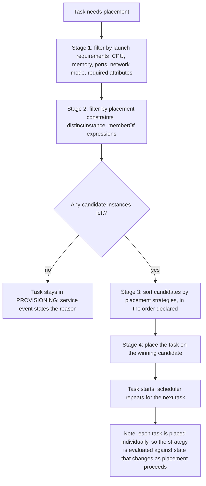
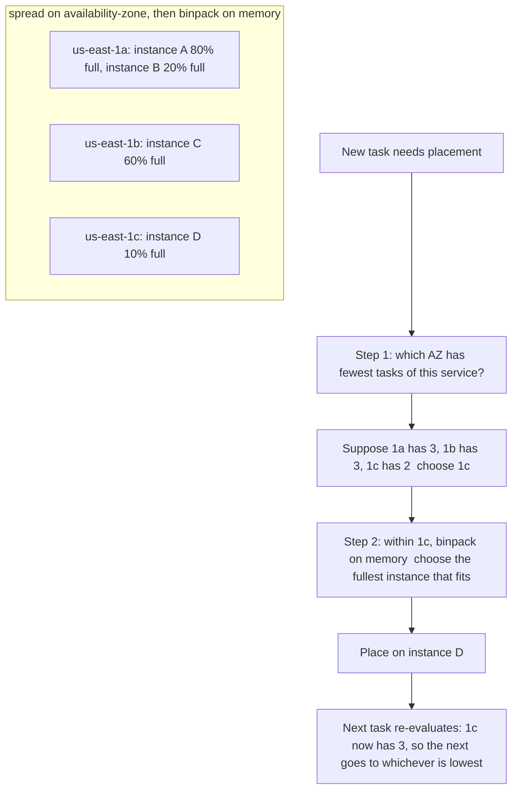
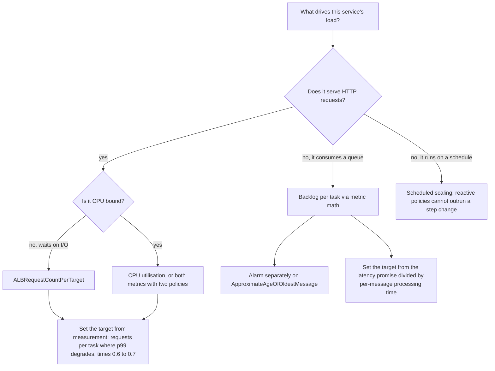
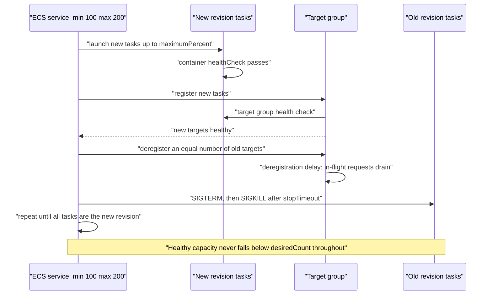

# Container Orchestration with Amazon ECS

## Definition

**Container orchestration** is the ==continuous, automated management of a container fleet's lifecycle:== deciding where each container runs, keeping the right number running, adjusting that number as demand changes, and replacing one version with another without interrupting service.

On Amazon ECS this is three cooperating control loops:

- **Placement** answers *where*. The ECS scheduler filters the available capacity, sorts it according to your declared strategy, and binds the task to a host or, on Fargate, to a subnet and an AWS-managed slot.
- **Scaling** answers *how many*. Application Auto Scaling adjusts a service's `desiredCount` from a metric, and on EC2 capacity a capacity provider adjusts the instance count underneath it.
- **Deployment** answers *which version, and how do we get there*. A deployment controller replaces tasks of one task-definition revision with tasks of another under constraints that bound the risk.

| Loop | Setpoint you declare | Mechanism | What goes wrong when it is left at defaults |
|---|---|---|---|
| **Placement** | Constraints and an ordered strategy list | ECS scheduler | Replicas co-locate in one AZ; an AZ event becomes an outage |
| **Task scaling** | A metric and a target value | Application Auto Scaling | Scaling on CPU for an I/O-bound service never triggers |
| **Capacity scaling** | Target capacity percentage | Capacity provider managed scaling | Tasks stick in `PROVISIONING` under load |
| **Deployment** | Minimum healthy and maximum percent, circuit breaker | ECS or CodeDeploy deployment controller | A bad release drains healthy capacity, or a deployment reduces capacity during peak |

## Why This Service or Concept Exists

- **Hosts are not identical and failures are correlated:** an Availability Zone fails as a unit, so where a task lands decides whether a single-AZ event takes the service down.
- **Placement balances density against availability:** bin packing minimises cost but concentrates risk, spreading maximises availability but wastes capacity, and production configurations spread first and pack within.
- **Static capacity is wrong in both directions:** provisioning for peak pays for idle capacity, provisioning for average fails at peak, and auto scaling replaces the fixed number with a control loop.
- **The scaling signal matters more than the mechanism:** the metric must track load per unit of capacity, such as requests per target or backlog per task, not a symptom such as CPU on an I/O-bound service.
- **Replacing running software is the riskiest routine operation:** ECS turns deployment into a controlled transition with bounds on capacity, a definition of healthy, and automatic rollback when it does not converge.
- **Health checks catch crashes, not regressions:** a release that starts, passes `/health`, and returns wrong answers needs alarm-based rollback or a validated blue/green or canary shift.

## Core Concepts

### The scheduler's decision pipeline

When the ECS scheduler must place a task, it runs a pipeline. Understanding the order explains most placement behaviour.



Two properties of this pipeline matter architecturally.

**Constraints filter; strategies sort.** A constraint can make placement impossible  if no instance satisfies it, the task simply does not run and the service event says so. A strategy can never make placement impossible; it only chooses among candidates that already qualify. This is why an over-tight constraint produces a stuck service and a poorly chosen strategy produces a working but badly distributed one.

**Tasks are placed one at a time.** The strategy is re-evaluated for each task against the state produced by previous placements, which is what makes `spread` converge on an even distribution rather than sending everything to the currently emptiest AZ.

On **Fargate** there are no container instances, so instance-level constraints and strategies do not apply. Fargate distributes tasks across the subnets you supply, which is why supplying subnets in three Availability Zones is, in practice, the entire availability configuration.

### Placement constraints

| Constraint | Syntax | Effect | Typical use |
|---|---|---|---|
| **`distinctInstance`** | `type=distinctInstance` | No two tasks of this service on the same container instance | Ensures an instance failure removes at most one replica |
| **`memberOf`** | `type=memberOf, expression=<CQL>` | Only instances matching the expression are candidates | Instance type, AZ, AMI, custom attributes |

The **Cluster Query Language** expresses `memberOf` filters over container-instance attributes:

```
attribute:ecs.instance-type =~ m6i.*
attribute:ecs.availability-zone in [us-east-1a, us-east-1b]
attribute:ecs.os-type == linux and attribute:ecs.cpu-architecture == arm64
attribute:workload-class == gpu
attribute:ecs.instance-type != t3.micro
```

Built-in attributes include `ecs.availability-zone`, `ecs.instance-type`, `ecs.os-type`, `ecs.os-family`, `ecs.cpu-architecture`, `ecs.ami-id`, `ecs.vpc-id`, `ecs.subnet-id`, and `ecs.capability.*` for agent features. Custom attributes are yours to define, either through `/etc/ecs/ecs.config` at boot or with `PutAttributes`, and they are the mechanism for expressing workload classes such as "instances licensed for this software" or "instances with the local NVMe our cache needs".

!!! danger "A constraint that nothing satisfies is a service that never runs"

    Constraints filter before strategies sort. If a `memberOf` expression references an instance type that is no longer in the Auto Scaling group, or a custom attribute nobody sets any more, every candidate is filtered out and tasks remain in `PROVISIONING` indefinitely  with a service event stating that no container instance met the requirements. This is one of the more confusing failures because the cluster has abundant free capacity. Audit constraints whenever the fleet composition changes.

### Placement strategies

| Strategy | Field | Behaviour | Optimises for |
|---|---|---|---|
| **`spread`** | `attribute:ecs.availability-zone`, `instanceId`, or any attribute | Distribute evenly across distinct values of the field | Availability |
| **`binpack`** | `cpu` or `memory` | Place on the instance with the least remaining of that resource that still fits | Density and cost |
| **`random`** | none | Choose a candidate at random | Nothing; a default, not a decision |

Strategies are an **ordered list**, applied as successive sort keys. The standard production configuration is:

```json
"placementStrategy": [
  { "type": "spread", "field": "attribute:ecs.availability-zone" },
  { "type": "binpack", "field": "memory" }
]
```

Read it as: first choose the Availability Zone that currently has the fewest tasks of this service, then within that zone choose the fullest instance that still has room. The result is even distribution across the correlated failure domain, and density within it  availability where it matters, cost efficiency where it does not conflict.



Reversing the order  binpack then spread  produces a very different and usually wrong outcome: the scheduler fills one instance completely before considering the zone, concentrating replicas on a single host in a single AZ.

!!! tip "Spread across zones, then bin pack within them"

    This ordering is the default recommendation for almost every production service on EC2 capacity, and it is worth being able to justify rather than just recite. Spreading across `instanceId` instead of AZ protects against instance failure but not zone failure, and zone failure is the larger correlated event. Adding `distinctInstance` as a constraint on top gives both, at the cost of requiring at least as many instances as tasks  appropriate for small, critical services and wasteful for large ones.

### Application Auto Scaling on ECS

The scaling layer is **Application Auto Scaling**, a separate service that registers a **scalable target**  here, `ecs:service:DesiredCount` for a given cluster and service  with a minimum and maximum capacity, and then applies **scaling policies** to it.

| Policy type | How it works | Best for |
|---|---|---|
| **Target tracking** | You give a metric and a target value; the service creates and manages CloudWatch alarms and computes the capacity change needed to hold the metric near the target | Almost everything; the default choice |
| **Step scaling** | You define alarm thresholds and the adjustment for each step | Asymmetric or aggressive responses target tracking cannot express |
| **Scheduled scaling** | You set minimum and maximum capacity at a time or on a cron schedule | Calendar-driven load; setting a floor before a known peak |
| **Predictive scaling** | Machine learning forecasts load from at least 24 hours of metric history and scales out ahead of the forecast | Recurring daily or weekly cycles where reactive policies lag |

**Target tracking** is the workhorse and is worth understanding rather than treating as magic. When you create a target-tracking policy, Application Auto Scaling creates two CloudWatch alarms  a high alarm and a low alarm  and continuously computes a desired capacity that would bring the metric to the target, assuming the metric is roughly proportional to load per task. It scales out aggressively and in conservatively by design, and it will not scale in while a scale-out cooldown is active.

**Cooldowns** deserve deliberate asymmetry:

- **Scale-out cooldown** short, 60 seconds or less. Under-capacity harms users immediately.
- **Scale-in cooldown** long, 300 seconds or more. Removing capacity too eagerly causes flapping, and the cost of holding a few extra tasks for five minutes is trivial next to the cost of oscillation.

**Predefined metrics** available for ECS target tracking are `ECSServiceAverageCPUUtilization`, `ECSServiceAverageMemoryUtilization`, their high-resolution counterparts `ECSServiceAverageCPUUtilizationHighResolution` and `ECSServiceAverageMemoryUtilizationHighResolution` (which use 20-second metrics and require high-resolution metrics to be enabled on ECS first), and `ALBRequestCountPerTarget`. Anything else  SQS backlog per task, custom business metrics  uses a **customised metric specification**, frequently a CloudWatch **metric math** expression.

!!! warning "`ALBRequestCountPerTarget` is not available with blue/green deployments"

    The predefined `ALBRequestCountPerTarget` metric type is not supported for services using the `CODE_DEPLOY` deployment controller, because the service's traffic is split across two target groups whose identity changes each deployment. A blue/green service that needs request-based scaling must express it as a customised metric specification with metric math over the target groups, or scale on a different signal. This constraint is easy to miss because each feature is documented separately, and it surfaces only when you adopt the second one.

### Choosing the scaling metric

**For a request-serving service**, `ALBRequestCountPerTarget` is usually correct. It measures requests arriving per task, which is the actual driver of load, and it works for I/O-bound services where CPU never moves. The target value is derived, not guessed: measure the requests per task at which p99 latency begins to degrade, and set the target somewhat below it  commonly 60 to 70 per cent of that value, leaving headroom for the scaling delay.

**For a queue consumer**, the correct signal is **backlog per task**:

```
backlog_per_task = ApproximateNumberOfMessagesVisible / RunningTaskCount
```

and the target is derived from the latency you have promised:

```
target_backlog_per_task = acceptable_latency_seconds / seconds_per_message_per_task
```

If a task processes one message every 0.2 seconds and you have promised that a message is processed within 60 seconds, the target is 60 / 0.2 = 300 messages per task. Scaling on raw depth instead has no denominator, so the controller has no idea whether the capacity it just added is sufficient  which is exactly why it oscillates.

**`ApproximateAgeOfOldestMessage`** is the complementary *alarm* metric: it measures whether the promise is actually being kept, and it belongs on a dashboard and an alarm even when scaling is driven by backlog per task.

**For a genuinely CPU-bound worker**, CPU utilisation is correct, and this is the case where the obvious answer is also the right one.



### The two scaling layers, revisited

[2.2](topic2.md#capacity-providers-and-strategies) introduced the distinction; here is the operational detail. Service auto scaling changes `desiredCount`. On EC2 capacity, capacity provider **managed scaling** changes the instance count, driven by the `CapacityProviderReservation` metric, which expresses how much capacity is needed relative to how much exists. The two loops run independently and must be tuned to cooperate: the capacity layer must react faster than, or at least concurrently with, the task layer, or every scale-out waits for an instance launch.

The practical settings that make them cooperate are **target capacity below 100 per cent** on the capacity provider, so there is standing headroom for immediate placement, and a **task scaling target below saturation**, so the service asks for capacity before it is in trouble. On Fargate the second loop does not exist and the only tuning is the first.

### Deployment: the rolling update

The default ECS deployment controller performs a rolling update governed by two percentages of `desiredCount`:

- **`minimumHealthyPercent`**: the floor below which the number of healthy tasks must not fall.
- **`maximumPercent`**: the ceiling on total tasks, old plus new, during the deployment.

| Configuration | Behaviour at `desiredCount` 10 | Capacity during deploy | Extra cost | Use when |
|---|---|---|---|---|
| min 100, max 200 | Start up to 10 new, then stop old | Never below 10 | Up to double, briefly | Production default |
| min 100, max 150 | Start 5 new, drain 5 old, repeat | Never below 10 | Up to 50 per cent | Production with capacity constraints |
| min 50, max 100 | Stop 5 old, start 5 new, repeat | Falls to 5 | None | Only when capacity cannot be exceeded and reduced capacity is acceptable |
| min 0, max 100 | Stop all, then start all | Zero | None | Singleton tasks that must not run twice; accepts downtime |

The `min 0, max 100` case is worth naming explicitly because it has a legitimate use: a task that must never have two instances running simultaneously  a scheduler, a leader process, or a service holding an exclusive lock  cannot use a strategy that starts a new task before stopping the old one.



### The deployment circuit breaker

The circuit breaker monitors a rolling deployment and, if new tasks repeatedly fail to reach a healthy state, marks the deployment failed and  with `rollback: true`  automatically redeploys the previous revision. It has a failure threshold that scales with the desired count, and it terminates a deployment that is not converging rather than allowing it to consume the fleet.

What it detects: tasks that fail to start, containers that exit immediately, images that cannot be pulled, containers that fail their health check, and targets that never become healthy.

What it cannot detect: a version that starts cleanly, passes `/health`, and behaves incorrectly. For that you need **CloudWatch alarm-based rollback**, configured with the deployment, which rolls back when a named alarm  error rate, latency, a business metric  enters `ALARM` during the deployment's bake period.

!!! danger "Enable the circuit breaker on every service, and do not stop there"

    There is no scenario in which you would prefer a failing deployment to continue. The circuit breaker with rollback costs nothing and should be a default in your infrastructure-as-code module. But it is a floor, not a ceiling: pair it with alarm-based rollback on error rate and p99 latency, because "the container started" is a much weaker statement than "the release is good".

### Blue/green with AWS CodeDeploy

Setting a service's deployment controller to `CODE_DEPLOY` changes the model entirely. Instead of replacing tasks in place, CodeDeploy stands up a **complete second task set** (green) alongside the running one (blue), routes test traffic to it if configured, then shifts production traffic from the blue target group to the green one according to a chosen mode.

| Traffic-shifting mode | Behaviour | Trade-off |
|---|---|---|
| `AllAtOnce` | 100 per cent of traffic moves in one step | Fastest; full exposure immediately |
| `Linear` | A fixed percentage every N minutes | Gradual; longer deployment window |
| `Canary` | A small percentage, a bake interval, then the remainder | Best risk profile for the time it costs |

The topology requires **two target groups** and, optionally, a **test listener** on a separate port, which is why blue/green must be designed in from the outset rather than retrofitted.

**Lifecycle hooks** are what distinguish blue/green from a fancier rolling update: Lambda functions that validate the green task set against the test listener before any production traffic reaches it, and assert business behaviour after traffic shifts. The CodeDeploy mechanics  the AppSpec file, deployment groups, the ECS hook order and automatic rollback triggers  are covered in [5.1 CodeCommit, CodeBuild and CodeDeploy](../unit5/topic1.md#aws-codedeploy); the decision this chapter owns is whether a service needs them at all.

Rollback in this model is a **routing change**, not a redeployment, which is why it is measured in seconds rather than minutes. The cost is double capacity for the duration of the deployment plus the bake period, and considerably more configuration.

### Deploy is not release

The most valuable idea in deployment engineering is that **shipping code and exposing behaviour are separable**. A **feature flag**  in AWS AppConfig, or any flag system  lets you deploy code with a new capability switched off, verify the deployment is healthy on its own terms, and then enable the capability for one per cent of users, then ten, then all, without another deployment. Turning a feature off is instantaneous and carries none of a rollback's risk.

This changes the risk calculus completely. A deployment becomes a low-risk, frequent, boring event, and the risky decision  exposing new behaviour  becomes a separately controlled, instantly reversible one. It also decouples the two from each other in time, so a release can happen during business hours with the team watching, rather than at the moment the pipeline finishes.

---

## Architecture Components

| Component | Responsibility in orchestration |
|---|---|
| **ECS scheduler** | Filters candidates by launch requirements and constraints, sorts by strategies, binds tasks to capacity |
| **ECS service scheduler (reconciliation loop)** | Maintains desired count, replaces failures, drives deployments |
| **Placement constraints** | `distinctInstance` and `memberOf` expressions that filter candidate instances |
| **Cluster Query Language** | The expression language over container-instance attributes |
| **Container-instance attributes** | Built-in facts (AZ, instance type, architecture) and custom attributes you define |
| **Placement strategies** | Ordered `spread`, `binpack`, `random` sort keys |
| **Application Auto Scaling** | Registers the scalable target and applies target-tracking, step, and scheduled policies |
| **Scalable target** | `ecs:service:DesiredCount` with a minimum and maximum |
| **Target-tracking policy** | Metric plus target value; manages its own alarms and computes capacity |
| **Step scaling policy** | Alarm thresholds with explicit adjustments per step |
| **Scheduled action** | Time-based minimum and maximum capacity |
| **CloudWatch alarms** | Created by target tracking; also authored by you for step scaling and deployment rollback |
| **CloudWatch metric math** | How backlog-per-task and other derived signals are expressed |
| **Capacity provider managed scaling** | The second scaling loop on EC2, driven by `CapacityProviderReservation` |
| **Deployment configuration** | `minimumHealthyPercent`, `maximumPercent`, circuit breaker, alarm-based rollback |
| **Deployment circuit breaker** | Detects a non-converging rollout and optionally rolls back |
| **ECS deployment controller** | The default in-place rolling update |
| **AWS CodeDeploy deployment controller** | Blue/green task sets, traffic shifting, lifecycle hooks |
| **Target groups (blue and green)** | The two registration points blue/green shifts between |
| **Test listener** | Optional second listener for validating green before production traffic |
| **AWS Lambda lifecycle hooks** | Validation functions invoked at each CodeDeploy lifecycle event |
| **AWS AppConfig** | Feature flags that separate release from deploy |
| **Amazon EventBridge** | Task state change and deployment state change events for automation and notification |
| **Amazon SQS** | The queue whose backlog drives worker scaling |
| **Application Load Balancer and target groups** | Source of `ALBRequestCountPerTarget`; owner of the deregistration delay |
| **Container Insights** | `RunningTaskCount`, `DesiredTaskCount`, per-task CPU and memory, restart counts |
| **AWS CloudTrail** | Audit of `UpdateService`, scaling actions, and deployments |

Read architecturally, these fall into three groups matching the three loops. **Placement** components are all about expressing intent to a scheduler that would otherwise choose arbitrarily. **Scaling** components are a control system whose quality depends almost entirely on the choice of input signal, not on the mechanism. **Deployment** components are about bounding the risk of change  how much capacity may be at risk, what counts as failure, and how fast the decision to abandon is made. The three interact only through capacity, which is why capacity headroom is the setting that most often turns a working configuration into a stuck one.

---

## AWS Service Deep Dive

!!! warning "On numbers and quotas"

    Figures are representative as of 2026 and most quotas are **soft**. They vary by Region and account. Verify in AWS Service Quotas for the account and Region you are designing in. Pricing is described as dimensions and relative positions only.

### ECS task placement

**Purpose.** Bind tasks to capacity in a way that expresses your availability, cost, and hardware requirements rather than leaving the choice arbitrary.

**Architecture.** A four-stage pipeline in the scheduler: filter by launch requirements, filter by placement constraints, sort by ordered placement strategies, place. Applied per task, so the state seen by each placement includes the effects of previous ones.

**Important features.** `distinctInstance` and `memberOf` constraints; the Cluster Query Language over built-in and custom attributes; `spread`, `binpack`, and `random` strategies applied as an ordered list; constraints and strategies settable at the service level or per `RunTask` call; task-definition-level `placementConstraints` for requirements intrinsic to the workload.

**Limitations.** Only five placement strategy rules and ten placement constraints per service. No equivalent of Kubernetes pod affinity or anti-affinity relative to *other services*' tasks  `distinctInstance` applies within a service only. No preemption: a higher-priority task cannot evict a lower-priority one. On **Fargate**, instance-level constraints and strategies do not apply at all; distribution is across the subnets you supply.

**Performance characteristics.** Placement decisions are fast; the latency in a scale-out is capacity acquisition and image pull, not the scheduling decision.

**Availability implications.** This is the whole point. `spread` on `attribute:ecs.availability-zone` is what converts three configured subnets into an actual multi-AZ deployment on EC2 capacity. Without it, distribution follows whatever the default produces, which is not guaranteed to be even.

**Common configurations.** `spread` on availability zone, then `binpack` on memory, for general production services on EC2. Add `distinctInstance` for small critical services. `memberOf` with a custom attribute for workload classes such as GPU or licensed instances.

### ECS service auto scaling

**Purpose.** Match a service's task count to demand automatically, within bounds you set.

**Architecture.** Application Auto Scaling registers a scalable target for `ecs:service:DesiredCount`, then applies policies that call `UpdateService`. Target-tracking policies create and own CloudWatch alarms; step-scaling policies use alarms you author; scheduled actions change the minimum and maximum on a schedule.

**Important features.** Predefined metrics for CPU, memory, their high-resolution variants, and `ALBRequestCountPerTarget` (the last unavailable with the blue/green deployment controller); customised metric specifications, including CloudWatch metric math for derived signals such as backlog per task; separate scale-out and scale-in cooldowns; `disableScaleIn` for policies that should only add capacity; multiple policies per service, with the maximum computed capacity winning; scheduled actions with cron or rate expressions.

**Limitations.** Reactive by nature  it cannot anticipate a step change, and the end-to-end delay from load arriving to capacity serving is typically one to five minutes. Scaling is capped by the scalable target's maximum, by placement constraints, by subnet IP availability, and on EC2 by instance capacity. Metric publication intervals bound how quickly a policy can react. There is no built-in predictive scaling for ECS as there is for EC2 Auto Scaling groups; anticipation must be expressed through scheduled actions.

**Pricing model.** Application Auto Scaling itself is not charged; the CloudWatch alarms it creates are, at a negligible rate. The real cost consequence is the capacity it provisions.

**Scaling behaviour.** Aggressive out, conservative in, by design. Scale-in is suppressed during scale-out cooldowns and after recent scale-out activity.

**Common configurations.** Target tracking on `ALBRequestCountPerTarget` with a scale-out cooldown of 60 seconds and a scale-in cooldown of 300; a scheduled action raising the minimum before a known daily peak; a second CPU-based policy for services that can be constrained by either.

### ECS deployments

**Purpose.** Replace one task-definition revision with another under explicit risk bounds, and abandon the attempt automatically when it is not working.

**Architecture.** Two deployment controllers. `ECS` performs an in-place rolling update governed by minimum healthy and maximum percent, with an optional circuit breaker and alarm-based rollback. `CODE_DEPLOY` creates a complete second task set and shifts traffic between two target groups, with Lambda lifecycle hooks. A third, `EXTERNAL`, hands task-set management to your own controller and is rarely used.

**Important features.** `minimumHealthyPercent` and `maximumPercent`; deployment circuit breaker with automatic rollback; CloudWatch alarm-based rollback with a bake period; `rolloutState` and `rolloutStateReason` for observability; `forceNewDeployment` to redeploy the same revision, which is how you pick up a moved image tag or refresh tasks; `enableECSManagedTags` and `propagateTags` for cost attribution; blue/green traffic shifting in all-at-once, linear, and canary modes; five CodeDeploy lifecycle hooks.

**Limitations.** The rolling update cannot shift traffic by percentage  it shifts by task count, which for small services is a coarse increment. The circuit breaker detects health failures only, never behavioural regressions. Blue/green requires two target groups designed in from the start and consumes double capacity during the deployment. There is no built-in automatic canary analysis comparing metrics between versions; alarm-based rollback is threshold-based rather than comparative.

**Pricing model.** No charge for the deployment mechanism. Blue/green's cost is the double capacity during the deployment and bake period, and the Lambda invocations for hooks.

**Performance characteristics.** A rolling update's duration is roughly (number of batches) × (task start time plus health-check time plus deregistration delay). Small images and short health-check thresholds make deployments materially faster, which matters because a slow deployment is a long window of mixed versions.

**Common configurations.** `minimumHealthyPercent: 100`, `maximumPercent: 200`, circuit breaker enabled with rollback, alarm-based rollback on 5xx rate and p99 latency, and a health-check grace period above the measured cold start.

## Important AWS Terminology

| Term | Meaning |
|---|---|
| **Placement** | The scheduler's decision about which capacity a task runs on |
| **Placement constraint** | A filter determining which container instances are candidates |
| **`distinctInstance`** | Constraint preventing two tasks of the same service on one container instance |
| **`memberOf`** | Constraint restricting candidates to instances matching a Cluster Query Language expression |
| **Cluster Query Language (CQL)** | The expression language over container-instance attributes |
| **Container-instance attribute** | A key-value fact about an instance, built-in or custom |
| **`attribute:ecs.availability-zone`** | Built-in attribute naming an instance's Availability Zone |
| **Placement strategy** | An ordered sort key list applied to candidate instances |
| **`spread`** | Strategy distributing tasks evenly across distinct values of a field |
| **`binpack`** | Strategy placing tasks on the fullest instance that still fits, maximising density |
| **`random`** | Strategy choosing among candidates arbitrarily |
| **Correlated failure domain** | A set of resources that fail together, principally an Availability Zone |
| **Application Auto Scaling** | The AWS service that scales ECS services and other non-EC2 resources |
| **Scalable target** | The registered resource being scaled: `ecs:service:DesiredCount` with min and max |
| **Target tracking** | Policy holding a metric near a target value by computing capacity proportionally |
| **Step scaling** | Policy with explicit adjustments per alarm threshold band |
| **Scheduled scaling** | Time-based adjustment of minimum and maximum capacity |
| **Predictive scaling** | Forecast-based policy that adds capacity ahead of recurring load patterns |
| **`ALBRequestCountPerTarget`** | Requests per target over a period; the standard signal for request-serving services |
| **`ECSServiceAverageCPUUtilization`** | Predefined CPU metric for target tracking; a `...HighResolution` variant exists for 20-second metrics |
| **Backlog per task** | Queue depth divided by running task count; the correct queue-consumer signal |
| **`ApproximateNumberOfMessagesVisible`** | SQS queue depth; wrong as a scaling signal on its own |
| **`ApproximateAgeOfOldestMessage`** | SQS metric measuring whether the latency promise is being kept; an alarm metric |
| **Metric math** | CloudWatch expressions combining metrics, used to derive backlog per task |
| **Scale-out cooldown** | Minimum interval before another scale-out; keep short |
| **Scale-in cooldown** | Minimum interval before scaling in; keep long to prevent flapping |
| **Flapping** | Repeated scale-out and scale-in oscillation caused by a poor signal or short cooldowns |
| **`disableScaleIn`** | Policy option permitting a policy to add capacity but never remove it |
| **`CapacityProviderReservation`** | The metric driving capacity provider managed scaling on EC2 |
| **Deployment configuration** | The service settings governing how a deployment proceeds |
| **`minimumHealthyPercent`** | The floor on healthy tasks during a deployment, as a percentage of desired count |
| **`maximumPercent`** | The ceiling on total tasks during a deployment |
| **Rolling update** | In-place replacement of tasks revision by revision under those bounds |
| **Deployment circuit breaker** | Mechanism detecting a non-converging deployment and optionally rolling back |
| **Alarm-based rollback** | Rollback triggered by a CloudWatch alarm entering `ALARM` during deployment |
| **Bake period** | The interval after traffic shift during which alarms are watched before success is declared |
| **`rolloutState`** | Deployment status: `IN_PROGRESS`, `COMPLETED`, or `FAILED` |
| **`forceNewDeployment`** | Redeploy the current revision, used to refresh tasks or pick up a moved tag |
| **Deployment controller** | `ECS` for rolling updates, `CODE_DEPLOY` for blue/green, `EXTERNAL` for custom |
| **Task set** | A group of tasks of one revision within a service; the unit CodeDeploy shifts between |
| **Blue/green deployment** | Running two complete versions and shifting traffic between them |
| **Canary deployment** | Shifting a small traffic percentage first and evaluating before proceeding |
| **Linear traffic shifting** | Moving a fixed percentage at fixed intervals |
| **Lifecycle hook** | A Lambda function CodeDeploy invokes at a deployment stage, able to fail the deployment; for ECS: `BeforeInstall`, `AfterInstall`, `AfterAllowTestTraffic`, `BeforeAllowTraffic`, `AfterAllowTraffic` |
| **Test listener** | A second ALB listener used to send validation traffic to the green task set |
| **Progressive delivery** | Automated gradual exposure with metric-driven promotion or abort |
| **Feature flag** | A runtime switch separating deploying code from releasing behaviour |
| **AWS AppConfig** | The AWS service for feature flags and dynamic configuration with validated deployment |
| **Deregistration delay** | Seconds the load balancer drains a target before it is removed |
| **`stopTimeout`** | Seconds between `SIGTERM` and `SIGKILL` when a task is stopped |
| **Health-check grace period** | How long a service ignores load-balancer health after a task starts |

---

## Configuration Options

### Placement configuration

| Setting | Options | How to decide |
|---|---|---|
| **Strategy order** | Any ordered list of up to five rules | `spread` on availability zone first, then `binpack` on memory, for almost every production service on EC2 capacity |
| **`spread` field** | `attribute:ecs.availability-zone`, `instanceId`, any attribute | AZ protects against the larger correlated failure; `instanceId` protects against host failure; use AZ first and add `distinctInstance` if you need both |
| **`binpack` field** | `cpu` or `memory` | Pack on whichever resource your tasks actually exhaust first; for most services that is memory |
| **`distinctInstance`** | Present or absent | For small critical services where an instance failure must cost at most one replica; note it caps task count at instance count |
| **`memberOf` expressions** | Any CQL expression | Express genuine requirements  architecture, instance family, licensed hosts  never incidental preferences, because a stale expression stops placement entirely |
| **Custom attributes** | Any key-value | Define a small vocabulary such as `workload-class` and set it in `/etc/ecs/ecs.config`; ad-hoc attributes become unmaintainable |
| **Fargate** | Not applicable | Distribution follows the subnets you supply; supply three AZs' subnets |

### Auto scaling configuration

| Setting | Options | How to decide |
|---|---|---|
| **Policy type** | Target tracking, step, scheduled | Target tracking by default; step for asymmetric responses; scheduled for calendar-driven load, usually alongside target tracking |
| **Metric** | CPU, memory, `ALBRequestCountPerTarget`, custom | By what actually drives load; request count for I/O-bound HTTP services, backlog per task for consumers, CPU only when CPU-bound |
| **Target value** | Any | Derived from measurement: the load per task at which p99 degrades, times roughly 0.6 to 0.7 |
| **Minimum capacity** | Any | At least 2, and at least the number of AZs you want covered; 1 is a single point of failure |
| **Maximum capacity** | Any | High enough to absorb a realistic peak, low enough to bound a runaway; also check it is not silently capped by constraints or subnet IPs |
| **Scale-out cooldown** | Seconds | 60 or less; under-capacity harms users now |
| **Scale-in cooldown** | Seconds | 300 or more; flapping costs more than a few minutes of extra capacity |
| **`disableScaleIn`** | True or false | True when a second mechanism owns scale-in, or when scale-in is genuinely unsafe |
| **Multiple policies** | Any number | Safe: the maximum computed capacity wins. Use two when a service can be limited by either CPU or request rate |
| **Scheduled actions** | Cron or rate | Raise the *minimum* before a known peak rather than setting a fixed count, so target tracking still handles variance above the floor |

### Deployment configuration

| Setting | Options | How to decide |
|---|---|---|
| **Deployment controller** | `ECS`, `CODE_DEPLOY`, `EXTERNAL` | `ECS` rolling for most services; `CODE_DEPLOY` when you need instant rollback, pre-traffic validation, or percentage-based canaries |
| **`minimumHealthyPercent`** | 0–100 | 100 for production, so capacity never dips; 0 only for singleton tasks that must not run twice |
| **`maximumPercent`** | 100–200 | 200 for fast deployments with full capacity; 150 when capacity is constrained; 100 forces reduced capacity |
| **Circuit breaker** | Enabled, with or without rollback | Always enabled with rollback; there is no scenario preferring a failing deployment to continue |
| **Alarm-based rollback** | A list of CloudWatch alarms | 5xx rate and p99 latency at minimum; this is what catches regressions the circuit breaker cannot |
| **Health-check grace period** | Seconds | Above the measured cold start, or the ALB kills warming tasks and the service replaces them in a loop |
| **Deregistration delay** | Seconds | Just above p99 request duration |
| **`stopTimeout`** | Up to 120 seconds | Slightly above the drain the application needs, and comfortably above the deregistration delay |
| **Traffic shifting (blue/green)** | All at once, linear, canary | Canary for user-facing services; all-at-once only for internal services where the bake period is not worth the wall-clock time |
| **Lifecycle hooks** | Up to five Lambda functions | At minimum `AfterAllowTestTraffic` running a smoke suite; this is where blue/green earns its cost |

!!! tip "Derive targets from measurement, not from round numbers"

    A target value of 70 per cent CPU or 1000 requests per target is a guess until you have measured the point at which the service degrades. Run a load test, find the load per task at which p99 latency begins to rise, and set the target at 60 to 70 per cent of it. The gap is the headroom the scaling delay consumes: if scaling takes two minutes and load can double in two minutes, a target at the degradation point guarantees the service is degraded for the whole scaling window.

## AWS Best Practices

- **Operational Excellence:** express placement, scaling, and deployment configuration as code in a standard module whose defaults are spread then binpack, circuit breaker with rollback, and minimum healthy 100.
- **Operational Excellence:** emit deployment events to EventBridge and verify actual task distribution on a dashboard rather than assuming the strategy worked.
- **Security:** restrict `UpdateService`, `RegisterTaskDefinition`, and `iam:PassRole` to specific clusters and roles, and deploy by immutable image digest.
- **Reliability:** run at least as many tasks as Availability Zones, spread on Availability Zone first, and enable the circuit breaker plus alarm-based rollback for user-facing services.
- **Reliability:** alarm on a sustained gap between `desiredCount` and `runningCount`, because that gap is how placement and capacity failures present themselves.
- **Performance Efficiency:** scale on the metric that reflects the real constraint, derive target values from a load test, and raise the floor with scheduled scaling ahead of known peaks.
- **Cost Optimization:** bin pack within the failure domain you spread across, let scale-in actually happen, prefer Spot above an On-Demand base, and bound maximum capacity with an alarm.
- **Sustainability:** bin packing, right-sized targets, a genuine scaling floor, and Graviton capacity reduce energy use alongside cost.

---

## Monitoring and Observability

| Signal | Source | What it tells you |
|---|---|---|
| **`RunningTaskCount` versus `DesiredTaskCount`** | Container Insights | The universal symptom: a sustained gap means placement failure, capacity shortage, or crash looping |
| **`DesiredTaskCount` over time** | Container Insights | Whether scaling is happening at all, and whether it is oscillating |
| **Task distribution by Availability Zone** | Container Insights or a Logs Insights query over task metadata | Whether your `spread` strategy is actually working  assume nothing |
| **`ALBRequestCountPerTarget`** | ALB target group | Load per task; also the scaling signal itself |
| **`TargetResponseTime` p99** | ALB | Whether the scaling target value is actually protecting latency |
| **`UnHealthyHostCount`** | ALB target group | The most informative deployment-failure signal; a rise during a deploy means roll back |
| **`HTTPCode_Target_5XX_Count`** | ALB | The metric that should drive alarm-based rollback |
| **Scaling activity history** | Application Auto Scaling `describe-scaling-activities` | Every scaling decision with its cause and outcome; the first place to look when scaling misbehaves |
| **`rolloutState` and `rolloutStateReason`** | `DescribeServices` | Whether a deployment is progressing, completed, or failed, and why |
| **Service events** | `DescribeServices` | Placement failures, registration, and scaling narrated in plain text |
| **`CapacityProviderReservation`** | ECS capacity provider | Whether the EC2 capacity layer is keeping up with the task layer |
| **`ApproximateAgeOfOldestMessage`** | SQS | Whether a consumer is keeping its latency promise, independent of how it scales |
| **Deployment state change events** | EventBridge | The hook for notifying a team that a deployment started, completed, or rolled back |
| **Error-budget burn rate** | Derived from SLIs | The only alarm that reliably corresponds to user harm |

**Three dashboards worth building.** A **scaling dashboard** per service showing the scaling metric, the target line, desired and running counts, and scaling activities on the same time axis  this makes flapping, capping, and non-firing policies immediately visible. A **deployment dashboard** showing `rolloutState`, unhealthy host count, 5xx rate, and p99 latency during deployments. And an **availability dashboard** showing task count by AZ, which is the only way to know whether your placement strategy is doing what you believe.

**Alarms that correspond to real problems.** A sustained gap between desired and running. A service sitting at its scaling maximum. `ApproximateAgeOfOldestMessage` above the promise. 5xx rate and p99 latency, wired both to paging and to deployment rollback. And deployment failure events from EventBridge. Resource metrics such as CPU belong on dashboards for capacity planning rather than on pagers.

!!! tip "`describe-scaling-activities` answers most scaling questions in one call"

    When a service is not scaling as expected, the scaling activity history states what Application Auto Scaling decided, when, why, and whether it succeeded  including messages such as a request being clamped to the maximum capacity. Reading it first replaces most of the guesswork about whether the problem is the metric, the policy, the limits, or placement.

## Advantages

**Declarative control loops replace procedures.** You specify what should be true and the platform continuously makes it so. Failures are absorbed rather than escalated, capacity follows demand without human action, and deployments are transitions with bounds rather than sequences of steps with a dangerous middle.

**Placement makes availability explicit and cheap.** Expressing "spread across Availability Zones, then pack within them" is two lines of configuration, and it converts a set of configured subnets into a genuine multi-AZ deployment. There is no engineering to build, only intent to state.

**Scaling is a control system with a small number of understandable knobs.** Target tracking removes the need to author alarms and adjustments; the entire design reduces to choosing the right signal and deriving the right target value. This is a much smaller cognitive surface than step scaling or custom controllers, and it fails in predictable ways.

**Rollback is trustworthy because the artefacts are immutable.** A task-definition revision names exact bytes, so rolling back is a pointer change to a known-good specification rather than another risky deployment. This is what makes automatic rollback safe enough to enable everywhere, and it is the payoff for the immutability discipline established in 2.1.

**Two independent deployment abort mechanisms.** The circuit breaker covers tasks that cannot run; alarm-based rollback covers releases that run but harm users. Neither requires custom tooling, and together they cover most of the realistic failure space.

**Blue/green provides pre-production validation against the real environment.** Lifecycle hooks let you run a smoke suite against a full-scale green task set, in the production VPC with production dependencies, before any user reaches it. No staging environment reproduces that fidelity.

**Fargate removes one entire loop.** With no capacity layer to configure, the most common production failure in this chapter  tasks stuck in `PROVISIONING` because only the task layer was scaled  cannot occur.

---

## Limitations

**Reactive scaling cannot anticipate.** The end-to-end delay from load arriving to capacity serving is typically one to five minutes, and no configuration reduces it to zero. A step change in load will be met with degraded service for that window unless you anticipated it with scheduled scaling or standing headroom. ECS also has no predictive scaling equivalent to the one EC2 Auto Scaling groups offer.

**Constraints can silently cap scaling.** `distinctInstance`, a `memberOf` expression, subnet IP availability, and instance capacity all bound the achievable task count, and none reports the cap as an error. The service simply stops growing while the policy keeps asking.

**The circuit breaker detects only health failures.** A release that starts, passes `/health`, and returns wrong answers or runs 40 per cent slower will deploy successfully. Detecting that requires alarms on behavioural metrics, or a canary with validation  and detecting it *reliably* requires the alarms to be sensitive enough to fire within the bake period, which is a genuinely hard tuning problem.

**Rolling updates shift by task count, not by traffic percentage.** For a service with four tasks, the smallest possible exposure step is 25 per cent of traffic. Percentage-based canaries require CodeDeploy, which requires the blue/green topology to have been designed in from the start.

**Blue/green costs double capacity and considerable configuration.** Two target groups, an optional test listener, lifecycle hook functions to write and maintain, and a longer deployment. If the hooks are never written, the additional cost buys only faster rollback.

**Placement is coarser than Kubernetes scheduling.** There is no affinity or anti-affinity relative to other services' tasks, no topology spread constraints with configurable skew, no priority and no preemption. `distinctInstance` applies within a service only. For most workloads this is immaterial; for dense mixed-workload clusters it is a real limitation.

**Metric availability bounds responsiveness.** ALB and SQS metrics publish at fixed intervals and alarms need evaluation periods, so there is a floor on how quickly a policy can react regardless of cooldown settings.

**Tuning requires load testing that many teams never do.** Every recommendation in this chapter that says "derive from measurement" assumes a load test exists. Without one, target values are guesses, and a guessed target either over-provisions permanently or fails to protect latency.

---

## Summary

First, **orchestration is three control loops, and an architect's job is to specify their setpoints rather than to operate them**. Placement answers where, scaling answers how many, and deployment answers which version and how we get there. Each runs continuously without being asked, each has a small number of settings that encode real engineering decisions, and each has defaults that are adequate for a demonstration and wrong for production. The discipline that follows is that when reality does not match intent, the specification is where you look first  the platform is doing exactly what it was told.

Second, **placement is an availability decision disguised as a scheduling detail**. An Availability Zone is a correlated failure domain, so where replicas live determines what a zone event costs you. `spread` on availability zone followed by `binpack` on memory buys availability across the domain that matters and density within it, in two lines of configuration. But supplying three subnets only *permits* even distribution  it does not guarantee it  so verification by counting tasks per zone is part of the design rather than an optional extra. And because constraints filter before strategies sort, a stale `memberOf` expression stops a service entirely on a cluster with abundant capacity, while `distinctInstance` silently caps how far that service can scale.

Third, **the scaling signal matters more than the scaling mechanism, and the requirement is mathematical rather than stylistic**. Target tracking computes new capacity by multiplying current capacity by the ratio of the metric to the target, which converges only if the metric falls as capacity is added. `ALBRequestCountPerTarget` and backlog per task have that property; CPU has it only for CPU-bound work; raw queue depth does not have it at all, which is why scaling on it oscillates no matter how the cooldowns are tuned. The target value should come from a load test  the load per task at which p99 degrades, discounted for the scaling delay  and the cooldowns should be deliberately asymmetric, because under-capacity harms users immediately and over-capacity costs a little money for a few minutes.

Fourth, **reactive scaling has a floor on its response time that no configuration removes**. Metric publication, alarm evaluation, capacity acquisition, image pull, container start, and health-check confirmation sum to minutes. For load that arrives predictably  a timetable, a market open, a nightly batch  the correct answer is scheduled scaling that raises the floor beforehand, with target tracking handling only the variance above it. Recognising which part of a load pattern is predictable, and refusing to solve it reactively, is one of the more valuable judgements in this chapter.

Fifth, **deployment safety requires two independent mechanisms because there are two independent failure classes**. The circuit breaker catches tasks that will not run and costs nothing, so it belongs on every service by default. It cannot catch a release that starts cleanly, passes its health check, and returns wrong answers or runs substantially slower  for that you need alarm-based rollback on error rate and latency, and for genuine pre-exposure validation you need CodeDeploy hooks running assertions against a green task set before any user reaches it. A team that has enabled the circuit breaker and stopped there is protected against roughly half of what actually goes wrong.

Sixth, **rollback is only trustworthy because the artefacts are immutable**, which is the payoff for the discipline established in 2.1. A task-definition revision names exact bytes, so rolling back is a pointer change to a specification that was known good rather than another untested deployment. This property is what makes automatic rollback safe enough to enable everywhere, and it evaporates the moment a service deploys mutable tags. The three chapters of this unit are connected precisely here: the artefact discipline in 2.1 is what makes the deployment automation in 2.3 safe.

Seventh, and most valuable in practice, **deploying code and releasing behaviour are separable, and separating them is the largest available risk reduction**. A feature flag lets a deployment become a frequent, boring, low-risk event and turns the risky decision  exposing new behaviour  into a separately controlled one that is reversible in seconds without a deployment at all. Every mechanism in this chapter bounds the damage of a bad release; only this one prevents the exposure. It works with any deployment controller, costs far less than blue/green, and shifts the release decision to a moment when the team is watching rather than to whenever the pipeline happens to finish.

---

!!! question "Practice and interview questions"
    Questions for this topic are kept separately: [Practice questions](../Questions/unit2.md#23-container-orchestration-with-amazon-ecs) · [Interview questions](../interviewquestions/unit2.md#23-container-orchestration-with-amazon-ecs).
