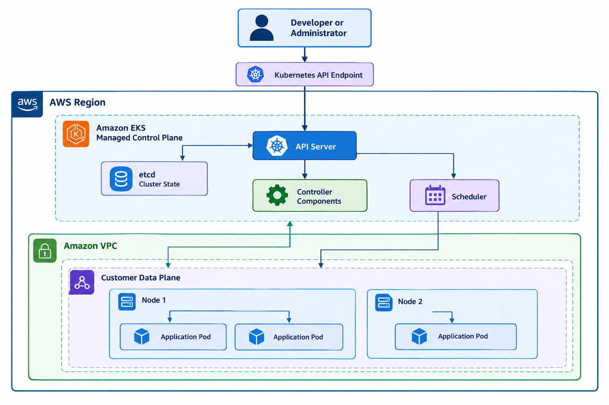
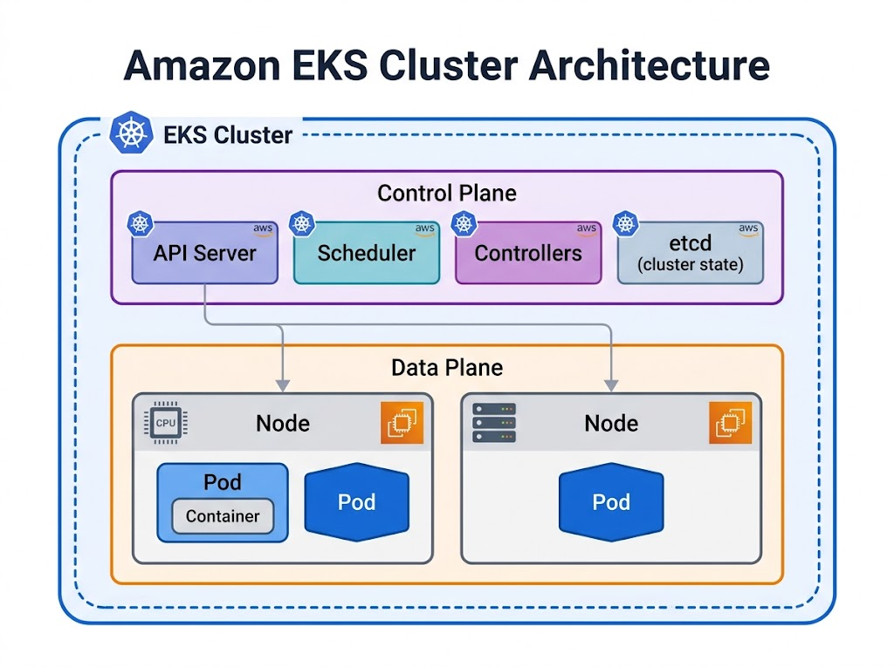
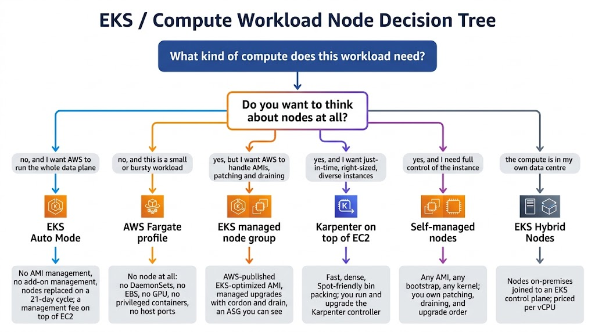
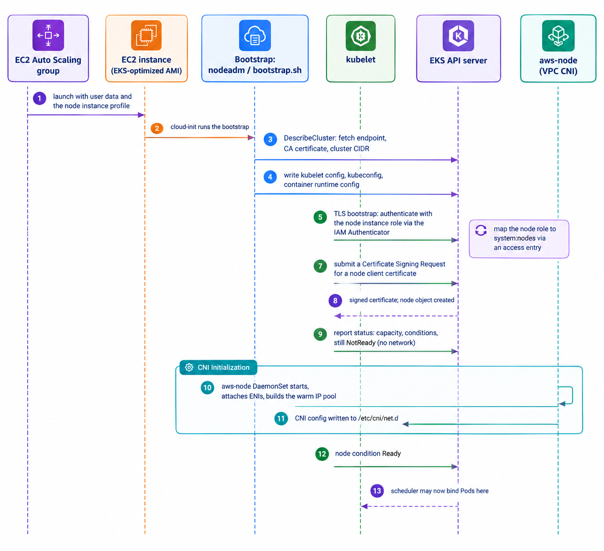
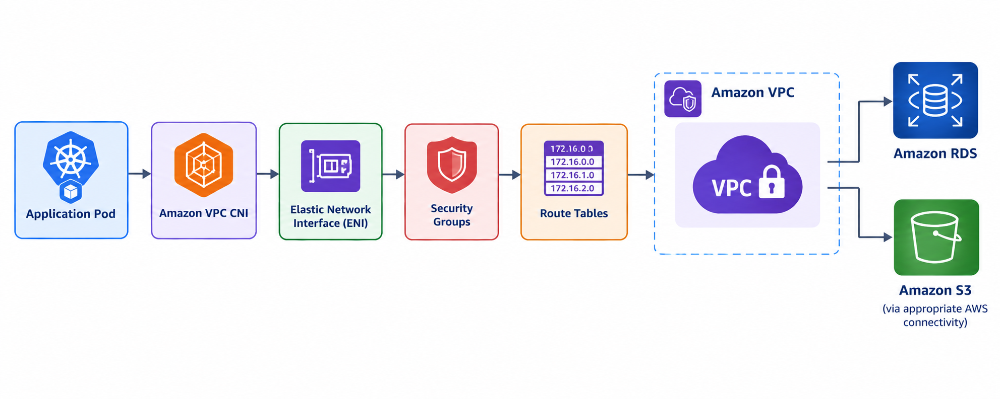
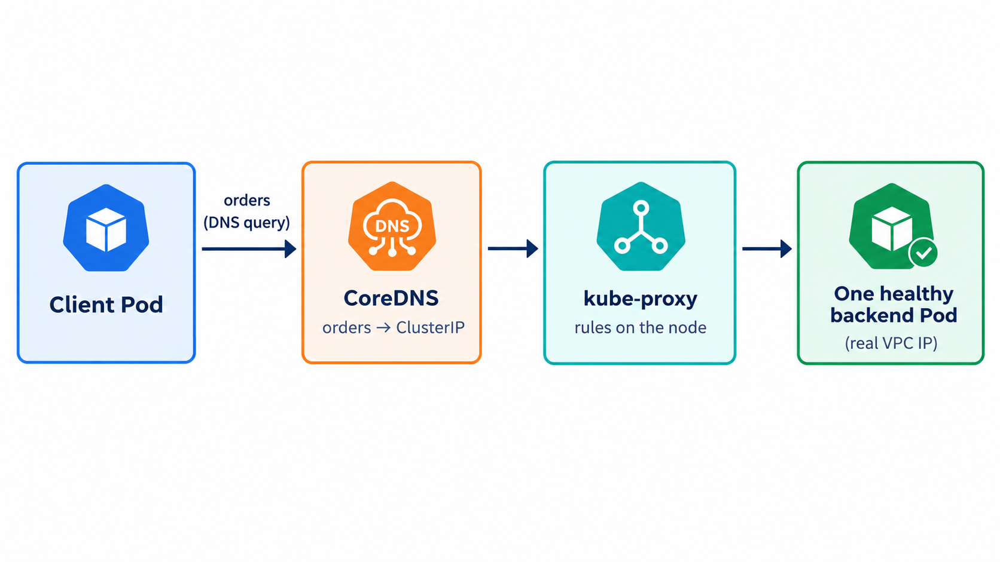
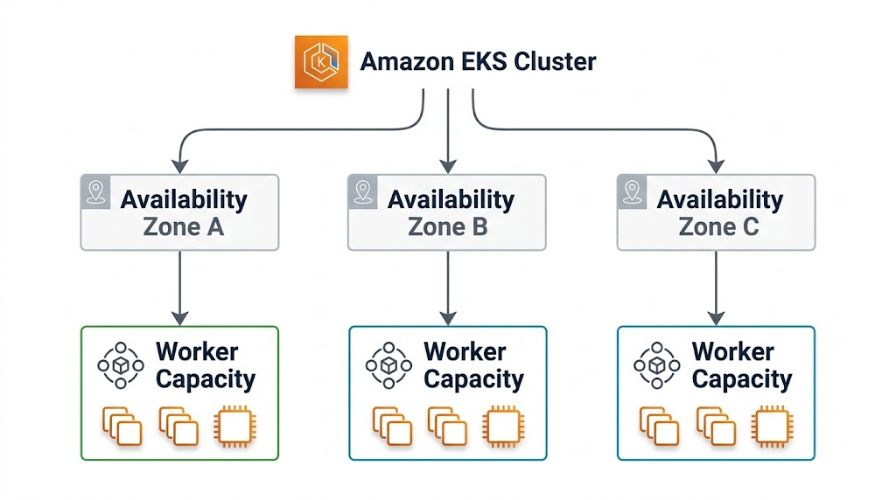
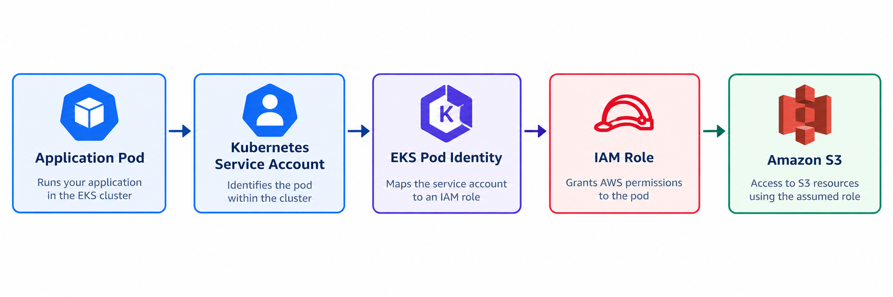
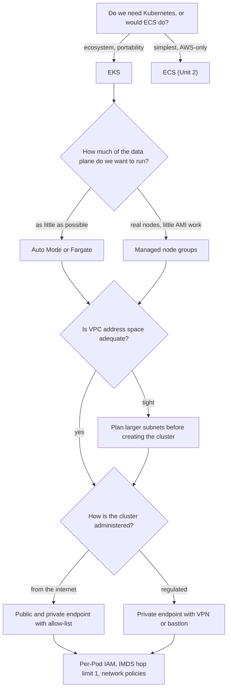
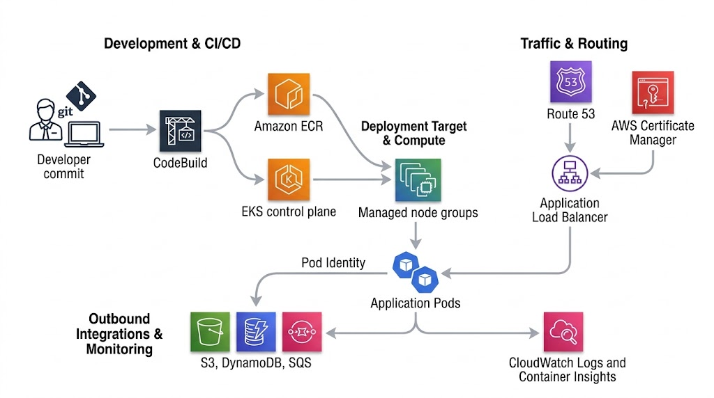

# 3.1 Amazon EKS Architecture

## Definition

**Amazon Elastic Kubernetes Service (Amazon EKS)** is a managed Kubernetes service. It lets an organisation run Kubernetes clusters on AWS without operating the Kubernetes control plane itself.

Every Kubernetes cluster has two halves:

- **Control plane**: manages the cluster and exposes the Kubernetes API.
- **Data plane**: the compute on which application Pods run.

In EKS, AWS runs the control plane in an AWS-managed account. The data plane runs inside **your** VPC, on compute you choose. The defining fact of EKS is therefore a **boundary through the middle of the cluster**:

| Side | What runs there | Who owns it | Who pays |
|---|---|---|---|
| **Control plane** | `kube-apiserver`, `etcd`, `kube-scheduler`, controller managers, IAM authenticator | AWS, in an AWS-managed VPC | Flat per-cluster hourly fee |
| **Data plane** | `kubelet`, `kube-proxy`, `containerd`, VPC CNI, CoreDNS, your Pods | You, in your VPC, on EC2 or Fargate | The compute, storage and network you use |

!!! note "How this unit flows"
    3.1 explains **how an EKS cluster is built** (control plane, networking, identity). 3.2 explains **how applications are deployed** onto it. 3.3 goes deeper into **the data plane choices** (Fargate, managed node groups, add-ons).

## Why This Service or Concept Exists

### What Kubernetes does

Kubernetes is a container orchestration platform. Instead of starting containers by hand, you describe the **desired state** of an application, for example:

- three replicas of a Pod;
- a specific container image;
- a fixed amount of CPU and memory;
- a stable network address;
- automatic replacement if a Pod fails.

Kubernetes repeatedly compares desired state with actual state and corrects any difference. This loop is called **reconciliation**, and it is the idea everything else in this unit builds on.

### Why a managed Kubernetes service

Running Kubernetes yourself means operating `etcd`, highly available API servers, control plane upgrades, and authentication. These are the hardest parts to run well, and a failure there makes the whole cluster unmanageable.

AWS runs the EKS control plane in its own account for three reasons:

1. **Isolation.** Each control plane is single-tenant in its own VPC, so a mistake in your VPC cannot take it down.
2. **Operability.** AWS can patch, scale and replace control plane instances without coordinating with you.
3. **An SLA.** Because reliability does not depend on your VPC, AWS can offer an availability SLA on the API endpoint.

The cost of this design: the control plane sits **outside** your VPC but must reach **inside** it. EKS places cross-account network interfaces (ENIs) in your subnets for this path, and that path is the source of many real-world EKS problems.

### EKS or ECS?

| Choose ECS when | Choose EKS when |
|---|---|
| The team has no Kubernetes experience | The team already has, or will hire, Kubernetes skills |
| The workload is AWS-only | Multi-cloud, hybrid or on-premises portability is required |
| You want the smallest operational surface | You need the Kubernetes ecosystem: Helm charts, operators, service meshes |
| Fast time to first deployment matters most | You are building an internal platform for other teams |

!!! tip "The decision is about the ecosystem, not the scheduler"
    Both orchestrators run containers well. If you need Kubernetes-packaged software, you need Kubernetes; if not, ECS reaches the same outcome with far fewer concepts (see [2.2 Amazon ECS](../unit2/topic2.md)). Kubernetes is not automatically "more advanced".

## Core Concepts

### Control plane and data plane

<figure markdown="span">
    {width="80%"}
    <figcaption>EKS architecture</figcaption>
    
<i>Image Source: AI Generated (Chatgpt)</i>

</figure>

| Aspect | Control plane | Data plane |
|---|---|---|
| Responsibility | Manage the cluster | Run application workloads |
| Components | API server, scheduler, controllers, `etcd` | Nodes and Pods |
| Managed by EKS | Yes | Depends on the compute model |
| Runs your containers | No | Yes |
| If it fails | You cannot change anything | Users are affected immediately |

!!! tip "A control plane problem stops change, not traffic"
    Running Pods keep serving requests if the API server is briefly unavailable. What stops is the ability to deploy, scale or change anything.

### Nodes, Pods and containers

A **node** provides compute capacity. A **Pod** is the smallest Kubernetes workload unit: one or more containers sharing a network address and storage. Pods are scheduled **onto** nodes; they are not the same thing.

<figure markdown="span">
    {width="80%"}
    <figcaption>Kubernetes components</figcaption>
    
<i>Image Source: AI Generated (Google Gemini)</i>

</figure>

### Kubernetes objects compared with ECS

If you studied ECS in Unit 2, this mapping is the quickest way in:

| ECS concept | Kubernetes equivalent | Key difference |
|---|---|---|
| Task definition | **Pod spec** (inside a Deployment) | A Pod is a group of containers sharing one network namespace |
| Task | **Pod** | Smallest schedulable unit |
| Service | **Deployment** + **Service** | Kubernetes separates "keep N replicas running" from "give them a stable address" |
| Cloud Map discovery | **Service** + CoreDNS | DNS is built in |
| Container instance | **Node** | A Node is an API object with labels, taints and capacity |
| Service auto scaling | **HorizontalPodAutoscaler** | Same control loop |
| Task role | **ServiceAccount + Pod Identity or IRSA** | The largest conceptual gap (see [IAM for workloads](#iam-for-workloads-pod-identity)) |

### How a request to the cluster flows

1. An engineer or pipeline submits desired state to the Kubernetes API.
2. The control plane authenticates, authorises, validates and stores it in `etcd`.
3. The scheduler picks a node for each new Pod.
4. The `kubelet` on that node starts the containers.
5. Controllers keep reconciling actual state with desired state.
6. The VPC connects Pods to each other and to other AWS resources.
7. IAM and Kubernetes RBAC decide what people and workloads may do.

## AWS Service Deep Dive

### EKS control plane and worker nodes

#### The EKS control plane

| Component | Role | On EKS |
|---|---|---|
| `kube-apiserver` | Front door: authenticates and authorises every request; the only component that talks to `etcd` | At least two instances across AZs |
| `etcd` | Key-value store holding all cluster state | Three instances across three AZs |
| `kube-scheduler` | Chooses a node for each unscheduled Pod | AWS-managed |
| `kube-controller-manager` | Built-in reconciliation loops (Deployment, ReplicaSet, Node, Job) | AWS-managed |
| `cloud-controller-manager` | AWS-specific loops such as node lifecycle | AWS-managed |
| AWS IAM Authenticator | Verifies the IAM identity behind each `kubectl` request | Built in |

> **You operate the Kubernetes workloads; AWS operates the control plane infrastructure.**

Key facts:

- **Availability.** Components are spread ==across multiple Availability Zones== and replaced automatically when unhealthy.
- **Pricing.** A flat fee ==per cluster per hour== (indicatively USD 0.10 per hour in standard support, about USD 0.60 in extended support), regardless of cluster size.
- **Scaling.** AWS scales the control plane with load; there is no setting.
- **Limits.** No direct `etcd` access. Upgrades go one minor version at a time and are effectively one-way. The VPC, control plane subnets and IP family are fixed at creation.

!!! warning "Upgrades are a yearly obligation"
    Each Kubernetes version gets about 14 months of **standard support**, then about 12 months of **extended support** at roughly six times the control plane price. Plan an annual upgrade (process covered in [3.2](topic2.md#creating-and-managing-eks-clusters)).

#### Worker nodes: data plane options

<figure markdown="span">
    {width="80%"}
    <figcaption>Types of node</figcaption>
    
<i>Image Source: AI Generated (Gemini)</i>

</figure>

| Option | You manage | AWS manages | Choose when |
|---|---|---|---|
| **Managed node group** | Instance types, scaling limits, labels | AMI, bootstrap, health replacement, rolling upgrades | The default for most clusters |
| **Self-managed nodes** | Everything about the nodes | Only the control plane | You need a custom AMI or unsupported setup |
| **AWS Fargate** | Nothing about infrastructure | The whole node (one micro-VM per Pod) | Small, bursty or isolation-sensitive Pods |
| **EKS Auto Mode** | Workloads and scaling policy | Compute, networking, storage, load balancing | You want AWS to run the data plane |
| **Hybrid Nodes** | On-premises hardware | The control plane | Workloads must stay on-premises |

Fargate and managed node groups are compared in depth in [3.3](topic3.md).

!!! tip "A sensible first production cluster"
    Managed node groups in private subnets across three AZs, with VPC CNI, CoreDNS and `kube-proxy` managed as EKS add-ons. Add Fargate later for specific namespaces.

#### How a node joins the cluster

A launched instance is not yet a node. It must authenticate to the API server and have working networking first.

<figure markdown="span">
    {width="80%"}
    <figcaption>Sequence diagram for a node joining the cluster</figcaption>
    
<i>Image Source: AI Generated (Gemini)</i>

</figure>

Two practical consequences:

1. A node stays `NotReady` until the VPC CNI works, so a broken CNI looks like nodes that never become ready.
2. The node's IAM role needs an **access entry**. EKS creates it automatically for managed node groups; you create it yourself for self-managed nodes.

### EKS networking and VPC integration

Nodes and Pods live in your VPC subnets. The VPC provides IP addresses, routing, security groups, internet access where allowed, and private connectivity through VPC endpoints.

#### The Amazon VPC CNI

Many Kubernetes network plugins give Pods addresses from an internal **overlay** network. The **Amazon VPC CNI** is different: **every Pod gets a real, routable IP address from your VPC subnet**, taken from secondary IPs on the node's ENIs.

<figure markdown="span">
    {width="80%"}
    <figcaption>VPC CNI</figcaption>
    
<i>Image Source: AI Generated (Chatgpt)</i>

</figure>

| Benefit | Cost |
|---|---|
| No encapsulation overhead; one network to debug | **Pod density is limited by IP addresses**, not just CPU and memory |
| Pod traffic appears in VPC Flow Logs | Each instance type supports a fixed number of ENIs and IPs |
| Load balancers can target Pods directly | Your subnet size becomes a cluster capacity limit |

!!! danger "The most common EKS surprise"
    A cluster can run out of subnet IP addresses while nodes still have free CPU. New Pods then stay `Pending`. Size subnets for **Pod count**, not node count. (Prefix delegation, custom networking and IPv6 are ways around this; they are beyond this module.)

#### Services, CoreDNS and kube-proxy

Pods are replaced often, so their IPs change. Other Pods reach them through a **Service**, which provides a stable name and virtual IP (ClusterIP).

- **CoreDNS** resolves the Service name to its ClusterIP.
- **`kube-proxy`** on each node rewrites packets for the ClusterIP so they reach a healthy Pod.

<figure markdown="span">
    {width="80%"}
    <figcaption>Services, CoreDNS, kube-proxy</figcaption>
    
<i>Image Source: AI Generated (Google Gemini)</i>

</figure>

| Service type | What it creates | Use |
|---|---|---|
| `ClusterIP` | Internal virtual IP | Default; service-to-service traffic |
| `NodePort` | A port on every node | Rarely used directly |
| `LoadBalancer` | An AWS load balancer (NLB) | Expose one Service externally |
| **Ingress** (not a Service type) | An ALB | HTTP routing for many Services behind one load balancer |

#### The AWS Load Balancer Controller

This controller (installed by you) turns an **Ingress** into an ALB and an annotated **Service** into an NLB.

| Target mode | Traffic goes to | Consequence |
|---|---|---|
| **Instance mode** | A node port, then `kube-proxy` forwards to a Pod | Extra hop |
| **IP mode** | **Pod IPs directly** | Lower latency; required on Fargate |

#### Cluster endpoint access

| Mode | Who can reach the API | Typical use |
|---|---|---|
| **Public only** | Internet, limited by a CIDR allow-list | Development |
| **Public and private** | Allow-listed internet plus the VPC; nodes stay internal | Common production choice |
| **Private only** | Only from inside the VPC or a connected network | Regulated environments |

!!! warning "Plan the admin path before going private-only"
    With a private-only endpoint, every engineer and CI/CD pipeline must reach the cluster from inside the VPC (VPN, bastion, in-VPC runners). Teams that skip this lock themselves out.

#### Subnets and Availability Zones

A common production layout:

- **private subnets** for nodes and Pods;
- **public subnets** for internet-facing load balancers;
- **NAT gateways** for outbound internet from private subnets;
- **VPC endpoints** for private access to AWS services such as ECR and S3.

<figure markdown="span">
    {width="80%"}
    <figcaption>Workload spread across Availability Zones</figcaption>
    
<i>Image Source: AI Generated (Chatgpt)</i>

</figure>

The goal is not "many nodes" but **surviving the loss of a whole AZ**: spread both nodes and replicas across zones. Remember that cross-AZ traffic is billed.

### EKS security and IAM integration

EKS security has two separate questions:

1. **Who can operate the cluster?** (people and pipelines using `kubectl`)
2. **What can the application in a Pod do in AWS?** (workload identity)

#### Cluster access: authentication versus authorisation

| Step | Layer | Mechanism | Failure message |
|---|---|---|---|
| **Authentication** (who are you?) | IAM | `kubectl` sends a token from `aws eks get-token` | `Unauthorized` |
| **Mapping** | EKS API | An **access entry** links the IAM principal to a Kubernetes identity | `Unauthorized` if missing |
| **Authorisation** (what may you do?) | Kubernetes | An **access policy** (cluster admin, admin, edit, view) or RBAC Role binding | `Forbidden` |

!!! tip "Unauthorized vs Forbidden"
    `Unauthorized` means the cluster does not recognise you (no access entry). `Forbidden` means it recognises you but you lack permission. Only the identity that created the cluster has admin access by default, so add access entries for your team immediately.

#### IAM for workloads: Pod identity

A Pod that writes to S3 needs AWS credentials. Three options:

| Approach | How it works | Verdict |
|---|---|---|
| **Node instance role** | Every Pod on the node borrows the node's role | Avoid: every Pod gets every permission |
| **IAM Roles for Service Accounts (IRSA)** | The cluster's OIDC provider lets a ServiceAccount assume an IAM role | Works everywhere, **including Fargate** |
| **EKS Pod Identity** | An agent add-on supplies credentials for a ServiceAccount-to-role association | Simpler; preferred on EC2 nodes; **not on Fargate** |

<figure markdown="span">
    {width="80%"}
    <figcaption>Pod access to other AWS services</figcaption>
    
<i>Image Source: AI Generated (Chatgpt)</i>

</figure>

Both IRSA and Pod Identity give **temporary, auto-rotated credentials**, so no access key is stored in the container. Apply **least privilege**: each workload gets only what it needs.

!!! danger "Block Pods from the node role"
    Even with Pod Identity, a Pod can reach the node's role through the instance metadata service (IMDS). Require **IMDSv2 with a hop limit of 1** on nodes. You need both settings together.

#### Secrets

Kubernetes Secrets are **base64-encoded, not encrypted**. Enable **envelope encryption with AWS KMS** for `etcd`, and use **AWS Secrets Manager** (with the Secrets Store CSI Driver) for credentials that rotate. Never delete the KMS key: every Secret would become unreadable.

## Architecture Components

| Component | Responsibility |
|---|---|
| **EKS cluster** | Managed control plane: API endpoint, `etcd`, scheduler, controllers |
| **Cluster IAM role** | Role EKS uses to manage ENIs, load balancers and logs for you |
| **Cluster security group** | Lets the control plane and nodes talk to each other |
| **Cross-account ENIs** | The control plane's path into your VPC |
| **Cluster endpoint** | API server DNS name (public, public and private, or private) |
| **VPC and subnets** | At least two AZs; private for nodes, public for internet-facing load balancers |
| **Node IAM role** | Used by `kubelet` to join the cluster and pull images from ECR |
| **`kubelet` / `containerd`** | Node agent that runs Pods / container runtime |
| **VPC CNI, CoreDNS, `kube-proxy`** | Pod IPs, cluster DNS, Service routing |
| **AWS Load Balancer Controller** | Creates ALBs for Ingress and NLBs for Services |
| **Access entries** | Map IAM principals to Kubernetes permissions |
| **Pod Identity Agent / OIDC provider** | Enable per-Pod IAM roles |
| **AWS KMS** | Envelope encryption of Secrets |
| **CloudWatch Logs and CloudTrail** | Control plane logs and audit of EKS API calls |

Think of these in three groups:

- **Boundary components** (endpoint, ENIs, security group, node role) decide whether the cluster works at all.
- **Data plane components** (nodes, CNI, `kube-proxy`, CoreDNS) decide whether workloads run, and you keep them current.
- **Integration components** (load balancer controller, Pod identity, KMS, CloudWatch) decide how much of AWS your Pods can use.

## Important AWS Terminology

| Term | Meaning |
|---|---|
| **Control plane** | Kubernetes management components AWS runs for you |
| **Data plane** | Nodes and Pods in your VPC that run workloads |
| **Pod** | Smallest schedulable unit; containers sharing a network address |
| **Node** | A machine (or Fargate capacity) that runs Pods |
| **`kube-apiserver`** | Front door to the cluster; only component that talks to `etcd` |
| **`etcd`** | Key-value store holding all cluster state |
| **`kubelet`** | Node agent that registers the node and runs Pods |
| **`kube-proxy`** | Implements Service virtual IPs on each node |
| **Reconciliation** | Continuous loop making actual state match desired state |
| **Standard / extended support** | About 14 months at base price / about 12 more months at a higher price |
| **Amazon VPC CNI** | Network plugin giving Pods real VPC IPs |
| **ENI** | Elastic network interface; Pod IPs are secondary addresses on it |
| **ClusterIP** | Internal virtual address of a Service |
| **Ingress** | HTTP routing object, realised on EKS as an ALB |
| **IP mode / instance mode** | Load balancer targets are Pod IPs / node ports |
| **Access entry** | EKS object mapping an IAM principal to a Kubernetes identity |
| **Access policy** | Managed permission set attached to an access entry |
| **RBAC** | Kubernetes authorisation: Roles, ClusterRoles and bindings |
| **ServiceAccount** | Kubernetes identity for a workload |
| **IRSA** | IAM Roles for Service Accounts, using OIDC federation |
| **EKS Pod Identity** | Newer per-Pod IAM mechanism using an agent add-on |
| **IMDSv2 hop limit** | Setting of 1 stops containers reaching the node's metadata service |
| **Envelope encryption** | KMS-backed encryption of Kubernetes Secrets |
| **NetworkPolicy** | Kubernetes rules controlling Pod-to-Pod traffic |

## Configuration Options

| Setting | Options | Recommendation |
|---|---|---|
| **Kubernetes version** | Supported minor versions | Stay in standard support |
| **Endpoint access** | Public, public and private, private | Public and private with a CIDR allow-list |
| **Authentication mode** | `CONFIG_MAP`, `API_AND_CONFIG_MAP`, `API` | `API` (access entries) for new clusters |
| **Secrets encryption** | None or a KMS key | Enable; protect the key from deletion |
| **Control plane logging** | `api`, `audit`, `authenticator`, `controllerManager`, `scheduler` | At least `audit` and `authenticator` |
| **IP family** | IPv4 or IPv6 | IPv4 unless there is a strong reason |
| **Subnets** | At least two AZs | Three private subnets, sized for Pod count |
| **Compute model** | Node groups, Fargate, Auto Mode, self-managed | Managed node groups as the baseline |
| **Workload identity** | Node role, IRSA, Pod Identity | Pod Identity on EC2 nodes; IRSA on Fargate; never the node role |
| **Network policy** | None, VPC CNI native, Calico | Enable; default-deny per namespace |

Node group settings (capacity type, labels, taints) are covered in [3.3](topic3.md#configuration-options).

!!! warning "Some settings can never change"
    The IP family, VPC and control plane subnets are fixed at creation. Changing them means building a new cluster and migrating.

## Design Considerations

| Quality | Design levers | Trade-off accepted |
|---|---|---|
| **Availability** | Three AZs, multiple replicas, PodDisruptionBudgets | Higher cost; cross-AZ traffic |
| **Scalability** | Pod and node autoscaling, large enough subnets | More moving parts |
| **Security** | Per-Pod IAM, private nodes, network policies, audit logs | More operational friction |
| **Cost** | Right-sized requests, Spot, fewer shared clusters | Shared clusters share blast radius |
| **Operability** | Managed node groups, EKS add-ons, Auto Mode | Less control the more AWS manages |

### Architecture scenarios

**Scenario 1: University web application.** Unpredictable traffic. Use managed node groups across three AZs, a Deployment with several replicas, an ALB via Ingress, RDS for data, and CloudWatch for observability. Kubernetes handles scheduling and recovery; managed AWS services hold state.

**Scenario 2: Pod needs S3 access.** Do not put an access key in the container. Create a ServiceAccount, associate it with a narrowly scoped IAM role through EKS Pod Identity, and grant only the required S3 actions. The application's identity is now separate from the node's.

## AWS Best Practices

| Pillar | Practice |
|---|---|
| **Operational Excellence** | Define clusters and add-ons as code ([5.3](../unit5/topic3.md)); enable control plane logging before you need it |
| **Security** | Access entries with least privilege; one IAM role per workload; IMDSv2 hop limit 1; private nodes; KMS for Secrets |
| **Reliability** | Three AZs; at least two replicas of important services; health probes and PDBs (see [3.2](topic2.md)) |
| **Performance Efficiency** | IP-mode targets; instance types that fit workload and Pod density |
| **Cost Optimization** | Stay in standard support; avoid many small clusters; share one ALB via Ingress |
| **Sustainability** | Higher utilisation; consider Graviton instances |

## Security Considerations

- **Per-Pod identity + IMDS hop limit 1.** Without both, a compromised Pod can use the node's IAM role.
- **Separate authentication from authorisation.** Grant the narrowest access policy, scoped to a namespace; keep cluster-admin for a small break-glass role.
- **Admission control.** Pod Security Admission blocks privileged Pods per namespace; Kyverno or OPA Gatekeeper add organisational rules.
- **Network segmentation.** NetworkPolicies for Pod-to-Pod rules; security groups for VPC boundaries such as database access.
- **Supply chain.** Scan images in ECR, deploy by digest or immutable tag, keep node AMIs current.
- **Audit.** CloudTrail records **EKS API** calls (clusters, node groups, access entries). Only the control plane `audit` log records **Kubernetes API** activity inside the cluster.

Deeper treatment: IAM in [8.1](../unit8/topic1.md), network security in [8.2](../unit8/topic2.md), KMS and Secrets Manager in [8.3](../unit8/topic3.md).

## Operating It: Performance, Cost and Monitoring

**Performance.** Use IP-mode targets to remove a hop. Keep images small so Pods start fast. Remember a node can run out of IPs before CPU.

**Cost.** The control plane fee is usually the smallest part of the bill.

| Cost driver | How to control it |
|---|---|
| Control plane fee | Stay in standard support; avoid unnecessary clusters |
| Compute (EC2 or Fargate) | Right-size requests; Spot above an On-Demand base ([3.3](topic3.md)) |
| Load balancers | Share one ALB across Services with Ingress |
| NAT and data transfer | VPC endpoints; watch cross-AZ traffic |
| Logs and storage | Set log retention; delete unused volumes |
| Idle clusters | Delete lab clusters when not in use |

**Monitoring.**

| Signal | Source | Tells you |
|---|---|---|
| Node conditions (`NotReady`, `MemoryPressure`) | `kubectl get nodes`, Container Insights | Node health |
| Pending Pods and events | `kubectl describe pod` | Why a Pod cannot be scheduled (CPU, memory, IPs) |
| Free subnet IPs | VPC / CloudWatch | Early warning of IP exhaustion |
| `audit` and `authenticator` logs | CloudWatch Logs | Who did what; why access was refused |
| EKS API activity | CloudTrail | Changes to clusters, node groups, access entries |

Observability is covered fully in Unit 7.

## Integration with Other AWS Services

| Service | Why it integrates with EKS |
|---|---|
| **Amazon EC2** | Instances behind node groups |
| **Amazon VPC** | The network Pods live in |
| **Elastic Load Balancing** | ALBs for Ingress, NLBs for Services |
| **IAM and STS** | Cluster authentication and per-Pod roles |
| **Amazon ECR** | Image registry ([2.1](../unit2/topic1.md)) |
| **EBS, EFS, S3** | Persistent storage via CSI drivers ([6.1](../unit6/topic1.md)) |
| **RDS, DynamoDB** | Managed databases ([6.2](../unit6/topic2.md)) |
| **SQS, SNS, EventBridge** | Messaging with per-Pod roles ([6.3](../unit6/topic3.md)) |
| **KMS and Secrets Manager** | Secrets encryption and injection |
| **CloudWatch and CloudTrail** | Logs, metrics, Container Insights, audit |
| **ACM and Route 53** | TLS certificates and DNS for load balancers |
| **CodePipeline, CodeBuild, CloudFormation** | Delivery and infrastructure as code (Unit 5) |

<figure markdown="span">
    {width="80%"}
    <figcaption>Integration with other AWS services</figcaption>
    
<i>Image Source: AI Generated (Google Gemini)</i>

</figure>

The diagram shows three flows:

- **Delivery flow** (commit → ECR → API server) changes what runs.
- **Runtime flow** (Route 53 → ALB → Pod → AWS services) never touches the control plane, which is why apps survive a control plane problem.
- **Identity flow** connects each Pod to its own IAM role.

## Advantages

- **AWS runs the hardest part.** `etcd`, API server availability and control plane patching, with a multi-AZ design and an SLA.
- **Upstream Kubernetes.** Helm charts, operators and standard tools work unchanged.
- **Native VPC networking.** Pods with real VPC IPs can be load balancer targets and appear in Flow Logs.
- **Fine-grained workload identity.** Each Pod can have its own short-lived IAM role.
- **Auditable access.** Access entries are visible in CloudTrail and definable as code.
- **Portability.** Manifests run on any conformant Kubernetes cluster.

## Limitations

- **Kubernetes is big.** EKS does not shrink the concept count; first production deployment takes longer than on ECS.
- **"Managed" covers half the cluster.** You still keep nodes, add-ons and controllers current.
- **Upgrades never stop.** Roughly yearly, one minor version at a time, one-way.
- **IP planning is a hard limit.** Out of subnet IPs means no new Pods.
- **Per-cluster fee** pushes towards shared clusters and shared blast radius.
- **The control-plane-to-VPC path can break.** Security group changes can stop webhooks, `kubectl logs` and `kubectl exec`.

## Common Mistakes

### Beginner Mistakes

| Mistake | Why it is wrong | Do instead |
|---|---|---|
| "EKS manages everything" | EKS manages the control plane; the data plane depends on your compute model | Know which side each component is on |
| "A node is a Pod" | A node is capacity; a Pod is scheduled onto it | Keep the terms distinct |
| "IAM permission = Kubernetes permission" | IAM authenticates; RBAC authorises; an access entry connects them | Create an access entry and policy |
| Creating the cluster with a pipeline role only | Only the creator is admin | Add a human admin access entry at once |
| Putting app permissions on the node role | Every Pod inherits them | Pod Identity or IRSA per workload |
| "Several nodes = high availability" | Nodes in one AZ fail together | Spread nodes and replicas across AZs |
| Small subnets or tiny instance types | Pods run out of IPs before CPU | Size for Pod density |
| Nodes in public subnets | Data plane exposed | Private subnets with NAT or endpoints |

### Production Mistakes

| Mistake | Consequence | Remedy |
|---|---|---|
| Tightening the cluster security group blindly | Deployments fail with webhook errors | Allow control plane to node traffic; test after changes |
| Falling into extended support | Several times the control plane price | Annual upgrade rehearsed in non-production |
| Private-only endpoint with no access path | Engineers and CI/CD locked out | VPN, bastion or in-VPC runners first |
| Not monitoring free IPs | Scale-out fails without warning | Alarm on free subnet addresses |
| Deleting the Secrets KMS key | All Secrets unreadable | Protect the key from deletion |

## Summary

Amazon EKS = Kubernetes orchestration + AWS-managed infrastructure. The central idea is the **boundary through the cluster**: AWS runs the control plane across multiple AZs in its own account; you choose and run the data plane in your VPC. A control plane problem stops change, not traffic.

| Area | Key lesson |
|---|---|
| **Control plane and nodes** | AWS runs API server, `etcd`, scheduler. Managed node groups are the default data plane; Fargate and Auto Mode hand more to AWS |
| **Networking** | VPC CNI gives each Pod a real VPC IP: great for load balancing, but **IP space limits capacity**. Spread across AZs |
| **Cluster access** | IAM authenticates, access entry maps, RBAC authorises. `Unauthorized` vs `Forbidden` |
| **Workload identity** | Pod Identity (EC2) or IRSA (Fargate), plus IMDS hop limit 1. Never the node role |
| **Operations** | Annual upgrades; cost is mostly compute, networking and logs, not the control plane fee |

**Next:** with the cluster's architecture understood, [3.2](topic2.md) shows how to create a cluster and deploy applications onto it.

!!! question "Practice and interview questions"
    Questions for this topic are kept separately: [Practice questions](../Questions/unit3.md#31-amazon-eks-architecture) · [Interview questions](../interviewquestions/unit3.md#31-amazon-eks-architecture).
