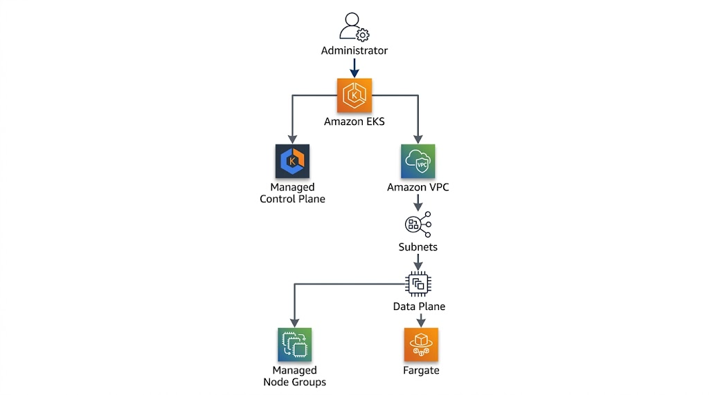
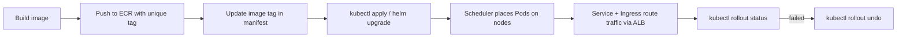

<!-- teachprep:refined 2026-10-11 -->
# 3.2 Deploying Applications on Amazon EKS

## Definition

[3.1](topic1.md) explained how an EKS cluster is built. A cluster exists to **run applications**. **Deploying an application on EKS** means:

1. describing the application's desired state as Kubernetes objects (Deployments, Services, ConfigMaps);
2. delivering those objects to the cluster's API server;
3. letting the cluster's controllers make reality match them (reconciliation, see [3.1](topic1.md#what-kubernetes-does)).

Deployment involves three separate concerns. Mixing them up causes most beginner confusion:

| Concern | Question it answers | Typical tools |
|---|---|---|
| **Cluster provisioning** | Does a cluster exist with the right network, nodes, add-ons and access? | `eksctl`, CloudFormation, CDK, Terraform, console |
| **Packaging** | Which objects describe this app, and how do they differ per environment? | YAML manifests, Helm, Kustomize |
| **Delivery** | How do those objects reach the cluster repeatably? | `kubectl` for learning, CI/CD pipelines for teams |

## Why This Service or Concept Exists

- **An image alone is not a running application.** Something must decide how many copies run, where, how traffic reaches them, and what happens when one fails. Kubernetes objects describe that.
- **A usable cluster is more than one API call.** It needs IAM roles, subnets, add-ons, nodes, access entries and a load balancer controller, created **in the right order**. Tools like `eksctl` understand this dependency graph.
- **Typing commands does not scale.** Hand-run `kubectl` leaves no reviewed record and spreads cluster credentials. Teams store manifests in Git and deploy through pipelines. (**GitOps** tools such as Argo CD or Flux go further by pulling from Git; covered in later study.)
- **Environments differ.** Dev, staging and production differ in replicas, sizes and image versions. Copying YAML per environment causes drift. **Helm** (parameterised packages) and **Kustomize** (base + overlays) solve this.

## Core Concepts

### Declarative deployment

Kubernetes is **declarative**: you say *what* should be true ("three replicas of version 1.4.2"), not the steps to get there. To release a new version you **change the description** (the image tag) and apply it; Kubernetes performs the transition.

### The objects you write

| Object | Responsibility |
|---|---|
| **Container image** | Packages code and runtime ("what runs") |
| **Deployment** | Keeps N identical Pods running and manages updates ("how many, how updated") |
| **ReplicaSet** | Created by a Deployment for each version; holds the Pod count |
| **Service** | Stable network address in front of changing Pods |
| **Ingress** | External HTTP access, realised as an ALB ([3.1](topic1.md#the-aws-load-balancer-controller)) |
| **ConfigMap** | Non-secret configuration |
| **ServiceAccount** | Workload identity, linked to an IAM role ([3.1](topic1.md#iam-for-workloads-pod-identity)) |
| **HorizontalPodAutoscaler** | Scales replica count from metrics |
| **PodDisruptionBudget** | Limits Pods evicted at once during maintenance ([3.3](topic3.md#eks-managed-node-groups)) |
| **Namespace** | Logical grouping and isolation inside a cluster |

!!! note "Image vs Deployment"
    A container image is not a deployment strategy. The image answers **what runs**; the Deployment answers **how many, how it is updated, and how it stays healthy**.

## AWS Service Deep Dive

### Creating and managing EKS clusters

**Decisions at creation.** Kubernetes version, Region, VPC and subnets (at least two AZs), endpoint access, authentication mode, compute model, IAM roles, add-ons, and logging. Most were explained in [3.1 Configuration Options](topic1.md#configuration-options).

**Quick or custom configuration.** The console's **Create cluster** page offers two paths:

| Console option | What it does | When to use it |
|---|---|---|
| **Quick configuration (with EKS Auto Mode)** | Asks for a name, version, roles and VPC, then creates an **Auto Mode** cluster: AWS launches and manages the nodes, networking, storage and load balancing ([3.1 compute models](topic1.md#worker-nodes-data-plane-options)) | You want a working cluster with the fewest decisions |
| **Custom configuration** | Every setting is shown. The **Use EKS Auto Mode** switch is on by default; turn it off to build the cluster from managed node groups and add-ons yourself | You need control, or (as in this course) you want to see each building block |

This course uses **Custom configuration with Auto Mode switched off**, so the node group and add-ons below are visible and can be inspected. The `eksctl` equivalent of Auto Mode is `eksctl create cluster --name <name> --enable-auto-mode`, or `autoModeConfig: enabled: true` in a `ClusterConfig` file.

<figure markdown="span">
    {width="80%"}
    <figcaption>Creating a cluster</figcaption>
    <p align='right' style="font-size:0.8em"><i>Image Source: AI Generated (Google Gemini)</i></p>
</figure>

!!! warning "`CreateCluster` makes the control plane only"
    Without Auto Mode, a brand-new cluster has an API server and **no nodes**. By default only the identity that created it (bootstrap cluster administrator access) can log in until more access entries are added. With Auto Mode, AWS takes over most of stages 4 to 6 below (Pod networking, DNS, nodes and load balancing) and launches nodes when Pods need them.

**Build order, and what breaks if a stage is missing:**

| Stage | What is created | Symptom if skipped or wrong |
|---|---|---|
| 1. **Prerequisites** | Cluster role, node role, VPC, subnets, NAT | Creation fails, or nodes cannot reach ECR |
| 2. **Control plane** | API server, `etcd`, cluster security group (10 to 15 min) | Nothing else can proceed |
| 3. **Access** | Access entries for people and pipelines | `Unauthorized` for everyone but the creator |
| 4. **Core add-ons** | VPC CNI, `kube-proxy`, CoreDNS | Nodes never `Ready`; DNS fails |
| 5. **Node group** | Auto Scaling group and EC2 instances | Every Pod stays `Pending` |
| 6. **Controllers** | AWS Load Balancer Controller, metrics-server | Ingress does nothing; no autoscaling metrics |

Subnets for load balancers need discovery tags: `kubernetes.io/role/elb` (public) and `kubernetes.io/role/internal-elb` (private).

!!! tip "CoreDNS `Pending` on a new cluster is normal"
    With no nodes yet, CoreDNS has nowhere to run. It starts once a node group exists. Learning to tell "nowhere to run" from "broken" is a core Kubernetes skill.

**Cluster lifecycle.** Create → configure → deploy workloads → monitor → upgrade → maintain nodes → manage access → scale → delete.

**Upgrading, at a high level.** Versions are supported for a limited time ([3.1](topic1.md#the-eks-control-plane)), so upgrades are recurring. They go **one minor version at a time**, and the **control plane always goes first**, because nodes may run behind the control plane (up to three minor versions) but never ahead of it. AWS's upgrade best-practices guide uses this order:

1. **Control plane** (for example 1.36 → 1.37). In the console this is the cluster's **Upgrade now** action.
2. **Add-ons** (VPC CNI, CoreDNS, `kube-proxy`) to versions compatible with the new control plane. A control plane upgrade does not upgrade them for you.
3. **Nodes**, replaced with new ones via a rolling update (cordon, drain, PodDisruptionBudgets, see [3.3](topic3.md#eks-managed-node-groups)). Managed node groups are not upgraded automatically; Auto Mode nodes are.

The EKS User Guide lists nodes before add-ons; either is acceptable as long as the control plane is first and every add-on version is compatible with both. Before upgrading, check the console's **Upgrade insights** tab and your manifests for APIs removed in the target version, and rehearse in non-production first.

!!! note "Treat an upgrade as a one-way door"
    Since July 2026, EKS can roll a control plane back to the **previous** minor version, but only **within 7 days** of the upgrade, and you must first roll back any managed node groups you already upgraded (and any incompatible add-ons) yourself. It is a safety net for a bad week, not a substitute for testing.

### Deploying applications using kubectl and eksctl

| Tool | Job |
|---|---|
| AWS Console | Visual management and learning |
| AWS CLI | AWS operations, including `aws eks update-kubeconfig` |
| `eksctl` | Create and manage EKS clusters and node groups |
| `kubectl` | Manage Kubernetes resources inside the cluster |
| Helm | Package and release Kubernetes applications |

!!! note "The critical distinction"
    **`eksctl` builds the cluster (AWS side). `kubectl` manages what runs inside it (Kubernetes side).** They are not interchangeable.

**`eksctl`** generates CloudFormation stacks for the cluster, VPC and node groups, and creates IAM roles, add-ons and access in the correct order.

For anything beyond a lab, put the definition in a `ClusterConfig` YAML file (`eksctl create cluster -f cluster.yaml`) so it is reviewable in Git. `eksctl upgrade cluster` performs the control plane step of an upgrade. Production teams usually use their standard IaC tool instead ([5.3](../unit5/topic3.md)).

**Connecting `kubectl` to the cluster:**

```bash
aws eks update-kubeconfig --name dso303-lab --region us-east-1
kubectl config current-context    # which cluster am I talking to?
kubectl get nodes                 # nodes should show STATUS Ready
```

This writes a **context** into `~/.kube/config`: the endpoint, its certificate, and a command (`aws eks get-token`) that fetches a short-lived token before each request. No password is stored; your cluster identity is whichever AWS identity is active.

!!! danger "Check the context before every change"
    `kubectl` acts on the current context. The costliest Kubernetes mistakes are commands run against the wrong cluster. A context can also set a **default namespace**, and a command without `-n` acts there. Give production contexts clearly different names.

**Essential `kubectl` commands:**

| Command | Purpose |
|---|---|
| `kubectl config get-contexts` / `use-context <name>` | List contexts (current one starred) / switch context |
| `kubectl apply -f deployment.yaml` | Create or update objects from a file |
| `kubectl get pods -o wide` | List Pods with node and IP |
| `kubectl get deploy,svc` | List Deployments and Services |
| `kubectl describe pod <name>` | Detailed state and **events**: the most useful diagnostic |
| `kubectl logs <pod> --previous` | Output of the crashed container |
| `kubectl rollout status deployment/<name>` | Wait until a rollout really finishes |
| `kubectl rollout history deployment/<name>` | List revisions (an undo re-uses an old ReplicaSet as a new revision number) |
| `kubectl rollout undo deployment/<name>` | Return to the previous revision |
| `kubectl exec -it <pod> -- sh` | Shell inside a running container |
| `kubectl port-forward svc/<name> 8080:80` | Reach an internal Service from your machine |

Use `kubectl apply` (create or update) rather than `kubectl create` (fails if the object exists).

!!! tip "`kubectl describe pod` first, always"
    Insufficient CPU, image pull failures, probe failures and out-of-memory kills all appear in plain English in the Pod's events. Read them before guessing.

**Typical deployment workflow:**



**How a rolling update works.** When the Pod template changes (for example a new image tag), the Deployment creates a new ReplicaSet and moves Pods across gradually:

- `maxSurge`: how many **extra** Pods may exist during the update.
- `maxUnavailable`: how many Pods may be **missing**.
- New Pods get traffic only after their **readiness probe** passes. A broken version stalls the rollout while old Pods keep serving.

!!! warning "Kubernetes does not roll back automatically"
    A stalled rollout is marked failed after `progressDeadlineSeconds`, but nothing is reverted. Unlike the ECS deployment circuit breaker ([2.3](../unit2/topic3.md)), you or your pipeline must run `kubectl rollout undo`. Also, `kubectl apply` returns when the object is **stored**, not when Pods are running, so always follow it with `kubectl rollout status`.

### Using Kubernetes manifests and Helm charts

#### Manifests

A **manifest** is a YAML file declaring Kubernetes objects. Stored in Git, manifests give repeatability, peer review and automated deployment.

```yaml
apiVersion: apps/v1
kind: Deployment
metadata:
  name: student-portal
  labels:
    app: student-portal
spec:
  replicas: 3
  selector:
    matchLabels:
      app: student-portal
  strategy:
    type: RollingUpdate
    rollingUpdate:
      maxSurge: 1
      maxUnavailable: 0
  template:
    metadata:
      labels:
        app: student-portal
    spec:
      containers:
        - name: web
          image: 111122223333.dkr.ecr.us-east-1.amazonaws.com/student-portal:1.4.2
          ports:
            - containerPort: 8080
          resources:
            requests:
              cpu: 250m
              memory: 256Mi
            limits:
              memory: 256Mi
          readinessProbe:
            httpGet:
              path: /ready
              port: 8080
            periodSeconds: 5
          livenessProbe:
            httpGet:
              path: /healthz
              port: 8080
            initialDelaySeconds: 10
            periodSeconds: 10
---
apiVersion: v1
kind: Service
metadata:
  name: student-portal
spec:
  type: ClusterIP
  selector:
    app: student-portal
  ports:
    - port: 80
      targetPort: 8080
```

Read this example for four things:

- **Labels connect objects.** `selector.matchLabels` must match the Pod template labels; that is how the Deployment and Service find their Pods.
- **Specific image tag** (`1.4.2`), never `latest`, so every Pod runs the same code and rollback means something.
- **`maxUnavailable: 0`** means a rollout never reduces serving capacity.
- **`ClusterIP`** is internal only. External access comes from an Ingress.

#### Requests and limits

| Setting | Used by | Effect |
|---|---|---|
| **Request** | Scheduler | Decides which node has room. No request = Pod looks "free", nodes get overpacked |
| **Memory limit** | Runtime | Exceeding it **kills** the container (`OOMKilled`) |
| **CPU limit** | Runtime | Exceeding it **throttles** (slows) the container; no kill |

Safe starting point: memory request = memory limit; a CPU request with no CPU limit for latency-sensitive services. Base values on observed usage.

#### Probes

| Probe | Question | On failure |
|---|---|---|
| **Readiness** | Can this Pod serve traffic now? | Removed from the Service until it recovers |
| **Liveness** | Is the process stuck? | Container restarted |
| **Startup** | Has a slow app finished starting? | Liveness checks held off until it succeeds |

!!! danger "Never make a liveness probe check the database"
    A short database outage would fail liveness on every replica at once, restarting them all and turning a blip into a full outage. **Liveness tests only the process.** Dependency checks belong in readiness, which removes the Pod from traffic instead of restarting it.

#### Helm

**Helm** is a package manager for Kubernetes. A **chart** bundles templates with a `values.yaml` of defaults:

```text
student-portal-chart/
├── Chart.yaml          # chart name and version
├── values.yaml         # default settings: the chart's public interface
└── templates/
    ├── deployment.yaml # templates with placeholders filled from values
    └── service.yaml
```

Templates contain placeholders (such as `.Values.replicaCount`) that Helm fills in. Each environment needs only a small values file:

```yaml
# values-prod.yaml
replicaCount: 6
image:
  repository: 111122223333.dkr.ecr.us-east-1.amazonaws.com/student-portal
  tag: "1.4.2"
resources:
  requests:
    cpu: 500m
    memory: 512Mi
```

Every install or upgrade becomes a numbered **release revision**, which makes rollback possible:

```bash
# Install-or-upgrade in one idempotent command (the form used in pipelines)
helm upgrade --install portal ./student-portal-chart -f values-prod.yaml

# Inspect history and roll back to revision 2
helm history portal
helm rollback portal 2

# Render locally without touching the cluster, to review the output
helm template portal ./student-portal-chart -f values-prod.yaml
```

Most third-party software (monitoring stacks, the AWS Load Balancer Controller) is installed with Helm. These commands are unchanged in **Helm 4**, the current major version; it renamed a few flags (for example `--atomic` is now `--rollback-on-failure`) and uses server-side apply for new installs.

!!! warning "Common Helm pitfalls"
    Quote number-like values (`tag: "1.10"`), because unquoted `1.10` becomes `1.1`. Use committed values files instead of `--set`, which leaves no record. Run `helm template` before upgrading to catch errors early.

**Kustomize** is the template-free alternative built into `kubectl` (`kubectl apply -k`): a shared base of plain YAML plus small per-environment patches.

## Architecture Components

| Component | Role in deployment |
|---|---|
| **`eksctl` / CloudFormation / CDK / Terraform** | Create the cluster, roles, network, node groups and add-ons |
| **kubeconfig** | Client config; gets short-lived tokens via `aws eks get-token` |
| **`kubectl`** | Inspect, diagnose and apply manifests |
| **Manifests** | Declarative YAML for application objects |
| **Helm chart, values, release** | Versioned, parameterised package with history and rollback |
| **Amazon ECR** | Stores the versioned images manifests reference |
| **CI/CD pipeline** | Builds, scans and pushes images, then applies manifests or Helm releases (Unit 5) |
| **Deployment controller** | Performs rolling updates inside the cluster |
| **metrics-server + HPA** | Scale replicas from metrics |
| **AWS Load Balancer Controller** | Turns Ingress into an ALB |

## Important AWS Terminology

| Term | Meaning |
|---|---|
| **`eksctl`** | CLI that creates EKS clusters and supporting AWS resources |
| **`ClusterConfig`** | Declarative YAML file read by `eksctl` |
| **kubeconfig / context** | Client config file / one cluster-plus-identity entry in it |
| **Manifest** | YAML file describing Kubernetes objects |
| **Deployment** | Maintains replicas of a Pod template and performs rolling updates |
| **ReplicaSet** | Per-version object a Deployment creates; `rollout undo` switches between them |
| **`maxSurge` / `maxUnavailable`** | Extra Pods allowed / missing Pods allowed during a rollout |
| **`progressDeadlineSeconds`** | Time before a stalled rollout is marked failed (no rollback) |
| **Requests / limits** | Scheduling amount / runtime ceiling |
| **Readiness / liveness / startup probe** | Can it serve / is it stuck / has it started |
| **Helm chart** | Versioned package of templates, values and metadata |
| **Release** | Named installation of a chart, with revision history |
| **Kustomize** | Base + overlay customisation built into `kubectl` |
| **`ImagePullBackOff`** | Node cannot pull the image: wrong name, tag or permissions |
| **`CrashLoopBackOff`** | Container keeps starting and exiting; check `kubectl logs --previous` |
| **`OOMKilled`** | Container exceeded its memory limit |

## Configuration Options

Cluster-level settings are in [3.1](topic1.md#configuration-options); node groups and add-ons in [3.3](topic3.md#configuration-options).

| Setting | Options | Recommendation |
|---|---|---|
| **`strategy.type`** | `RollingUpdate`, `Recreate` | Rolling for anything serving traffic; `Recreate` only if two versions must never coexist |
| **`maxSurge` / `maxUnavailable`** | Counts or percentages | `maxSurge: 1`, `maxUnavailable: 0` for services that must not lose capacity |
| **`replicas`** | Integer | At least 2 (ideally 3) for anything important |
| **Packaging tool** | Plain YAML, Kustomize, Helm | YAML for small apps; Helm for third-party or heavily parameterised apps |
| **Image reference** | Mutable tag, unique tag, digest | Unique immutable tag or digest; never `latest` |
| **Values management** | Committed files or `--set` | Committed files |
| **Secrets** | Kubernetes Secret, or Secrets Manager via driver | Secrets Manager; never plaintext in Git |

## Design Considerations

| Quality | Meaning | Design levers | Trade-off |
|---|---|---|---|
| **Reproducibility** | Cluster and apps can be rebuilt from code | IaC, manifests in Git, versioned images | Every change needs a commit |
| **Safety of change** | A bad release does not reach every user | Readiness probes, `maxUnavailable: 0`, `rollout status` | Slower rollouts |
| **Recoverability** | Rollback is fast and trustworthy | Immutable tags, `rollout undo`, `helm rollback` | Image versioning discipline |

### Manifests versus Helm

| Characteristic | Plain manifests | Helm charts |
|---|---|---|
| Purpose | Describe resources | Package and parameterise applications |
| Environment variation | Separate files or Kustomize overlays | One chart, per-environment values |
| Rollback | Deployment revisions | Built-in release revisions |
| Learning curve | Lower | Higher |

Use plain manifests for simple apps with few environments. Use Helm for reusable apps, many variations, or third-party software. Do not adopt Helm just because it exists.

## AWS Best Practices

| Pillar | Practice |
|---|---|
| **Operational Excellence** | Cluster as code, workloads as manifests in Git; `kubectl rollout status` in every pipeline; rehearse upgrades in non-production |
| **Security** | Least-privilege pipeline access; no secrets in images or Git; scan images |
| **Reliability** | Multiple replicas across AZs; correct readiness and liveness probes; `maxUnavailable: 0` |
| **Performance Efficiency** | Small images; requests from observed usage; no CPU limits on latency-sensitive services |
| **Cost Optimization** | Right-size requests (they drive node count); share clusters with namespaces; delete unused clusters and load balancers |
| **Sustainability** | Accurate requests and switching off idle non-production environments |

## Operating It: Performance, Cost and Monitoring

**Performance.** Rollout time ≈ number of batches × (image pull + start + readiness). Small images and a `startupProbe` for slow apps keep it short. A readiness probe that passes too early sends traffic to Pods that cannot serve it. Preview changes with `helm template` or `kubectl diff -f`.

**Cost.** Requests drive node count, so over-requesting silently inflates the bill. Scale non-production down when unused.

!!! warning "Deleting a Deployment does not delete everything"
    Load balancers (from Services or Ingresses) and EBS volumes (from persistent volume claims) are AWS resources that can outlive the Kubernetes objects or even the cluster. Delete Services, Ingresses and PVCs **before** deleting the cluster, then check the console.

**Monitoring.**

| Signal | Source | Tells you |
|---|---|---|
| Rollout result | `kubectl rollout status` | Did the deployment actually finish? |
| Pod events | `kubectl describe pod` | Plain-language cause of start-up failures |
| Restarts and `OOMKilled` | `kubectl get pods`, Container Insights | Crash loops; memory limits too low |
| CPU and memory usage | `kubectl top pods`, Container Insights | Actual usage vs requests |
| ALB 5xx and unhealthy targets | CloudWatch | User-facing view of a bad rollout |
| Control plane audit log | CloudWatch Logs | Who applied what, and when |

Useful alarms: a Deployment that stops progressing, sustained Pod restarts, rising ALB 5xx during a release. More in [7.1](../unit7/topic1.md).

## Advantages

- **Declarative.** Controllers keep the described state true, even after failures.
- **Manifest = executable documentation.** Image, resources, probes and identity in one reviewable file.
- **Fast rollback.** `kubectl rollout undo` and `helm rollback`, if images are immutable.
- **Zero-downtime updates.** Rolling updates with readiness probes.
- **Reuse across environments.** Values files or overlays express only the differences.
- **Portable skills.** `kubectl`, manifests and Helm work on any conformant cluster.

## Limitations

- **No automatic rollback.** Less safe out of the box than the ECS circuit breaker.
- **YAML is error-prone**, and templated YAML more so.
- **Many tools** to learn and secure: `kubectl`, `eksctl`, Helm, controllers, CI/CD.
- **`kubectl apply` reports acceptance, not success.**
- **Secrets need extra components** such as Secrets Manager plus a driver.
- **Multi-layer debugging.** A failure may be the app, the image, a permission, scheduling or a probe.

## Common Mistakes

### Beginner mistakes and misconceptions

| Mistake | Reality | Do instead |
|---|---|---|
| "`kubectl` creates the EKS cluster" | Cluster creation is an AWS operation | Use `eksctl`, console or IaC |
| "`eksctl` replaces `kubectl`" | One builds the cluster, the other manages workloads | Use both, each for its job |
| "Helm is mandatory" | Useful, not required | Plain manifests for simple apps |
| Treating `kubectl apply` as success | It returns when stored, not running | Follow with `kubectl rollout status` |
| `image: myapp:latest` | Pods may run different code; rollback meaningless | Unique tag per build |
| No resource requests | Scheduler overpacks nodes | Set requests from observed usage |
| Liveness probe checks the database | A DB blip restarts every replica | Dependencies go in readiness |
| Fixing things with `kubectl edit` | Unreviewed and later overwritten | Change the manifest, apply, commit |
| Committing a Secret to Git | Credential exposed in history forever | Secrets Manager with a driver |
| Copying YAML per environment | Copies drift apart | One chart or base, per-env values |
| Running databases in Kubernetes by default | More operational burden | Prefer RDS or DynamoDB |

### Production mistakes

| Mistake | Consequence | Remedy |
|---|---|---|
| Pipeline with cluster-admin credentials | One compromised build controls the cluster | Scope pipeline access tightly |
| Upgrading without checking removed APIs | Workloads break; rollback is only possible for 7 days and only one version back | Check Upgrade insights and manifests; upgrade non-production first |
| Mixing `eksctl` and Terraform on one cluster | Conflicting state, hidden stacks | One provisioning tool per cluster |
| `--set` in automation | Real config hidden in a pipeline script | Committed values files |
| Assuming a stalled rollout recovers | Stays failed | `rollout status` + `rollout undo` in the pipeline |
| Deleting the cluster before Services and volumes | Orphaned load balancers and EBS keep billing | Scripted teardown, then verify |

## Summary

Deploying on EKS is a layered process:

1. Package the app as an image with a **unique version** and push it to ECR.
2. Provision the cluster and nodes with `eksctl` or IaC.
3. Describe the app as Kubernetes objects (manifests or a Helm chart).
4. Apply them, then confirm with `kubectl rollout status`.
5. Expose it with a Service and an Ingress (ALB).
6. Give it AWS access through workload identity, never stored keys.
7. Monitor the whole application, not just the cluster.

| Key lesson | Why it matters |
|---|---|
| Keep provisioning, packaging and delivery separate | They change at different rates and carry different risks |
| `eksctl` builds the cluster; `kubectl` and Helm run the apps | Different tools, different jobs |
| Requests schedule, memory limits kill, CPU limits throttle | A few fields decide behaviour |
| Readiness controls traffic; liveness controls restarts | Wrong probe design causes outages |
| Kubernetes does not roll back for you | Always check `rollout status`; be ready to undo |
| Upgrade the control plane first, then add-ons and nodes | Nodes never run ahead of the control plane |

**Next:** this topic treated "the nodes" as a given. [3.3](topic3.md) looks at the data plane options in depth: Fargate profiles, managed node groups and add-ons.

!!! question "Practice and interview questions"
    Questions for this topic are kept separately: [Practice questions](../Questions/unit3.md#32-deploying-applications-on-amazon-eks) · [Interview questions](../interviewquestions/unit3.md#32-deploying-applications-on-amazon-eks).
