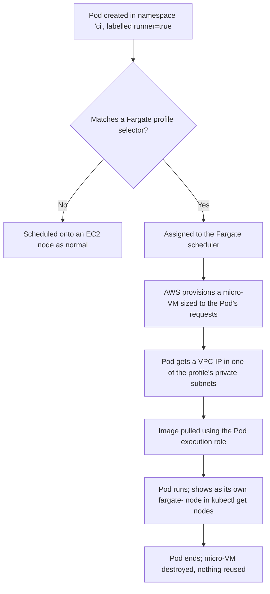
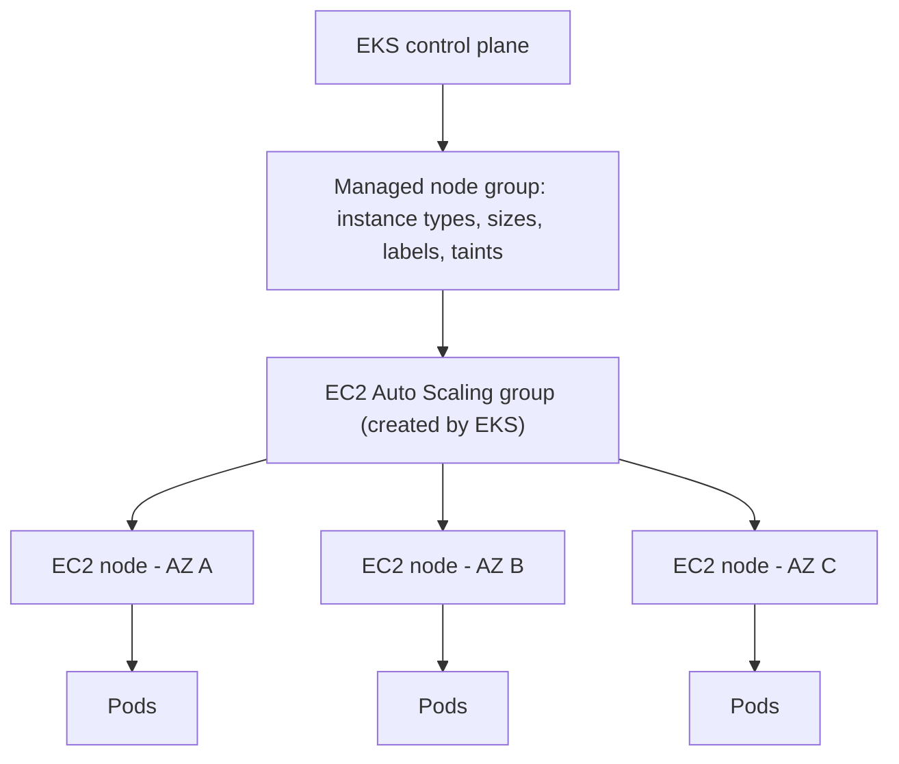
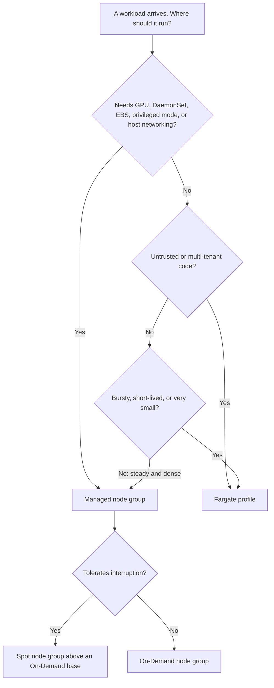
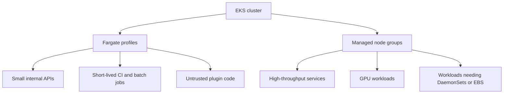

# 3.3 Amazon EKS Advanced Concepts

## Definition

[3.1](topic1.md) showed that AWS runs the EKS control plane while **you choose the data plane**. [3.2](topic2.md) deployed applications onto "the nodes". This topic looks at the three EKS features that shape that data plane:

- **AWS Fargate on EKS** runs selected Pods on serverless compute. Each Pod gets its own isolated micro-VM; there is no node to create, patch or size. A **Fargate profile** decides which Pods run this way.
- **EKS managed node groups** are EC2 instances acting as nodes, where EKS automates the lifecycle: launching from an EKS-optimized AMI, joining the cluster, replacing unhealthy instances, and safe upgrades. You still choose instance types and scaling limits.
- **EKS add-ons** are AWS-packaged, versioned installs of components every cluster needs (VPC CNI, CoreDNS, `kube-proxy`), managed through the EKS API instead of loose YAML.

| Mechanism | Removes from you | Costs you |
|---|---|---|
| **Fargate profile** | The node: no AMI, patching or capacity planning | No DaemonSets, EBS, GPUs or privileged containers; per-Pod pricing; slower start |
| **Managed node group** | AMI choice, bootstrap, registration, safe node replacement | You still choose instance types, scaling and upgrade timing |
| **EKS add-on** | Building and version-matching core components | A version to update with every cluster upgrade |

!!! note "These combine; they are not alternatives"
    A typical production cluster runs managed node groups for most workloads, Fargate for a few namespaces, and core add-ons managed by EKS. The real skill is explaining **which workload belongs where, and why**.

## Why This Service or Concept Exists

Pods must run somewhere. Traditionally that is an EC2 node you patch, size, secure and pay for whether it is full or not. Different workloads tolerate that overhead differently.

### Why Fargate exists

| Workload | Why a node is a poor fit |
|---|---|
| Small service needing 0.25 vCPU | Smallest sensible node is much bigger and mostly idle |
| CI job running four minutes | Launching and draining a node takes longer than the job |
| Untrusted or customer code | Pods on a shared node share one kernel, a weaker boundary than a VM |
| Bursty, unpredictable traffic | Capacity must be guessed in advance |

Fargate makes **the Pod itself the unit of compute**: AWS creates a micro-VM sized to the Pod and bills per second. Almost every Fargate limitation follows from this one decision, so understand the reason rather than memorising the list.

### Why managed node groups exist

Self-managed nodes mean choosing an AMI, writing bootstrap scripts, building an Auto Scaling group, registering nodes, replacing failures and, hardest of all, **upgrading without dropping traffic**. This work is easy to get subtly wrong. Managed node groups do it behind one API and leave you the decisions that are really about the workload.

### Why add-ons exist

The network plugin, DNS and Service proxy are separate open-source projects with their own release cycles. Installed as loose `kubectl apply` files, nobody knows which version runs, nobody updates them, and a later cluster upgrade fails mysteriously. EKS add-ons give each one a **version, configuration and update operation**, visible in the EKS API and CloudTrail.

## Core Concepts

### The compute-management spectrum


Moving right: fewer servers to manage, less low-level control, more workload constraints, and pricing shifts from **per instance** to **per Pod**. Neither end is universally better.

| Model | Who manages the node | You still decide |
|---|---|---|
| **Self-managed** | You: AMI, bootstrap, registration, upgrades | Everything |
| **Managed node group** | EKS automates provisioning, replacement, updates | Instance types, scaling limits, labels, taints, upgrade timing |
| **Fargate** | AWS; no node is visible to you | Pod resource requests and which Pods use Fargate |

### Key ideas

- **Fargate changes where Pods run, not how Kubernetes works.** Deployments, Services, RBAC and the API are unchanged.
- **A managed node group is still EC2**, in your account, billed as normal EC2.
- **Add-ons are data plane software.** They run as Pods and must match the control plane version.
- **One cluster can mix models**, placing each workload where its trade-offs fit.

## AWS Service Deep Dive

### EKS Fargate profiles

**What a profile contains.** A name, a **Pod execution role**, a list of **private subnets**, and up to **five selectors**. Each selector needs a **namespace** and may add **labels**.

```yaml
fargateProfiles:
  - name: ci-runners
    podExecutionRoleARN: arn:aws:iam::111122223333:role/EksFargatePodExecutionRole
    subnets: [subnet-0a1, subnet-0b1, subnet-0c1]   # private subnets only
    selectors:
      - namespace: ci
        labels:
          runner: "true"        # namespace AND label must both match
      - namespace: preview-*    # wildcards are supported
```

Here, Pods in `ci` labelled `runner: "true"` run on Fargate, as do all Pods in any `preview-*` namespace. Everything else runs on EC2 nodes.

| Rule | Meaning |
|---|---|
| **Namespace is required** | Labels alone cannot select a Pod |
| **Labels within a selector: AND** | All must match |
| **Selectors within a profile: OR** | Any one may match |
| **Wildcards** | `*` and `?` allowed |
| **Profiles are immutable** | To change, create a new profile and delete the old |
| **Deleting a profile stops its Pods** | They become `Pending` |
| **Private subnets only** | No public IP; egress via NAT gateway or VPC endpoints |

**How a Pod reaches Fargate:**



Because nothing is reused (no warm capacity, no image cache), **Fargate Pods start more slowly** than Pods on an existing node.

!!! warning "Design selectors around stable namespaces"
    Profiles cannot be edited, and deleting one stops its Pods. Select on stable namespaces like `ci` or `tenant-plugins`, not labels teams change often.

**Fargate limitations, and why they exist:**

| Limitation | Reason |
|---|---|
| No DaemonSets | A DaemonSet runs one Pod per node; there is no shared node |
| No privileged containers | They could reach the host, which AWS owns |
| No `hostNetwork` / `hostPort` | No customer host network to join |
| No GPUs | Capacity is standard AWS compute, not a chosen instance type |
| No EBS volumes | EBS attaches to an instance; use **EFS** instead |
| No EKS Pod Identity | Its agent is a DaemonSet; use **IRSA** ([3.1](topic1.md#iam-for-workloads-pod-identity)) |
| Load balancer targets must use IP mode | There is no instance to register |
| Slower Pod start | New micro-VM plus uncached image pull |

**Billing.** Per second (one-minute minimum) for the **vCPU and memory the Pod requests**, rounded up to the nearest supported size. Fargate adds about 256 MB per Pod for Kubernetes components. Sizes range from 0.25 vCPU / 0.5 GB to 16 vCPU / 120 GB. Each Pod gets 20 GiB ephemeral storage by default.

| Requested (all containers) | Allocated and billed |
|---|---|
| 0.4 vCPU, 1.5 GB | 0.5 vCPU, 2 GB |
| 1 vCPU, 7.5 GB | 1 vCPU, 8 GB |
| 3 vCPU, 5 GB | 4 vCPU, 8 GB |

!!! tip "On Fargate, requests are the bill"
    On EC2 nodes, an oversized request mainly affects how many Pods fit. On Fargate, the rounded-up request is exactly what you pay.

**Other Fargate details:**

- **Pod execution role:** used by AWS to register the Pod and pull images. Application containers cannot use it; give them IRSA.
- **Storage:** ephemeral storage dies with the Pod. Persistent or shared storage = EFS CSI driver.
- **Logging:** no node for a logging DaemonSet, so use the built-in Fluent Bit router, configured with a ConfigMap in the `aws-observability` namespace.

### EKS managed node groups

**What it is.** EKS creates an EC2 **Auto Scaling group** and **launch template** in your account and operates them as Kubernetes nodes. No extra charge beyond EC2.



| Self-managed burden | Managed node group provides |
|---|---|
| Choose and track an AMI | AWS-published EKS-optimized AMIs per Kubernetes version |
| Bootstrap scripts | Automatic |
| Let nodes join the cluster | Access entry for the node role created automatically |
| Replace unhealthy nodes | Health monitoring and automatic replacement |
| Upgrade safely | Rolling replacement with cordon and drain |
| Spot interruptions | Nodes drained when AWS signals reclamation |

**AMI families.**

| AMI | Use |
|---|---|
| **Amazon Linux 2023** | General-purpose default |
| **Bottlerocket** | Minimal container OS: read-only root, no shell; smaller attack surface, faster boot, harder to customise |
| **GPU AMIs** | Include drivers for machine learning |
| **Windows** | Windows containers |

**How node updates work.** Nodes are **replaced, not upgraded in place**:

1. Launch new nodes with the new AMI.
2. **Cordon** an old node: no new Pods scheduled there.
3. **Drain** it: evict its Pods so their controllers recreate them elsewhere, respecting each workload's **PodDisruptionBudget (PDB)**.
4. Terminate the old node and repeat.

`updateConfig` sets how many nodes are replaced at once (`maxUnavailable` count or `maxUnavailablePercentage`). Small = safer; large = faster.

!!! danger "A PodDisruptionBudget can block an upgrade"
    A PDB limits how many Pods of an app may be evicted at once, keeping it available during drains. But if it allows **zero** disruptions (for example `minAvailable: 3` with three replicas), the drain never completes and the update times out. Keep `minAvailable` below the replica count or use `maxUnavailable: 1`. Check `kubectl get pdb -A` and the `ALLOWED DISRUPTIONS` column before upgrading. The force option ignores PDBs: an emergency escape, not a fix.

**Spot capacity.** `SPOT` capacity type uses spare EC2 capacity at a large discount, but AWS can reclaim it with a **two-minute warning**. Managed node groups drain the affected node automatically. To use Spot well:

- specify **several compatible instance types**, so one reclaimed pool does not remove the group;
- run only interruption-tolerant work (batch, CI, stateless workers);
- keep an **On-Demand group that can carry essential traffic alone**, with Spot above it (the same base-plus-Spot idea as ECS capacity providers in [2.3](../unit2/topic3.md)).

**Availability Zones.** Span node groups across AZs. But a multi-AZ node group alone is not high availability: the app also needs replicas spread across zones, and resilient dependencies.

**Names to know.**

- **Karpenter:** open-source autoscaler that launches right-sized EC2 instances directly for pending Pods, instead of scaling a fixed group.
- **EKS Auto Mode:** AWS runs the whole data plane for an extra fee.
- **Launch template:** customises disk size, security groups and instance metadata (for example IMDSv2 hop limit 1, see [3.1](topic1.md#iam-for-workloads-pod-identity)). A **custom AMI** in it means EKS no longer updates that image for you.

### EKS add-ons

**What it is.** An AWS-managed install of a cluster component with a name, version, optional configuration, and optionally its own IAM role. No extra charge beyond resources used.

The core networking add-ons were explained in [3.1](topic1.md#eks-networking-and-vpc-integration). Here the focus is **what breaks without each one**:

| Add-on | Job | Symptom when missing or broken |
|---|---|---|
| **Amazon VPC CNI** | VPC IPs for Pods | Nodes never `Ready`; Pods stuck `ContainerCreating` |
| **CoreDNS** | Service name resolution | Scattered timeouts that look like unrelated errors |
| **`kube-proxy`** | Service virtual IP routing | ClusterIP Services unreachable from affected nodes |
| **Amazon EBS CSI driver** | Creates and attaches EBS volumes for PVCs | PVCs stay `Pending`; stateful apps never start |
| **EKS Pod Identity Agent** | Per-Pod IAM credentials | Pods cannot get their AWS permissions |

Other add-ons: the **EFS CSI driver** (shared storage; the persistent option for Fargate) and the **CloudWatch Observability agent** (Container Insights).

!!! danger "CoreDNS failures look like everything failing"
    DNS problems rarely say "DNS is down". Run CoreDNS with at least two replicas across nodes and zones, and monitor its errors and latency.

**Add-ons and upgrades.** Add-ons must match the control plane version. Update them as the middle step of every upgrade: control plane → add-ons → nodes ([3.2](topic2.md#creating-and-managing-eks-clusters)). Pin versions in IaC.

**Give add-ons their own IAM role.** The EBS CSI driver creates volumes; the VPC CNI manages ENIs. Putting these permissions on the node role hands them to every Pod on the node.

**Operators, briefly.** An **operator** is a custom resource type plus a controller that keeps the real world matching it. The AWS Load Balancer Controller (Ingress → ALB) is a familiar example.

### Fargate versus managed node groups

| Dimension | Fargate | Managed node groups |
|---|---|---|
| Compute | AWS micro-VM per Pod | EC2 instances in your account |
| Node administration | None | Reduced; upgrades and sizing remain |
| Instance type / GPUs | No | Yes |
| DaemonSets | No | Yes |
| EBS volumes | No (EFS only) | Yes |
| Workload identity | IRSA only | Pod Identity or IRSA |
| Density | One Pod per micro-VM | Many Pods per node |
| Isolation | Per-Pod VM | Shared node kernel |
| Pod start | Slower | Fast when capacity exists |
| Pricing | Per Pod, by requested vCPU and memory | Per instance, full or not |
| Best fit | Small, bursty, short-lived, untrusted | Steady, dense, specialised, node-dependent |

## Architecture Components

| Component | Responsibility |
|---|---|
| **Fargate profile** | Selects which Pods run on Fargate, and in which private subnets |
| **Pod execution role** | IAM role AWS uses to start Fargate Pods and pull images |
| **Fargate micro-VM** | Isolated compute for one Pod, destroyed when it ends |
| **Fargate log router** | Built-in Fluent Bit, configured in `aws-observability` |
| **Managed node group** | EKS-operated EC2 nodes with lifecycle automation |
| **Auto Scaling group + launch template** | Created by EKS to launch and replace nodes |
| **EKS-optimized AMI** | Node image with `kubelet`, `containerd` and bootstrap tooling |
| **PodDisruptionBudget** | Limits evictions per workload during drains |
| **EKS add-ons** | Versioned core components (VPC CNI, CoreDNS, `kube-proxy`, CSI drivers, Pod Identity Agent) |

Three groups: **compute** (Fargate, node groups: where Pods run), **platform components** (add-ons: needed by every cluster), and the **supporting AWS services** from [3.1](topic1.md#architecture-components).

## Important AWS Terminology

| Term | Meaning |
|---|---|
| **AWS Fargate** | Serverless compute; one micro-VM per Pod |
| **Fargate profile** | Selects which Pods run on Fargate, and where |
| **Selector** | Required namespace plus optional labels; up to five per profile |
| **Pod execution role** | IAM role AWS uses to run Fargate Pods |
| **Managed node group** | EKS-operated Auto Scaling group of EC2 nodes |
| **Self-managed node** | EC2 instance you bootstrap, register and upgrade |
| **EKS-optimized AMI** | AWS-published node image for a Kubernetes version |
| **Bottlerocket** | Minimal, immutable container-focused OS |
| **Launch template** | Customises node disks, security groups, metadata options |
| **Cordon / drain** | Stop new Pods on a node / evict its Pods |
| **PodDisruptionBudget (PDB)** | Limits voluntary evictions for a workload |
| **`updateConfig`** | How many nodes are replaced at once |
| **Capacity type** | On-Demand, Spot or Capacity Blocks |
| **Spot interruption notice** | Two-minute warning before Spot reclamation |
| **Karpenter** | Autoscaler launching right-sized nodes for pending Pods |
| **EKS add-on** | AWS-managed, versioned cluster component |
| **CSI driver** | Plugin connecting Kubernetes to EBS or EFS storage |
| **Operator** | Custom resource + controller automating a system |

## Configuration Options

### Fargate

| Setting | Options | Recommendation |
|---|---|---|
| **Selectors** | Namespace + optional labels | Namespace-only, on stable namespaces |
| **Subnets** | Private only | Several AZs |
| **Pod execution role** | IAM role | Image pull and registration only |
| **Workload identity** | IRSA | Pod Identity not supported |
| **Resource requests** | vCPU, memory | Accurate: rounded up and billed |
| **Persistent storage** | EFS | EBS not supported |
| **Logging** | Fluent Bit ConfigMap | Configure at cluster build |

### Managed node groups

| Setting | Options | Recommendation |
|---|---|---|
| **AMI type** | AL2023, Bottlerocket, GPU, Windows | AL2023 or Bottlerocket |
| **Instance types** | One or several | Several, especially for Spot |
| **Capacity type** | On-Demand, Spot, Capacity Blocks | On-Demand base; Spot for tolerant work |
| **Scaling** | `minSize`, `maxSize`, `desiredSize` | Min covers baseline; max caps cost |
| **Subnets** | One or more | Two, preferably three, AZs |
| **Labels and taints** | Any | Labels guide placement; taints reserve nodes |
| **`updateConfig`** | Count or percentage | Small for small groups; about 25% for large |
| **Launch template** | Optional | Disk size, security groups, IMDS settings |

### Add-ons

| Setting | Options | Recommendation |
|---|---|---|
| **Which add-ons** | Core + optional | VPC CNI, CoreDNS, `kube-proxy`, Pod Identity Agent; EBS CSI if stateful |
| **Version** | Explicit or default | Pin in IaC |
| **Configuration** | JSON/YAML via EKS API | Keep in code (for example CoreDNS replicas) |
| **IAM role** | IRSA or Pod Identity | Own role per add-on, not the node role |

## Design Considerations

### Decision framework

Ask these for each workload:

1. **Needs node-level features?** GPUs, DaemonSets, EBS, privileged mode, host networking → managed node group.
2. **Untrusted or multi-tenant code?** → Fargate's per-Pod VM boundary.
3. **Usage pattern?** Bursty, short-lived or tiny → Fargate (no idle node). Steady and dense → well-packed nodes are cheaper.
4. **Fast scale-out on the user path?** Nodes with spare capacity respond faster than new Fargate micro-VMs.
5. **Full cost?** Include utilisation, idle capacity, operations effort, storage and logs, not just unit price.



### Trade-offs

!!! note "Core trade-off"
    More abstraction reduces infrastructure management, but also reduces low-level control.

| Quality | Fargate | Managed node groups |
|---|---|---|
| **Operational burden** | Lowest | Moderate |
| **Isolation** | Per-Pod VM | Shared node kernel |
| **Cost, steady workloads** | Higher | Lower when well packed |
| **Cost, bursty workloads** | Lower (no idle nodes) | Higher if nodes sit idle |
| **Elasticity** | Per Pod, slower start | Fast with headroom |
| **Flexibility** | Constrained | High |

### Architecture scenarios

**Scenario 1: small internal APIs.** Moderate, unpredictable traffic; team wants minimal admin. Fargate fits if the services meet its constraints: no nodes, pay per running Pod.

**Scenario 2: high-throughput service.** Needs predictable compute, high density, specific instance families and node monitoring agents. Managed node groups fit.

**Scenario 3: mixed.** One cluster, both models:



**Principle:** choose the compute model **per workload**, not one model for everything.

## AWS Best Practices

| Pillar | Practice |
|---|---|
| **Operational Excellence** | Node groups, Fargate profiles and add-ons in IaC with pinned versions; update add-ons in every upgrade |
| **Security** | Fargate for untrusted code; own IAM role per add-on; minimal node role; Bottlerocket where suitable |
| **Reliability** | Node groups across AZs; CoreDNS with 2+ replicas; PDBs that allow at least one disruption |
| **Performance Efficiency** | Match compute model to workload shape; small images (especially on Fargate); keep node headroom |
| **Cost Optimization** | Spot above an On-Demand base; Fargate where nodes would idle; Graviton where images support ARM |
| **Sustainability** | Dense packing; scale batch node groups to zero when idle |

## Security Considerations

- **Fargate isolation is a real boundary.** A container escape on a shared node reaches a kernel shared with other Pods; on Fargate it reaches an AWS kernel running one Pod. Apply it to just the namespaces that need it.
- **No node role on Fargate to misuse.** The Pod execution role is not available to containers. On EC2 nodes, block IMDS with hop limit 1 ([3.1](topic1.md#iam-for-workloads-pod-identity)).
- **Add-ons get their own roles**, not the node role.
- **Harden nodes.** Encrypted EBS, Systems Manager instead of SSH, minimal AMI, regular updates.
- **Private subnets** for Fargate Pods and nodes; NAT or VPC endpoints for egress.

!!! warning "Review what you install"
    Helm charts and add-ons often create cluster-wide permissions. Read what they create, and install only what the cluster needs.

## Operating It: Performance, Cost and Monitoring

**Performance.** A latency-sensitive service that must scale out fast is better on nodes with spare capacity than on Fargate. Keep images small, scale CoreDNS with the cluster, keep node headroom.

**Cost.**

| Lever | Helps by | Caution |
|---|---|---|
| Spot above On-Demand base | Big discount | Must tolerate rescheduling; use several types |
| Fargate for bursty work | No idle nodes | Costlier for steady work |
| Accurate requests | Fewer nodes / smaller Fargate bill | Too low hurts performance |
| Graviton (ARM) | Better price-performance | Needs ARM images |
| Scale batch groups to zero | No idle cost | Only for work that really stops |

!!! tip "Fargate is not always cheaper"
    Cost depends on utilisation, requests and density. Compare per workload.

**Monitoring.**

| Signal | Source | Tells you |
|---|---|---|
| `Pending` Pods | `kubectl get pods`, events | No matching capacity or Fargate profile |
| Node group update status | `aws eks describe-nodegroup` | Upgrade progressing or stuck |
| PDBs | `kubectl get pdb -A` | `ALLOWED DISRUPTIONS: 0` will block drains |
| Fargate Pods | `kubectl get nodes -l eks.amazonaws.com/compute-type=fargate` | What runs (and bills) on Fargate |
| Add-on health and version | `aws eks describe-addon` | Version drift or degraded add-on |
| CoreDNS errors and latency | Container Insights | DNS trouble before it spreads |
| Audit trail | CloudTrail | Who changed node groups, profiles, add-ons |

!!! note "Running is not healthy"
    A `Running` Pod can still return errors. Monitor latency and error rates too.

## Advantages

- **Compute is a per-workload choice.** Fargate and node groups coexist in one cluster.
- **Fargate removes node management** and gives per-Pod isolation.
- **Managed node groups keep control without the plumbing.** AMIs, bootstrap, replacement and rolling updates handled.
- **Spot becomes practical** through automatic draining.
- **Add-ons are visible and upgradable** through the EKS API.
- **No extra management charge** for node groups or AWS add-ons.

## Limitations

- **Fargate's limits are structural** (no node): no DaemonSets, privileged containers, GPUs, EBS or Pod Identity; slower start.
- **Fargate is costly for steady, dense work.**
- **Fargate profiles are immutable.**
- **Node groups do not pick sizes for you**; varied needs may need several groups.
- **Your own PDBs can block node updates.**
- **Custom AMIs** shift update responsibility back to you.
- **Add-ons need updating** with every Kubernetes upgrade.

## Common Mistakes

### Beginner mistakes and misconceptions

| Mistake | Why it is wrong | Do instead |
|---|---|---|
| "Fargate is always cheaper" | Steady workloads are often cheaper on nodes | Compare full cost per workload |
| "Fargate eliminates Kubernetes" | Only the compute layer changes | Manage Deployments, Services, RBAC as normal |
| "Managed node groups = managing each instance by hand" | EKS automates lifecycle | Focus on sizing and scaling |
| "One compute model per cluster" | Models coexist | Choose per workload |
| Whole cluster on Fargate | Loses DaemonSets, EBS, GPUs; costs more for steady work | Fargate for specific namespaces |
| Expecting DaemonSets or EBS on Fargate | No node to run on or attach to | Fluent Bit, sidecars, EFS, or nodes |
| Pod Identity on Fargate | Agent is a DaemonSet | IRSA |
| Editing a Fargate profile | Immutable | Create new, delete old |
| One instance type for Spot | One reclaimed pool removes the group | Several compatible types |

### Production mistakes

| Mistake | Consequence | Remedy |
|---|---|---|
| PDB allowing zero disruptions | Node upgrades stall and time out | Allow at least one; check before upgrades |
| Routinely forcing node updates | PDBs give no protection | Fix the budgets instead |
| Add-ons skipped during upgrades | Networking or DNS failures | Update between control plane and nodes |
| CoreDNS with one replica | Cluster-wide mysterious timeouts | 2+ replicas across zones |
| Add-ons using the node role | Every Pod gains their permissions | Own role per add-on |
| All Spot, no On-Demand base | One capacity event removes the workload | On-Demand base + diverse Spot |
| All nodes in one AZ | One zone failure = no capacity | Span multiple AZs |
| No Fargate log routing | Fargate logs lost | Configure `aws-observability` at build |

## Summary

EKS compute is a trade-off between **control, operational effort, flexibility, density and cost**.

| Feature | Key lesson |
|---|---|
| **Data plane choice** | Per workload. Fargate and node groups can share a cluster; start from workload requirements |
| **Fargate** | For small, bursty, short-lived or untrusted Pods. Limits (no DaemonSets, EBS, GPUs, Pod Identity; billed on rounded-up requests) all follow from "no node" |
| **Fargate profiles** | Namespace + optional labels; immutable; design around stable namespaces |
| **Managed node groups** | For EC2-level control, special hardware, node agents, density. EKS handles AMIs, replacement and rolling updates |
| **PDBs** | Protect availability during drains, but zero slack blocks upgrades |
| **Spot** | Several instance types, tolerant workloads, On-Demand base |
| **Add-ons** | Essential data plane software; pin versions, own IAM roles, update every upgrade |

**Unit 3 in one line:** 3.1 built the cluster, 3.2 deployed onto it, 3.3 chose the right compute underneath each workload.

!!! question "Practice and interview questions"
    Questions for this topic are kept separately: [Practice questions](../Questions/unit3.md#33-amazon-eks-advanced-concepts) · [Interview questions](../interviewquestions/unit3.md#33-amazon-eks-advanced-concepts).
