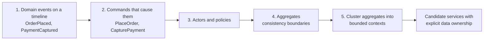
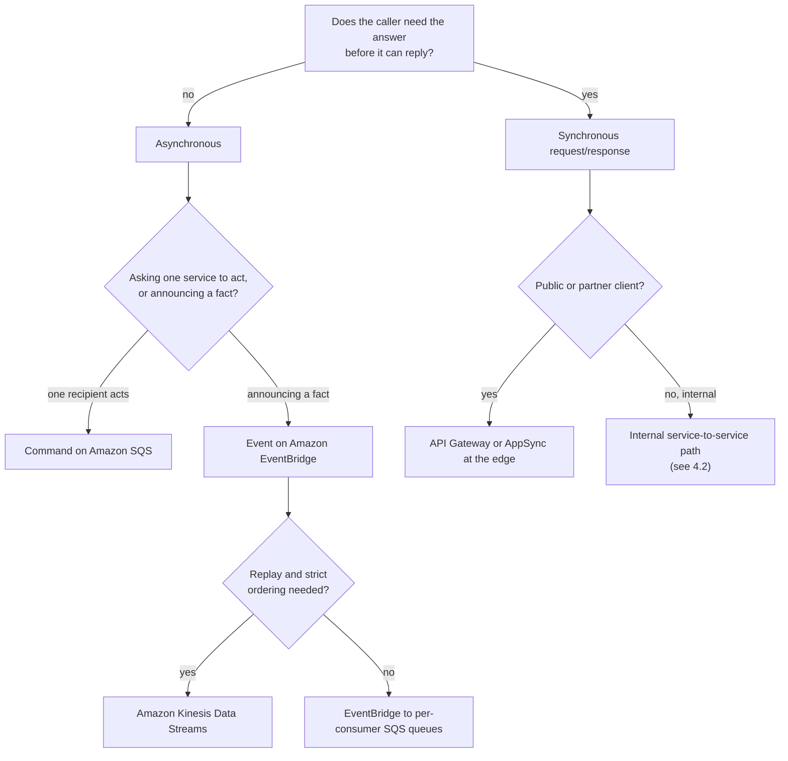
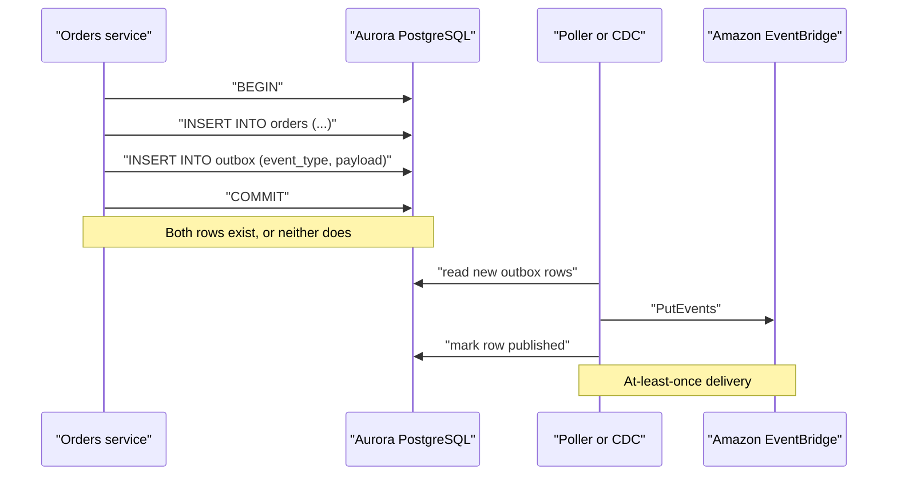
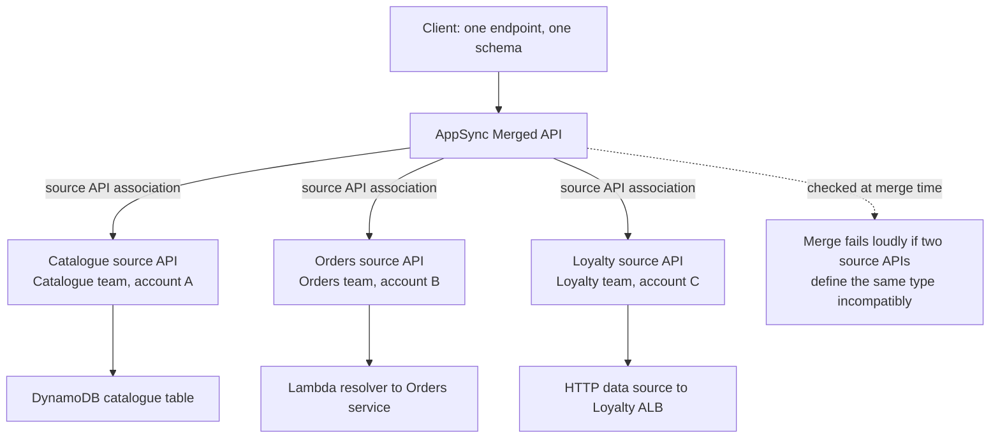
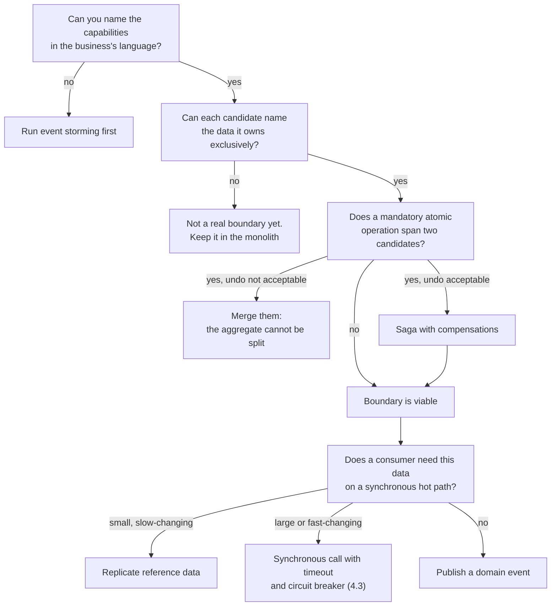
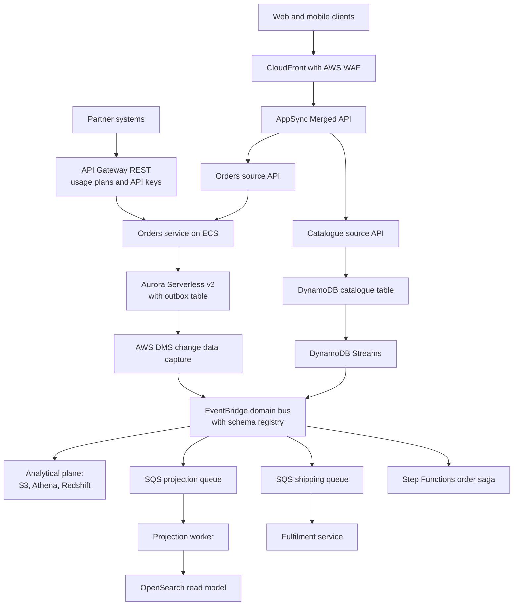

<!-- teachprep:refined 2026-10-11 -->
# Microservices Design Principles on AWS

## Definition

**Microservices design principles** are the rules an architect applies when turning a business domain into a set of independently deployable services.

The principles are the same on any platform. What AWS adds is a specific toolkit for each one, and the choice of tool affects cost, latency, operational load and how hard a boundary is to move later.

Three principles dominate this chapter:

| Principle | The question it answers | The failure it prevents | Main AWS instruments |
|---|---|---|---|
| **Decomposition by business capability** | Where does one service end and the next begin? | Boundaries drawn on technical layers, giving a distributed monolith | Domain analysis; Migration Hub Refactor Spaces; Application Discovery Service |
| **Explicit, versioned contracts** | How do services talk, and who owns the contract? | Hidden coupling through shared libraries, schemas or undocumented behaviour | API Gateway, AppSync, EventBridge, SQS, SNS |
| **Exclusive data ownership** | Who may write this data, and who may only ask? | A shared database that re-couples services while keeping the network hops | DynamoDB, Aurora, RDS and the other purpose-built databases |

A fourth principle, **design for failure**, is covered in [4.3](topic3.md).

!!! note "How this unit flows"
    4.1 decides **where the boundaries go** and how services share data. [4.2](topic2.md) covers **the network layer between services** (API Gateway, service discovery, service mesh). [4.3](topic3.md) makes the result **resilient** (timeouts, retries, sagas).

!!! tip "The order is fixed: boundaries, contracts, data, then compute"
    Teams that start with "we will use EKS" end up with services shaped like their existing deployment units. The compute platform (Units 2 and 3) is the **last** and easiest decision to change. The data boundary is the **hardest** to change, so it deserves the most analysis.

## Why This Service or Concept Exists

### Where microservices programmes fail

[1.7](../unit1/topic7.md) introduced microservices as a pattern. In practice, adoptions rarely fail because of container orchestration, which is a solved problem. They fail at boundary-drawing and data ownership, in four recognisable shapes:

| Failure shape | What it looks like | Root cause |
|---|---|---|
| **Distributed monolith** | Twelve services, one release train, a shared library bumped everywhere at once | Boundaries without ownership; implicit contracts |
| **Shared database** | Three services on one Aurora cluster; nobody can change a column | Data ownership never assigned |
| **Chatty chain** | One user request fans into fourteen sequential internal calls | Over-splitting on technical lines |
| **Aggregation bottleneck** | One "API service" every team must modify to expose a field | A central team owns the edge |

No container platform can detect or repair any of these. They are design failures.

### What AWS changed

Managed services make each principle **affordable** to follow:

| Principle | Before managed cloud | On AWS today |
|---|---|---|
| Database per service | Run N database servers; most teams gave up and shared one | Create N DynamoDB tables or Aurora Serverless clusters through IaC |
| Federated GraphQL across teams | Run a schema-stitching gateway with its own team | AppSync **Merged APIs** |
| Reliable event publication | Build an outbox poller and run a broker | DynamoDB Streams or database CDC into EventBridge or SQS |

!!! warning "Managed services make a principle cheaper; they do not enforce it"
    AWS will happily let four ECS services share one Aurora cluster, or let one team own an AppSync API that eleven teams queue to modify. Every anti-pattern in this chapter is fully supported by the platform. The discipline is the architect's job.

## Core Concepts

### What a good boundary looks like

This chapter uses one running example: an online shop with **Catalogue, Pricing, Inventory, Ordering, Fulfilment and Payments** capabilities.

A good decomposition satisfies five criteria:

1. **High cohesion inside a service**: things that change together live together.
2. **Low coupling between services**: a change in one rarely forces a change in another.
3. **One owner**: exactly one team is accountable.
4. **Exclusive data**: no other service writes (and ideally none reads) its store.
5. **Fits one team's head**: the team can understand it and be on call for it.

These criteria conflict. Cohesion pushes towards fewer, larger services; cognitive load pushes towards smaller ones. The strategies below are heuristics for resolving that tension.

### Decomposition strategies

#### Business capability

A **business capability** is something the business does, named in its own language: *accept payment*, *manage inventory*, *price a product*. Capabilities stay stable for decades; implementations do not.

In a workshop, list what the business does, group it into capabilities of similar size, name the data each must own, and assign each to one team. If two teams claim a capability, it is probably two.

| Capability | Owns | Needs from others | Interaction |
|---|---|---|---|
| Catalogue | Products, categories, media | Nothing | Publishes `ProductUpdated` |
| Pricing | Price lists, rules, tax | Product identity | Subscribes to `ProductUpdated` |
| Inventory | Stock, reservations | Product identity | Subscribes to `ProductUpdated` |
| Ordering | Orders, order lines | Product summary, price, stock | Sync stock check; **copies** price and product into the order |
| Fulfilment | Shipments, tracking | Order contents | Subscribes to `OrderConfirmed` |
| Payments | Transactions, refunds | Order total | Subscribes to `OrderConfirmed`; publishes `PaymentSettled` |

!!! tip "A copy is not always denormalisation"
    Ordering copies the price into the order. This is about **correctness**, not performance: the price on an order is the price agreed, not whatever the catalogue says six months later. Spotting values that should be snapshots removes many apparent cross-service dependencies.

#### Subdomain and bounded context

Domain-driven design gives a sharper tool. A **subdomain** is part of the problem space. A **bounded context** is a boundary in the solution space inside which one model and vocabulary are consistent.

The type of subdomain decides how much to invest:

| Subdomain type | Meaning | Investment |
|---|---|---|
| **Core** | What differentiates the business (the shop's pricing engine) | Best engineers, custom build |
| **Supporting** | Specific to you but not differentiating | Build simply, prefer serverless |
| **Generic** | Same in every business: identity, email, payment processing | Buy or use a managed service (Cognito, SES, a payment provider) |

Teams routinely build a bespoke identity service and under-invest in the pricing engine that actually makes them money. This classification prevents that.

Relationships between contexts also have names. The most common healthy one is **customer-supplier**, where downstream needs shape the upstream roadmap. Where the upstream is a legacy or third-party system, the downstream protects itself with an [anti-corruption layer](#anti-corruption-layer). Sometimes the right answer is **separate ways**: no integration, and duplication is accepted.

!!! tip "Across a boundary, prefer duplication to coupling"
    Inside a service, duplication is a defect. Across services it is often correct, because the alternative (a shared library or table) brings back the coupling the boundary exists to remove. Ordering and Fulfilment may each have their own `Address` type with different validation. That is two contexts, correctly separated.

#### Event storming

**Event storming** is a facilitated workshop that turns domain experts' knowledge into a boundary map in a day or two.

Two outputs matter most:

- The **aggregate**, the smallest set of data that must be transactionally consistent. It cannot be split across services.
- **Pivotal events** where the language changes. The moment a basket becomes an order, or an order becomes a shipment, is almost always a context boundary.

#### Supporting heuristics

Capability and subdomain analysis lead. The following heuristics corroborate or veto a candidate boundary:

| Heuristic | Signal | Example from the shop |
|---|---|---|
| **Volatility** | Code changing at very different rates | Promotions change weekly; tax rules twice a year. Coupling them redeploys tax logic fifty times a year |
| **Scaling and availability profile** | Different load shapes, availability targets or failure semantics | Checkout peaks 40 times on sale days; review ingestion is flat. Payment must fail closed; recommendations may fail open |
| **Compliance and data classification** | Regulated data (cardholder, health, personal) | Card data isolated in its own AWS **account** under Organizations and SCPs ([8.1](../unit8/topic1.md)); unlike a VPC or namespace, an account boundary is platform-enforced and easy to show an auditor |

Volatility is **measurable**: commit history (`git log --name-only`) shows how often each file changes and which files change together, which is often a better guide than intuition.

!!! warning "Scaling profile alone over-splits"
    A service extracted only because it is CPU-heavy, with no domain coherence, becomes a technical-layer service that everything calls synchronously.

#### The aggregate and the transaction

The hardest constraint: **you cannot split an aggregate across services without giving up its transaction.**

If placing an order must atomically reserve stock and create the order, either both live in one service, or you accept a **saga**: a chain of local transactions with business-level compensations, and eventual consistency in between. Two-phase commit across services is not a practical option at scale. Sagas are covered in [4.3](topic3.md#saga-with-compensating-transactions).

Work backwards from the business:

1. List the operations that must be all-or-nothing.
2. List the data each one touches.
3. Ask: "If the second half fails, can we undo the first half a few seconds later, and what does the customer see meanwhile?"

Where the answer is no, you must not draw a boundary. This conversation is worth more than any amount of later saga engineering.

### Service granularity and the anti-patterns

| Anti-pattern | Symptom | Correction |
|---|---|---|
| **Entity service** | A "Customer service" exposing only CRUD, called by everyone | A service owns a capability, not a table |
| **Technical-layer service** | "Validation service", "data access service" | Split vertically by capability |
| **Nano-service** | Two hundred services for forty engineers | Merge; fixed per-service cost dominates |
| **God service** | One service owns most data and everything calls it | The monolith survived; decompose it again |
| **Chatty chain** | Many sequential internal calls per request | Merge services, replicate reference data, or use events |
| **Shared database** | Two services on one schema | Assign ownership; expose an API or events |
| **Central aggregation layer** | Every team queues to add a field to "the API" | Federate: AppSync Merged APIs or per-team APIs |

!!! danger "The most common decomposition error"
    Splitting along the layers of the existing code (controllers, services, repositories) because those boundaries are visible. The result must deploy together, calls itself synchronously and shares one database: a **distributed monolith**. It pays the full cost of microservices and gets none of the independence. Draw boundaries in the **problem** space first.

### Inter-service communication

Every interaction sits on two axes:

| | **One-to-one** | **One-to-many** |
|---|---|---|
| **Synchronous** | Request/response: HTTP or GraphQL | Scatter-gather; usually a mistake on a request path |
| **Asynchronous** | A command on an SQS queue | An event on EventBridge or SNS; a stream on Kinesis |

Two further distinctions matter:

**Commands versus events.** A *command* names a recipient and asks for an action: `ReserveInventory`. An *event* states a past fact without knowing who listens: `OrderPlaced`. An "event" named `SendEmail` is a command in disguise and carries all the coupling of a direct call.

**Orchestration versus choreography.** In *orchestration* a coordinator (on AWS, Step Functions) drives the process, giving one inspectable flow. In *choreography* each service reacts to events, giving maximum decoupling but no single picture of the process.

!!! tip "Rule of thumb"
    Orchestrate processes a business person would draw as a flowchart and that need compensation. Choreograph genuinely independent side effects.

The messaging services themselves are covered in [6.3](../unit6/topic3.md); the edge and service-to-service networking in [4.2](topic2.md#amazon-api-gateway).

Asynchronous is the **default**, not the only option. A synchronous call is correct where the user is waiting and the answer must be authoritative, such as the stock check before an order is accepted.

### Database per service with polyglot persistence

The rule is one sentence: **each service exclusively owns its data store; no other service reads or writes it directly.** "Its own store" does not mean its own engine. Two services may both use DynamoDB, each with its own tables.

Every consequence of the rule costs something:

| You lose | You use instead |
|---|---|
| Cross-service joins | API composition, a CQRS read model, or an analytical copy (S3 with Athena, Redshift) |
| Cross-service ACID transactions | A saga with compensations |
| Shared foreign keys | Tombstone events, soft deletes and reconciliation jobs |
| One database to run | N managed stores; serverless options (DynamoDB on-demand, Aurora Serverless v2) make this affordable |

!!! danger "The read that becomes a write dependency"
    "The reporting service will only *read* the orders table." Within a quarter, the Orders team cannot rename a column or migrate the table, because unknown readers depend on its physical schema. A read dependency on a schema couples as tightly as a write; it is just less visible.

**Polyglot persistence** means each service may choose the engine that fits its access pattern. The common choices:

| Access pattern | Typical store |
|---|---|
| Known key-based lookups at any scale | DynamoDB |
| Transactions, joins, ad-hoc SQL | Aurora (Serverless v2 for variable load) |
| Relationships are the query | Neptune |
| Full-text search, facets | OpenSearch (as a derived read model, not the system of record) |
| Time series | Timestream |
| Cache or session state | ElastiCache |

Engine details are in [6.2](../unit6/topic2.md).

!!! note "Permitted, not required"
    Every extra engine is another set of skills, backups and upgrades. A sensible default for a mid-sized estate is two engines (for example DynamoDB and Aurora Serverless v2), adding a third only when an access pattern genuinely demands it.

### The cross-service data patterns

With no shared database, data moves between services through a small set of patterns.

#### Transactional outbox and change data capture

Writing to your database and publishing an event are two separate operations. If you do both directly (a **dual write**), a crash between them leaves the database and the event stream disagreeing, and no retry can fix it.

The **transactional outbox** makes it one local transaction plus one asynchronous publication:

**Change data capture (CDC)** derives the event feed from the database's own log:

- On **DynamoDB**, Streams give CDC for free. Write the item; a Lambda triggered by the stream publishes the event. The stream record *is* the outbox.
- On **Aurora**, AWS DMS can read the transaction log, or a poller reads an outbox table.

Delivery is at-least-once, so consumers must be idempotent ([4.3](topic3.md#idempotency)).

#### API composition and backend for frontend

**API composition** builds a view by calling several services and joining the results in an aggregation layer. The shop's order-details screen calls Ordering, Fulfilment and Payments.

A **backend for frontend (BFF)** gives each client type (web, mobile, partner) its own aggregating service, owned by that client's team. AppSync is a managed composition engine; a BFF is what you build when composition needs real logic.

The failure mode of both is a central team owning them, which is why Merged APIs matter (see [AppSync](#aws-appsync-and-graphql)).

#### CQRS and event sourcing

**CQRS** (Command Query Responsibility Segregation) separates the write model from read models. A projector consumes events and builds a purpose-built read store: DynamoDB for a key-shaped view, OpenSearch for a searchable one. This replaces the lost cross-service join.

A read model is eventually consistent by design, and it must be **rebuildable** from retained events, or a projector bug becomes permanent data corruption.

**Event sourcing** goes further: the event log itself becomes the system of record, and current state is derived from it. It is powerful for audit and "what was true on date X" queries, but evolving old event schemas and rebuild time become real engineering problems.

#### Reference-data replication

When Ordering needs a few fields of Catalogue data on a hot path, it subscribes to `ProductUpdated` and keeps a **local projection** of exactly those fields.

This removes the synchronous call entirely, and keeps working when Catalogue is down. It is usually the single most valuable change in a chatty system.

#### Thin events with callback

A **thin event** carries identifiers, the change type and a timestamp, not the full record. Consumers that need details call the owner back under their own authorisation.

| | Thin event | Thick (event-carried state) |
|---|---|---|
| Coupling to producer's model | Low | High |
| Sensitive data copied to consumers | No | Yes, into every queue, log and DLQ |
| Consumer works when producer is down | No (needs the callback) | Yes |

Thin is the safe default for sensitive data; thick is a deliberate choice for non-sensitive data where consumer independence matters.

#### Anti-corruption layer

An adapter that translates a legacy or third-party model into your domain model, so the foreign model does not leak in. Essential during a strangler-fig migration and for any external supplier.

#### Zero-ETL and the analytical plane

"Finance needs a report across all six services" is answered by replicating each service's data into Redshift through **zero-ETL integrations**, or landing events in S3 for Athena. Nobody reads anyone else's operational tables.

### Consistency, stated honestly

| Model | Where you get it on AWS | Cost |
|---|---|---|
| Strong, within one aggregate | One DynamoDB item; one Aurora transaction | None; this is why aggregates stay whole |
| Strong, across items in one table or account | DynamoDB `TransactWriteItems` | Bounded item count; no cross-service reach |
| Strong, across Regions | Aurora DSQL | Feature subset relative to PostgreSQL |
| Read-your-writes | Strongly consistent reads; reading the Aurora writer | Higher cost or no replica offload |
| Eventual | Everything cross-service | A stale window and reconciliation jobs |

!!! warning "Eventual consistency is a business decision"
    "The customer may not see the order in their history for two seconds" is either acceptable or not, and the architect must **ask**. If the answer is no, the fix is usually a different boundary, not more engineering. Budget for reconciliation jobs that can answer "do these two services agree?"

### Migrating from a monolith

#### Strangler fig

The **strangler fig** pattern extracts capabilities from a monolith one at a time behind a routing layer:

1. Put a router (API Gateway or an ALB) in front of the monolith. All paths go to it.
2. Build one capability as a new service.
3. Route that capability's paths to the new service, shifting traffic gradually (ALB weighted target groups or API Gateway canary stages).
4. Move data ownership (AWS DMS can migrate and replicate the data).
5. Delete the old code. Repeat.

The discipline is **finishing each iteration**. A strangler fig stopped halfway is a permanent hybrid nobody can change. The managed version of this routing layer, Refactor Spaces, is described [below](#aws-migration-hub-refactor-spaces).

#### Branch by abstraction and parallel run

Two techniques that reduce extraction risk:

- **Branch by abstraction**: add an interface inside the monolith, implement it twice (old code and new service), and switch with a feature flag (for example in AWS AppConfig).
- **Parallel run**: send traffic to both, serve the old result, compare asynchronously and alarm on divergence. Worth its cost for payments, pricing and anything regulated.

## AWS Service Deep Dive

### AWS AppSync and GraphQL

**GraphQL** is a query language in which the client specifies exactly the fields it needs and the server resolves each field independently. **AWS AppSync** is the managed GraphQL service: AWS runs the engine, WebSocket subscriptions, authorisation, caching and schema merging. You supply a schema, data sources and resolvers.

Why it suits microservices:

1. **The client declares its data shape.** A mobile screen needing data from four services makes one request instead of four.
2. **Fields resolve in parallel.** A query touching four services costs roughly the slowest one, not the sum.
3. **Partial success is native.** A failed nullable field returns `null` plus an `errors` entry; the rest of the response succeeds.
4. **The schema can be composed** from parts owned by different teams.

The danger: **one schema is one shared artefact.** If a central team owns it, every product team queues behind them.

| Term | Meaning |
|---|---|
| **Schema** | SDL document defining types and the `Query`, `Mutation` and `Subscription` roots |
| **Data source** | A backend AppSync calls: DynamoDB, Lambda, Aurora via the RDS Data API, OpenSearch, HTTP, EventBridge, or `NONE` |
| **Resolver** | Code mapping one field to data-source operations |
| **Pipeline resolver** | An ordered chain of functions sharing a stash, for example authorise then fetch |
| **APPSYNC_JS** | AppSync's JavaScript resolver runtime (a subset of the language); preferred over the older VTL |
| **Subscription** | A field clients open over WebSocket, bound to mutations with `@aws_subscribe` |

Key behaviours and limits:

| Topic | What to know |
|---|---|
| **Authorisation** | API key, IAM, Cognito user pools, OIDC or a Lambda authoriser; several modes per API, selectable per field with directives |
| **N+1 problem** | A list of 100 orders each resolving a `customer` field triggers 100 resolver calls. Use batching (`BatchInvoke` with `maxBatchSize` for Lambda, `BatchGetItem` for DynamoDB) |
| **Query depth and complexity** | A deeply nested query can fan out into hundreds of resolver calls; set limits deliberately |
| **Caching** | Per-API or per-resolver with a TTL; suits reference data rather than fast-changing state |
| **Scaling** | AppSync scales automatically; the bottleneck moves to the data sources (Lambda concurrency, DynamoDB throughput, Aurora connections) |
| **Pricing dimensions** | Per query or mutation, per subscription message, per connection-minute, plus optional cache instance-hours |

### Merged APIs: federation without a central team

A **Merged API** composes one schema from several **source APIs**, each owned and deployed by a different team, possibly in different accounts.

- A team ships a field by deploying **its own** source API. With **auto-merge**, the merged schema updates with no central action.
- Type conflicts are detected and reported at merge time, not silently resolved.
- Source APIs can sit in different accounts, so ownership can follow account boundaries.

A Merged API is an **ownership** mechanism, not a performance feature. With one team, a single AppSync API is simpler and fine.

!!! tip "AppSync or API Gateway?"
    Use **API Gateway** for contracts published to consumers you do not control (partners, third parties) that need per-consumer keys and usage plans. Use **AppSync** for your own web and mobile clients when the pain is over-fetching and round trips. Large estates run **both**. API Gateway is covered in [4.2](topic2.md#amazon-api-gateway).

### AWS Migration Hub Refactor Spaces

Refactor Spaces packages the strangler-fig routing layer as one managed resource. An **environment** holds an **application**, which provisions API Gateway, a VPC link, a Network Load Balancer, Transit Gateway attachments and the cross-account sharing needed between them. You register **services** and **routes**; the default route goes to the monolith and each new route peels one path off.

!!! warning "Closed to new customers"
    Since **7 November 2025**, Refactor Spaces has been closed to new customers, with **AWS Transform** positioned as the alternative for modernisation. Study it for the **pattern** it encodes (a managed router in front of the monolith, extraction expressed as a route), which you would otherwise assemble from API Gateway, a VPC link, an NLB and Transit Gateway. It is migration scaffolding, not a permanent edge.

### Supporting analysis services

| Service | Role in decomposition |
|---|---|
| **AWS Application Discovery Service** | Inventories servers and their **network dependencies**: real evidence of coupling |
| **AWS App2Container** | Containerises an existing Java or .NET app: a pragmatic first step before decomposing |
| **CloudWatch Application Signals** | After extraction, an automatic service map and per-service SLOs show whether real call patterns match the design |

A dependency graph shows what the system **does**, not what it **should** do; it is input to the domain conversation, not a substitute for it.

## Architecture Components

| Component | Role in a decomposed architecture |
|---|---|
| **API Gateway** | Partner and public API front door ([4.2](topic2.md)) |
| **AWS AppSync** | First-party client API: aggregation, subscriptions, Merged APIs |
| **ECS, EKS, Lambda** | Where services run; chosen per service, and last |
| **EventBridge, SNS, SQS, Kinesis** | Events, fan-out, per-consumer buffering and ordered streams ([6.3](../unit6/topic3.md)) |
| **Step Functions** | Explicit home of a multi-service business process |
| **DynamoDB, Aurora and other stores** | One store per service; DynamoDB Streams give outbox semantics |
| **S3, Athena, Redshift** | The analytical plane that replaces cross-service joins |
| **IAM** | Per-service workload identity: the real boundary between services |
| **CloudWatch, X-Ray, ADOT** | Traces and service maps: the only complete record of a request |

The [reference architecture](#integration-with-other-aws-services) below shows how they fit together.

## Important AWS Terminology

| Term | Meaning |
|---|---|
| **Business capability** | Something the business does, named in its own language |
| **Bounded context** | A boundary inside which one model and vocabulary are consistent |
| **Aggregate** | Smallest set of data that must be transactionally consistent |
| **Domain event** | A past-tense fact published without knowledge of consumers |
| **Command** | A message asking a named recipient to act |
| **Dual write** | Writing to the database and publishing separately; always unsafe |
| **Transactional outbox** | Writing the event in the same local transaction as the state change |
| **Change data capture (CDC)** | Deriving events from a database's own log |
| **Read model (projection)** | A query-shaped store built by consuming events |
| **Partial response** | GraphQL `data` with nulls plus an `errors` array, returned with HTTP 200 |
| **Tombstone event** | An event announcing a deletion |
| **Reconciliation job** | A scheduled check that two services agree |

## Configuration Options

### AppSync

| Setting | How to decide |
|---|---|
| **API type** (GraphQL, Merged, Events) | Merged API with auto-merge once more than one team owns fields |
| **Authorisation modes** | Cognito or OIDC for users; IAM for internal callers; API key only for public read-only data |
| **Data source** | Direct DynamoDB or HTTP for simple mappings (no Lambda cost or cold start); Lambda for real logic |
| **`maxBatchSize`** | Set on every Lambda resolver under a list field |
| **Depth and resolver-count limits** | Always set; unset limits are a denial-of-service vector |

### Decomposition decisions

| Decision | How to decide |
|---|---|
| **Granularity** | Start coarse. Splitting later is far cheaper than merging diverged services |
| **Extraction order** | Lowest risk and highest learning first; the first extraction builds the pipeline and confidence |
| **Temporary shared-database access** | Only with a named owner, a removal ticket and a date |
| **Isolation level** | Account for regulated boundaries; VPC or namespace for convenience |

## Design Considerations

Use this flow to test whether a candidate boundary is viable:

!!! danger "Two pieces of arithmetic govern every decomposition"
    **Availability multiplies.** Six services in a synchronous chain, each 99.9 per cent available, give about 99.4 per cent: roughly three and a half hours of downtime a month.

    **Latency adds.** Six 50 ms p99s do not give a 50 ms p99; tail latencies compound.

    Every synchronous call replaced by a local projection or an event removes a term from both. This is why asynchronous is the default.

## AWS Best Practices

| Pillar | Practice specific to microservice design |
|---|---|
| **Operational Excellence** | Keep each service's code, infrastructure, API schema, event schemas and runbook in one repository. Register event schemas in the EventBridge schema registry. Use contract tests between consumers and providers |
| **Security** | One IAM role per service naming exactly its own tables, queues and keys, so data ownership is enforced, not hoped for |
| **Reliability** | Idempotent consumers, a DLQ per consumer, no dual writes, reconciliation jobs from day one (details in [4.3](topic3.md)) |
| **Performance Efficiency** | Shape the edge to the client; batch under list fields; choose the database from the access pattern |
| **Cost Optimization** | Serverless per-service stores; one shared ALB; VPC endpoints instead of NAT for AWS API calls; per-service cost tags |
| **Sustainability** | Higher utilisation and fewer redundant calls; local projections reduce total work per request |

## Security Considerations

**Identity is the boundary.** All services sit in private subnets and can reach one another, so the network says little. What separates them is that the Orders role can call `dynamodb:GetItem` on exactly one table. A shared "application role" makes any compromised container as powerful as all services combined. IAM itself is covered in [8.1](../unit8/topic1.md).

**Condition keys refine least privilege:**

- `dynamodb:LeadingKeys` limits a role to items whose partition key matches, enforcing tenant isolation at the credential level.
- `events:source` limits which `source` a service may publish, so one service cannot impersonate another on the event bus.

**GraphQL-specific risks:**

| Risk | Control |
|---|---|
| Deeply nested queries as a denial-of-service amplifier | Depth and complexity limits |
| API-wide auth does not protect sensitive fields | Per-field directives or a pipeline authorisation function |
| Introspection reveals the whole domain | Consider disabling it on public production APIs |
| Over-broad AppSync data-source roles | Scope each role to one table and the actions used |

**Events are a data-exfiltration surface.** A thick event with personal data is copied into every consumer's queue, logs and DLQ. Use [thin events](#thin-events-with-callback) for sensitive data. The cheapest way to keep a service out of audit scope is for it never to receive regulated data at all.

## Operating It: Performance, Cost and Monitoring

**Performance.** Remove synchronous hops before optimising them; reference-data replication is usually the biggest win. Fan independent calls out in parallel (three 40 ms calls cost 40 ms in parallel, 120 ms in series). Test GraphQL with realistic list sizes, because a three-record test dataset hides N+1 completely. Design DynamoDB keys from the access patterns before writing code; no capacity setting fixes a hot partition. Cache in one place per piece of data, with an explicit invalidation strategy.

**Cost.** The structural lesson is that **fixed per-service costs multiply**: a database, pipeline, log group, dashboard and alarm set per service. That is the argument against nano-services and for serverless stores with a near-zero floor. Frequently overlooked drivers: backgrounded mobile clients holding AppSync subscriptions open, Lambda resolvers that could be direct DynamoDB data sources, NAT gateway charges for AWS API calls without VPC endpoints, and AppSync logging at `ALL` in production.

**Monitoring.** In a decomposed system, failures live in the **composition**, not in any one service's logs. Carry a trace ID and a business correlation ID (such as the order ID) in every log line, in EventBridge event detail and in SQS message attributes, or the trace breaks at the async boundary. Full monitoring is covered in [7.1](../unit7/topic1.md). The metrics specific to this chapter:

| Metric | What it tells you |
|---|---|
| GraphQL `errors` count (metric filter on AppSync logs) | Partial failures hidden behind HTTP 200 |
| Resolver calls per request | N+1: a count that grows with list size |
| `IteratorAge` (Streams, Kinesis) | How late the outbox publisher is |
| DLQ depth | Failed work a human must handle; always alarm |
| Reconciliation divergence (custom) | Whether two services actually agree |

!!! danger "The HTTP 200 blind spot"
    A GraphQL response with one failed field returns **HTTP 200**. Every dashboard counting non-200 responses reports perfect health while a feature is broken. Create a metric filter on the AppSync log group for error entries, dimensioned by field path, and alarm on it.

## Integration with Other AWS Services

The shop's reference architecture brings the chapter together:

Read it in four planes:

- **Client plane**: GraphQL for first-party clients, REST with usage plans for partners.
- **Ownership plane**: each service has exactly one store, and there are **no arrows between stores**. That absence is the design.
- **Event plane**: changes leave each store through its own log (Streams, CDC), so there is no dual write, and each consumer has its own queue.
- **Analytical plane**: where the cross-service join went.

## Common Architecture Patterns

| Pattern | Problem it solves | AWS implementation |
|---|---|---|
| Decompose by business capability | Where to draw boundaries | One service and store per capability |
| Core / supporting / generic subdomains | Where to invest effort | Cognito, SES and payment providers for generic subdomains |
| [Strangler fig](#strangler-fig) | Migrating a monolith safely | API Gateway or ALB routing; DMS for data |
| [Branch by abstraction, parallel run](#branch-by-abstraction-and-parallel-run) | De-risking a cutover | Feature flags in AppConfig; async comparison |
| Self-contained systems | Removing the aggregation layer entirely | Each service owns its UI too; integration by links |
| [API composition and BFF](#api-composition-and-backend-for-frontend) | Building views across services | AppSync; per-client BFF services |
| [Database per service](#database-per-service-with-polyglot-persistence) | Coupling through a shared schema | Separate DynamoDB tables or Aurora clusters |
| [Transactional outbox and CDC](#transactional-outbox-and-change-data-capture) | Unsafe dual writes | DynamoDB Streams; DMS CDC; outbox table |
| Saga | Lost cross-service transaction | Step Functions ([4.3](topic3.md#saga-with-compensating-transactions)) |
| [CQRS and event sourcing](#cqrs-and-event-sourcing) | Lost cross-service joins | Projectors into DynamoDB or OpenSearch |
| [Reference-data replication](#reference-data-replication) | Chatty synchronous hot paths | EventBridge to SQS to a local table |
| [Anti-corruption layer](#anti-corruption-layer) | Foreign models leaking inward | An adapter service per legacy system or supplier |
| [Thin events with callback](#thin-events-with-callback) | Coupling and sensitive data in events | Identifier-only events; callback API |
| [Zero-ETL analytical plane](#zero-etl-and-the-analytical-plane) | Cross-service reporting | Zero-ETL into Redshift; S3 with Athena |

## Industry Use Cases

| Sector | Key design decision |
|---|---|
| **E-commerce** | Capabilities as services; AppSync Merged API for clients; EventBridge between services; OpenSearch for search |
| **Retail banking** | Payment initiation in its own account by compliance scope; only cross-account events into it |
| **Insurance** | The claim process as an explicit Step Functions orchestration, including human adjuster steps |
| **Media streaming** | Split on access pattern as much as domain: DynamoDB for entitlement, Neptune for rights graphs |
| **Healthcare** | Patient records isolated by classification; thin events carrying identifiers only |
| **Public sector** | Boundaries follow supplier contracts, one Merged API source per supplier account, so no supplier blocks another |

## Advantages and Limitations

| Advantages | Limitations |
|---|---|
| **Stable boundaries.** Capabilities change over years, so a `pricing` service survives several internal rewrites | **Boundaries are hard to reverse.** Splitting is easy; merging diverged services is a project. Start coarse |
| **Real autonomy.** A team that owns its store changes schema and engine without asking anyone | **Domain knowledge is scarce.** Good boundaries need people who know where the business language changes |
| **Purpose-built persistence.** The right engine per access pattern | **Transactions, joins and foreign keys must be replaced** with sagas, projections and reconciliation |
| **Federated edge.** Merged APIs give clients one schema while teams deploy independently | **Fixed per-service costs multiply**; a modular monolith remains right for small organisations |
| **Partial failure is first-class.** You choose what breaks first | **Latency adds and availability multiplies** along synchronous chains |
| **Compliance scope is designable.** Keep regulated data out of most services | **GraphQL has its own traps**: N+1, complexity attacks, the HTTP 200 blind spot |
| **Attributable cost.** Per-service tags give each team its own bill | **Testing and observability become preconditions**: contract tests and tracing are not optional |

## Common Mistakes

### Beginner Mistakes

| Mistake | Why it is wrong | Do instead |
|---|---|---|
| Expecting microservices to make the system faster | Network hops usually **add** latency; the gains are independent deployment, scaling and smaller blast radius | Adopt them for organisational and scaling reasons, not speed |
| Splitting along technical layers | Services must all deploy together | Split vertically by capability |
| Treating separate schemas on one Aurora cluster as database-per-service | Capacity, failover and maintenance are still shared | Use it only as a stepping stone to separate stores |
| Sharing a database "just for reads" | Couples as tightly as a write, less visibly | API, events or a local projection |
| Dual-writing to database and event bus | A crash between the two cannot be repaired | Outbox or CDC |
| Naming events as commands (`SendEmail`) | Coupling with an event's syntax | Past-tense facts: `OrderPlaced` |
| Assuming event-driven means no synchronous calls | Some answers must be authoritative while the user waits | Async by default, sync where justified |
| Referencing a value that should be a snapshot | An order's price changes when the catalogue does | Copy agreed values into the order |
| A shared `company-common` library | Every version bump needs a coordinated deploy | Prefer duplication across boundaries |
| Using a new engine per service because "polyglot" | Each engine adds skills, backups and upgrades | Own store per service; engine by access pattern |

### Production Mistakes

| Mistake | Consequence | Remedy |
|---|---|---|
| One AppSync API owned by a platform team | Every team queues to add a field | Merged API with auto-merge |
| No batching under list fields | Latency and cost grow with list size | `maxBatchSize`; test with production-sized lists |
| Monitoring only HTTP status on GraphQL | Broken fields invisible | Metric filter on `errors` |
| Thick events with personal data | Regulated data in every queue and log | Thin events |
| No `events:source` condition | Services can impersonate each other | Condition key per service role |
| Non-idempotent consumers | Duplicate orders and double charges | Idempotency keys ([4.3](topic3.md#idempotency)) |
| No reconciliation jobs | Divergence found by customers months later | Scheduled comparison with an alarm |
| Read model with no rebuild path | A projector bug becomes permanent | Retain events; test the rebuild |
| Reading an Aurora replica on a read-your-writes path | Users do not see their own change | Read from the writer, or show pending state |
| No trace propagation across async boundaries | The service map breaks where it matters | Trace ID in event detail and message attributes |

## Summary

Decomposition is a **problem-space** activity. Boundaries drawn from business capabilities are stable; boundaries drawn from the shape of existing code reproduce the monolith across a network. Every principle costs something, and the architect's job is to price it honestly. For a new, small system, a modular monolith with one store remains the correct default.

| Area | Key lesson |
|---|---|
| **Decomposition** | Capabilities and bounded contexts first; volatility, scaling and compliance corroborate. Never technical layers |
| **The aggregate** | Cannot be split without giving up its transaction. Ask the business what must be atomic before drawing the line |
| **Communication** | Availability multiplies and latency adds along sync chains. Async by default; replace hot-path calls with local projections |
| **The edge** | An API layer is an ownership question. Merged APIs let teams deploy independently behind one schema |
| **Data ownership** | One store per service, enforced by IAM. Polyglot is permitted, not required |
| **Publishing events** | Never dual-write. Use an outbox or CDC, and make consumers idempotent |
| **Migration** | Strangler fig, one capability at a time, finishing each iteration |

**Next:** with boundaries and data ownership decided, [4.2 API Management and Service Mesh](topic2.md) covers how requests reach and travel between those services.

!!! question "Practice and interview questions"
    Questions for this topic are kept separately: [Practice questions](../Questions/unit4.md#41-microservices-design-principles) · [Interview questions](../interviewquestions/unit4.md#41-microservices-design-principles).
