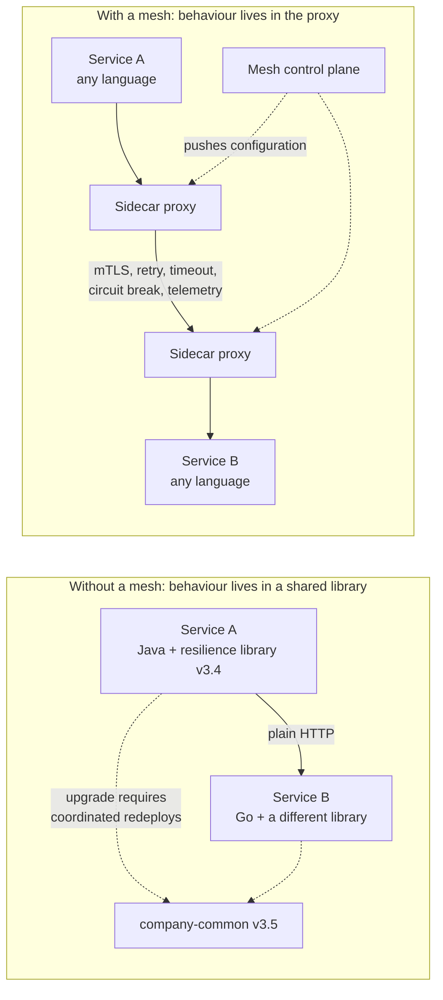
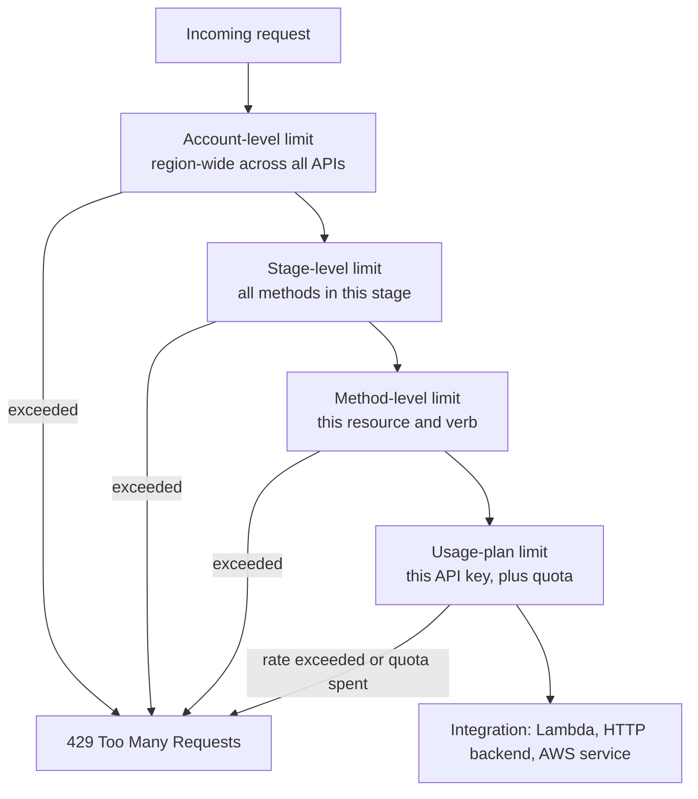
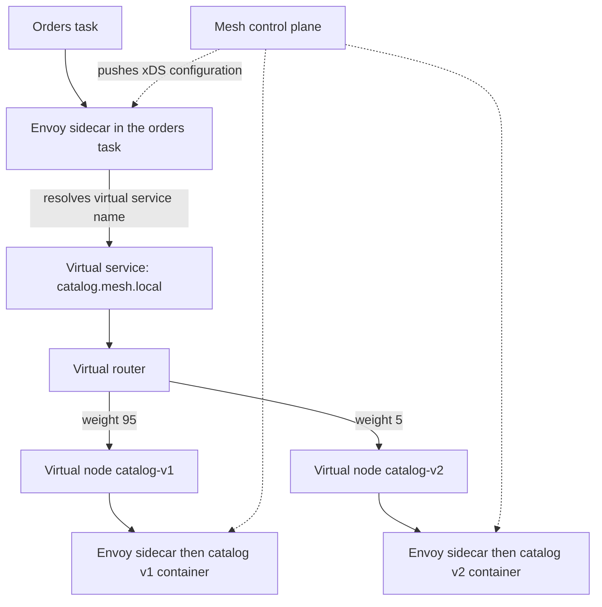
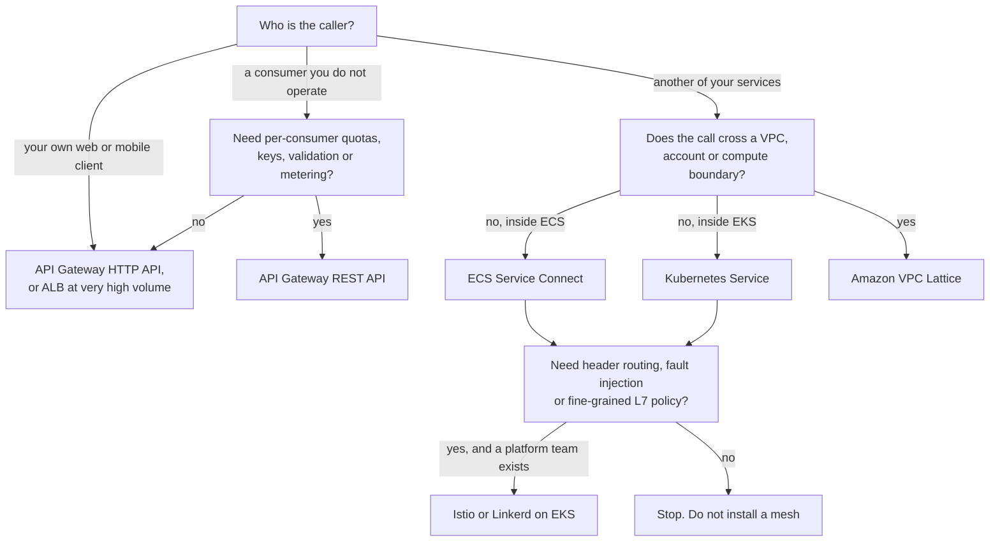
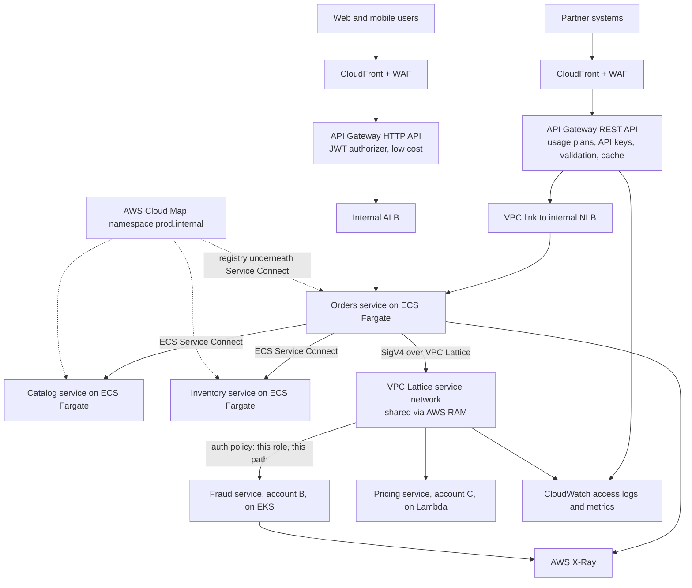

<!-- teachprep:refined 2026-10-11 -->
# API Management and Service Mesh on AWS

[4.1](topic1.md) decomposed the system into services; this topic explains how traffic reaches those services from outside, and how the services find and talk to one another.

## Definition

Once a system is split into services, two kinds of traffic appear:

- **North–south traffic** enters or leaves the system from clients you do not operate: browsers, mobile apps, partner systems.
- **East–west traffic** flows between your own services, inside your own trust domain.

Three different capabilities manage this traffic. They are often bundled together as "API infrastructure", but they solve different problems.

| Capability | Direction | Question it answers | Main AWS instruments |
|---|---|---|---|
| **API management** | North–south | How do external clients call us, under what contract, and at what rate? | Amazon API Gateway (with WAF and Cognito) |
| **Service discovery** | East–west | Where is the `catalog` service right now? | AWS Cloud Map, Route 53 private zones, Kubernetes Services and CoreDNS |
| **Service mesh / application networking** | East–west | How do all internal calls behave, and how do I change that without touching code? | ECS Service Connect, Amazon VPC Lattice, Istio or Linkerd on EKS (formerly AWS App Mesh) |

A fourth concern, **load balancing** (which instance handles this request?), appears in both directions: an ALB or NLB at the edge, or client-side balancing inside a proxy.

!!! note "A gateway is not a mesh"
    A common proposal is to route internal service-to-service calls through API Gateway "for consistency". This doubles cost, adds a hop and a failure mode, consumes quotas meant for external traffic, and mixes internal calls with customer traffic in every metric.

    The gateway governs a boundary you do **not** control. The mesh governs traffic **inside** your own trust domain. Keep them separate.

## Why This Service or Concept Exists

### The API management problem

Before managed gateways, every team exposing an API rebuilt the same concerns, each slightly differently:

| Concern | What each team built | Consequence |
|---|---|---|
| Authentication | A bespoke token check | Many implementations, many bugs, no central revocation |
| Rate limiting | An in-process counter, or nothing | One abusive consumer saturates the service |
| Per-consumer quotas | Usually nothing | No tiered access, no billing by usage |
| Request validation | Inside the handler | Malformed requests consume compute before rejection |
| Versioning and documentation | A path prefix and a wiki page | Old versions live forever; docs go stale |

None of these differentiate a business. API Gateway turns them into **configuration**, and rejects bad or excessive traffic **before** it costs you compute.

### The service-discovery problem

On physical servers, service B's address sat in service A's config file because it never changed. Containers broke that assumption:

- a Fargate task in `awsvpc` mode gets a fresh private IP each time it starts;
- a Kubernetes Pod's IP lives only as long as the Pod;
- an Auto Scaling group replaces instances continuously.

The set of valid addresses for one logical service changes many times a day. Something must keep track of it.

Plain DNS is a poor fit for three reasons:

1. It carries no metadata beyond an address.
2. Clients control caching and frequently ignore TTLs.
3. It expresses health only by removing records, which clients notice late.

AWS Cloud Map exists to fix this: a queryable registry with health state and **custom attributes**, which can also publish DNS records for clients that want them.

### The service-mesh problem

With many services calling each other, every service needs the same network behaviour:

- mutual TLS (mTLS), where both sides present automatically rotated certificates, so the callee can authenticate the caller;
- timeouts, retries and circuit breaking (semantics in [4.3](topic3.md#timeout-retry-with-backoff-and-jitter-circuit-breaker-bulkhead));
- connection pooling, because TLS handshakes dominate small internal calls;
- weighted traffic splitting, so a new version can take five per cent of traffic by changing route weights, with no deployment;
- consistent telemetry per caller–callee pair.

Implemented in code, these become a **shared library**. It must exist for every language, and upgrading it requires coordinated redeploys of every service. That reintroduces the coupling microservices were meant to remove.

A mesh moves this behaviour **out of the process** and into a proxy that intercepts the workload's traffic. The application makes a plain HTTP call; the proxy does the rest.

### Why AWS moved away from App Mesh

AWS App Mesh implemented the classic model: an AWS-managed control plane configuring Envoy sidecars. Its concepts are still the standard concepts. But the sidecar model has real costs:

- a proxy container per task or Pod, multiplied by every replica;
- an extra hop and longer start-up time;
- a new failure surface where a misconfigured proxy silently breaks traffic.

App Mesh also did not solve connectivity **across** VPCs and accounts, where large organisations struggle most. AWS split the problem in two:

| Need | Current AWS answer |
|---|---|
| Service-to-service inside ECS | **ECS Service Connect**: a managed proxy AWS injects and configures |
| Across VPCs, accounts and compute types | **Amazon VPC Lattice**: built into the VPC data plane, no sidecars, IAM auth |
| Full mesh features on Kubernetes | **Istio or Linkerd on EKS** (open source) |

!!! warning "App Mesh is past end of support"
    AWS ended support for App Mesh on 30 September 2026. It appears here only to explain what a mesh does. Do not choose it for new work. Existing estates should migrate by **traffic path** (in-ECS, cross-boundary, full-mesh), not by mapping resources one-for-one, because the successors use different models.

## Core Concepts

### Two rings with different concerns

| | **North–south ring** | **East–west ring** |
|---|---|---|
| Components | Route 53, CloudFront, WAF, API Gateway, custom domains | Cloud Map, Service Connect, Lattice, a mesh, internal ALBs |
| Trust | Everything is hostile until authenticated | Inside your trust domain, but still authenticated per service |
| Main concerns | Auth, quotas, validation, versioning, metering | Discovery under churn, uniform failure behaviour, service identity, per-caller telemetry |

Most serious mistakes in this topic come from using one ring's tools for the other's problem.

### Service discovery mechanisms

| Mechanism | Where the decision is made | Extra hop | Health awareness | Metadata |
|---|---|---|---|---|
| **DNS** (Route 53 private zone, Cloud Map DNS) | Client, after resolution | No | Only by removing records | No |
| **API registry** (Cloud Map `DiscoverInstances`) | Client | No | Yes, filterable | **Yes**: custom attributes |
| **Server-side load balancer** (ALB, NLB) | Load balancer | **Yes** | Yes, health checks | No |
| **Client-side via a proxy** (Service Connect, sidecar) | Caller's local proxy | No | Yes, with outlier ejection | Yes, via control plane |

!!! tip "Why DNS caching is the recurring failure"
    A client resolves `catalog.internal` and caches three IPs, often for the life of the process. A task is replaced; its IP is now dead or reassigned. The client keeps sending traffic there until something forces re-resolution. This is why proxy-based discovery exists, and why "just use DNS" is not enough for high-churn workloads.

### Service mesh: data plane and control plane

A mesh has two planes. The split explains how it behaves under failure.

| Plane | What it is | On the request path? |
|---|---|---|
| **Data plane** | Proxies (usually Envoy) deployed with each workload, often as a **sidecar** sharing its network namespace. Traffic is redirected into the proxy by `iptables` rules or a node-level component | **Yes**: every request flows through it |
| **Control plane** | Computes configuration from declared resources and pushes it to the proxies | No |

!!! tip "A control plane failure stops change, not traffic"
    Each proxy keeps its last-known configuration. If the control plane fails, existing traffic keeps flowing; you lose only the ability to change routing and to learn about new endpoints. This is the same idea as the EKS control plane in [3.1](../unit3/topic1.md).

## AWS Service Deep Dive

### Amazon API Gateway

[1.6](../unit1/topic6.md#amazon-api-gateway) introduced API Gateway as the managed front door. This section covers the features that make it an API **management** tool.

#### The three API types

| Dimension | **REST API** | **HTTP API** | **WebSocket API** |
|---|---|---|---|
| Positioning | Full-featured API management | Lower cost, lower latency, fewer features | Bidirectional, stateful connections |
| Relative cost | Highest per request | Substantially lower per request | Per message and per connection-minute |
| API keys and usage plans | Yes | **No** | No |
| Request validation (JSON Schema) | Yes | No | No |
| Mapping templates (VTL) | Yes | No (parameter mapping only) | Yes |
| Caching | Yes | **No** | No |
| Private endpoint and resource policies | Yes | No | No |
| Direct WAF association | Yes | **No** (put CloudFront in front) | No |
| Authorisation | IAM, Cognito, Lambda authorisers | JWT, IAM, Lambda authorisers | IAM, Lambda authorisers |
| VPC link targets | NLB; ALB with VPC links V2. **Not** Cloud Map | ALB, NLB or Cloud Map service | n/a |
| Canary releases | Yes | No | No |
| Typical use | Partner and public APIs needing governance and metering | First-party APIs, Lambda proxying, high volume | Chat, live dashboards, notifications |

!!! info "The type decision is a feature decision, not a price decision"
    If the requirements mention per-consumer quotas, partner tiers, schema validation at the edge, caching, or a private API, you need **REST**. If they stress lowest cost for a simple Lambda proxy with JWT auth, **HTTP** is right and REST is over-engineering. Teams that pick HTTP for price and then need usage plans end up migrating under pressure.

#### Key features

| Feature | What it does | Why it matters |
|---|---|---|
| **Stages and deployments** | Immutable snapshots promoted to named stages (`dev`, `prod`) with their own variables, throttles and logging | Rollback is promoting the previous deployment |
| **Usage plans and API keys** | Per-consumer rate, burst and quota | Makes tiered or metered APIs possible. An API key **identifies** a consumer; it does not authenticate one |
| **Authorisers** | IAM (SigV4), Cognito user pools, Lambda (token or request), JWT on HTTP APIs | Authentication at the edge. Cache Lambda authoriser results, or every request pays its latency |
| **Request validation** | Rejects bodies or parameters that fail a JSON Schema model | Malformed requests never reach compute |
| **Caching** | Per-stage cache with per-method TTL and cache keys | Absorbs repeated reads; charged per hour whether hit or not |
| **Resource policy** | IAM-style policy restricting by VPC endpoint, IP or account | Together with the private endpoint type, the only way to make an API truly private |
| **VPC link** | Private connection to a backend in a VPC | Backends stay in private subnets |
| **Custom domain and base-path mapping** | One hostname, several APIs by path prefix | Lets each team deploy its own API under a shared domain |
| **Direct AWS service integration** | Calls SQS, DynamoDB, Step Functions and others with no Lambda in between | Removes a pass-through function, its cost, cold start and failure mode |

**Endpoint types.** REST APIs can be **edge-optimized** (AWS adds a CloudFront distribution), **regional**, or **private** (reachable only through interface VPC endpoints). If you already run your own CloudFront distribution, choose regional: edge-optimized would stack two distributions.

#### Throttling: four levels

Throttling uses a **token bucket**: a steady **rate** refills the bucket, and the **burst** is its capacity, allowing short spikes. Every level can reject independently.

Two design consequences:

- Throttling protects your **backend**, so derive limits from what the backend can sustain (Lambda reserved concurrency, database connections), not from a round number.
- A `429` is an immediate, well-formed rejection a client can back off from. That is far better than a timeout. Load shedding at the edge is a reliability feature ([4.3](topic3.md)).

#### Limits that shape design

- **Integration timeout**: 29 seconds by default for REST APIs. Long-running work must become asynchronous, typically returning `202 Accepted` with a status resource.
- **Payload size** is capped, so large uploads go directly to S3 with presigned URLs.
- **VTL mapping templates** are powerful but hard to test and debug; prefer proxy integrations by default.
- **Per-request cost** makes the gateway the wrong instrument for high-volume internal traffic.

### AWS Cloud Map

Cloud Map is the managed **service registry**: namespaces, services and instances, with health state and metadata.

| Term | Meaning |
|---|---|
| **Namespace** | A grouping such as `prod.internal`: public DNS, private DNS (Route 53 private zone), or API-only (`HTTP`, no DNS) |
| **Service** | A logical service in a namespace, with DNS record type and health-check settings |
| **Service instance** | One endpoint (IP and port) plus **custom attributes** such as `VERSION=2.1` |
| **`DiscoverInstances`** | API lookup filtered by health and attributes |
| **SRV record** | A DNS record carrying the **port** as well as the host; needed when ports vary |
| **`HealthCheckCustomConfig`** | Health reported by an external system, such as the ECS agent |

!!! note "Cloud Map sits underneath ECS"
    ECS service discovery and ECS Service Connect are both built on Cloud Map. ECS registers and deregisters instances for you as tasks start and stop ([2.2](../unit2/topic2.md)).

Cloud Map tells you **where** instances are. It does no load balancing, retries or circuit breaking. Calling `DiscoverInstances` on every request is slow, billable and throttled; cache the result, or let a proxy do it.

### Amazon ECS Service Connect

Service Connect is the current AWS choice for service-to-service traffic **inside ECS** ([2.3](../unit2/topic3.md)).

How it works:

1. In the ECS service definition you declare a namespace and, for services that receive traffic, a **discovery name** and **client aliases**.
2. ECS injects and manages an Envoy proxy in each task and registers endpoints in Cloud Map.
3. Callers use a short name such as `http://catalog:8080`, which resolves to the local proxy.

| You get, with no proxy configuration | You do not get |
|---|---|
| Endpoint discovery and client-side load balancing | Header-based routing |
| Connection pooling and reuse | Fault injection |
| Outlier ejection and retry of connection failures | Fine-grained authorisation policy |
| Metrics **by client service and server service** (`ECS/ServiceConnect` namespace) | Cross-cluster or cross-account reach |

The per-caller metrics are the hidden gem: they answer "which caller is causing the callee's errors?" with no application instrumentation.

### Amazon VPC Lattice

VPC Lattice is application networking built **into the VPC data plane**, with no sidecars. It connects services **across VPCs, accounts and compute types**.

| Term | Meaning |
|---|---|
| **Service network** | The boundary that services register into and VPCs associate with; shared across accounts with AWS Resource Access Manager |
| **Service** | A logical service with listeners and a managed DNS name |
| **Listener rule** | Path, header or method match, forwarding to weighted target groups |
| **Target group** | Instances, IPs, Lambda functions, or an ALB |
| **Auth policy** | An **IAM policy** on the service network or service, authorising callers by principal |

Why it matters architecturally:

- It works across **overlapping CIDRs**, because it does not route at layer 3.
- It treats **Lambda, ECS, EKS and EC2** uniformly as targets.
- Authorisation is an **identity** statement ("the orders role may `GET` `/products/*`"), reviewable with normal IAM tooling, not a CIDR rule.
- There is **no proxy** in your workloads: no per-replica overhead, nothing to upgrade.
- On EKS, the AWS Gateway API Controller lets teams declare Lattice resources as Kubernetes `Gateway` and `HTTPRoute` objects ([3.1](../unit3/topic1.md)).

!!! warning "VPC Lattice is not a full mesh"
    It has no fault injection and a smaller L7 feature set than Istio. It is also billed per service-network hour, per service hour and per data processed. It earns its cost when it replaces several internal load balancers, PrivateLink endpoints or a peering topology, not for a handful of services inside one VPC.

### AWS App Mesh (legacy reference)

App Mesh is past end of support. Its resource model is still a clear way to see what any mesh does, and Istio's model maps onto it closely.

| App Mesh resource | Meaning | Nearest Istio equivalent |
|---|---|---|
| **Virtual service** | The **name** callers use | `VirtualService` plus `Service` |
| **Virtual node** | A pointer to a real workload, with discovery, listeners, health checks and allowed backends | `DestinationRule` plus workload labels |
| **Virtual router** and **route** | Where traffic is split between versions by match and weight | `VirtualService` route rules |
| **Backend** | A service a node may call; unlisted backends denied by default | Authorization policy |

The mental model: a **virtual service is a name**, a **virtual node is a workload**, and a **virtual router is the decision between them**. A canary is just a change to router weights.

### Istio and Linkerd on EKS

For teams on EKS that need full mesh features (header-based routing, fault injection, fine-grained L7 authorisation, mesh-wide mTLS with a chosen CA), the open-source meshes are the option. Istio's ambient mode reduces per-Pod overhead by moving proxying to node level; sidecars remain necessary on Fargate, where DaemonSets are unavailable. Running a mesh needs a platform team: a control plane, a certificate authority and a permanent upgrade obligation.

## Architecture Components

| Component | Responsibility in this topic |
|---|---|
| **CloudFront, WAF, Shield** | Edge TLS, caching and the cheapest rejection point; WAF attachment point for HTTP APIs ([8.2](../unit8/topic2.md)) |
| **API Gateway** | The governed north–south boundary |
| **Cloud Map** | Registry of endpoints, health and attributes |
| **ECS Service Connect** | Managed proxy for in-ECS discovery, balancing and per-caller metrics |
| **VPC Lattice** | Cross-VPC, cross-account, cross-compute networking with IAM auth |
| **Cognito, IAM** | JWTs for user-facing APIs; SigV4 and principals for services ([8.1](../unit8/topic1.md)) |
| **ACM, Private CA** | Certificates for custom domains and for mesh mTLS ([8.3](../unit8/topic3.md)) |
| **CloudWatch, X-Ray** | Metrics, access logs and traces across both rings ([7.1](../unit7/topic1.md)) |

## Important AWS Terminology

| Term | Meaning |
|---|---|
| **North–south / east–west** | External-to-system traffic / service-to-service traffic |
| **Proxy integration** | Request passed to the backend untouched; response returned as-is |
| **Mapping template** | VTL transformation separating the public contract from the backend's shape |
| **API key** | A metering identity, **not** a credential |
| **Token bucket** | Throttling algorithm: refill rate plus burst capacity |
| **Client-side load balancing** | The caller's proxy chooses among healthy endpoints, removing a load balancer hop |
| **Sidecar** | Helper container in the same task or Pod, sharing its network namespace |
| **xDS** | The protocol a control plane uses to push configuration to Envoy |
| **Outlier detection** | Ejecting an endpoint that keeps returning errors |

## Configuration Options

### API Gateway configuration

| Setting | Options | How to decide |
|---|---|---|
| **API type** | REST, HTTP, WebSocket | REST for keys, usage plans, validation, caching, resource policies or WAF; HTTP otherwise; WebSocket for bidirectional traffic |
| **Endpoint type** | Edge-optimized, regional, private | Regional behind your own CloudFront; private plus a resource policy for internal-only APIs |
| **Integration** | Lambda proxy, HTTP proxy, custom, AWS service, mock | Proxy by default; AWS service to drop a pass-through Lambda; mock for contract-first development |
| **Authorisation** | IAM, Cognito, Lambda, JWT | IAM for AWS callers; Cognito or JWT for users; Lambda for bespoke schemes. Never `NONE` on a mutating method |
| **Authorizer result TTL** | 0 to 3600 seconds | Set it from your token-revocation requirement. Zero means an authoriser call on every request |
| **Request validation** | Body, parameters, both | Both, on every method that accepts input |
| **Throttle rate and burst** | Account, stage, method, usage plan | From measured backend capacity |
| **Caching** | Off, or size plus per-method TTL | Only for repeated idempotent reads. **If responses vary per user, include identity in the cache key** |
| **VPC link** | REST: NLB, or ALB (V2); HTTP: ALB, NLB, Cloud Map | Always for backends in a VPC. A public backend with a secret header is not a substitute |
| **Access logging** | Off, or JSON to CloudWatch or Firehose | On, with request ID, API key ID, latency and integration latency |
| **Execution logging** | Off, `ERROR`, `INFO` with data tracing | `ERROR` in production. Data tracing writes request bodies to logs: costly and a data-protection risk |
| **Mutual TLS** | On a custom domain, truststore in S3 | For partners that require client certificates |

### Service Connect, Lattice and mesh settings

| Setting | How to decide |
|---|---|
| **Do you need a mesh at all?** | Start with none. Service Connect for ECS, Lattice across boundaries, a full mesh only for a named requirement |
| **mTLS mode** | Permissive during migration; strict once every workload is enrolled, verified with a negative test |
| **Retries and timeouts** | Configure retries in **one** layer only (mesh or application), and fit them inside the caller's deadline ([4.3](topic3.md#timeout-retry-with-backoff-and-jitter-circuit-breaker-bulkhead)) |
| **Outlier detection** | Always cap the maximum ejection percentage |
| **Connection pool limits** | Per-destination caps act as a bulkhead |
| **Traffic split weights** | Start at 1–5%, watch errors and latency, automate the abort |
| **Lattice auth policy** | Name specific principals and paths |

!!! warning "Two settings that turn a small failure into an outage"
    **Retries in both mesh and application**: three application retries over three mesh retries is nine requests per logical call, a retry storm generator.

    **Outlier detection without an ejection cap**: when a shared dependency degrades, every endpoint errors, every endpoint is ejected, and no healthy targets remain.

## Design Considerations

### Choosing the right tool

| | **API Gateway** | **ECS Service Connect** | **VPC Lattice** | **Istio / Linkerd** |
|---|---|---|---|---|
| Traffic | North–south | East–west, inside ECS | East–west, across VPCs, accounts, compute | East–west, inside EKS |
| Proxy in your workload | No | Yes, AWS-managed | No | Yes, you operate it |
| Authorisation | Authorisers, keys, WAF | Security groups; no L7 policy | IAM auth policies | mTLS identity and L7 policy |
| Traffic shifting | Canary stages | Via separate services | Weighted target groups | Rich, header-aware |
| Choose when | External consumers need governance | ECS services call each other | Calls cross boundaries or need IAM-based auth | A named requirement only a full mesh meets |
| Main cost | Per request (REST > HTTP) | Proxy CPU and memory | Hourly plus data processed | Proxies plus a platform team |

AppSync for first-party clients with over-fetching problems is covered in [4.1](topic1.md).

## AWS Best Practices

| Pillar | Practice |
|---|---|
| **Operational Excellence** | Define APIs contract-first in OpenAPI, held in version control. Use one access-log format across all APIs. Measure usage per API key per version before retiring a version |
| **Security** | Authenticate at the edge, authorise at both rings. Keep backends private behind VPC links. Express east–west permission as identity, not CIDR ranges |
| **Reliability** | Set throttles from measured capacity. Timeouts everywhere, retries in one layer. Never put a discovery API call on the request path |
| **Performance Efficiency** | Cache authoriser results. Reuse connections. Use direct service integrations instead of pass-through Lambdas |
| **Cost Optimization** | HTTP over REST where features allow. No internal traffic through the gateway. Share one ALB across services |

## Security Considerations

- **API keys are not credentials.** They travel in a header and can be extracted from any client. A method protected only by a key is effectively public. Always pair keys with a real authoriser.
- **Authoriser cache TTL is a security setting.** A longer TTL lowers latency but extends how long a revoked token still works. Choose it from the revocation requirement; use short-lived tokens where revocation must be immediate.
- **Private needs two parts.** A private endpoint type plus a resource policy restricting `aws:SourceVpce`.
- **The cache key is a security control.** Caching a per-user response without identity in the key serves one user's data to another, and is invisible when testing with one account.
- **East–west authorisation differs by model.** An App Mesh backend list is a coarse allow-list; an Istio `AuthorizationPolicy` is per path and method; a Lattice auth policy is an IAM policy with CloudTrail and condition keys. All require **one IAM role per service**: you cannot authorise by principal if services share one.

## Operating It: Performance, Cost and Monitoring

### Performance

- **Cache the Lambda authoriser.** Without caching, its full latency (including cold starts) is added to every request. This is often the single largest latency win.
- **Reuse connections and remove hops.** Service Connect and mesh proxies pool connections, and client-side balancing removes the internal load balancer hop.
- **Compare `Latency` with `IntegrationLatency`.** The difference is the gateway's own overhead. If `Latency` grows and `IntegrationLatency` does not, look at the authoriser or mapping template.
- **Watch the proxy itself.** An under-provisioned Envoy causes application latency with no application cause.

### Cost: three lessons

!!! tip "The structural cost lessons"
    1. **The gateway is for external traffic.** Routing internal calls through it is the most expensive mistake available here; per-request cost at internal volume can exceed the compute behind it.
    2. **REST versus HTTP has a real price difference.** Ask whether you need keys, usage plans, validation, caching, resource policies or WAF. If not, use HTTP.
    3. **Sidecar overhead is invisible in the bill.** It appears as ordinary Fargate or EC2 cost. Multiply the proxy's CPU and memory reservation by the replica count before adopting a mesh.

Other common leaks: an API Gateway cache that is rarely hit (charged per hour regardless), one ALB per service instead of a shared one, `DiscoverInstances` per request, and execution logs with no retention policy.

### Monitoring

| Metric | Source | What it tells you |
|---|---|---|
| `4XXError` | API Gateway | Includes **429 throttles**; a spike may mean a consumer hit its quota, not that the API broke |
| `Latency` vs `IntegrationLatency` | API Gateway | Gateway overhead versus backend time |
| Requests and errors **by client and server** | `ECS/ServiceConnect` | Which caller causes a callee's errors |
| Retry count, outlier ejections | Envoy statistics | Early signs of a retry storm or correlated failure |
| `RequestCount`, `HTTPCode_5XX`, auth denials | VPC Lattice | Cross-boundary health; alarm on denials after any policy change |
| Registered instances vs running tasks | Cloud Map | Registration or deregistration failing |

!!! tip "The most useful east–west dashboard"
    A caller-by-callee grid of request rate, error rate and p99 latency, available from Service Connect, mesh or Lattice metrics without touching application code. It turns "the catalogue service is unhealthy" into "the orders service is causing it". Propagate X-Ray trace context through every hop so traces start at the gateway ([7.1](../unit7/topic1.md)).

## Integration with Other AWS Services

| Service | Why it integrates |
|---|---|
| **CloudFront, WAF, Shield** | Edge caching and protection; required for WAF on HTTP APIs |
| **ECS, EKS** | Workloads behind the gateway; Service Connect and the Gateway API Controller |
| **SQS, DynamoDB, Step Functions** | Direct API Gateway integrations without Lambda |
| **Resource Access Manager** | Shares Lattice service networks across accounts |
| **PrivateLink** | One-to-one private exposure; Lattice is the many-to-many generalisation |
| **CodeDeploy, CodePipeline** | Deployment strategies that use traffic shifting ([5.2](../unit5/topic2.md)) |

## Common Architecture Patterns

| Pattern | What it is | AWS implementation |
|---|---|---|
| **API gateway** | One managed entry point for auth, throttling, validation and routing. Avoid one central team owning all config | API Gateway with per-team base-path mappings on a custom domain |
| **BFF at the edge** | A client-specific API per frontend, owned by the client team (defined in [4.1](topic1.md)) | Separate HTTP APIs or AppSync per client type |
| **Gateway offloading** | Move TLS, auth, validation, caching and filtering to the edge | CloudFront, WAF, API Gateway authorisers and validators |
| **Canary / traffic shifting** | Send a small share of traffic to a new version; automate the abort | API Gateway canary stages, ALB weighted target groups, Lattice weights, mesh routes |
| **Sidecar** | Helper container for cross-cutting concerns | Service Connect proxy, Envoy, log routers |
| **Client-side discovery and balancing** | Caller's proxy holds healthy endpoints | Service Connect, mesh sidecars |
| **Ambassador** | A proxy giving an unmodifiable legacy app TLS, retries and telemetry | A sidecar in front of outbound calls |

Strangler fig and anti-corruption layer are covered in [4.1](topic1.md); circuit breakers, retries, bulkheads and timeouts in [4.3](topic3.md#timeout-retry-with-backoff-and-jitter-circuit-breaker-bulkhead). A mesh, Service Connect or Lattice can enforce timeouts, retries, outlier ejection (a circuit breaker) and connection-pool limits (a bulkhead) at the network layer, but each must be implemented **once**.

## Industry Use Cases

| Sector | Requirement | Choice |
|---|---|---|
| Logistics | Hundreds of partner integrators on three commercial tiers | REST API with a usage plan per tier |
| Fintech | Partners must present client certificates | Custom domain with mutual TLS |
| Media streaming | Very high-volume internal traffic on ECS | ECS Service Connect: no gateway cost, no extra hop |
| Retail banking | Many services across many accounts, overlapping CIDRs | VPC Lattice shared with RAM |
| Healthcare | Internal API that must never be internet-reachable | Private REST API with a resource policy |
| Telecommunications | Fault injection and header routing on EKS | Istio, justified by a named requirement |

## Advantages and Limitations

| Area | Advantage | Limitation |
|---|---|---|
| **API Gateway** | Auth, throttling, quotas, validation and metering become configuration; bad traffic is rejected before it costs compute | Extra hop, integration timeout, payload caps, per-request cost; HTTP APIs lack key features |
| **Usage plans** | Make tiered, metered APIs possible | REST only |
| **Cloud Map** | Discovery under churn without running a consensus system | DNS mode cannot force clients to honour TTLs; no traffic management |
| **Service Connect** | Discovery, balancing, pooling and per-caller metrics with no proxy config | ECS only; limited L7 features |
| **VPC Lattice** | Cross-account, cross-VPC, overlapping CIDRs, IAM auth, no sidecars | Not a full mesh; hourly charges uneconomic for small single-VPC estates |
| **Full mesh** | Uniform mTLS, resilience and telemetry in any language; traffic shifting in seconds | Proxy per replica, control plane, CA and upgrades; harder debugging (failures look like connection resets) |

## Common Mistakes

### Beginner Mistakes

| Mistake | Why it is wrong | What to do instead |
|---|---|---|
| Routing internal traffic through API Gateway | Doubles cost, adds a hop, consumes external quotas | Service Connect, an internal ALB, or VPC Lattice |
| Choosing HTTP API, then needing usage plans or caching | HTTP APIs lack them | Decide from the feature list first |
| Treating an API key as authentication | It is a metering identity | Pair with IAM, Cognito, JWT or a Lambda authoriser |
| Expecting to attach WAF directly to an HTTP API | Not supported | Put CloudFront in front and attach WAF there |
| Planning a REST API VPC link to a Cloud Map service | REST VPC links reach an NLB or ALB only | Use an HTTP API, or front the service with an NLB/ALB |
| Lambda authoriser with no result caching | Full latency and cost on every request | Set a TTL from the revocation requirement |
| Caching per-user responses without identity in the key | Serves one user's data to another | Include identity in the cache key, or do not cache |
| "Private" endpoint with no resource policy | Not private as assumed | Add a resource policy on `aws:SourceVpce` |
| Trusting DNS TTL to refresh clients | Many clients cache for the process lifetime | Proxy-based discovery for high-churn services |
| Treating VPC Lattice as a mesh, or as the same as PrivateLink | Lattice lacks mesh features; PrivateLink is one-to-one exposure | Pick by requirement: Lattice for many-to-many routing with IAM auth |
| Installing a mesh with no named requirement | Large permanent cost for unused features | Start with none; add only for a specific need |
| Choosing App Mesh for new work | Past end of support | Service Connect, VPC Lattice, or Istio/Linkerd |

### Production Mistakes

| Mistake | Consequence | Remedy |
|---|---|---|
| Throttles set to round numbers | A stampede reaches an exhausted backend | Derive from concurrency, connections and load tests |
| Retries in both mesh and application | Multiplied load during failures | Choose one layer; disable the other explicitly |
| Outlier detection with no ejection cap | A correlated failure ejects the whole fleet | Cap ejection well below half |
| Switching mTLS to strict before full enrolment | Silent breakage of unenrolled callers | Enrol, run a negative test, then switch |
| Lattice auth policy deployed without checks | Legitimate callers denied at cutover | Stage it, alarm on denials, test with real caller roles |
| Execution logging with data tracing in production | Request bodies in logs: cost and data-protection risk | Access logs with reviewed fields; `ERROR` level |
| No canary on partner-facing changes | A breaking change reaches every integrator at once | Canary stages with automatic rollback |
| Retiring an API version without usage data | An unknown partner breaks | Meter per key per version; publish a deprecation window |

## Architecture Diagrams

A reference architecture combining both rings:

How to read it:

- **North–south** differs by audience: partners get REST (metering and quotas); first-party clients get the cheaper HTTP API. Everything sits behind CloudFront and WAF.
- **East–west** differs by boundary: in-cluster calls use Service Connect; cross-account calls use VPC Lattice with IAM auth.
- **What is absent** is deliberate: no internal traffic through API Gateway, no public backends, and no full mesh, because nothing here requires one.

## Summary

API management governs the boundary you do not control; service discovery and application networking govern traffic inside your own trust domain. Keep the two rings separate, and pick east–west tooling by the boundary the traffic crosses.

| Area | Key lesson |
|---|---|
| **Two rings** | North–south needs auth, quotas, validation and metering. East–west needs discovery, uniform failure behaviour and service identity. Never route internal traffic through the gateway |
| **API Gateway type** | A feature decision: keys, usage plans, validation, caching, private APIs or WAF mean REST; otherwise HTTP |
| **Discovery** | DNS caching makes plain DNS weak for high-churn services. Cloud Map is the registry; a local proxy is better still |
| **Service mesh** | Moves mTLS, retries, timeouts and telemetry out of code into proxies. Data plane carries traffic; control plane failure stops change, not traffic. Adopt only for a named requirement |
| **Current AWS choices** | Service Connect inside ECS; VPC Lattice across VPCs, accounts and compute; Istio or Linkerd on EKS. App Mesh is past end of support |
| **Identity** | East–west authorisation is by principal (Lattice auth policies, mesh policies), which needs one IAM role per service |
| **Cost** | Gateway for external traffic only; REST costs more than HTTP; sidecar overhead hides in compute |

**Next:** with traffic routed and services able to find each other, [4.3 Resilience in AWS Microservices](topic3.md) explains how to keep the system working when those calls fail.

!!! question "Practice and interview questions"
    Questions for this topic are kept separately: [Practice questions](../Questions/unit4.md#42-api-management-and-service-mesh) · [Interview questions](../interviewquestions/unit4.md#42-api-management-and-service-mesh).
