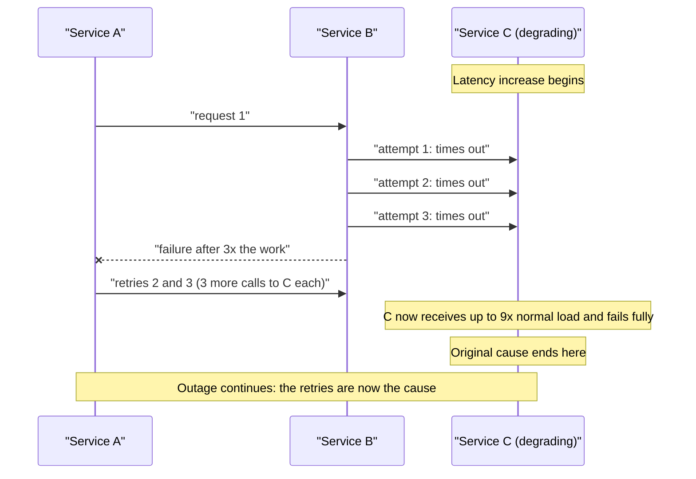
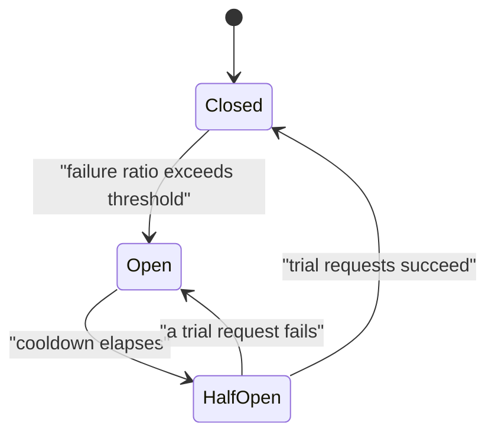
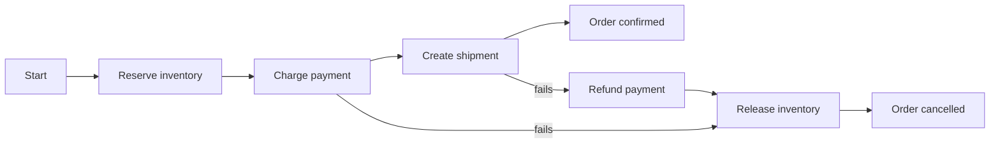
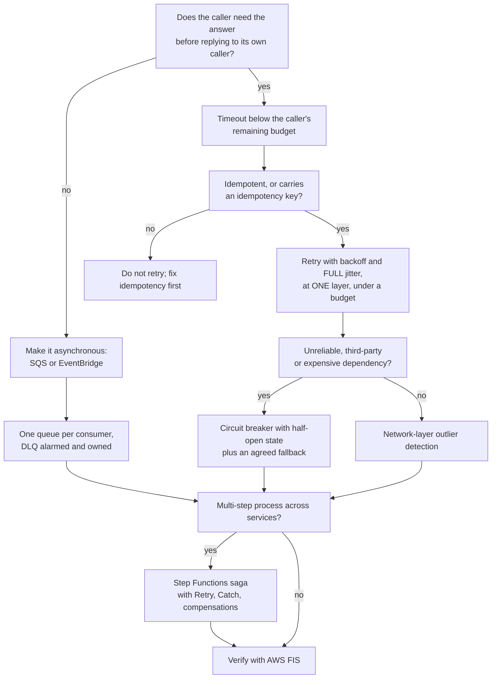
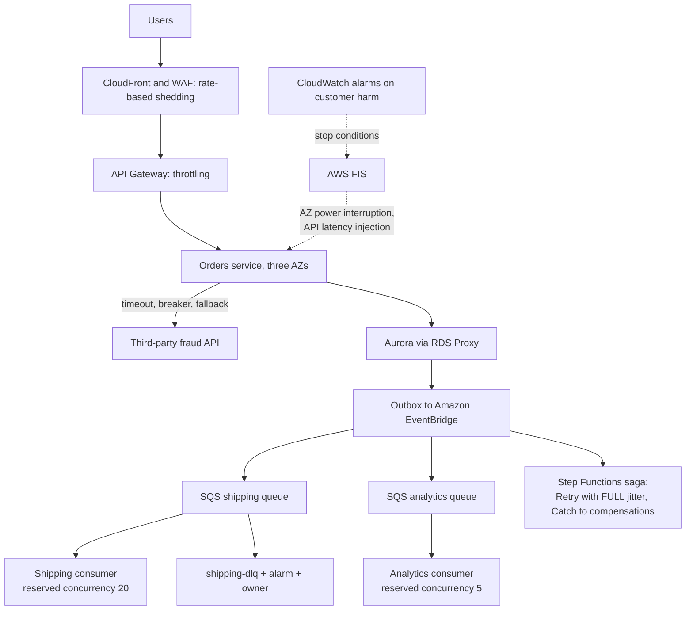

# Implementing Resilience in AWS Microservices

---

[4.1](topic1.md) split the system into services and [4.2](topic2.md) connected them; every one of those connections is a network call that can be slow, fail, or fail ambiguously, and this chapter is about designing for that.

## Definition

**Resilience** is the ability of a system to keep providing acceptable service while something is broken, and to return to full service afterwards without manual intervention.

It is not the same as availability (a measurement) or reliability (correctness over time). Resilience is a **design property** you build in deliberately. It has four parts:

| Capability | Question it answers | Mechanisms in this chapter |
|---|---|---|
| **Fault isolation** | When something breaks, how much breaks with it? | Bulkheads, per-consumer queues, cells, AZ and account boundaries |
| **Fault tolerance** | Can we still produce an acceptable result? | Retries, fallbacks, graceful degradation, queue buffering |
| **Fault containment** | Does the fault stay put, or spread? | Timeouts, circuit breakers, load shedding, retry budgets |
| **Recovery** | Does it heal itself, and how fast? | Health checks, dead-letter queues with redrive, saga compensation |

Three AWS services anchor the chapter:

- **AWS Step Functions**: where a multi-step process's error handling lives explicitly (retries, catch handlers, timeouts, compensation).
- **Amazon SQS and Amazon SNS**: where isolation and buffering live. A queue is a bulkhead, a shock absorber and a durable record of unfinished work.
- **AWS Fault Injection Service (FIS)**: where resilience stops being a claim and becomes a measurement.

!!! note "Resilience is a property of the whole system"
    Every component can be highly available while the system is fragile, because fragility lives in the **interactions**: a retry policy that amplifies load, a shared connection pool, a timeout longer than the caller's patience. [Unit 1.7](../unit1/topic7.md) introduced these patterns; this chapter explains how they work and how to configure them on AWS. Often the best resilience change is removing a synchronous dependency rather than hardening it.

## Why This Service or Concept Exists

### The failure modes that distribution introduces

A monolith fails in one simple way: the process dies and everything stops. Distribution replaces that with several harder problems.

| Failure mode | What it means | Why it is hard |
|---|---|---|
| **Partial failure** | Some components work, others do not | The system is neither up nor down |
| **Ambiguous outcome** | A call timed out; did it succeed? | Retrying may duplicate the effect; only idempotency resolves this |
| **Gray failure** | A component is degraded but reports healthy | Health checks pass while users suffer |
| **Metastable failure** | The system stays broken after the trigger is gone | The recovery mechanism (retries) now sustains the failure |
| **Correlated failure** | Many components fail together | Redundancy assumed independence: same AZ, same dependency, same bad deployment |
| **Cascading failure** | One failure overloads the next service | Spreads along the dependency graph faster than humans react |
| **Poison message** | One malformed item blocks a queue forever | Without a dead-letter path, everything behind it stops |

!!! danger "Metastable failure surprises people"
    A brief latency spike causes timeouts. Timeouts cause retries. Retries multiply load. The extra load keeps latency high **after the original cause has gone**. The system is now stably broken, and restarting services often makes it worse because they come back to a backlog of retries. The exits are shedding load, opening circuits or draining the retry backlog, and all three must be designed in beforehand.

### What AWS provides, and what it does not

AWS supplies the building blocks: SQS and SNS for buffering and isolation, dead-letter queues for poison messages, Step Functions for durable multi-step state with declarative retries, SDK retry modes and mesh proxies for backoff and circuit breaking, Lambda reserved concurrency for bulkheads, and FIS for fault injection.

What AWS does **not** provide is the design. Retries at three layers, no timeouts, a DLQ nobody owns: the platform supports all of these at no extra cost. AWS makes correct designs cheap; it does not make incorrect ones impossible.

## Core Concepts

### Timeouts: the foundation

A call without a timeout is a hang waiting to happen. When a dependency stops responding, an untimed caller holds its thread and connection indefinitely. Under load every thread ends up waiting on that one dependency, and the caller stops serving **all** traffic, including requests that never touch the failing dependency.

Set timeouts from **measured latency**, not round numbers:

| Timeout | What it bounds | How to set it |
|---|---|---|
| **Connection** | Establishing a TCP connection | Short (hundreds of milliseconds); a slow connect means unreachable, not busy |
| **Request (read)** | Waiting for a response | Above the dependency's p99, below the caller's remaining budget |
| **Total operation** | All attempts including retries | Must fit inside the caller's deadline |
| **Idle** | An unused pooled connection | Shorter than the server's idle timeout |

!!! danger "The arithmetic teams get wrong"
    A caller has a 2-second budget. It calls a dependency with a 1-second timeout and three retries. Worst case is over 3 seconds of attempts, so the caller gives up during the second retry and the third attempt is **work for a request nobody is waiting for**, sent at the moment the dependency is struggling. The **total retry time must fit inside the caller's deadline**. Two attempts with a tight timeout beat five with a loose one.

### Retries with backoff and jitter

Retries recover from **transient** faults: a dropped packet, a brief throttle, an instance replaced mid-request. They are useless against persistent faults and harmful against **overload**, where the retry *is* the overload.

The rules:

1. **Retry only what is retryable.** 500, 503, 429 (honour `Retry-After`), connection resets and timeouts are retryable. 400, 401, 403, 404 and validation errors are not.
2. **Retry only what is safe to repeat.** A GET is naturally idempotent. A POST creating an order is not, unless it carries an [idempotency key](#idempotency).
3. **Use exponential backoff with full jitter.** Backoff spaces retries out. Jitter stops clients that failed together from retrying together.
4. **Retry at exactly one layer.** Usually the one closest to the failure. Disable retries everywhere else.
5. **Cap retries with a budget.** A retry budget limits retries to a fraction of total requests (typically 10 to 20 per cent). Beyond that, fail fast.

```python
# Exponential backoff with full jitter (the AWS-recommended form).
sleep = random_between(0, min(cap, base * 2 ** attempt))
```

The `random_between(0, ...)` is the important part: it spreads retries across the whole interval instead of letting them cluster.

### The retry storm

Each layer's retry policy looks reasonable on its own. Together they multiply: three retries at the client, three at the gateway and three in the SDK is up to **27 requests per logical call**. Even two layers of three gives 9.



The defences are cumulative:

| Defence | What it stops |
|---|---|
| **Retry at one layer only** | Multiplicative amplification (27 times down to 3 times) |
| **Full jitter** | Synchronised waves of retries |
| **Retry budget** | Amplification when everything is failing |
| **Circuit breaker** | Calling a dependency known to be down |
| **Deadline propagation** | Work for requests already abandoned |
| **Load shedding at the callee** | Accepting more work than can be completed |
| **A queue in between** | The synchronous coupling that lets the caller push at all |

### Circuit breakers

A circuit breaker wraps calls to one dependency. When failures exceed a threshold it **opens** and fails calls immediately, giving the dependency room to recover and giving the caller a fast failure instead of a slow, thread-consuming one.



The **half-open** state makes it a breaker rather than a kill switch: after a cooldown it lets a few trial requests through. Without it, the breaker never recovers on its own.

Its three parameters (failure threshold, window and cooldown) should come from measured error rates. Set too low, the breaker flaps on normal errors; set too high, it never opens or stays open long after the dependency recovers.

There is **no AWS circuit breaker service**. A breaker lives in one of three places:

1. **The network layer**: Envoy outlier detection in a mesh, or ECS Service Connect ejecting bad endpoints. No application code; the right default for service-to-service HTTP ([4.2](topic2.md)).
2. **The SDK or application**: the AWS SDK `adaptive` retry mode rate-limits the client when AWS APIs throttle; language libraries cover other calls.
3. **Explicit workflow state**: a DynamoDB item holding breaker state, read by a Step Functions state before calling a third-party API. The state is shared across all executions and visible to operators.

!!! warning "The ECS deployment circuit breaker is a different thing"
    It detects a failing rolling **deployment** and rolls it back ([2.3](../unit2/topic3.md#deployment-the-rolling-update)). It does nothing about a failing dependency on the request path.

### Bulkheads

Named after a ship's watertight compartments: partition resources so exhausting one does not sink everything. A bulkhead prevents **resource coupling**, where one slow dependency drains a shared pool that unrelated work also needs.

| Bulkhead | AWS implementation | What it isolates |
|---|---|---|
| Per-dependency connection pool | Separate HTTP clients; Envoy per-cluster limits | One slow dependency cannot take every connection |
| Per-consumer queue | SNS fan-out to one SQS queue per consumer | A slow consumer's backlog is its own |
| Per-tenant or per-priority queue | Queue per tenant tier, or interactive versus batch | One tenant or batch job cannot starve others |
| Per-workload concurrency | Lambda **reserved concurrency** | One function cannot use the whole account's concurrency |
| Per-cell, per-AZ, per-account | Cells, zonal isolation, separate AWS accounts | Correlated infrastructure failure and quota exhaustion |

!!! tip "Lambda reserved concurrency is the clearest bulkhead on AWS"
    All functions in an account share one concurrency limit. A function draining a large backlog can consume it all and throttle the user-facing functions. Reserved concurrency both **caps** the function and **guarantees** it that capacity.

### Load shedding and backpressure

When demand exceeds capacity there are three options: serve slower, reject some work, or buffer it. Serving slower is the worst, because unbounded queueing gives unbounded latency.

- **Load shedding** rejects excess work early with a 429 or 503, ideally with `Retry-After`. The client can back off, and in-flight work is protected.
- **Backpressure** lets the consumer slow the producer. Synchronous HTTP has none. A queue provides it: the producer's write completes immediately, the consumer works at its own pace, and queue depth becomes the scaling signal.

!!! note "Why asynchrony matters most"
    A queue converts an **availability** problem into a **latency** problem. A downstream outage becomes a backlog that drains later, rather than failed requests.

### Idempotency

At-least-once delivery is the norm on AWS: SQS standard queues, SNS, EventBridge, Lambda event source mappings and Step Functions Express workflows can all deliver more than once. FIFO queues reduce duplicates within the deduplication window but do not remove the need. Every consumer must be **idempotent**: processing a message twice has the same effect as processing it once.

| Technique | Implementation | Notes |
|---|---|---|
| **Conditional write** | DynamoDB `attribute_not_exists(pk)`; SQL unique constraint | Simplest and strongest |
| **Idempotency key table** | Store key, result and TTL; return the stored result on repeat | For operations that are not a single write |
| **Natural idempotency** | `SET status = 'SHIPPED'` rather than `increment(count)` | Design operations to be repeatable |
| **Provider-side keys** | Pass the key to the payment provider | The key must reach the system of record |
| **Powertools for AWS Lambda** | Idempotency utility with a DynamoDB store | Handles in-progress state and expiry |

!!! warning "The key must come from the caller"
    The idempotency key must be **supplied by the caller and stable across retries**, typically a business identifier such as `orderId`. Generating a UUID inside the handler defeats the mechanism, because each delivery gets a new key. Include the tenant or caller identity in the key so one caller cannot collide with another's.

### Deadline propagation

If the caller has already given up, downstream work is waste. Deadline propagation passes the remaining time budget with each call: the edge sets a deadline, each hop subtracts elapsed time, and a service that sees an expired deadline fails immediately.

```python
deadline_ms = int(headers.get("x-deadline-ms", 0))
remaining = deadline_ms - now_ms()
if remaining <= 0:
    raise DeadlineExceeded("caller has already abandoned this request")
timeout = min(my_default_timeout, remaining - safety_margin)
downstream_headers["x-deadline-ms"] = str(now_ms() + timeout)
```

Step Functions offers the same idea with `TimeoutSeconds` on a state and on the whole state machine.

### Graceful degradation and static stability

**Graceful degradation** means deciding in advance what happens when each dependency fails: recommendations fall back to a generic list, a loyalty balance shows "unavailable", fraud scoring falls back to a value threshold. This is a **business decision**, made before the incident. A feature flag (for example AWS AppConfig) lets you switch to the degraded mode in seconds without a deployment.

**Static stability** is stronger: the system keeps working using only resources it already has, without calling a control plane. An Auto Scaling group pre-provisioned to survive the loss of one AZ is statically stable. One that must scale out during the AZ failure depends on the EC2 control plane at its busiest moment.

!!! danger "Fail closed where security depends on it"
    If an authorisation service is unreachable, the fallback must be to **deny**, not allow. For non-security dependencies, failing closed may turn a small degradation into an outage. Decide the direction per dependency.

### Saga with compensating transactions

Splitting a system ([4.1](topic1.md)) removes the database transaction that once spanned an order, its payment and its shipment. Two-phase commit across services is impractical. A **saga** replaces it with a sequence of **local transactions**, each in one service, plus a **compensating transaction** for each step that semantically undoes it if a later step fails.

A compensation is a new business operation, not a rollback: a refund, not an erased charge.



| Style | How it works | Choose when |
|---|---|---|
| **Orchestration** | A coordinator (Step Functions) calls each step and runs compensations via `Catch` | The process needs visibility, an audit trail and explicit compensation |
| **Choreography** | Each service reacts to the previous service's events | Few steps, and decoupling matters more than central visibility |

Design rules:

- **Put irreversible steps last.** Sending an email or shipping a parcel cannot be compensated cleanly.
- **Make compensations idempotent.** A retried refund must not refund twice.
- **Agree the compensation window with the business.** For a short time the customer may see a charge that is later refunded.

The event that starts or continues a saga must be published reliably alongside the state change; that is the transactional outbox, covered in [4.1](topic1.md#transactional-outbox-and-change-data-capture).

### Chaos engineering

Chaos engineering is the disciplined injection of faults to build confidence that the system withstands them. It is an experiment, not random breakage:

1. **Define steady state** as a user-facing measure: order completion rate, p99 latency, error rate.
2. **Form a hypothesis**: "if one AZ is lost, order completion stays above 99 per cent."
3. **Bound the blast radius**: the smallest injection that can disprove the hypothesis.
4. **Define stop conditions**: CloudWatch alarms that abort the experiment automatically.
5. **Run it**: pre-production first, then production in business hours with the team present.
6. **Learn**: a disproved hypothesis is the point.

!!! danger "Untested resilience is not resilience"
    Fallbacks, DLQ redrives, failovers and compensations run only during failure, so they are almost never exercised, and untested paths rot: a fallback references removed configuration, a runbook names a renamed queue. Chaos engineering is what makes the rest of this chapter true.

## AWS Service Deep Dive

!!! warning "On numbers and quotas"
    Quotas below are representative and mostly soft; check Service Quotas for your account and Region.

### AWS Step Functions as a resilience tool

A **state machine** (written in Amazon States Language) runs as an **execution**. Step Functions durably records state after every transition, so an execution survives the failure of any service it calls.

| Workflow type | Duration | Execution semantics | Pricing | Use for |
|---|---|---|---|---|
| **Standard** | Up to one year | Exactly-once state transitions, full history | Per state transition | Sagas, long-running auditable processes |
| **Express** | Up to five minutes | At-least-once | Per invocation and duration | High-volume, short orchestration (tasks must be idempotent) |

The resilience features:

| Feature | What it does |
|---|---|
| **`Retry`** | Per-state retry with backoff, a cap and jitter |
| **`Catch`** | Routes a named error to a recovery or compensation state |
| **`TimeoutSeconds`, `HeartbeatSeconds`** | Bounds a state's duration; heartbeats detect a stalled worker |
| **State machine `TimeoutSeconds`** | The deadline for the whole execution |
| **`.waitForTaskToken`** | Pauses until an external system or human calls `SendTaskSuccess` or `SendTaskFailure` |
| **Redrive** | Restarts a failed Standard execution from the point of failure |
| **Execution history** | Every input, output, error and retry, queryable during an incident |

**Retry semantics.**

```json
{
  "Retry": [
    {
      "ErrorEquals": ["Lambda.TooManyRequestsException", "Lambda.ServiceException"],
      "IntervalSeconds": 1,
      "MaxAttempts": 4,
      "BackoffRate": 2.0,
      "MaxDelaySeconds": 20,
      "JitterStrategy": "FULL"
    },
    {
      "ErrorEquals": ["States.ALL"],
      "IntervalSeconds": 2,
      "MaxAttempts": 2,
      "BackoffRate": 2.0
    }
  ]
}
```

- `IntervalSeconds` is the first wait; each later wait is multiplied by `BackoffRate`; `MaxDelaySeconds` caps it.
- `JitterStrategy: FULL` randomises each wait between zero and the computed value. It is **not the default**, so set it explicitly.
- Retriers are evaluated **in order, first match wins**. Specific errors go first; `States.ALL` goes **last**.
- `MaxAttempts: 0` makes a known non-retryable error fail fast.
- In `Catch`, use `ResultPath` to keep the original input alongside the error so the compensation knows what happened.

**Limitations.** Standard workflows are priced per transition (retries count), so model coarse steps. Payloads between states are capped in the hundreds of kilobytes, so pass large data by S3 reference. Execution history may contain sensitive input and output; choose the logging level and KMS key deliberately.

### Amazon SQS as a bulkhead and shock absorber

SQS fundamentals are in [6.3](../unit6/topic3.md). What matters for resilience is the **receive, process, delete** cycle: a received message becomes invisible for the **visibility timeout**, and the consumer deletes it only after success. A consumer that crashes mid-processing loses nothing; the message reappears.

| Queue type | Ordering | Delivery | Effect on idempotency |
|---|---|---|---|
| **Standard** | Best effort | At least once | Duplicates expected; consumers must be idempotent |
| **FIFO** | Strict **within a message group** | Exactly-once processing within the deduplication window | Fewer duplicates, but consumers should still be idempotent; one group is processed one message at a time |

The resilience settings:

| Setting | What it does | How to set it |
|---|---|---|
| **Visibility timeout** | How long a received message stays hidden | Above p99 processing time; with Lambda, **at least six times the function timeout** |
| **`maxReceiveCount` (redrive policy)** | After N receives, move the message to the DLQ | 3 to 5. Too low sends transient failures to the DLQ; too high delays poison detection |
| **Dead-letter queue** | Destination for repeatedly failing messages | On every consumer queue, with maximum (14-day) retention |
| **DLQ redrive** | Moves messages back to the source after a fix | Test it before you need it |
| **`ReportBatchItemFailures`** | Lambda reports which messages in a batch failed | On; otherwise one bad message redelivers the whole batch |
| **Lambda ESM maximum concurrency** | Caps invocations driven by this queue | A per-queue bulkhead protecting downstream databases |
| **FIFO message group ID** | The unit of ordering **and** parallelism | The smallest key that preserves needed order (customer ID, not a constant) |

!!! danger "Visibility timeout and Lambda: the classic misconfiguration"
    If the function timeout exceeds the queue's visibility timeout, the message reappears **while the function is still processing it** and a second invocation starts. The duplicates look random and are hard to diagnose. Keep the visibility timeout at least six times the function timeout, and make the consumer idempotent anyway.

Scale consumers on **backlog per consumer** (visible messages divided by running consumers), not raw depth. Raw depth ignores capacity just added and makes scaling oscillate.

### Amazon SNS for fan-out with isolation

SNS delivers one published message to many subscriptions. For resilience, the key pattern is **SNS to one SQS queue per consumer**:

| Feature | Why it matters |
|---|---|
| **SNS to SQS fan-out** | Each consumer has its own durable buffer, DLQ and scaling: the canonical bulkhead |
| **Subscription filter policy** | Consumers receive only relevant messages |
| **Delivery retry policy** | Bounded retry to HTTP/S endpoints you do not control |
| **Subscription DLQ** | Without one, undeliverable messages are discarded after retries are exhausted |

!!! warning "SNS directly to Lambda is not a bulkhead"
    A direct subscription has SNS's retry policy and then discard: no backlog, no `maxReceiveCount`, no redrive. **SNS to SQS to Lambda** costs one hop and gives all of those. Use the direct form only where losing a message is acceptable.

EventBridge offers the same shape (rule targets with per-target retry and DLQ, plus archive and replay); see [6.3](../unit6/topic3.md).

### AWS Fault Injection Service

FIS (formerly Fault Injection Simulator) runs controlled experiments against AWS resources. An **experiment template** contains:

- **Actions**: what fault to inject, optionally sequenced with `startAfter`.
- **Targets**: which resources, chosen by tags, filters or ARNs, with a **selection mode** (`ALL`, `COUNT(n)`, `PERCENT(n)`) that controls blast radius.
- **Stop conditions**: CloudWatch alarms; if any fires, FIS halts the experiment.
- **An IAM role**: what FIS may disrupt.

| Category | Example actions | What it tests |
|---|---|---|
| Serverless | Lambda errors and added latency | Retry configuration, DLQs |
| Database | Reboot or fail over RDS and Aurora | Failover time, connection-pool recovery |
| Networking | Disrupt subnet or AZ connectivity; add latency | Timeouts, retries, circuit breakers |
| Scenarios | AZ availability power interruption | The multi-AZ claim end to end, with correlated faults |

!!! danger "Two rules that separate chaos engineering from vandalism"
    **Stop conditions are mandatory** and must alarm on **customer harm** (error rate, latency), not on the injected fault itself, or every experiment aborts at once. **Blast radius must be explicit and small**: target a dedicated tag such as `ChaosReady=true`, start with `COUNT(1)`, keep durations to minutes, and scope the experiment role to that tag.

**Limitations.** FIS injects infrastructure faults. Application-level faults (a corrupted cache entry, a third party returning wrong data) need other techniques such as reconciliation jobs or parallel runs. Some actions require the SSM Agent on targets.

## Architecture Components

The components of a resilient design fall into three groups:

| Group | Role | AWS components |
|---|---|---|
| **Absorbers** | Reject load cheaply or hold it durably | CloudFront and WAF rate rules, API Gateway throttling ([4.2](topic2.md)), SQS, Kinesis |
| **Isolators** | Bound how far a failure travels | Per-consumer queues, Lambda reserved concurrency, separate ECS services, AZs, cells, accounts |
| **Recoverers** | Return the system to correctness | Load balancer health checks and task replacement, DLQ redrive, saga compensation, Step Functions redrive, EventBridge replay |

Supporting these: DynamoDB stores idempotency records and shared breaker state; RDS Proxy keeps database connections across failover; ElastiCache removes load from origins but can cause a stampede if it fails; CloudWatch and X-Ray provide alarms and traces ([7.1](../unit7/topic1.md)); AWS Resilience Hub assesses an application against RTO and RPO targets.

A design missing a group fails in a characteristic way: no absorbers, it falls over under load; no isolators, everything fails together; no recoverers, it stays broken until a human intervenes.

## Important AWS Terminology

| Term | Meaning |
|---|---|
| **Blast radius** | How much is affected when one thing fails |
| **`maxReceiveCount`** | Receives allowed before a message moves to the DLQ |
| **Backlog per consumer** | Visible messages divided by running consumers; the queue scaling signal |
| **Cell-based architecture** | Independent stacks, each serving a shard of customers |
| **Shuffle sharding** | Each customer gets a random subset of workers, so no two share all of them |

## Design Considerations



Every lever has a cost: isolation adds components, a fallback is a rarely run code path that must be tested, shedding rejects real users, and compensation windows are visible to customers. These are business decisions as much as technical ones.

## AWS Best Practices

- **Operational excellence:** every DLQ has a named owner, a depth alarm and a tested redrive. Write runbooks as Systems Manager Automation documents triggered from alarms. Run game days regularly and record results. Alarms and incident response are covered in [7.3](../unit7/topic3.md).
- **Reliability:** a timeout on every outbound call; retries at one layer with full jitter under a budget; idempotent consumers; a DLQ on every queue and event target; multiple AZs, verified with FIS.
- **Security:** scope the FIS role to a chaos tag; treat DLQs and execution history as data stores (same encryption and access as the source); fail closed for security dependencies.
- **Cost and sustainability:** deadline propagation, breakers and budgets avoid wasted work. A retry storm multiplies invocations and reads while delivering nothing.

## Operating It: Performance, Cost and Monitoring

**Performance.** A timeout set from measured p99 cuts the long tail users feel, and an open breaker fails in microseconds instead of blocking a thread. Batch SQS reads only with `ReportBatchItemFailures` enabled. Use RDS Proxy and reserved concurrency so many small consumers cannot exhaust database connections, and add jitter to cache TTLs so mass expiry does not stampede the origin.

**Cost.** Most mechanisms in this chapter are free or nearly so: a DLQ, a correct visibility timeout, partial batch responses, jitter, reserved concurrency. The expensive ones are redundancy and pre-provisioned capacity, and how much to buy is a business decision about which failures to survive. FIS is charged per action-minute, which encourages short, targeted experiments. Step Functions Standard is charged per transition, including retries.

**Monitoring.** A breaker that opens invisibly or a DLQ nobody watches creates confidence without evidence. Metric and tracing fundamentals are in [7.1](../unit7/topic1.md).

| Metric | Source | What it tells you |
|---|---|---|
| `ApproximateAgeOfOldestMessage` | SQS | Consumers falling behind; the asynchronous equivalent of latency |
| DLQ `ApproximateNumberOfMessagesVisible` | SQS | Permanently failed work; **alarm at greater than zero** |
| `ExecutionsFailed`, `ExecutionsTimedOut` | Step Functions | Processes that ended in failure or compensation |
| Retry counts and breaker state changes | Execution history, Envoy, custom metrics | A dependency degrading before it fails |
| `Throttles`, `ConcurrentExecutions` | Lambda | Whether reserved concurrency is binding |
| API Gateway 429 count | API Gateway | Load shedding engaging |
| Error-budget burn rate | CloudWatch Application Signals | User harm; the right trigger for paging |

Propagate trace IDs through asynchronous hops (SQS message attributes, EventBridge event detail), or the service map breaks exactly where you need it.

## Integration with Other AWS Services



The front end absorbs load, separate queues with their own reserved concurrency isolate consumers (an analytics backlog cannot affect shipping), owned DLQs and saga compensations recover, and breaker state shared through DynamoDB contains the one synchronous external call to the fraud API. FIS tests the arrangement using the same customer-harm alarms as stop conditions.

## Common Architecture Patterns

| Pattern | Failure it handles | AWS implementation |
|---|---|---|
| Timeout, retry, breaker, bulkhead | Slow or failing dependency | Mesh or Service Connect, SDK retry modes, reserved concurrency |
| Queue-based load levelling | Spiky producer, slower consumer | SQS between services; scale on backlog per consumer |
| Fan-out with per-consumer queues | One slow consumer affecting others | SNS or EventBridge to one SQS queue per consumer |
| Saga | Partial completion of a cross-service process | Step Functions `Retry` and `Catch` ([above](#saga-with-compensating-transactions)) |
| Transactional outbox | State change and event diverging | See [4.1](topic1.md#transactional-outbox-and-change-data-capture) |
| DLQ with owned redrive | Poison messages | `maxReceiveCount`, DLQ, alarm, redrive |
| Graceful degradation | Non-critical dependency down | Fallbacks switched by AWS AppConfig feature flags |
| Static stability | Control plane unavailable during failure | Pre-provisioned capacity across AZs |
| Cells and shuffle sharding | One customer's workload harming all | Independent stacks per customer shard |
| Chaos engineering | Untested recovery paths | AWS FIS experiments and game days |

### Timeout, retry with backoff and jitter, circuit breaker, bulkhead

Together these make a failure **bounded and local**. Implement each exactly once per call path: in the network layer ([4.2](topic2.md)), the SDK or the application, not in two of them. Duplicating them is how retry storms start.

### Dead-letter queue with owned redrive

Every consumer has a DLQ. Every DLQ has a depth alarm, a named owning team, 14-day retention and a tested redrive procedure. This turns a poison message from an outage into a ticket. SQS redrive mechanics are in [6.3](../unit6/topic3.md).

### Cell-based architecture and shuffle sharding

**Cells** are independent copies of the stack, each serving a subset of customers, so a failure affects one cell rather than everyone. **Shuffle sharding** gives each customer a random subset of workers, so one customer's poison workload degrades only a small, overlapping fraction of others. Large AWS services are built this way.

## Industry Use Cases

| Sector | Failure to survive | Mechanisms |
|---|---|---|
| Banking | Poison payment instruction | DLQ, owned redrive, FIFO group per customer so one record blocks one customer |
| B2B SaaS | One tenant starving others | Queue and reserved concurrency per tenant tier, shuffle sharding |
| Fintech | Ambiguous payment after timeout | Idempotency keys passed to the provider, reconciliation jobs |

## Advantages and Limitations

| Advantages | Limitations |
|---|---|
| Failure becomes **bounded**: you choose what breaks first (recommendations before checkout) | Every mechanism can be misconfigured, and most fail silently |
| Recovery is **automatic**: visibility timeouts, DLQs, compensations, redrive | Untested failure paths rot; they need regular exercise |
| Queues turn availability problems into latency problems | Asynchrony costs read-your-writes and simple debugging |
| Step Functions makes a cross-service process visible and its retries declarative | Sagas are much more work than a transaction; some steps cannot be compensated |
| Bulkheads make multi-tenant and mixed workloads safe | Redundancy assumes independence you may not have (shared pipeline, config, cache) |
| Chaos engineering turns belief into evidence | Chaos experiments carry real risk and need observability and stop conditions |
| Most mechanisms cost almost nothing | Redundancy and pre-provisioned capacity cost money continuously |

## Common Mistakes

### Beginner Mistakes

| Mistake | Why it is wrong | Do instead |
|---|---|---|
| No timeout on an outbound call | One slow dependency exhausts every thread | Timeout on every call, from measured p99 |
| Retrying non-idempotent writes | Double orders and charges | Idempotency keys first, then retry |
| Retrying 4xx errors | Wastes capacity; delays the real error | Retry only 5xx, 429, timeouts, connection errors |
| Retries at several layers | Up to 27 requests per logical call | One layer only; disable the rest |
| No dead-letter queue | One poison message stalls the consumer (a whole group on FIFO) | DLQ on every queue, alarmed and owned |
| Visibility timeout below processing time | Random-looking duplicates | Above p99; six times the Lambda timeout |
| Assuming FIFO or ordering removes the need for idempotency | FIFO deduplicates only within a window; standard queues are best-effort order | Idempotent consumers everywhere |
| No `ReportBatchItemFailures` | One bad message redelivers the batch | Enable partial batch responses |
| SNS directly to Lambda for important work | No buffer, DLQ or redrive | SNS to SQS to Lambda |
| Breaker with no half-open state | Never recovers on its own | All three states |
| Expecting an AWS circuit breaker service, or confusing it with the ECS deployment circuit breaker | Neither protects the request path | Breaker in the mesh, SDK or workflow state |
| `States.ALL` as the first retrier | Swallows every specific policy | Specific errors first, `States.ALL` last |
| Assuming Step Functions retries are jittered by default | `JitterStrategy` defaults to none | Set `JitterStrategy: FULL` explicitly |
| Idempotency key generated inside the handler | Each delivery gets a new key | Caller-supplied, stable key |

### Production Mistakes

| Mistake | Consequence | Remedy |
|---|---|---|
| DLQ with no alarm and no owner | Silent loss of business events | Alarm at depth above zero; owner; tested redrive |
| No reserved concurrency on batch functions | User-facing functions throttle | Reserved concurrency on non-interactive functions |
| Scaling consumers on raw queue depth | Oscillating scaling | Backlog per consumer |
| Assuming multi-AZ means surviving an AZ loss | Failover time and correlated dependencies decide that | Test with FIS AZ power-interruption scenarios |
| Chaos experiment without stop conditions, or alarming on the injected fault | A scheduled outage, or false confidence | Alarms on customer harm |
| Chaos experiment without telling on-call | A real concurrent incident is misattributed | Announce; use change management |
| FIFO queue with a single message group | One bad message blocks everything | Group by customer or entity |
| Non-idempotent compensation | A retried refund pays twice | Conditional writes on compensations |
| No reconciliation jobs | Divergence found months later by a customer | Scheduled comparison with an alarm |

## Summary

Distribution introduces partial, ambiguous, gray, correlated and metastable failures. The mechanisms in this chapter answer them one by one, and none of them works until it has been tested.

| Area | Key lesson |
|---|---|
| **Order of defence** | Timeouts first, then single-layer jittered retries under a budget, then circuit breakers, then bulkheads |
| **Retry storms** | Layered retries multiply (3 times 3 times 3 is 27); one layer, full jitter, a budget |
| **Idempotency** | Every AWS async mechanism is at-least-once; use caller-supplied keys and conditional writes |
| **Step Functions** | Declarative `Retry` (set `JitterStrategy: FULL`, `States.ALL` last) and `Catch` for saga compensation |
| **Queues** | A bulkhead, shock absorber and durable record in one; per-consumer queues, each with an owned DLQ |
| **Small settings** | Visibility timeout, `maxReceiveCount`, `ReportBatchItemFailures` decide real outcomes |
| **Isolation** | Reserved concurrency, cells and accounts bound failures you did not anticipate |
| **Verification** | Untested resilience is not resilience; use FIS with stop conditions on customer harm |

**Next:** with resilient services designed, [Unit 5](../unit5/overview.md) covers how to build, test and deploy them safely through CI/CD pipelines.

---

!!! question "Practice and interview questions"
    Questions for this topic are kept separately: [Practice questions](../Questions/unit4.md#43-resilience-in-aws-microservices) · [Interview questions](../interviewquestions/unit4.md#43-resilience-in-aws-microservices).
